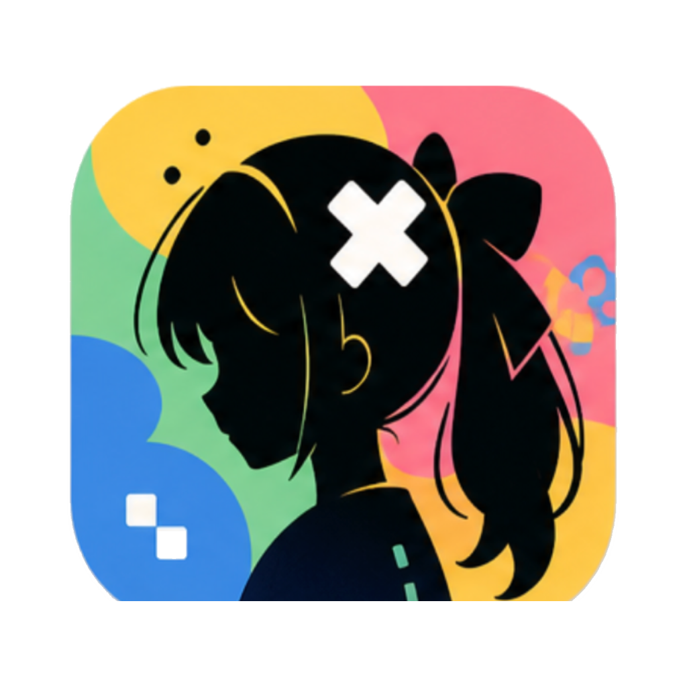
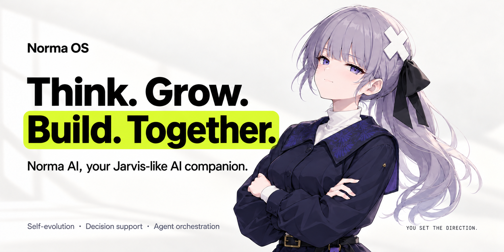
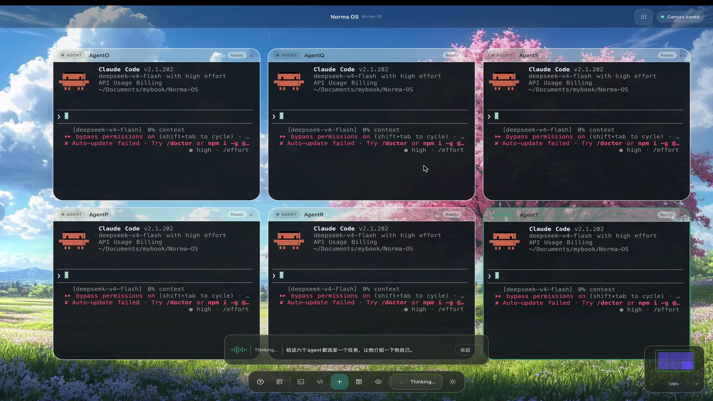
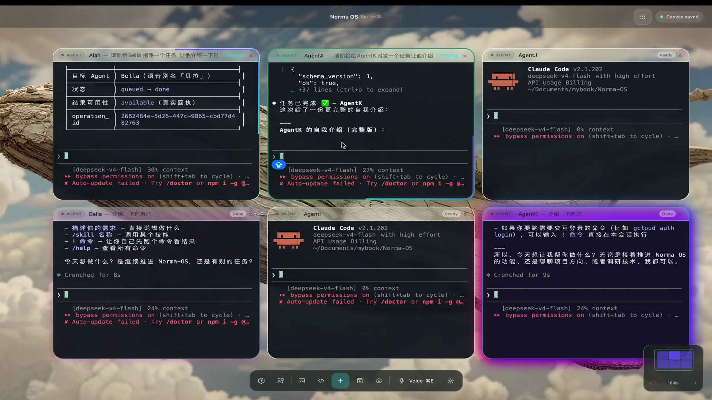
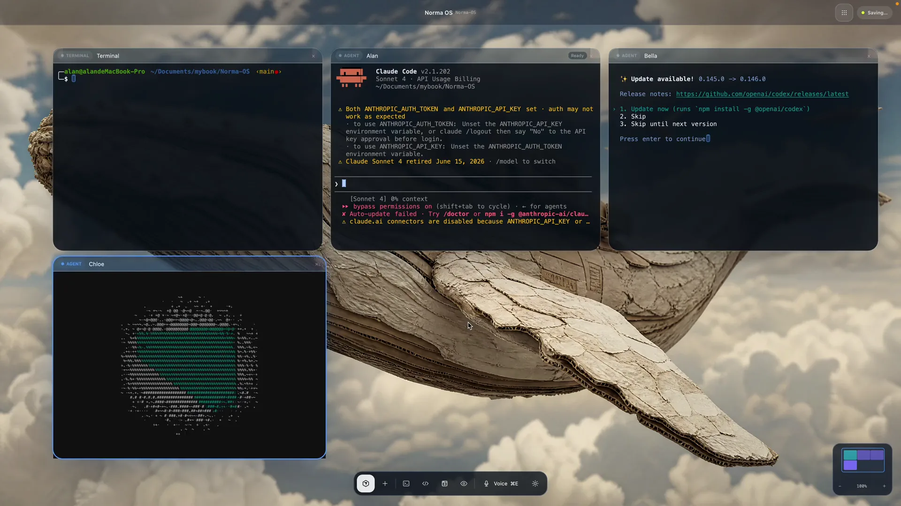
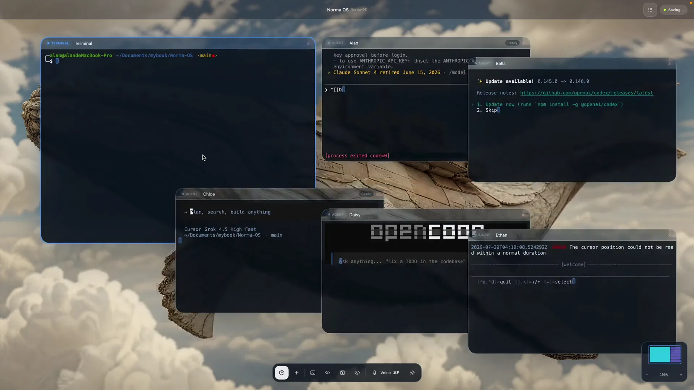
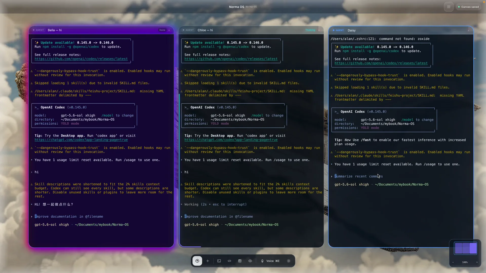

<p align="center">
  
</p>

<h1 align="center">Norma OS</h1>

<p align="center">
  <strong>English</strong> · <a href="README.zh-CN.md">简体中文</a>
</p>

<p align="center">
  <strong>Think. Grow. Build. Together.</strong><br />
  Norma AI, your Jarvis-like AI companion. Self-evolution, decision support, and your own team of agents.
</p>

<p align="center">
  <a href="https://github.com/multisoul-ai/norma-os-releases/releases/latest/download/Norma-OS_aarch64.dmg"></a>
</p>

<p align="center">
  <a href="https://norma-os-desktop-site.vercel.app/">Website</a> ·
  <a href="#norma-ai">Norma AI</a> ·
  <a href="#see-it-in-action">Demos</a> ·
  <a href="#quick-start">Quick start</a> ·
  <a href="ARCHITECTURE.md">Architecture</a> ·
  <a href="https://github.com/multisoul-ai/Norma-AI-OS/issues">Feedback</a>
</p>

<p align="center">
  <a href="https://github.com/multisoul-ai/norma-os-releases/releases/latest"></a>
  <a href="LICENSE"></a>
  
</p>

<p align="center">
  
</p>

**Norma AI is the heart of Norma OS**: an AI companion that builds a lasting relationship with you, keeps useful memories, supports your decisions, and manages multiple coding agents. You share your ideas and direction. She works with the context, organizes execution, follows progress, and brings back results and decisions that need your attention.

We want to bring a **Jarvis-like interaction experience** to your Mac: natural conversation, useful advice while you work, and timely updates while you stay in control. The infinite canvas and **Live Nodes** form your shared workbench, giving every agent, terminal, webpage, and deliverable a visible place you can interact with.

## Norma AI

### Self-evolution: a companion that grows with you

Norma's growth begins with memory. She can remember preferences, project conventions, and working knowledge you explicitly ask her to save, then retrieve them in later conversations. You can correct existing memories to make future collaboration better fit your needs. Personal, shared project, and worktree memories are managed separately and remain available after a restart.

**Self-evolution is a core direction for Norma AI**: progressing from remembering useful context to reflecting on experience, refining methods, and developing capabilities. Explicitly authorized memory reading, writing, correction, and settings management are available today. Automatic learning after ordinary conversations, Dream reflection, and Skill growth are still planned. Growth here means improving memory and working methods; it does not involve training foundation model weights.

### Decision support: understand progress and choose what comes next

Norma can query actual project and agent states, turning scattered information into something you can act on. Her background **Chief of Staff** combines task goals, agent conversations, and execution results to summarize progress, identify unfinished work, and suggest next steps with reasons.

Ask her what to prioritize, what still needs validation, or which decisions need you. Currently, follow-up proposals appear as pending items for you to confirm before dispatch. You can also give her a new direction directly.

### Multi-agent management: you set the direction, she coordinates the work

Bring Codex, Claude Code, Cursor, OpenCode, and other coding agents into your team. Use natural language to create agents, assign tasks, continue existing sessions, check progress, and open deliverables. You can also view and coordinate work across projects.

An agent can delegate a clearly scoped task to another agent and receive the result. Norma reduces repeated explanations, manual handoffs, and terminal-by-terminal check-ins, helping you focus on goals and judgment.

### Jarvis-like interaction: speak naturally and hear what matters

Talk to the same Norma AI through text or real-time voice: share an idea, ask for progress, adjust a task, or have her explain a recommendation. With the Chief of Staff and voice reports enabled, she summarizes progress and proactively reports important changes. When you speak, reports give way to your conversation.

You can enter an agent's terminal and take over at any time, then return to the overview and keep talking to Norma. **Natural conversation, lasting memory, decision support, and team coordination are the core Norma OS experience.**

Try prompts like these:

| You can say | How Norma helps |
| --- | --- |
| “Remember: give me the conclusion first, then explain why.” | Saves an explicit communication preference for future conversations |
| “Who's still working? What needs my decision?” | Checks actual states and summarizes progress and pending items |
| “Look at their results. What should we do next?” | Hands analysis to the Chief of Staff for follow-up recommendations and reasons |
| “Have Codex implement the feature and Claude Code add tests.” | Creates or selects agents and assigns their tasks |

### Your execution workbench

Norma OS hosts real work in **Live Nodes on an infinite canvas**: agents write code, Terminal runs builds and tests, Browser displays webpages, and Preview opens files and deliverables.

While the app is running, background tasks can continue as you switch projects or focus. Pan, zoom, rearrange the workspace, or expand a node to concentrate on one task. Layouts and session checkpoints are saved locally, while node states and notifications help you find where to step in.

## See it in action

These demos are real product recordings from the website. **Click a poster to watch the full video**, or visit the [website demo section](https://norma-os-desktop-site.vercel.app/#in-action). The original recordings retain their UI language; interfaces and shortcuts may vary by version. Current defaults are listed below.

### One instruction, six agents

Tell Norma your goal. She turns a voice instruction into task assignments for six agents working in the same visible workspace.

<p align="center">
  <a href="https://norma-os-desktop-site.vercel.app/media/demo-voice-command.mp4">
    
  </a>
</p>

<table>
  <tr>
    <td width="50%" valign="top">
      <h3>Agents working together</h3>
      <a href="https://norma-os-desktop-site.vercel.app/media/demo-agent-collaboration.mp4"></a>
      <p>Hand a clear subtask to another agent and receive the result in the same workspace.</p>
    </td>
    <td width="50%" valign="top">
      <h3>Build your workspace from the keyboard</h3>
      <a href="https://norma-os-desktop-site.vercel.app/media/demo-live-node-shortcuts.mp4"></a>
      <p>Create terminals and agents quickly, bringing your tools onto one canvas.</p>
    </td>
  </tr>
  <tr>
    <td width="50%" valign="top">
      <h3>One shortcut, a new layout</h3>
      <a href="https://norma-os-desktop-site.vercel.app/media/demo-layout-command-m.mp4"></a>
      <p>Use ⌘M to switch between master-detail and tiled layouts, moving from the current task to the full picture.</p>
    </td>
    <td width="50%" valign="top">
      <h3>Know when it's your turn</h3>
      <a href="https://norma-os-desktop-site.vercel.app/media/demo-agent-notifications.mp4"></a>
      <p>Completion and attention indicators appear on the relevant nodes, so you can find what changed and keep going.</p>
    </td>
  </tr>
</table>

## How it works

```text
Your ideas and direction
      |  Text / real-time voice
      v
Norma AI · Your AI companion
      +-- Memory             Preferences, project conventions, corrections
      +-- Chief of Staff     Understand goals, analyze progress, suggest next steps
      +-- Team coordination  Assign work, follow progress, summarize results
      +-- Workbench          Live Nodes on an infinite canvas
            +-- Agent        Claude Code / Codex / Cursor / OpenCode ...
            +-- Terminal     Shells, builds, tests, development servers
            +-- Browser      Webpages and local apps
            +-- Preview      Files, documents, and generated deliverables

Progress and results -> Norma's reports and recommendations -> Your next decision
```

**The work runs on your Mac.** Project files, workspace layouts, and session checkpoints are stored locally. Coding agents use your own installations and accounts. Requests to cloud models or speech services still go to the providers you configure.

## Quick start

### 1. Install Norma OS

Download the [Apple Silicon DMG](https://github.com/multisoul-ai/norma-os-releases/releases/latest/download/Norma-OS_aarch64.dmg), open it, drag **Norma OS** into **Applications**, and launch the app.

The current distribution targets **Apple Silicon Macs running macOS 12 or later** and is signed and notarized. See [Releases](https://github.com/multisoul-ai/norma-os-releases/releases/latest) for release notes and checksums.

### 2. Set up your coding agents

Install and sign in to at least one agent CLI, then confirm it runs in your system terminal. Common options:

| Coding agent | Command Norma launches | Default shortcut in the project canvas |
| --- | --- | --- |
| Claude Code | `claude` | `⌘2` |
| Codex | `codex` | `⌘3` |
| Cursor Agent | `cursor-agent` | `⌘4` |
| OpenCode | `opencode` | `⌘5` |

You can also begin with a regular terminal. Additional agent types are available in the creation menu. Models, accounts, and service charges are managed by their respective providers.

> The built-in Claude Code and Codex launch configurations currently skip their usual approval prompts. Use them in projects and environments you trust.

### 3. Create a workspace and open a project

1. Create a workspace (`⌘N`).
2. Add a local project or clone a repository (`⌘⇧A`), then enter its canvas.
3. Create a terminal or agent and give it a task. Add Browser and Preview nodes as needed to inspect results.

For example, have one agent implement a feature and another write tests, then run a development server and inspect the page on the same canvas.

### 4. Bring Norma AI into your workflow

Configure the model services you need in **Settings**, then enable the capabilities you want:

- **Memory**: open **Norma → Memory** to inspect and edit memories and control reading and saving. You can also tell her, “Please remember…”
- **Voice**: in Norma's voice settings, choose an interaction mode, speech recognition, and speech output providers. Prepare models or credentials as prompted and grant microphone access.
- **Chief of Staff**: select an installed coding agent backend, prepare its adapter as prompted, and enable progress summaries, next-step proposals, and voice reports.

Once configured, use the bottom command input or `⌘E` to start talking:

> “Norma, create two agents: one to explore the project structure and another to map out the tests.”

As work progresses, ask: “How is it going? What do you recommend next?”

The voice shortcut's hold, single-shot, or continuous-listening behavior depends on the interaction mode selected in Settings.

## Common controls

These are the current defaults. Record or restore shortcuts in **Settings → Keyboard Shortcuts**.

| Action | Default shortcut / gesture |
| --- | --- |
| Create workspace / add project | `⌘N` / `⌘⇧A` |
| Create terminal | `⌘1` |
| Create Claude Code / Codex / Cursor / OpenCode | `⌘2` / `⌘3` / `⌘4` / `⌘5` |
| Focus the bottom command input | `⌘K` |
| Voice interaction | `⌘E` |
| Switch master-detail layout / retile | `⌘M` / `⌘⇧L` |
| Open file preview | `⌘⇧O` |
| Leave node focus and return to the canvas | `⌘Esc` |
| Open settings | `⌘,` |
| Move node / pan canvas | Drag title bar / Space-drag or middle-button drag |

See the [shortcut reference](docs/references/keyboard-shortcuts.md) for full project navigation, idea dispatch, and input rules.

## Run from source

You need an Apple Silicon Mac, Git LFS, [Rust / rustup](https://rustup.rs/), and Xcode with the Metal toolchain. The repository pins Rust through `rust-toolchain.toml`.

The development launcher creates **Norma OS Dev.app** and requires an available **Apple Development** signing identity in your keychain. Sign in to your developer account in Xcode and create a development certificate. To simply try the product, use the DMG above.

```bash
git clone https://github.com/multisoul-ai/Norma-AI-OS.git
cd Norma-AI-OS
git lfs install
git lfs pull

# Check the Metal toolchain and development signing identity
xcrun metal --version
security find-identity -v -p codesigning

# Build and launch the native macOS development app
cargo run -p app
```

Common development checks:

```bash
cargo check -p app
cargo test -p canvas -p terminal -p runtime -p storage
cargo build -p app --release
```

See [CLAUDE.md](CLAUDE.md) for testing, dependency boundaries, and engineering conventions, and the [packaging guide](docs/references/packaging.md) for signing, notarization, and DMG builds.

## Technology and architecture

The Norma OS desktop app uses **Rust + GPUI + Metal**. Canvas, terminal, runtime, and storage are independent of the UI; the interface presents state and handles interaction.

| Capability | Implementation |
| --- | --- |
| Native macOS interface | GPUI, gpui-component, Metal |
| Infinite canvas | Geometry, selection, hit testing, and viewport |
| Real terminals | portable-pty, alacritty_terminal |
| Norma AI and decision support | NormaSession, background `brain`, actual state queries, next-step proposals |
| Multi-agent coordination | Typed tools, AgentCardAdapter, `norma` CLI |
| Long-term memory and persistence | Scoped Markdown memories, SQLite, workspace and session checkpoints |
| Voice input and output | Shared audio capture, local and cloud ASR, multiple TTS providers |
| iOS companion | SwiftUI, connecting to the Mac for status and lightweight control |

See [ARCHITECTURE.md](ARCHITECTURE.md) for module relationships and core flows. The [iOS README](ios/README.md) covers building and connecting the companion app; coding agents and terminal processes continue to run on the Mac.

## Documentation and contributing

Most detailed engineering documents linked below are currently in Chinese.

| What you want to learn | Start here |
| --- | --- |
| Documentation overview | [Documentation index](docs/README.md) |
| How the system works | [Architecture](ARCHITECTURE.md) |
| Norma's memory and growth | [Implemented memory capabilities](docs/exec-plans/2026-10-03-norma-memory-access-and-settings.md) · [Growth roadmap](docs/design-docs/2026-10-02-norma-master-memory-and-growth.md) |
| Background decisions and coordination | [Chief of Staff design](docs/design-docs/2026-10-23-norma-brain-acp.md) |
| Local development and tests | [Engineering handbook](CLAUDE.md) |
| Contributing with coding agents | [Agent guide](AGENTS.md) |
| Shortcuts and input | [Shortcut reference](docs/references/keyboard-shortcuts.md) |
| Brand and visual assets | [Brand resources](docs/brand/README.md) |
| Building and distribution | [Packaging guide](docs/references/packaging.md) |

Report bugs or share ideas through [GitHub Issues](https://github.com/multisoul-ai/Norma-AI-OS/issues). Include your macOS and Norma OS versions, reproduction steps, and log excerpts with sensitive information removed.

## License

[MIT](LICENSE) · Copyright © 2026 multisoul-ai. See [THIRD_PARTY_NOTICES.md](THIRD_PARTY_NOTICES.md) for third-party components and resources.
