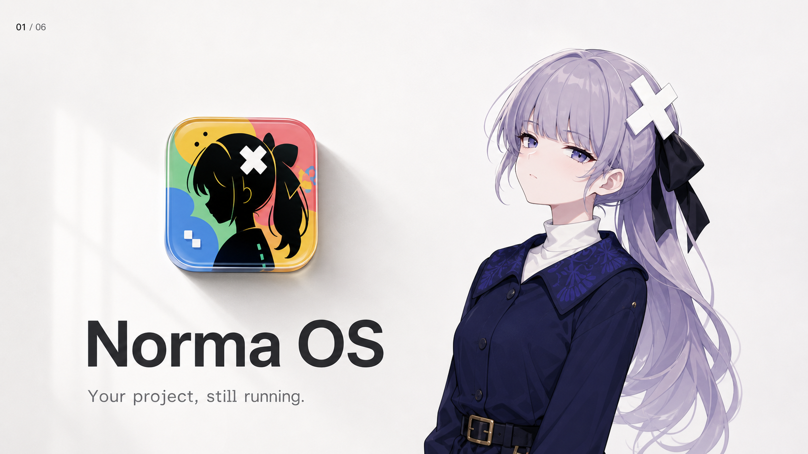

# Norma OS 品牌资料

本目录收录 Norma OS 当前采用的 V2 品牌方向、视觉规范、生成式视觉简报与参考资产。

> 当前方向：以 Apple 式产品设计哲学为启发，强调克制、清晰、产品主角、精密材质与人本体验；不使用 Apple 标志，也不复刻具体 Apple 页面、包装或硬件外形。

## 核心文档

- [品牌视觉规范](./norma-os-brand-guidelines.md)
- [生成式视觉简报](./generation-brief.md)

## V2 品牌视觉手册

1. [封面：Quietly Iconic](./assets/manual-v2/01-quietly-iconic-cover.png)
2. [产品理念：A Desktop That Works](./assets/manual-v2/02-product-idea.png)
3. [设计系统：Clarity in Every Layer](./assets/manual-v2/03-design-system.png)
4. [角色系统：Norma, the AI Soul](./assets/manual-v2/04-norma-ai-soul.png)
5. [状态反馈：Voice, Light & State](./assets/manual-v2/05-voice-light-state.png)
6. [品牌生态：Ecosystem & Experience](./assets/manual-v2/06-ecosystem-experience.png)

## 资产约定

- `assets/manual-v2/`：当前正式视觉方向，可用于内部评审、演示与后续设计参考。
- `assets/source-references/`：角色和图标的原始参考，仅供身份一致性与设计追溯，不作为最终对外物料直接发布。
- 新物料应优先遵循本文档中的品牌原则，而不是机械复制任意一张生成图。
- 生成图片中的小字号文字、UI 内容、尺寸数据和色值在投入生产前必须由设计师复核。

