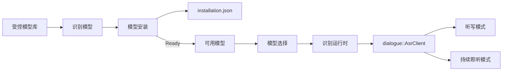
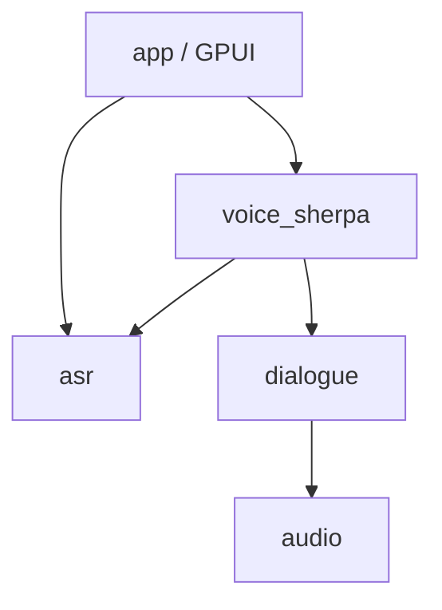

# ASR 模型框架与语音交互设置设计

> 2026-07-18 更新：受控目录现包含第四个非推荐候选 Zipformer Bilingual；其运行时分支与发布状态如下补充，推荐证据以 [`../quality/asr-model-release-gate.md`](../quality/asr-model-release-gate.md) 为准。

**Status:** Accepted
**Date:** 2026-07-11

## 1. 目标

Norma OS 需要先建立可扩展的语音识别模型框架，再把 Zipformer Streaming ZH 作为第二个模型接入。框架必须让 Settings 面向稳定的模型身份和用户可理解的能力，不再暴露 ONNX 文件夹、Paraformer 专属路径或 Sherpa 配置细节。

本设计同时收敛 Voice Settings：“听写”与“持续聆听”是两种互斥的语音交互模式，它们共享麦克风和识别模型，但只有持续聆听使用 Agent、LLM 和 TTS。

## 2. 范围

### In Scope

- 新建零 GPUI 的 `crates/asr`，拥有模型身份、受控模型库、能力、安装清单、校验和选择规则。
- 把现有 Paraformer 迁入新框架，作为第一条完整纵向链路。
- 通用后台下载、SHA-256 校验、安全解压、原子安装与删除保护。
- 使用不可变模型 ID 持久化当前选择，两种语音交互模式共享该选择。
- Voice Settings 改为模式驱动的渐进展开结构。
- 接入 `sherpa-onnx-streaming-zipformer-zh-int8-2025-06-30`。

### Out of Scope

- 远程动态模型市场、任意 URL、本地自定义导入或第三方插件。
- 非 Sherpa 识别引擎；领域边界保持引擎无关，但首版不建插件协议。
- TTS 模型库、TTS 下载与 TTS 模型选择。
- 旧 `voice.paraformer.model_dir` 或 `voice.realtime.enabled` 的迁移。

## 3. 领域模型



核心不变量：

1. 模型 ID 绑定精确、不可变的模型工件版本。
2. Settings 只保存模型 ID，不保存文件路径。
3. 只有安装、校验和加载都成功的 Ready 模型才能成为当前选择。
4. 听写与持续聆听共享一个当前识别模型。
5. 当前模型不能删除；必须先切换至另一个 Ready 模型。
6. 新模型加载失败不改变当前选择。
7. 文件系统中的安装清单是安装状态的唯一事实来源。

## 4. 公共类型与边界

`crates/asr` 提供下列稳定概念，具体字段名可在 TDD 第一条纵向切片中微调，但职责不变：

```rust
pub struct AsrModelId(String);

pub struct AsrModelDescriptor {
    pub id: AsrModelId,
    pub display_name: String,
    pub description: String,
    pub capabilities: AsrCapabilities,
    pub artifact: AsrArtifact,
}

pub struct AsrCapabilities {
    pub languages: Vec<String>,
    pub streaming_partials: bool,
    pub local_only: bool,
}

pub struct AsrArtifact {
    pub url: String,
    pub sha256: String,
    pub archive_bytes: u64,
    pub required_files: Vec<String>,
}

pub struct InstallationManifest {
    pub schema_version: u32,
    pub model_id: AsrModelId,
    pub artifact_sha256: String,
}

pub struct AvailableAsrModel {
    pub descriptor: AsrModelDescriptor,
    pub root: PathBuf,
}

pub enum AsrInstallationState {
    NotInstalled,
    Installing { downloaded_bytes: u64, total_bytes: u64 },
    Ready(AvailableAsrModel),
    Failed { message: String },
}
```

`crates/asr` 不依赖 `dialogue`、`voice_sherpa`、`storage`或 GPUI。`voice_sherpa` 接收 `AvailableAsrModel`，按模型 ID 选择 Sherpa 适配，并产生现有 `dialogue::AsrClient`。

## 5. 依赖与运行时



Paraformer 与 Zipformer 必须共用一个 recognizer config factory，删除 `asr_stream.rs` 和 `session.rs` 中重复的 Paraformer builder。

- Paraformer：`OnlineParaformerModelConfig { encoder, decoder }`
- Zipformer Bilingual：`OnlineTransducerModelConfig { encoder, decoder, joiner }`
- Zipformer Streaming ZH：`OnlineTransducerModelConfig { encoder, decoder, joiner }`
- Zipformer Streaming CTC ZH：`OnlineZipformer2CtcModelConfig { model }`
- 四者共用 `tokens`、16 kHz PCM、VAD、partial/final 事件和 `AsrClient`。
- 四者共用一个固定 SHA-256 的 `silero_vad.onnx` 支持工件，安装在模型根的
  `silero_vad/` 目录；首个模型安装时后台下载，后续模型复用。ASR 完整但共享 VAD 缺失或
  损坏时不得显示 Ready。

## 6. 安装生命周期

模型不打包进 `.app`。用户从 Voice Settings 主动安装受控模型库中的条目：

1. app 在 `background_executor` 上从固定 HTTPS URL 下载到 Application Support 临时目录。
2. 下载完成后先验证固定 SHA-256，再解压。
3. 解压必须阻止路径穿越，仅保留模型条目声明的必要文件。
4. 验证必要文件后写入 `installation.json`。
5. 将临时目录原子重命名为 `<model-id>` 安装目录。
6. 任一步骤失败都不影响现有 Ready 模型，临时文件可重试或清理。

首版模型库只包含：

| 显示名称 | 不可变 ID | Sherpa 适配 | 状态 |
|---|---|---|---|
| Paraformer Bilingual | `paraformer-bilingual-zh-en-int8` | Online Paraformer | 第一阶段基准 |
| Zipformer Bilingual | `zipformer-bilingual-zh-en-int8-2023-02-20` | Online Transducer | 中英混说非推荐候选，等待真实质量/性能/许可证据 |
| Zipformer Streaming ZH | `zipformer-streaming-zh-int8-2025-06-30` | Online Transducer | 中文推荐候选 |
| Zipformer Streaming CTC ZH | `zipformer-streaming-ctc-zh-int8-2025-06-30` | Online Zipformer2 CTC | 非推荐候选，等待真实质量/性能/许可证据 |

Zipformer 模型许可证未在官方归档中明确时，只允许用户主动从官方地址下载，不随应用再分发。

## 7. Voice Settings

Voice Settings 无总开关，`⌘⇧V` 是唯一语音入口。页面按模式渐进展开：

```text
语音
│
├─ 使用模式        [ 听写 | 持续聆听 ]
├─ 听见（始终展开）
│  ├─ 麦克风
│  └─ 识别模型    [ Zipformer Streaming ZH ▾ ]
├─ 听写设置（听写模式展开）
│  └─ 触发方式    [ 切换 | 按住 ]
├─ 理解与回应（持续聆听展开）
│  ├─ Agent Provider / LLM
│  └─ TTS 与语音反馈
└─ 高级（默认折叠）
   └─ endpoint / API key / trace / 诊断
```

听写模式下，`⌘⇧V` 按“按住”或“切换”语义控制一次录音。持续聆听模式下，第一次按下启动长会话，再次按下停止；TTS 播放中按下优先打断回应并保持会话。

模型选择器中：

- 所有受控条目都可见，但未安装条目的主动作是“安装”，不是立即选中。
- Ready 条目可选择，当前条目不可删除。
- 显示语言、流式能力、下载体积、已安装/未安装/下载中/失败和推荐状态。
- 不把参数量当成下载体积；体积来自固定工件。

## 8. Settings 数据

新键：

```text
voice.interaction.mode       = dictation | continuous_listening
voice.dictation.trigger      = hold | toggle
voice.asr.model_id           = <immutable model id>
```

缺省时，使用模式为 `dictation`，听写触发为 `hold`，当前模型为空。无可用模型时触发 `⌘⇧V` 不启动麦克风，而是展示可恢复错误并引导用户打开模型选择。

旧 `voice.paraformer.model_dir` 与 `voice.realtime.enabled` 不读取、不迁移、不写回。Agent/LLM 相关键保留。

## 9. 错误与恢复

- 下载失败：保留旧模型，显示可重试错误。
- 哈希或文件清单失败：不写安装清单，不进入 Ready。
- 启动加载失败：当前模型不变；如无当前模型，保持未配置。
- 会话中切换：立即停止当前收音/回应，后台加载新模型；失败则恢复旧模型。
- 安装清单损坏：该安装变为 Failed，不信任 Settings 或内存缓存。

## 10. 验收标准

1. Paraformer 在不使用裸路径 Settings 的情况下完成听写和持续聆听。
2. 模型库、安装、选择和运行时在代码中是独立边界。
3. 新增 Zipformer 时，Settings 不需要 Zipformer 专属分支。
4. 两个 Transducer Zipformer 使用各自固定的 encoder/decoder/joiner 文件名，CTC Zipformer 只使用 model/tokens，Paraformer 仍使用 Paraformer 配置；四者都必须产生 partial/final 文本。
5. 下载、校验、安装、切换、失败回退和删除保护有自动化证据。
6. 固定中文命令集上，Zipformer 不低于 Paraformer，关键产品命令全部正确。
7. 目标 Apple Silicon 机型上记录四个模型的首次 partial、final、CPU 和内存基线后，才决定是否将任一 Zipformer 标记为推荐。

## 11. 决策记录

- [ADR-0002](../adr/0002-separate-asr-model-selection-from-installation.md)
- [ADR-0003](../adr/0003-ship-a-curated-asr-model-catalog.md)
- [ADR-0004](../adr/0004-keep-asr-domain-engine-neutral-without-a-plugin-system.md)
- [ADR-0005](../adr/0005-use-filesystem-install-manifests-as-the-asr-installation-source-of-truth.md)
- [ADR-0006](../adr/0006-model-dictation-and-continuous-listening-as-exclusive-voice-interaction-modes.md)
- [ADR-0007](../adr/0007-route-the-single-voice-shortcut-by-interaction-mode.md)
- [ADR-0008](../adr/0008-share-one-asr-model-selection-across-voice-modes.md)
- [ADR-0009](../adr/0009-own-asr-model-domain-in-a-gpui-free-crate.md)
- [ADR-0010](../adr/0010-identify-asr-models-by-immutable-versioned-artifacts.md)
- [ADR-0011](../adr/0011-reset-legacy-asr-and-voice-mode-settings-at-the-new-architecture-boundary.md)
- [ADR-0012](../adr/0012-limit-the-first-model-framework-to-asr.md)
