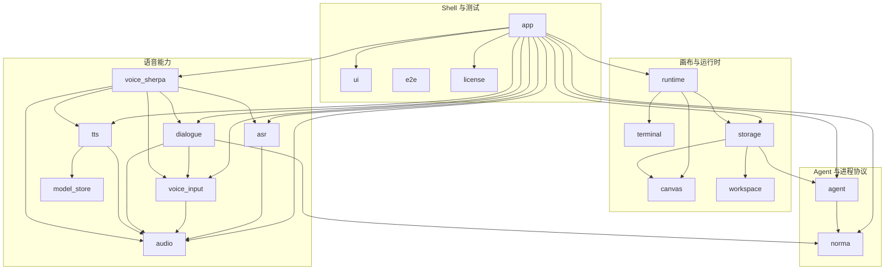

# Norma OS 当前架构与合并候选讨论稿

> 日期：2026-08-01
> 状态：讨论稿，未形成重构决策
> 基线：`dev` 分支，`ec12d6e9`；审查时工作区存在未提交修改，因此本文描述的是当时工作区事实，不只描述该提交
> 范围：workspace crate、主要 module、Cargo 依赖方向、兼容层、持久化与 App 组合根
> 非目标：本文不定义最终 interface，不修改代码，不安排迁移批次

## 1. 文档目的

项目能力增多后，crate 数量、App 壳层体量和跨层依赖都在增长。本文先建立一份可共同讨论的架构事实基线，再逐项判断：

1. 哪些拆分形成了有价值的深 module，应继续保留。
2. 哪些拆分只是迁移期兼容、透传或单消费者 package，可以删除或合并。
3. 哪些依赖方向虽然能编译，但破坏了 locality 或引入了不必要的技术栈。
4. 哪些复杂度来自 App 内部组织，而不是 crate 数量。
5. 后续每个候选应讨论什么，而不是直接进入实施。

本文不是目标架构。所有“建议”都是待讨论候选，只有形成 ADR 或明确执行计划后才成为项目决策。

## 2. 评估词汇和判断方法

本文统一使用以下词汇：

- **Module**：拥有一个 interface 和一套 implementation 的代码组织，可大可小。
- **Interface**：调用者正确使用 module 所需知道的全部事实，包括类型、约束、顺序、错误和性能特征。
- **Implementation**：module 内部隐藏的行为。
- **Seam**：能够替换行为而不修改调用点的位置。
- **Adapter**：在 seam 上满足 interface 的具体实现。
- **Depth**：调用者学习少量 interface 后能够获得的行为杠杆。
- **Leverage**：一份 implementation 服务多个调用方和测试的收益。
- **Locality**：变更、知识、错误和验证是否集中在一个 owner 内。

每个合并候选都要通过 **deletion test**：

> 假设删除这个 module，它隐藏的复杂度是消失了，还是会在多个调用方重新出现？

- 复杂度直接消失：通常是浅 module、兼容 facade 或透传层。
- 复杂度在多个调用方重现：该 module 正在提供 leverage，通常应该保留。
- 只有一个生产 Adapter：seam 可能只是面向未来的假设，需要重新审查。
- 有两个以上真实 Adapter，或存在明确的进程/第三方边界：seam 通常成立。

## 3. 当前 workspace 结构

### 3.1 总览

当前共有 18 个 workspace crate：



### 3.2 Crate 职责与体量

以下行数只统计 `crates/<crate>/src/**/*.rs`，包含源码内嵌测试，不包含独立 `tests/`：

| Crate | Rust 文件 | 行数 | 当前主要职责 | 初步判断 |
|---|---:|---:|---|---|
| `app` | 327 | 63,671 | GPUI 组合根、页面、Settings、Canvas 渲染、Agent/Voice 编排 | 最大复杂度热点 |
| `e2e` | 73 | 17,206 | Headless 与 L3 用户流程验证 | 保留独立 |
| `norma` | 27 | 4,813 | 本地协议、CLI、Client、Hook 与安装器 | 真实进程 seam |
| `agent` | 21 | 4,436 | NormaSession、Rig、typed tools、协调与预算 | 深 module |
| `runtime` | 20 | 4,105 | LiveNode、焦点、输入路由、恢复与事件 | 职责存在穿透 |
| `storage` | 19 | 3,257 | SQLite、migration、Stores 与持久化 DTO | 边界正确，依赖过宽 |
| `terminal` | 13 | 3,167 | PTY、ANSI grid、session、输入编码 | 深 module |
| `canvas` | 15 | 2,388 | 几何、文档、节点、选择、命中与 viewport | 深 module |
| `tts` | 16 | 2,351 | TTS Provider、Voice、模型目录与回复级流 | 深 module |
| `asr` | 13 | 1,883 | ASR Provider、识别协议、本地与 Azure | 深 module |
| `voice_sherpa` | 9 | 1,628 | Sherpa TTS 及历史 ASR/输入兼容 | 混合了有效 Adapter 与浅 facade |
| `voice_input` | 8 | 1,087 | 权限、设备、采集、重采样、PCM 与 VAD | 深 module |
| `dialogue` | 8 | 927 | 对话状态/策略及 Legacy ASR/TTS interface | 核心有效，interface 偏宽 |
| `ui` | 3 | 646 | Theme、图标、gpui-component 初始化 | 小但高频共享 |
| `model_store` | 2 | 408 | 模型安全解压、校验、manifest、原子安装 | 深 implementation，当前 seam 偏弱 |
| `license` | 4 | 214 | License 纯逻辑验证 | 安全 seam |
| `workspace` | 3 | 109 | Recent workspace 模型与路径显示 | 最浅 crate 候选 |
| `audio` | 2 | 53 | `PcmFormat`、`PcmAudioChunk` | 小 interface、高 leverage |

`app` 约占上述源码总量的 56.7%。如果排除专门用于测试的 `e2e`，App 占生产源码的比例更高。因此“项目臃肿”不能只通过减少 crate 数解决。

### 3.3 当前生产依赖图

以下只列 workspace 内部普通依赖，不含 dev-dependency：

```text
agent         -> norma
app           -> agent, asr, audio, canvas, dialogue, license, norma,
                 runtime, storage, terminal, tts, ui, voice_input,
                 voice_sherpa, workspace
asr           -> audio
dialogue      -> audio, norma, voice_input
runtime       -> canvas, storage, terminal
storage       -> agent, canvas, workspace
tts           -> audio, model_store
voice_input   -> audio
voice_sherpa  -> asr, audio, dialogue, tts, voice_input
```

`app` 作为组合根拥有较高 fan-out 本身并不错误。问题是它是否只负责组装，还是同时了解并修改所有子系统内部状态。

## 4. 当前健康且应保留的拆分

### 4.1 `canvas`、`terminal`、`runtime`、`storage`

这四个 crate 的变化轴不同：

- `canvas` 隐藏空间文档、几何和选择规则。
- `terminal` 隐藏 PTY、Alacritty grid 和子进程生命周期。
- `runtime` 负责 LiveNode、焦点、输入路由和运行时事件。
- `storage` 负责 SQLite schema、migration 和持久化。

不建议把它们合成一个 crate。删除 `canvas` 或 `terminal` 会让复杂度在 App、Runtime 和 Storage 中重新出现，deletion test 不通过。

当前需要修正的是 `runtime -> storage` 的职责穿透，而不是消除 Runtime 与 Storage 之间的 module 区分。

### 4.2 `asr`、`voice_input`、`tts`

这三个 crate 分别拥有：

- 识别 Provider 与识别协议。
- provider-neutral 的音频输入、设备、PCM 与 VAD。
- 合成 Provider、Voice、模型与回复级音频流。

本地 Sherpa 和云端 Provider 都会复用输入能力，ASR 与 TTS 也有不同的生命周期与错误模型。ADR-0025 与 ADR-0026 已确认这些职责，不建议重新合并。

### 4.3 `audio`

`audio` 虽然只有 53 行，但被 ASR、TTS、Voice Input、Sherpa Adapter、Dialogue 和 App 共同使用。其 interface 很小，leverage 很高。

如果删除它，PCM 类型必须归属于某个不合适的上层能力，或者在多个调用方复制。因此它不是浅 module。

### 4.4 `agent` 与 `norma`

- `agent` 是进程内 Agent Runtime。
- `norma` 同时提供外部 CLI、本地协议、Client 和 Hook 二进制。

两者之间存在真实的进程 seam，不建议直接合并。应讨论的是共享协议词汇的 interface 是否过宽，而不是取消这条 seam。

### 4.5 `license`、`e2e`

- `license` 是零 GPUI、可独立验证的安全 module，且 ADR-0015 明确要求 GateRoot 之外的纯逻辑验证。
- `e2e` 应保持独立测试 crate；需要缩小的是对 App 内部实现的 friend access，而不是把测试并回 App。

## 5. 需要优先梳理的依赖关系

### D-01 `storage -> agent`

**当前事实**

`storage` 只为以下两类事实依赖 `agent`：

- `AgentName` 的解析与校验。
- 内置 Agent 名称及语音别名。

证据：

- [`../../crates/storage/src/agent_definition_store.rs`](../../crates/storage/src/agent_definition_store.rs)
- [`../../crates/storage/src/migrations.rs`](../../crates/storage/src/migrations.rs)
- [`../../crates/agent/src/identity.rs`](../../crates/agent/src/identity.rs)

但该 Cargo 边会让 Storage 间接依赖 Rig、HTTP、Tokio、Norma 协议等完整 Agent Runtime 技术栈。

**初步判断**

这是当前成本最高、收益最低的内部依赖边。问题不是两个 crate 应该合并，而是少量稳定身份词汇的 owner 不合理。

**待讨论问题**

1. Agent 身份与内置名称属于 Agent Runtime，还是更稳定的共享领域词汇？
2. Migration 是否应该依赖运行时域对象，还是只依赖持久化 schema 所需的稳定数据？
3. 调整后能否完全删除 `storage -> agent`，同时不复制名称校验？

### D-02 `runtime -> storage`

**当前事实**

[`Runtime`](../../crates/runtime/src/runtime.rs) 直接导入并接收：

- `CanvasStore`
- `SessionStore`
- `NodeSessionStore`
- Storage DTO 与 Storage Error

Runtime 还参与外部 Agent 会话目录扫描、JSONL 读取、session 保存和恢复。另一方面，App 已有 [`app/src/workspace`](../../crates/app/src/workspace/) 负责项目打开和持久化编排。

**初步判断**

Runtime 应拥有“如何从快照恢复 live node”的 implementation，但不应知道“快照来自哪种 SQLite Store”或“去哪里扫描供应商会话目录”。

**待讨论问题**

1. Runtime 的外部 interface 是生命周期 module，还是公开状态容器？
2. 哪些恢复逻辑是 Runtime 的领域行为，哪些是 App/Storage Adapter 的 I/O 编排？
3. 是否能删除 Cargo 边，而不新增只有一个 Adapter 的假设 seam？

### D-03 `agent -> norma`

**当前事实**

Agent 使用 `norma::protocol` 中的 `AgentProfile`、`PreviewType`、`CardCommandResult` 等协议词汇；但 `norma` crate 同时包含 CLI、Clap、Hook 安装器和本地 Client。

**初步判断**

`agent` 与 `norma` 不应合并，但当前共享词汇的 package 粒度可能过宽。需要先确认协议事实的 owner，再讨论是否调整依赖。

### D-04 `dialogue -> norma`

当前源码扫描没有发现 `dialogue` 使用 `norma::`。这是一条高置信度的无效依赖候选，但实际删除前仍应由 `cargo check -p dialogue` 验证。

### D-05 `voice_sherpa` 成为语音依赖汇聚点

`voice_sherpa` 当前同时依赖 `asr`、`voice_input`、`dialogue`、`tts` 和 `audio`。其中一部分是本地 Sherpa TTS Adapter 的真实需要，另一部分来自迁移期兼容 facade。

ADR-0026 已将它定义为“暂时兼容门面”，并要求调用方迁移到 provider-neutral interface 后单独删除兼容层。因此这不是新的架构方向，而是尚未完成的既有架构迁移。

## 6. 合并、删除与深化候选

### C-01 删除独立 `workspace` crate

**推荐强度：强；最明确的 crate 级减包候选**

当前 109 行实现包含两类责任：

- `recent.rs`：Recent Workspace 模型与列表操作。
- `path_display.rs`：用于 App 展示的路径格式化。

[`storage::RecentStore`](../../crates/storage/src/recent_store.rs) 已与 Recent Workspace 模型紧密耦合；App 也已有同名 [`app/src/workspace`](../../crates/app/src/workspace/) module。

候选方向：

- Recent 模型与操作归入持久化 owner。
- Path display 归入 App Workspace 展示 owner。
- 删除 `workspace` member，以及 `storage/app -> workspace` 两条 Cargo 边。

Deletion test：删除后 109 行只进入两个已经存在的 owner，不需要在多个调用方复制复杂度。

待确认：Recent Workspace 是否未来会被 App 之外的第二个生产调用方消费。如果有明确计划，应重新评估该 seam。

### C-02 合并 `SessionStore` 与 `NodeSessionStore`

**推荐强度：强；需要数据库 migration**

当前同一个 node 的恢复事实被拆成两套：

- `session_checkpoints` 保存 kind、终端尺寸、shell、profile 等。
- `node_sessions` 保存 kind、cwd、session ID 等。

保存使用两个事务，恢复时再按 `node_id` 建立两个 Map 配对。其问题是：

- `kind` 等字段重复。
- 两次写入存在非原子窗口。
- 调用方必须同时知道两种 Store 和两种 DTO。

候选方向：让同一 node 的持久化事实拥有一个 owner 和一条保存/恢复路径。

Deletion test：删除第二套 Store 后，复杂度集中到一个 session persistence module，不会扩散到调用方。

### C-03 深化 `model_store`，否则并回 `tts`

**推荐强度：强；需要二选一**

`model_store` 有约 408 行安全安装 implementation：SHA 校验、manifest、安全解压、临时目录和原子提升。但当前生产消费者只有 TTS。

与此同时，[`asr/src/installation.rs`](../../crates/asr/src/installation.rs) 独立维护相似的 SHA、manifest、解压和原子安装逻辑。

候选 A，优先：

- 让 ASR 与 TTS 都使用 `model_store`。
- 形成两个真实调用方，使安全安装逻辑获得 leverage。

候选 B，回退：

- 如果 ASR 的真实差异无法在不扩大 interface 的前提下复用，则把 `model_store` 并回唯一消费者 TTS。

不建议继续保持“一个生产消费者，但又与另一个 crate 重复实现”的中间状态。

### C-04 退役 `voice_sherpa` 的 ASR/输入兼容 facade

**推荐强度：强；ADR-0026 已提供方向**

当前可识别的兼容内容包括：

- 重新导出 ASR Config。
- 重新导出麦克风、设备、VAD 和 PCM Session。
- 在 `asr::RecognitionEvent`、`dialogue::AsrEvent` 和 `ListeningPipelineEvent` 之间重复转换。
- 保留旧的单次 Sherpa 录音/识别 session。
- 让通用 App 错误反向依赖 `voice_sherpa::SpeechError`。

应保留的是真实 Sherpa 本地 TTS Adapter，不应保留的是对 ASR、Voice Input 和通用错误的兼容包装。

这里的“删除”不等于把 Sherpa implementation 并入 `tts`。ADR-0023 要求 TTS domain 不直接依赖 Sherpa；后续应讨论收窄后的 Adapter 归属和命名。

### C-05 收窄 `dialogue`，保留纯策略核心

**推荐强度：强；不建议直接并入 App**

应保留的深 implementation：

- `DialogueSession`
- `UtteranceCommitter`
- `SpokenTextNormalizer`
- `SpeechBacklog`
- 报告播报仲裁

需要重新审查的是 `dialogue::clients` 中重复定义的：

- `AsrClient` / `AsrEvent`
- `LegacyTtsClient` / `LegacyTtsChunkSink`
- 与正式 ASR/TTS interface 重叠的错误模型

删除 legacy interface 后，Dialogue 有机会成为纯 in-process 对话策略 module，并删除对 `audio`、`voice_input`、`norma` 的部分或全部依赖。

### C-06 合并两套 Agent 任务取消编排

**推荐强度：强；module 内部合并，不是 crate 合并**

当前 typed-tool 路径和 CLI/task-ref 路径各自实现一套取消流程，均涉及：

1. 解析任务。
2. 检查 pending typed input。
3. 清理输入状态。
4. 更新 coordinator 与持久化。
5. 对运行任务发送 Ctrl-C。
6. 映射结果。

两个入口可以保留不同 Adapter，但安全敏感的核心取消 implementation 应只有一个 owner。

### C-07 删除无收益占位和重复入口

**推荐强度：高置信度快速清理**

当前候选包括：

- 未被 `settings/mod.rs` 声明的 `settings/hooks.rs` 及其孤立状态。
- `app` 与 `norma` 中内容完全相同的 `multisoul-agent-hook` 二进制包装入口。
- 空占位公开 module：`canvas/commands.rs`、`canvas/history.rs`、`runtime/snapshot.rs`。

这些项的 deletion test 是复杂度直接消失。是否删除仍需在实施前验证打包目标、测试引用和文档引用。

### C-08 重新审查 `LiveNode` seam

**推荐强度：条件性；先确认路线图**

当前唯一生产 `LiveNode` implementation 是 `TermLive`；Agent 也是基于 Terminal 的 `TermLive`，`NodeView`、Resize 和 Scroll 也主要是 Terminal 语义。

如果近期 Browser、Ego 或其他 Node 会成为第二个真实 Runtime Adapter，则保留该 seam 有明确价值。如果没有，应讨论当前动态分派是否只是面向未来的假设。

这不是近期优先项，因为 Live Node 是产品核心抽象，不能只根据当前 Adapter 数量机械收缩。

## 7. App 内部组织问题

### 7.1 `MultisoulApp` 是分散式 God Object

当前 [`MultisoulApp`](../../crates/app/src/app/mod.rs) 约有 71 个平铺字段，覆盖：

- 数据库与 Workspace
- Runtime、Canvas、Terminal
- Agent Runtime、队列、授权和会话回复
- Voice、ASR、TTS、Dialogue 和模型下载
- Settings、Shortcuts、Wallpaper
- Browser、Preview、Ego
- 动画、重绘、渲染缓存与性能监控

约 87 个源码文件包含 `impl MultisoulApp`。单文件行数约束避免了超长文件，却没有形成有 depth 的内部 module。结果是功能状态、生命周期和副作用分散在大量文件中。

### 7.2 Runtime interface 向 App 泄漏内部状态

`Runtime` 公开 `document`、`selection`、`focus`，当前 App 中约 47 个文件直接穿过 Runtime 操作这些状态。

这使 Runtime 同时表现为：

- LiveNode 生命周期 module。
- Canvas/Selection/Focus 的公开状态容器。

这两种角色混合后，选择、焦点和节点组合规则容易散落在 Canvas UI、Norma、Preview、Browser 和 Agent 逻辑中。

### 7.3 Settings 体量不是单纯页面问题

`app/src/settings` 约 19,772 行，其中 `settings/voice` 约 13,097 行。它同时承载：

- 设置展示。
- 模型扫描与下载生命周期。
- Provider 校验。
- TTS Preview。
- ASR/TTS 运行状态同步。

后续应讨论哪些是设置页面状态，哪些是 Voice 能力生命周期。目标是让状态、生命周期和副作用具有 locality，而不是简单把文件移动到另一个目录。

## 8. 当前不建议的合并

| 候选 | 当前判断 | 原因 |
|---|---|---|
| `canvas + runtime` | 不建议 | 会让 Storage 间接接触 Terminal/lifecycle，几何与 live node 变化轴不同 |
| `runtime + storage` | 不建议 | 会把 SQLite 与运行时热路径放进同一 module；应断依赖而非合并 |
| `asr + voice_input` | 不建议 | Provider 识别与 CoreAudio/VAD 是真实独立能力 |
| `tts + voice_sherpa` | 不建议整体合并 | 会破坏 TTS domain 零 Sherpa 约束；应先删除兼容 facade |
| `audio` 并入任一语音 crate | 不建议 | PCM contract 被多个能力共享，删除后会形成错误依赖或类型复制 |
| `agent + norma` | 不建议 | 进程内 Runtime 与进程外 CLI/协议 seam 真实存在 |
| `license + app` | 不建议 | 安全验证需要零 GPUI、独立测试，ADR-0015 已确认 |
| `e2e + app` | 不建议 | 测试层级和真实 App 需要独立生命周期 |
| `ui + app` | 低优先级、不建议现在做 | 技术上可合并，但只能少一个 crate，不能改善主要 depth/locality 问题 |

## 9. 候选优先级

| ID | 主题 | 类型 | 收益 | 风险 | 当前建议 |
|---|---|---|---:|---:|---|
| D-01 | 删除 `storage -> agent` | 依赖梳理 | 很高 | 中 | 第一批讨论 |
| C-04/C-05 | 退役语音兼容 facade 与 Legacy interface | 删除/深化 | 很高 | 中高 | 第一批讨论 |
| D-02/C-02 | 删除 `runtime -> storage`，合并 Session Store | 依赖/合并 | 很高 | 高 | 第二批讨论 |
| C-03 | `model_store` 深化或并回 TTS | 合并决策 | 高 | 中 | 第二批讨论 |
| C-01 | 删除 `workspace` crate | crate 合并 | 中 | 低 | 适合先形成决策 |
| C-06 | 合并 Agent 取消流程 | module 合并 | 高 | 中 | 独立讨论 |
| C-07 | 删除死代码、空 module、重复 sidecar | 删除 | 中 | 低 | 实施前快速核验 |
| App | 收拢 `MultisoulApp` 能力状态 | 深化 | 很高 | 高 | 在依赖方向稳定后讨论 |
| C-08 | 收缩 `LiveNode` seam | seam 审查 | 不确定 | 高 | 等产品路线确认 |

## 10. 建议的讨论顺序

为了避免同时改变多个 seam，建议每次只讨论一个主题：

1. **`workspace` crate 是否删除**
   范围最小，可以先统一 deletion test 和“什么值得独立成 crate”的判断标准。

2. **`storage -> agent` 如何消除**
   先确定 Agent 身份词汇的 owner，不讨论其他 Agent Runtime 重构。

3. **语音迁移何时算完成**
   明确 `voice_sherpa` 哪些 interface 属于兼容层，哪些属于真实 Sherpa TTS Adapter。

4. **`model_store` 的第二个真实调用方是否成立**
   比较 ASR/TTS 安装差异，再决定深化还是并回。

5. **Session 持久化模型是否统一**
   先决定事实模型，再讨论 `runtime -> storage` 的移除方式。

6. **App 组合根如何变深**
   等底层 seam 稳定后，再按 Voice、Agent、Workspace 等能力收拢状态与生命周期。

## 11. 单项决策记录模板

后续每讨论一个候选，可直接在本文追加以下结构，或者单独建立 ADR：

```text
主题：
状态：讨论中 / 接受 / 拒绝 / 延后

当前事实：
问题：
必须保留的约束：

方案 A：
方案 B：
方案 C（如有）：

Deletion test：
对依赖方向的影响：
对测试 surface 的影响：
对 migration / 数据兼容的影响：

最终决策：
拒绝其他方案的原因：
需要新增或更新的 ADR：
```

## 12. 相关资料

- [`../../ARCHITECTURE.md`](../../ARCHITECTURE.md)
- [`../../CONTEXT.md`](../../CONTEXT.md)
- [`../../CLAUDE.md`](../../CLAUDE.md)
- [`../references/crate-file-map.md`](../references/crate-file-map.md)
- [`../adr/0023-own-remote-tts-providers-inside-the-tts-crate.md`](../adr/0023-own-remote-tts-providers-inside-the-tts-crate.md)
- [`../adr/0025-ship-only-built-in-tts-providers.md`](../adr/0025-ship-only-built-in-tts-providers.md)
- [`../adr/0026-own-built-in-asr-providers-and-azure-speech-in-asr.md`](../adr/0026-own-built-in-asr-providers-and-azure-speech-in-asr.md)
- [`../quality/agent-execution-policy.md`](../quality/agent-execution-policy.md)
