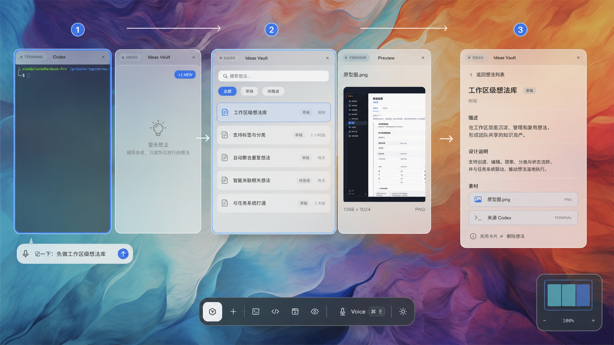
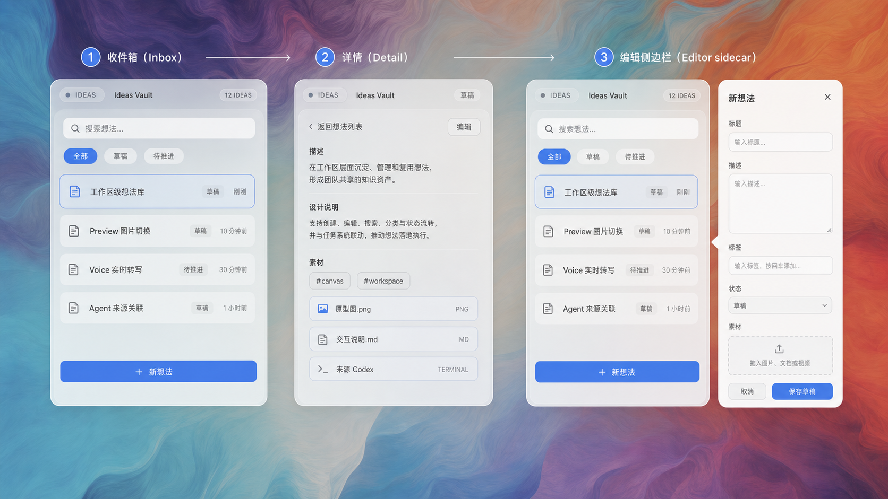
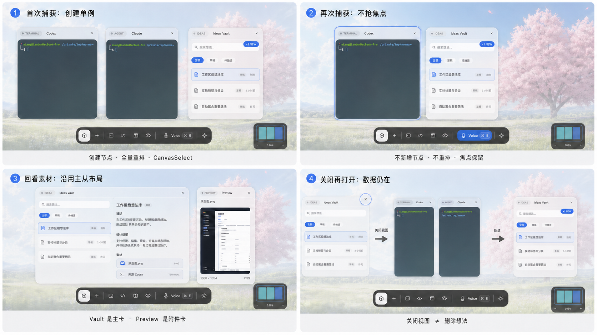

# Ideas Vault Canvas-native 原型

- 日期：2026-08-04
- 状态：Redesign Prototype / Decision Support
- 关联方案：[`Ideas Vault：基于现有 Canvas 的原生化重设计`](../../product-specs/2026-08-04-SPEC-ideas-vault-canvas-native-redesign.md)
- 替代原型：2026-08-04 的 Browser Library / Preview 原型；旧稿已从当前文档树移除，可从 Git 历史查阅。
- 范围：原型只表达未来交互，不是已经实现的产品截图

生成提示词与纠错记录见 [`IMAGEGEN-PROMPTS.md`](IMAGEGEN-PROMPTS.md)。

## 1. 原型边界

新原型只使用当前 Norma OS 已存在的空间与交互语言：

- 无限画布上的同构 Card chrome
- workspace 网格 reflow 与 master-detail
- terminal-backed AgentCard，而不是 Norma 聊天卡
- 底部 Voice/Norma 入口
- 静态 Preview/Browser 附件卡
- 锚定卡片的非模态 sidecar

原型中唯一建议新增的第一等 UI 是 `Ideas Vault Card`；它仍属于既有节点/Card registry，而不是独立 Library 页面。

## 2. 原型总览

### 2.1 Canvas 对应关系与主闭环

一张图覆盖：底部 Voice 捕获、workspace 单例 Vault、新想法更新不抢 AgentCard 焦点、同一卡片 Inbox/Detail、附件复用 Preview/Browser，以及关闭只移除视图。

### 2.2 Vault Card 的 Inbox、Detail 与 Editor sidecar

三种模式都依附同一 Canvas node：列表和详情在 card body 内切换；编辑器沿用 Agent queue 的锚定 sidecar，不打开网页或全屏 modal。

### 2.3 焦点、布局、关闭与恢复

覆盖两条最重要的系统合同：已有 Vault 时保存不改变 AgentCard 的 `NodeFocused`；首次创建、展开、附件打开和关闭分别服从 reflow、master-detail、Preview/Browser 和 shared close route。

## 3. 逐步交互逻辑

### A. 捕获但不中断当前工作

1. 用户保持 Codex/Claude 等 AgentCard 的输入焦点。
2. 用户通过底部 Voice 说“记一下：先做 workspace 级想法库”。
3. Voice 依次显示 listening、transcript、thinking。
4. Norma 调用 `capture_idea`；后台事务成功后才更新 Canvas。
5. Vault 已存在：列表首行插入新 Idea，badge 短暂显示 `+1 NEW`，AgentCard 焦点不变，画布不 reflow。
6. Vault 不存在：创建唯一 Vault node，参与标准网格 reflow，并选中但不进入 `NodeFocused`。
7. Norma 根据真实 receipt 给 spoken reply。

### B. 回看与检索

1. 用户点击 Vault，或说“打开想法库”。
2. 系统复用已有单例；没有才创建。
3. `⌘F` 聚焦卡内搜索，关键词/状态只更新同一 body。
4. 点击结果后，同一 Card 切入 Detail；返回不改变 Canvas 布局。
5. 用户需要更大空间时，使用现有布局菜单将 Vault 设为 master。

### C. 富内容与来源

1. 用户在 detail 点击图片/Markdown/Text 附件。
2. 系统优先聚焦已打开的 Preview；否则创建 Preview，并沿用当前 master-detail 规则。
3. URL 同理打开或聚焦 Browser。
4. “来源 Agent”只保存捕获时卡片身份和稳定 locator；来源卡关闭后，Idea 本身不受影响。
5. 视频 P0 使用系统播放器，不伪装成 Image Preview。

### D. 编辑、关闭与恢复

1. `＋ 新想法` 或 `编辑` 打开锚定 sidecar。
2. sidecar 在右侧空间不足时切到左侧；操作期间阻止事件冒泡。
3. 保存成功后更新同一 Vault；失败保留输入并提供重试。
4. 关闭 Vault 只调用节点 close/reflow，不删除任何 Idea。
5. 再次从 New 菜单/Norma 打开时，从当前 ProjectStore 重新 hydrate。
6. app 重启后，Canvas snapshot 恢复 Vault 外壳；IdeaStore 恢复内容。

## 4. 关键视觉与可访问性状态

| 元素 | 必须状态 |
|---|---|
| Idea 行 | default、hover、pressed、keyboard focus、selected |
| 搜索框 | idle、focused、querying、results、no result、error |
| 状态筛选 | default、hover、selected、disabled |
| 保存按钮 | disabled、hover、pressed、saving、success、failed |
| Vault Card | unselected、selected、new-attention、master |
| sidecar | opening、editing、dirty、saving、partial asset failure |

Reduce Motion 开启时，`+1 NEW` 和 Card attention 只 cross-fade，不执行位移或弹跳。

## 5. 原型不代表的能力

- 原型不表示当前代码已经有 `IdeasVault` NodeType。
- 原型不表示 Norma 是某张 AgentCard。
- 原型不表示可以读取 Agent terminal 全文作为 Idea。
- 原型不表示视频已经由 Preview 内嵌播放。
- 原型不表示 Ideas 跨 workspace 自动同步。
