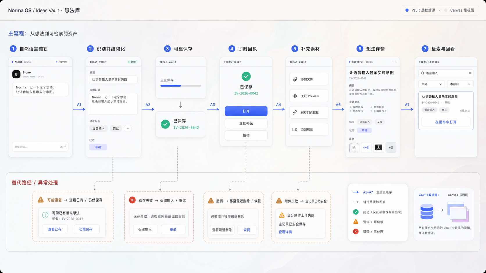
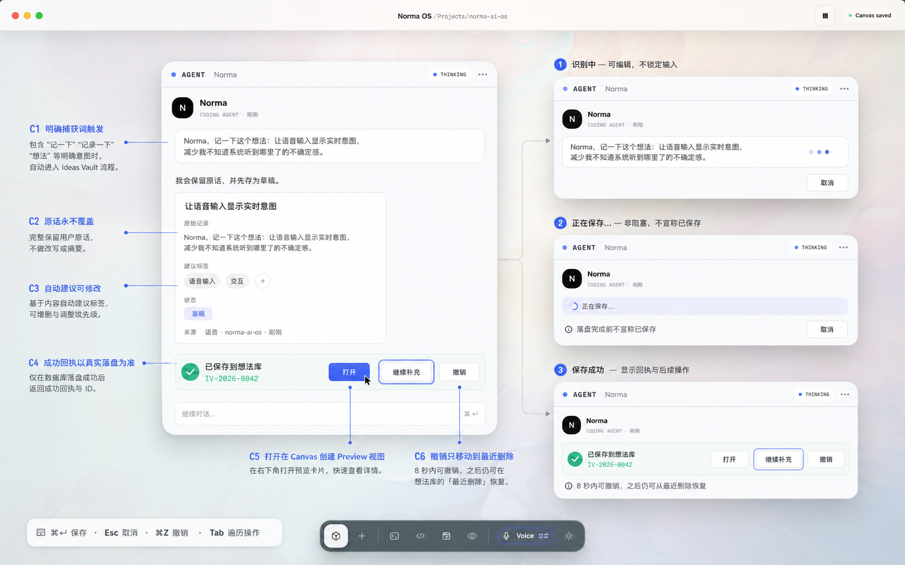
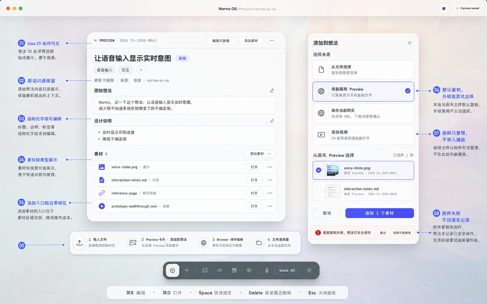
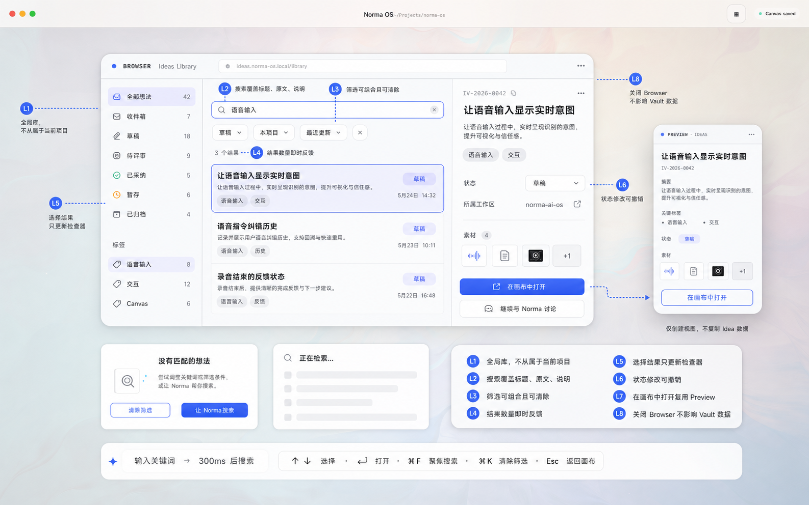
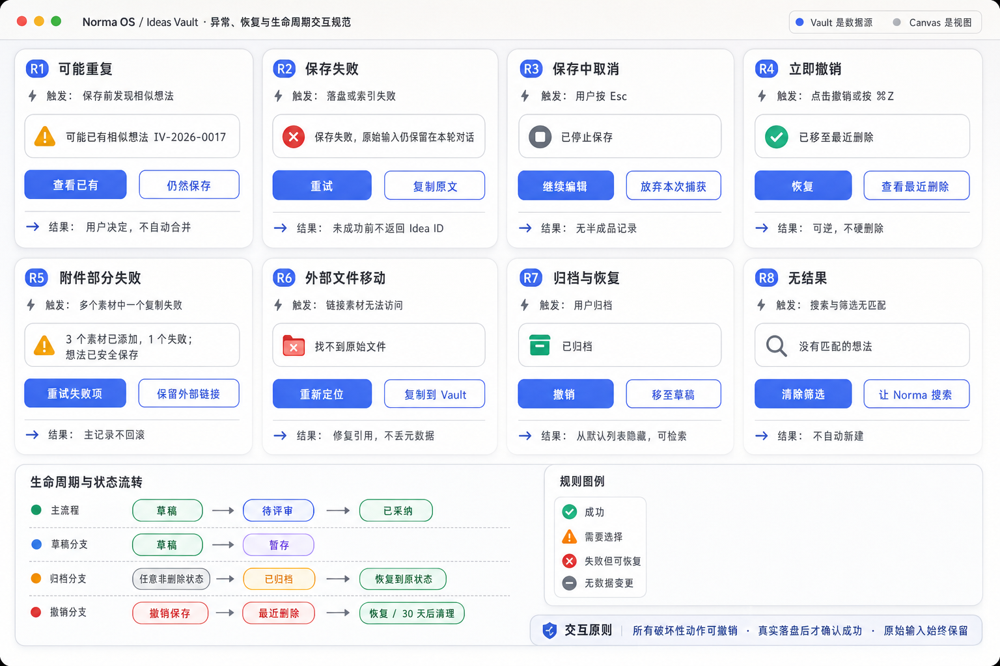
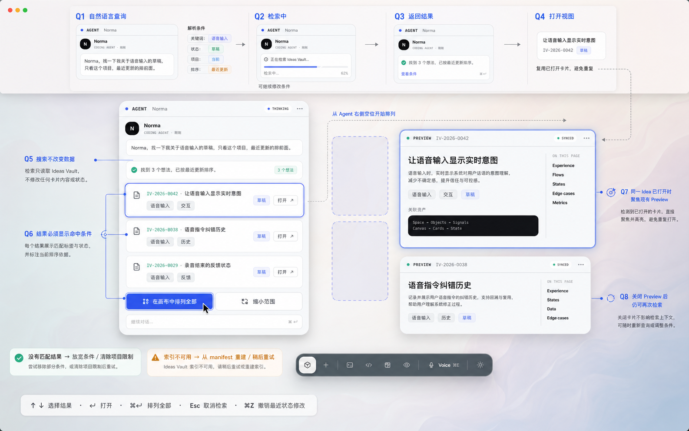

# Ideas Vault 原型交互与设计稿

> **已废弃（2026-08-04）：** 本目录中的 Browser Library、Preview 主视图和 Norma 对话卡交互不符合当前 Canvas 机制，图片仅保留为历史草案，不得作为实现参考。替代原型见 [`Ideas Vault Canvas-native 原型`](../2026-08-04-ideas-vault-canvas-native/README.md)。

- 日期：2026-08-04
- 状态：Prototype / Decision Support
- 关联方案：[`Ideas Vault 设计与原型规划`](../../product-specs/2026-08-04-SPEC-ideas-vault-design-and-prototype-plan.md)
- 范围：只提供交互与视觉原型，不修改产品代码、不新增节点类型、不改 Runtime
- 视觉基线：现有 Norma OS Canvas、Preview、Browser、Agent Card；Apple 设计原则

## 1. 原型目标

这套原型用于回答五个产品决策问题：

1. 用户如何用自然语言低摩擦保存想法，同时知道内容确实已经落盘？
2. 想法如何在不丢失原话的前提下被结构化？
3. 图片、文档、网页和视频如何进入同一 Idea？
4. P0 不新增节点类型时，用户如何检索和回看？
5. 失败、重复、撤销、归档和恢复是否形成完整闭环？

原型坚持一个边界：**Vault 是数据源，Canvas 是视图。** 关闭 Preview、Browser 或 workspace 不得删除 Idea。

## 2. 设计稿总览

### 2.1 端到端交互总览



覆盖：自然语言捕获、结构化、可靠保存、回执、素材补充、详情、检索，以及重复、失败、撤销和附件部分失败。

### 2.2 捕获与保存状态



覆盖：识别中、结构化预览、保存中、保存成功、打开、继续补充、撤销、键盘路径和焦点状态。

### 2.3 Idea 详情与富内容素材



覆盖：原始想法、结构化设计说明、标签、状态、四种素材类型、Preview 关联、Browser 链接、视频管理、部分失败。

### 2.4 P1 Ideas Library



覆盖：全局库、状态与标签导航、关键词搜索、组合筛选、检查器、空状态、加载状态，以及在 Canvas 中复用 Preview 打开。

### 2.5 异常、恢复与生命周期



覆盖：重复、保存失败、保存中取消、立即撤销、附件部分失败、外部文件移动、归档恢复、无结果及状态流转。

### 2.6 P0 对话检索与回看



覆盖：自然语言查询、条件解析、检索、结果卡片、单个打开、批量排列、已有 Preview 聚焦、无结果和索引不可用。

## 3. 完整交互逻辑

### 3.1 主闭环

```text
用户明确说“记一下”
  → Norma 保留原始表达
  → 生成可修改的标题、标签、摘要和状态建议
  → 写入 Vault canonical 文件
  → 更新可重建索引
  → 返回真实 Idea ID 和成功回执
  → 用户选择打开、继续补充或撤销
  → 打开时创建/聚焦现有 Preview 视图
```

不得在持久化成功前展示“已保存”。索引更新失败时，只要 canonical 文件已成功写入，Idea 仍然安全；系统应提示索引稍后重建，而不是谎报整次保存失败。

### 3.2 捕获状态表

| 状态 | 用户可见反馈 | 可执行操作 | 下一状态 |
|---|---|---|---|
| `listening` | Voice 激活、实时 transcript | 继续说、取消 | `structuring` / `cancelled` |
| `structuring` | 原话、建议标题/标签、草稿状态 | 修改建议、补充、保存、取消 | `saving` / `cancelled` |
| `saving` | “正在保存…”；提交动作 disabled | 取消 | `saved` / `save_failed` / `cancelled` |
| `saved` | Idea ID、状态和三项后续动作 | 打开、继续补充、撤销 | `opened` / `enriching` / `recently_deleted` |
| `save_failed` | 原始输入仍留在对话 | 重试、复制原文 | `saving` / `cancelled` |
| `possible_duplicate` | 相似 Idea ID 和摘要 | 查看已有、仍然保存 | `opened_existing` / `saving` |

### 3.3 捕获触发规则

以下表达触发保存流程：

- “我有一个想法……”
- “记一下这个点子……”
- “把这个存到想法库……”
- “将刚才那段整理成一个 Idea……”

普通讨论、反问或假设不会静默入库。无法判断时，Norma 只问一个最小问题：“要把它保存到想法库吗？”

### 3.4 保存成功后的三条路径

| 操作 | 系统动作 | Canvas 结果 | 可逆性 |
|---|---|---|---|
| 打开 | 解析 `idea_id`，查找已有视图 | 有则聚焦；无则创建 Preview | 关闭卡片不影响数据 |
| 继续补充 | 将本轮 active idea 设为当前上下文 | 保留 Agent Card，接受后续自然语言 | 每次补充保留历史 |
| 撤销 | 移至最近删除并记录原状态 | 已打开 Preview 标记为已删除/关闭 | 可立即恢复 |

“打开”不复制 Idea 数据；Preview 只读取稳定的 `idea.md` 或派生视图。

### 3.5 详情编辑

- Idea ID、创建时间和原始想法为稳定来源信息。
- 标题、摘要、设计说明、标签、状态和 workspace 关联可编辑。
- 编辑入口贴近对应区域；不使用一个覆盖全屏的大表单。
- 原始想法默认只读；若允许纠正转写，应保留原始版本并明确标为修订。
- 状态变更立即反馈，并提供 Undo。

### 3.6 素材进入系统

| 入口 | 用户动作 | 系统处理 | 失败处理 |
|---|---|---|---|
| 文件选择器 | 点击“从文件选择” | 默认复制到 Idea 的受管目录 | 主 Idea 保留，失败项可重试 |
| 拖入文件 | 拖到素材区 | 显示 drop target，释放后复制 | 列出逐项结果 |
| Preview | 菜单“添加到想法” | 解析源路径，选择目标 Idea，再复制 | 不把 NodeId 当永久文件引用 |
| Browser | “保存当前网页” | P0 保存 URL 和标题 | 下载网页内容需要再次确认 |
| 视频 | 选择或拖入 `.mov/.mp4` | 复制、记录类型和元数据 | P0 使用系统播放器打开 |

默认“复制到 Vault”，外部链接只作为显式选择。附件部分失败不回滚已经保存的 Idea 或其他成功附件。

### 3.7 P0 对话检索

```text
“找我关于语音输入的草稿，只看这个项目，最近更新优先”
  → 解析：关键词 / 状态 / workspace / 排序
  → 在回复中回显命中条件
  → 返回结果数量和最多若干条结果
  → 用户选择单个打开或在 Canvas 中排列全部
  → 已打开的 Idea 聚焦现有 Preview
```

查询是只读操作，不得隐式修改状态。结果必须展示 Idea ID、标题、摘要、状态、关键标签和更新时间，避免用户只能凭标题猜测。

### 3.8 P1 Ideas Library

- 左栏是全局范围、状态和标签；不是 workspace 文件树。
- 中栏负责搜索、组合筛选、排序和结果选择。
- 右栏只检查或轻量修改当前 Idea，不在选择时自动打开 Canvas 卡片。
- “在画布中打开”是明确动作；同一 Idea 已经打开时聚焦已有 Preview。
- Browser 卡片关闭后，筛选视图可以丢弃或下次重建，但 Vault 数据不受影响。

### 3.9 搜索状态

| 状态 | 表现 | 操作 |
|---|---|---|
| 输入中 | 搜索框有焦点；旧结果仍可见 | 继续输入、Esc 清除 |
| 检索中 | skeleton 或轻量进度，不阻断导航 | 修改条件、取消 |
| 有结果 | 显示数量与当前排序 | 选择、打开、修改筛选 |
| 无结果 | “没有匹配的想法” | 清除筛选、让 Norma 搜索 |
| 索引不可用 | 可恢复警告 | 从 manifest 重建、稍后重试 |

### 3.10 生命周期

```text
草稿 → 待评审 → 已采纳
  └→ 暂存

任意非删除状态 → 已归档 → 恢复到原状态
撤销保存 → 最近删除 → 恢复 / 到期清理
```

状态流转不要求线性。`archived` 和 `recently_deleted` 是系统层行为；恢复时应回到记录的上一状态。

## 4. 错误与恢复合同

| 场景 | 必须保留 | 不允许 | 恢复动作 |
|---|---|---|---|
| 保存失败 | 本轮原始输入 | 返回虚假 Idea ID | 重试、复制原文 |
| 可能重复 | 新输入和相似候选 | 自动合并或覆盖 | 查看已有、仍然保存 |
| 附件部分失败 | Idea 与成功附件 | 整体回滚 | 重试失败项、保留外链 |
| 外链失效 | 素材元数据和原 URI | 静默删除素材 | 重新定位、复制入库 |
| 立即撤销 | 完整 Idea 和上一状态 | 硬删除 | 恢复 |
| 索引损坏 | canonical manifest、正文和附件 | 把索引当唯一数据源 | 重建索引 |

## 5. 焦点、快捷键与可访问性

- `Tab` 顺序遵循：内容 → 主操作 → 次操作 → overflow。
- `⌘↩` 用于确认保存或批量打开；`Esc` 取消当前面板/检索，不关闭整个窗口。
- `⌘Z` 撤销最近一次状态修改或保存撤销。
- 搜索结果支持 `↑/↓` 选择、`↩` 打开、`⌘F` 聚焦搜索。
- hover、pressed、focus、selected、disabled 均需有不同视觉状态。
- 保存成功、失败和结果数量需要可被辅助技术感知，不能只依赖颜色。
- Reduce Motion 下，卡片创建和面板出现使用短 cross-fade；不使用大范围位移动画。

## 6. 动效说明

| 交互 | 动效 | 行为约束 |
|---|---|---|
| 保存成功回执 | 轻量 materialize + check 状态切换 | 仅在真实落盘完成后触发 |
| 打开 Preview | 从触发按钮方向出现，落在 Agent 右侧空位 | 动画可中断，不锁输入 |
| 关联素材面板 | 锚定“添加素材”按钮展开 | 关闭沿原路径返回 |
| 拖入素材 | 1:1 跟随并显示 drop target | 离开区域立即取消高亮 |
| 撤销 | toast/receipt 原位更新 | 不使用庆祝动画 |

默认使用临界阻尼、无弹跳的短响应；只有用户拖拽卡片时才允许继承手势速度。保存、错误和警告反馈保持克制。

## 7. P0 / P1 对应关系

| 原型 | 阶段 | 实现边界 |
|---|---|---|
| 捕获、保存、回执 | P0 | Norma Agent + typed tool + background writer |
| Idea 详情 | P0 | 复用 Preview |
| 对话检索与回看 | P0 | Norma Agent + Preview |
| 文件、Preview、URL、视频关联 | P0/P1 | P0 文件选择与 URL；拖入/下载桥接逐步增强 |
| Ideas Library | P1 | Browser-backed local library，经 L3 验证后启用 |
| 专属 Ideas Node | 不在本原型内 | 只有高频 Canvas 管理需求被验证后再决策 |

## 8. 原型验收清单

- [ ] 用户能在一句话内触发捕获，且普通讨论不会静默保存。
- [ ] 保存成功回执只在 canonical 数据落盘后出现。
- [ ] 回执提供打开、继续补充和撤销三条明确路径。
- [ ] 原始想法始终可回看，结构化建议可修改。
- [ ] 图片、文档、网页链接和视频都能关联到同一 Idea。
- [ ] 附件失败不会导致 Idea 丢失。
- [ ] 用户能用自然语言按关键词、状态、项目和时间排序检索。
- [ ] 打开同一 Idea 时不会无意创建多个重复 Preview。
- [ ] Library 支持组合筛选、清除、空状态和索引恢复。
- [ ] 归档、撤销和最近删除均可恢复。
- [ ] 所有关键操作均有 hover、focus、pressed、disabled 状态。
- [ ] 键盘可完成保存、搜索、选择、打开、撤销和关闭面板。

## 9. 图片生成说明

所有设计稿使用内置图片生成能力创建，并使用现有 `core-ui-v2/canvas.png` 作为 Norma OS 视觉参考。生成提示词保存在 [`IMAGEGEN-PROMPTS.md`](IMAGEGEN-PROMPTS.md)，便于后续定向修改和生成暗色主题、窄窗口或无障碍变体。
