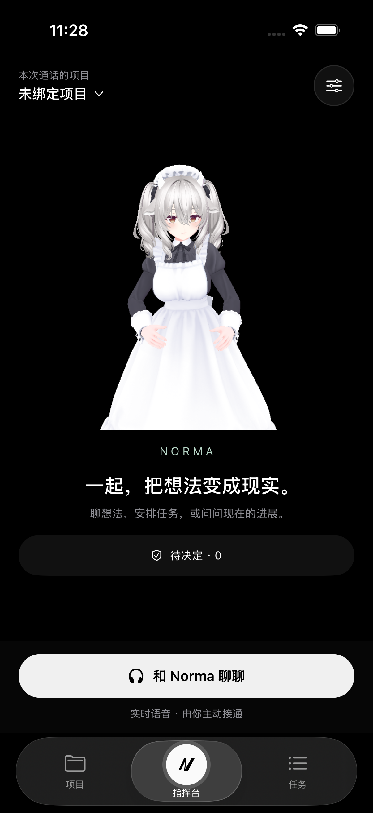
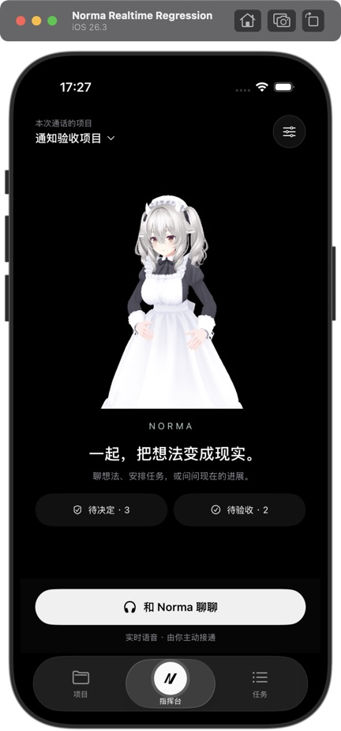
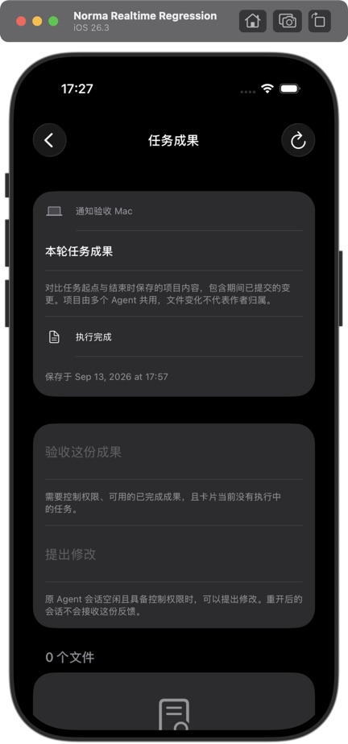
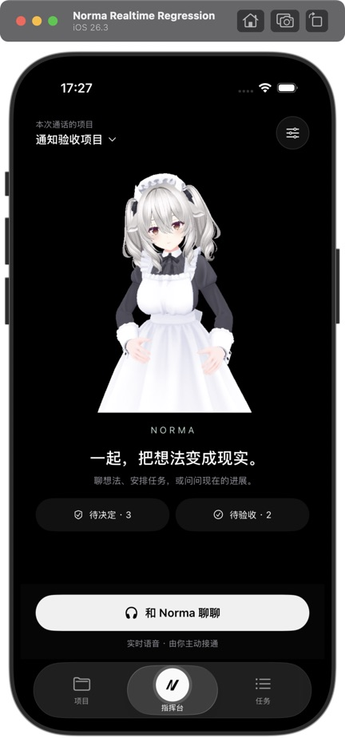
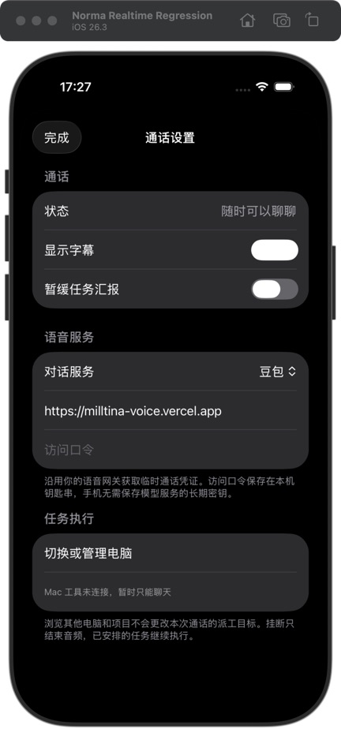
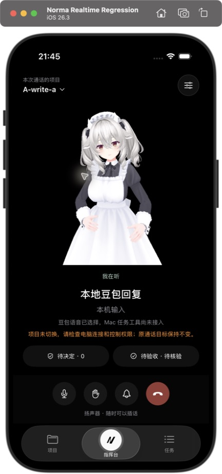
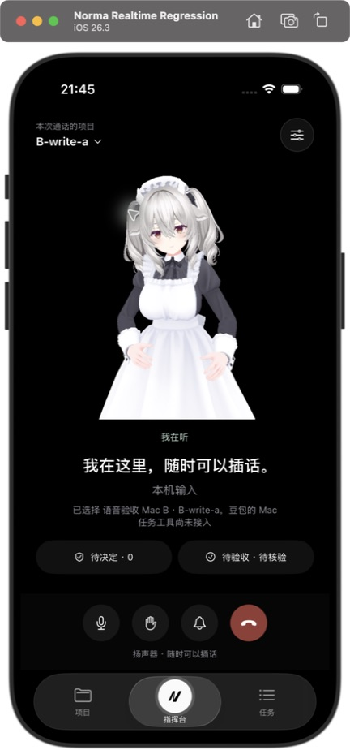

# 实时指挥台原生实施与验收记录

2026-09-13。本记录区分实现、自检和用户验收；当前尚未完成整个 Goal。

## 当前证据

| 需求 | 实现 / 证据 | 状态 |
|---|---|---|
| 原生陪伴布局、真实角色 | `CommandCenterView`、`CommandCenter/Avatar*`；正式 bundle 读取 Milltina 场景、Head 骨骼和三组动作 | 原生构建、bundle、AX5 检查与 Computer Use 已通过，见 v3 记录 |
| 删除旧指挥台 | 删除 CommandPlanView、CommandInboxLinks、CommandBriefCard、ApprovalSwipeCard 和 commandShowsPlan；ProjectTodoView 仅保留共享详情 | 源码清理与旧入口迁移完成；主要与扩展原生回归已通过，见 v4 记录 |
| 全电脑审批/记录、成果入口 | CommandDecisionInbox 保留所有配对电脑的订阅、准确请求校验与先保存后发送；CommandDeliveryReminder 复用成果订阅和 TaskDeliveriesView；计划记录从项目菜单打开 | 无 Mac 入口、在线准确审批与成果收件箱回归通过；Computer Use 已查看审批、成果和计划详情 |
| App 唯一通话对象 | NormaApp 的 StateObject 注入 RootView、NotificationPresenter 及通知目的页；不在 selectedID 页面内创建 | 双 Mac 原生及 CUA 已验证浏览/明确切目标与持续通话，见 v16 |
| GPT / 豆包音频 | 迁入 WebRTC / AudioDuplex；152.0.0 依赖已锁定，默认豆包并保留 GPT | 豆包原生 PCM 回环及云端合成语音通过；GPT 本地 RTP/SCTP 实播/暂停通过；物理耳机与 GPT 云端闭环待验收 |
| call_id 与凭据 | 固定 OpenAI SDP 地址，解析 Location；Mac 离线媒体可独立创建；网关口令在 Norma 钥匙串内使用 AfterFirstUnlockThisDeviceOnly | Location 正负测试通过；独立 Mac sideband 已接入并通过回环验证；同 OpenAI 项目真实鉴权仍未验收 |
| 锁屏/中断 | 后台音频声明；前后台仅停止角色更新，不再挂断；耳机拔出/系统音频中断暂停；本地打断立即 silenceOutput | 实现存在；物理设备、实际停播和 30 分钟锁屏未测 |
| 任务工具/汇报/验收闭环 | 持久回合预算、原话草稿、只读操作核对、GPT 汇报、无窗口 Adapter 及命令通道已接入；手机不执行 Mac 工具 | 六项 realtime e2e、Swift、原生汇报和 CUA 记录入口通过；豆包任务网关、真实云端派工和真实 .app 无窗口链路尚未验收 |

## 已执行命令

- `swift test --package-path ios --filter RealtimeCallTests`：先因缺少实现失败，再通过 1 项校验。
- `swift test --package-path ios`：64 项通过，0 失败（16:42）。
- `xcodebuild -project ios/Norma.xcodeproj -scheme Norma -destination 'platform=iOS Simulator,id=AF8B48D2-975E-4F81-97AB-B5FB6F555618' -derivedDataPath /tmp/norma-realtime-build -only-testing:NormaUITests/RealtimeCommandFlowTests -only-testing:NormaDeviceTests/RealtimeCompanionTests test`：1 项 UI 流程 + 2 项原生检查通过。
- UI 测试红灯记录：`/tmp/norma-realtime-build/Logs/Test/Test-Norma-2026.09.13_16-28-51-+0800.xcresult`；绿灯记录：`/tmp/norma-realtime-build/Logs/Test/Test-Norma-2026.09.13_16-39-47-+0800.xcresult`。
- `cargo test -p e2e`：253 通过、0 失败、71 ignored；原生 L3 runner 明确 ignored，未把它算成执行通过。日志 `/tmp/norma-realtime-e2e.log`。
- Computer Use：初次读取 Simulator 返回 `-10005 timeoutReached`；重置会话后成功选择 iPhone 17 Pro 窗口并从主屏打开 Norma，可读取实际截图。但 App 内容未暴露 AX 子树，按截图坐标点击指挥台返回 `-10005 noWindowsAvailable`；重取窗口、Raise、重绑句柄后仍失败。未完成陪伴页的 Computer Use 操作，不能以 XCTest 替代。

## 设计与动效

参考 `apple-design`、`emil-design-eng` 与 `review-animations`。采用绑定项目在顶部、角色/字幕为主、紧凑提醒和独立通话控制；主要按钮至少 44pt，正文使用 Dynamic Type 和可滚动布局；弹层使用 SwiftUI 系统呈现。没有新增方向切换器或示意执行状态。

| Before | After | Why |
|---|---|---|
| 旧滑卡承担审批、手势可能与阅读竞争 | 原生可滚动上下文和明确批准/拒绝按钮 | 直接反馈、完整阅读和辅助功能操作 |
| companion 背景为绿色，后台 suspend 通话 | 角色纯黑背景；SceneKit 在非 active 时停止持续渲染，音频独立 | 还原选定布局，并分离锁屏与音频生命周期 |
| 身体动作在正常状态持续播放 | 沿用 reduceMotion 分支抑制摆动；嘴型来自实际播放音量 | 减少动态效果仍保留通话反馈 |

截图比对发现原开聊按钮被底栏遮挡；新增位置断言后得到明确红灯（按钮底部 802.67pt > 导航顶部 796pt）。将 CallControlsView 与 WorkspaceTabBar 放入同一根部 inset 后复测通过，避免依靠固定补白。最新记录：`/tmp/norma-realtime-build/Logs/Test/Test-Norma-2026.09.13_16-56-02-+0800.xcresult`。



动效代码检查未发现新增 UI 缓慢动画或方向切换动效；标准字号的真实操作与 AX5 自动化检查已补齐；真机音频和用户界面验收仍未完成。

## 来源与剩余工作

源版本、迁入文件和资源 SHA-256 见 [来源清单](2026-09-13-realtime-source.json)。资源包含预览、CMU/CC0/TWH 原许可、第三方声明和 Milltina 授权核查；源码和 bundle 构建不读取 companion 绝对路径。模型软件分发授权未落实，未上传或分发模型产物。

剩余：豆包任务网关与语音汇报、GPT 云端同项目 sideband/自动汇报、真实 .app 无窗口语音派工、物理耳机锁屏和延迟测量、用户实际界面验收。网关范围补充尚待用户回答；草稿/预算/手机回执/队列的最新证据见 v17/v18。

物理设备检查：`xcrun devicectl list devices` 仅列出 Alan / iPhone 11，状态 `unavailable`；未测试耳机、锁屏或真实延迟。


## v3：原生回归与持久 Adapter（2026-09-13）

本轮独占模拟器为 `Norma Realtime Regression`，UUID `B0998C1C-2439-4A8E-AC4F-F5EDB49EE5EB`，iPhone 17 Pro / iOS 26.3。每项有副作用的用例使用全新回环 TLS、SQLite、配对和授权；结束后清理指定模拟器的测试电脑并撤销测试授权。未使用实际模型服务、实际口令或物理耳机。

| 已验证内容 | 命令 / 证据 | 结果 |
|---|---|---|
| 共享工具策略 | `cargo test -p agent`；`tests/tool_call_policy.rs` | 单回合 20 次；连续失败 3 次；成功清零；unknown 阻断其他克隆入口 |
| 可选 Window Adapter | `cargo test -p e2e --lib realtime_adapter_`；`/tmp/norma-realtime-durable-adapter-v4.log` | 两项通过：无窗口新建/派工/查询/明确取消；内部持久回执和故障注入 |
| 内部命令网络隔离 | `cargo test -p e2e --test ios_realtime_companion realtime_adapter_command_cannot_be_injected_by_a_phone` | 先缺少内部变体失败，再通过；内部命令可序列化计算哈希，但不能被手机 JSON 反序列化 |
| 原生入口与最大字号 | `xcodebuild ... -only-testing:NormaUITests/RealtimeCommandFlowTests test`；`/tmp/norma-realtime-accessibility-v3.log` | 两项通过；开聊按钮至少 44pt、无底栏遮挡、AX5 提醒可滚动到达、文本/触控审计通过 |
| 在线准确审批 | `ApprovalSwipeFlowTests/testButtonsSubmitOnlyTheCurrentDecision`；`/tmp/norma-realtime-approval-v3.log` | 只发送 `request-second/allow` 和 `request-first/deny`；只读、下一项、内容更新不授权；记录保留 |
| AX5 Todo 闭环 | `TodoFlowTests/testAccessibleTodoDecisions`；`/tmp/norma-realtime-todo-ax-v4.log` | 安排、撤回、重新安排、完成、拒绝与记录通过；只发送准确原文一次 |
| 调整方向 | `DirectionFlowTests/testDirectionPrioritySubmissionAndReadOnly`；`/tmp/norma-realtime-direction-v3.log` | 只读禁用，控制授权后只提交一次；结构化优先项实际重排，重新打开仍是保存的方向 |
| 成果收件箱 | `DeliveryInboxFlowTests/testCommandInboxUpdatesAndStaysScoped`；`/tmp/norma-realtime-delivery-v3.log` | 另一端验收后 2→1；切到空项目为 0；已验收记录保留，审批未知不伪造零 |
| 全 workspace | `cargo test --workspace`；`/tmp/norma-realtime-workspace-v4-retry.log` | 1831 通过、0 失败、100 ignored；ignored 不作为已执行证据 |
| App 编译检查 | `cargo check -p app`；`/tmp/norma-realtime-app-check-v4.log` | 通过 |
| Release 构建 | `cargo build -p app --release`；`/tmp/norma-realtime-release-v4.log` | 通过；未打包、未上传、未发布 |
| Swift 领域测试 | `swift test --package-path ios`；`/tmp/norma-realtime-swift-v4.log` | 66 通过、0 失败 |
| 机械护栏 | storage / performance / TTS Provider / video wallpaper / SOCKS proxy / max-file-lines / no-allow / agent-guide-lines，加 `git diff --check` | 通过 |

内部执行沿用 `MobileCommandStore.reserve` 和原来的租约、项目/route 检查与完成回执。`mobile_realtime` 在已有可选 Window Adapter 后等待画布持久化，并在后台通过 writer barrier 后按稳定 `task_ref` 回读准确任务、节点及指令。测试只对第二条指定任务安装失败 INSERT trigger：barrier 本身仍成功，但没有实际任务记录，最终必须是 `outcome_unknown`，原成功记录保留、重试没有第三次副作用。尚未实现 Mac sideband 调用方，不能将该测试声称为真实语音派工。

失败及修复记录：第一次全仓编译发现 `mobile_swift_pairing` 的穷尽分支遗漏内部命令，补充不可从手机构造的明确失败分支后全仓通过。Todo AX5 先失败：共享滚动 helper 把存在但零尺寸的虚拟行误判为“上方”，下滑导致确认弹层关闭；同时无法回找已回收的上方筛选行。修为仅使用非零 frame 定位并双向有界搜索，原生流程复测通过。曾将两个修改状态的 Todo 用例放在同一 fixture，后续改为每项独立 fixture，未把被污染的结果算作通过。

### Computer Use 实际操作

通过 `ComputerUseAcceptanceTests/testInteractiveSession` 仅保持模拟器 AX 桥，实际点击、读取和截图由 `mcp__cua_repl` 完成。首轮因 360 秒会话超时失败，保留截图但未算桥接测试通过；第二轮显式写入完成标记，完整 runner 通过（`/tmp/norma-realtime-cua-v4.log`，297.01 秒包含配对、操作与清理）。模拟器部分导航按钮未出现在 Computer Use 的 AX 树，使用元素暴露的系统 `Cancel` 动作返回；对应记录/关闭按钮另外经原生 UI 测试验证，未为工具差异改动页面导航。

实际观察：真实角色与黑色陪伴页、设置里的工具未连接提示、只读审批按钮禁用、下一项不提交决定、两份待验收成果、只读验收/反馈禁用、计划历史和完整详情、项目/任务/指挥台三标签可往返，回到指挥台仍未自动开始通话。所有成果为隔离 fixture 已保存的数据；“执行完成”没有被当作用户验收通过。





其他原始截图：`cua-settings-v3.png`、`cua-decision-v3.png`、`cua-plans-v3.png`、`cua-plan-detail-v3.png`、`cua-deliveries-v3.png`、`cua-tasks-v3.png`，均位于 `assets/norma-realtime/`。

## v4：人物放大、扩展回归与 sideband（2026-09-13）

继续使用独占模拟器 `B0998C1C-2439-4A8E-AC4F-F5EDB49EE5EB`，没有触碰真实模型凭据、付费通话或其他线程模拟器。

### 人物与原生入口

根据用户“虚拟人物太小了，再变大一些”的反馈，将 `AvatarScene` 摄像机距离由 1.65 改为 1.30，投影约为原来的 `1.65 / 1.30 ≈ 1.27`。保持人物容器高度，字幕和控制栏仍有独立空间。Computer Use v12 实际检查人物触摸和决定入口开关，runner 123.78 秒正常结束；人物及动作资源没有替换或重新生成。

大字号决定入口曾在 v6/v7 失败：外部 safeAreaInset 没有让 TabView 按预期缩小内容。RootView 的指挥台改由外层 VStack 实际安放内容、通话栏及底栏；Todo 共享滚动 helper 只在可滚动内容区域发起手势。后续位置断言证明整个决定入口位于通话栏上方，并实际打开/关闭弹层。失败尝试保留，未计算为通过。

| 验证 | 日志 / 证据 | 结果 |
|---|---|---|
| AX5 决定入口 | `/tmp/norma-realtime-decision-ax-v8.log` / `-native.log` | 45.46 秒通过 |
| 剩余计划动态更新 | `ProjectBoardFlowTests/testLiveDirectionUpdatesStayInCommandCenter`；`/tmp/norma-realtime-live-plans-v10.log` | 90.55 秒通过；扩展矩阵收尾 |
| 人物放大后原生检查 | `/tmp/norma-realtime-avatar-v11.log`；xcresult `Test-Norma-2026.09.13_18-45-38-+0800.xcresult` | RealtimeCommandFlowTests 2 项 + RealtimeCompanionTests 2 项通过 |
| Computer Use v9 | `/tmp/norma-realtime-cua-v9.log` | 实际打开设置、决定入口及三个 Tab 往返；198.40 秒正常收尾 |
| Computer Use v12 | `/tmp/norma-realtime-cua-v12.log` | 人物放大构图、触摸及决定入口开关；123.78 秒正常收尾 |



### 实时绑定、任务执行与恢复边界

手机用独立固定证书 WSS 绑定 `rtc_` 媒体 ID、项目和代次；沿用现有最多八个 socket，另一设备不能接管，旧代次和只读项目拒绝。Mac 验证授权后才加载凭据，且先核对 provider/完整 endpoint 必须是官方 OpenAI，再读取 Keychain；回环上游测试完全跳过真实凭据。状态区分 connecting、attached、ready、unavailable，只有确认任务工具注册后才 ready。挂断/撤销释放 sideband，不发送任务取消。

`tokio-tungstenite 0.28` 已在 Cargo.lock 中，显式启用 connect 与系统信任根支持。网络、快照和 SQLite 均在后台。sideband 保留角色工具，Mac 独占任务工具；转写迟到允许等待三秒，执行授权来自上游原始用户转写。当前意图门是保守中英文祈使规则，有覆盖范围限制，不能声称已完成通用语义识别。

稳定操作 ID 为 `rt-` 加 SHA-256(JSON([machine, device, media_call_id, function_call_id]))，不含连接代次。复用 MobileCommandStore reservation/receipt，实时工具指纹排除已经即时验证的授权版本，其余参数保持比较；普通手机命令沿用原序列化指纹。重连恢复原 route，同调用改参数仍拒绝。内部前台接收和最终 Agent 任务完成分别记录，accepted 从未作为完成证据。

| 验证 | 日志 / 命令 | 结果与范围 |
|---|---|---|
| 绑定鉴权/隔离 | `/tmp/norma-realtime-binding-v5.log`；`mobile_realtime_binding` | 两项真实本机 TLS + 回环上游测试通过；不代表真实 OpenAI 鉴权 |
| 工具基本接线 | `/tmp/norma-realtime-tools-red.log` → `/tmp/norma-realtime-tools-v1.log` | 从“缺任务工具注册”红灯到三项绑定/工具测试通过 |
| 插话与回执失败 | `/tmp/norma-realtime-tools-safety-red.log` → `-green.log` | 红灯复现插话后旧请求继续提交、执行后回执错误变 rejected；修复后旧请求零投递，未知结果冻结后续工具 |
| 授权版本与混合工具 | `/tmp/norma-realtime-tools-reconnect-red.log` → `/tmp/norma-realtime-tools-v13.log` | 两项绑定 + 五项工具测试通过：跨连接/授权版本回读、改参拒绝、迟到转写、Mac/角色混合只续答一次 |
| 意图边界 | `/tmp/norma-realtime-intent-red-v3.log` → `/tmp/norma-realtime-intent-green-v3.log` | “测试结果很好”“实现方案不错”、无问号询问和任务汇报暂停均不产生任务写操作 |
| Swift 领域层 | `/tmp/norma-realtime-swift-v10.log` / `/tmp/norma-realtime-swift-v13.log` | 67 / 68 项通过；新增 Mac 失联仅恢复角色工具的正负校验 |
| clippy（工具模块加入前） | `/tmp/norma-realtime-clippy-v12.log` | 通过；不作为最新 events/execution 模块的检查证据 |

工具 E2E 使用真实手机 TLS、SQLite 和假 OpenAI 事件，前台替身仅返回 `task_id=7` 的接收回执。它证明任务传输、权限和去重，未证明真实 Coding Agent 完成；真实 GPUI Adapter 的持久落盘另由 v3 测试覆盖。Mac 工具失联后手机恢复初始角色 schema/聊天指令，只更新会话能力，不代替 Mac 合成函数回执或挂断媒体。

仍待完成：跨连接/进程回合预算和 unknown 状态恢复、手机未确认操作持久记录/核对、明确换绑定、未提交草稿、合并汇报/用户讲话排队/暂停恢复；成果返回原任务的完整实时接线、真实 `.app` 无窗口语音派工。物理设备、同项目 OpenAI 会话、30 分钟锁屏、P50/P95 与实际插话停播仍无测量证据。

### 最新完整验证（v14）

- `cargo test --workspace -- --test-threads=1`：1839 通过、0 失败、100 ignored；日志 `/tmp/norma-realtime-workspace-v14.log`。ignored 不作为已执行证据。
- 默认并行全仓首轮有两项项目路由读取失败（`e2e_mobile_terminal_read_input_events_and_authorization`、`realtime_adapter_receipt_requires_persisted_task_and_canvas`），日志 `/tmp/norma-realtime-workspace-v13.log`；补充实际响应断言后，两项分别单独通过，串行完整验证也通过。尚未证明并行失败的根因，没有通过调大生产超时掩盖失败。
- `cargo clippy -p app -p agent -p e2e --all-targets -- -D warnings`：通过，日志 `/tmp/norma-realtime-clippy-v14.log`。首轮发现测试 helper 同名嵌套 module 和既有后台测试注释缺段落空行，已分别改名及补空行。
- `cargo check -p app`：生产 feature 配置通过，日志 `/tmp/norma-realtime-app-check-v14.log`。
- 最新原生构建/入口测试：2 项 RealtimeCommandFlowTests + 2 项 RealtimeCompanionTests 通过；日志 `/tmp/norma-realtime-native-v13.log`，xcresult `Test-Norma-2026.09.13_19-13-27-+0800.xcresult`。该轮包含离线工具恢复接线；真实音频仍未测试。
- storage / performance / TTS Provider / video wallpaper / SOCKS proxy / max-file-lines / no-allow / agent-guide-lines 与 `git diff --check` 均通过。
- `cargo build -p app --release`：通过（2 分 40 秒），日志 `/tmp/norma-realtime-release-v14.log`；仅本地构建，未打包或上传。


## v15：豆包优先迁入（2026-09-13）

- 来源：指定 companion 的 VoiceCall/AudioDuplex 与归一化网关协议；源工程未修改，正式构建不依赖源绝对路径。默认豆包，保留 GPT。
- 票据验证红→绿日志：`/tmp/norma-doubao-ticket-red.log`、`/tmp/norma-doubao-ticket-green.log`。原生分帧/事件红→绿日志：`/tmp/norma-doubao-audio-red.log`、`/tmp/norma-doubao-call-red.log`、`/tmp/norma-doubao-call-green.log`。
- Rust L3：`NORMA_IOS_SIMULATOR=B0998C1C-2439-4A8E-AC4F-F5EDB49EE5EB NORMA_IOS_DERIVED_DATA=/tmp/norma-realtime-build cargo test -p e2e --test ios_realtime_companion native_doubao_realtime_audio_and_reconnect -- --ignored --nocapture`。首次停在系统麦克风授权，Computer Use 授权后 v2 通过；日志 `/tmp/norma-doubao-native-l3-v2.log`，xcresult `Test-Norma-2026.09.13_21-16-31-+0800.xcresult`。
- 上述 L3 运行正式 App 的真实 AVAudioEngine、WebSocket 与 PCM 播放。验证16k上行分帧、24k真实播放完成、已播位置插话、迟到字幕隔离、静音无上行、后台标志不结束媒体、立即重拨等待旧连接释放；云端由本机回环协议服务替代，不冒充物理耳机或真实模型语音验收。
- 线上只做无音频鉴权冒烟：`https://milltina-voice.vercel.app/health` 正常，豆包票据200，WebSocket收到session.created，关闭收到session.closed；没有上传麦克风音频或打印凭据。证据 `/tmp/norma-doubao-service-smoke.log`。
- Swift 69项通过（`/tmp/norma-doubao-swift.log`）；原生入口/AX5/角色4项通过（`/tmp/norma-doubao-ui.log`）；e2e目标clippy通过（`/tmp/norma-doubao-clippy.log`）。
- Computer Use 实际操作正式设置的豆包→GPT→豆包与关闭；按 apple-design 使用原生 Form/Picker、选中反馈和通话中禁用，未增加自绘选择器。AX桥 `/tmp/norma-doubao-cua.log` 正常结束。



仍未宣称完成：物理耳机、30分钟锁屏、云端语音转写/回复、P50/P95声学延迟、豆包的 Mac 工具链路，以及 Goal 中的草稿/汇报/明确换绑定/完整恢复。


## v16：静音恢复与明确切换目标

- 新失败证据：`/tmp/norma-doubao-muted-red-v2.log` 显示静音重连多上传1帧；发送器初始化即继承静音，修复日志 `/tmp/norma-doubao-muted-green-v2.log`。重连时先清除旧采集缓冲，解除静音控制与音频同序发送。
- 目标授权红→绿：`/tmp/norma-realtime-target-red.log`、`/tmp/norma-realtime-target-green.log`。切换时读取目标Mac的最新快照并要求control；成功后停止旧sideband、释放旧凭据，目标身份只由明确操作修改；失败保留原绑定。
- 原生双Mac与音频L3：`/tmp/norma-doubao-target-native-v3.log`。两台真实TLS隔离Mac各有两个control项目和一个read项目，走正式配对/Keychain/快照；证明只读拒绝、同Mac/跨Mac明确切换、浏览不换绑定、媒体对象不重建，以及静音重连和挂断无连接重叠。fixture首轮缺少live snapshot source已修正，不修改生产快照超时。
- 线上合成语音：`/tmp/norma-doubao-voice-smoke.log`。发送系统生成的“你好，请用一句话介绍你自己。”，收到转写、助手回复、24k PCM首帧4800bytes和关闭ACK；未上传现场麦克风。当前共享网关仍沿用companion的Milltina人设，未擅自修改或部署源服务；豆包Mac任务工具仍未接入。
- `swift test --package-path ios` 70项通过：`/tmp/norma-doubao-final-swift.log`；`cargo test -p e2e -- --test-threads=1` 263项通过/72忽略：`/tmp/norma-doubao-e2e.log`；目标clippy通过：`/tmp/norma-doubao-final-clippy.log`。
- Computer Use：两次6分钟窗口超时未计为通过；只对显式双Mac语音场景把AX桥窗口设为15分钟，生产音频/网络超时保持不变。修复测试偏好落盘问题后，v4实际完成配置检查、接通、只读拒绝、切换A项目、浏览B不改绑定、明确切换B项目、通话中服务禁用、最后挂断。`/tmp/norma-doubao-target-cua-v4.log` 记录桥与隔离数据清理结果。





## v17/v18：原话草稿、持久操作恢复与汇报

### 实现与证据边界

- `RealtimeDiscussion` 保存完整转写、说话时 Mac/项目和稳定去重 ID；字幕截断不影响原文。原生长转写测试在挂断并重建 VoiceCall 后读取同一文件；不自动连接或派工。草稿 JSON 上限 512 条 / 4 MiB，损坏/写入失败保留原文件及内存原话。生产 tick 在保存失败后暂停通话并释放采集，保留未保存原话供处理；达到文件上限后不会无限继续采集。文件损坏场景已有原生红→绿证据。
- Mac 的 `mobile_realtime_calls` 在已有命令 SQLite 内先占位再执行，从已知结果、unknown 和未完成占位恢复共同预算。跨真实子进程第 21 次被拒；同操作回读不重复计数；改参数/归属被拒。unknown 后除只读核对外不继续调用。手机 `RealtimeOperationStore` 只存身份和结果，不存可执行命令。
- 手机按设备/项目读取分页，先落盘，再查原操作回执；not_found 仍是未知，不补发。真实 TLS 双 Mac fixture 的 `rt-pending-A/B` 只保存历史占位，完全没有执行命令。原生和 CUA 读取到「执行结果待核对」。三个只读入口共用 1+2+4 秒恢复，最多四次读取；错凭据、错电脑、非法响应不重试。持续故障耗尽预算后显示未核对，媒体重连/明确换目标会重新核对；不包装任何 submit。
- 汇报从既有真实成果订阅和分页核对生成，首个事件后 5 秒合并，每批最多 6 项。用户讲话/暂停时等待，执行状态、用户验收和播放状态独立。GPT 使用 conversation=none / tools=[] 的 response.create，发送前保存，真实音频播放结束才 played；插话回 waiting，崩溃时 speaking 恢复为 unconfirmed，明确恢复后才重播。
- 豆包尚不支持任务工具/任意文本汇报。记录页展示真实限制；没有伪造已播状态。GPT 自动 response.create 已接线，但本地 peer 测试手动准备队列后验证真实播放链，**尚未证明真实云端接受自动汇报请求**。

### 红灯与修复

| 问题 | 红灯 | 绿灯 / 结论 |
|---|---|---|
| 缺少原话持久化 | `/tmp/norma-discussion-red.log`、`/tmp/norma-discussion-native-red.log` | Core 与原生长转写恢复通过 |
| 重连重置失败预算 | `/tmp/norma-budget-reconnect-red.log` | `/tmp/norma-budget-reconnect-green-v2.log`；新连接仍受原回合限制 |
| 操作结构/分页缺失 | `/tmp/norma-operation-red.log`、`/tmp/norma-operation-page-red.log` | 原身份落盘、错项目拒绝和真实 TLS 回读通过 |
| 汇报队列缺失 | `/tmp/norma-report-red.log` | 合并、暂停、插话、崩溃恢复和已播去重通过 |
| 设置页暂停没有停止当前音频 | `/tmp/norma-report-settings-red.log`：取消事件缺失、speaking 未回 waiting、旧回复仍活动、真实音量仍大于零 | 将副作用集中到 reportsPaused 的 didSet；`/tmp/norma-report-settings-green.log` 实际 RTP/SCTP、取消、队列和零嘴型全部通过 |

最初 `/tmp/norma-report-peer-red.log` 仅因 tick 私有导致编译失败，不能作为声学行为失败证据。测试音为本机 48 kHz / 10 ms / 480 samples、220 Hz、振幅 800/32768；只证明模拟器真实音频回调与协议，不是物理耳机停播延迟。

### 最新验证

| 验证 | 结果 / 日志 |
|---|---|
| `cargo test --workspace -- --test-threads=1` | 1842 passed、0 failed、101 ignored，169 个结果段；`/tmp/norma-recovery-workspace.log` |
| `swift test --package-path ios` | 76 passed、0 failed；`/tmp/norma-operation-retry-green.log`，新增短暂故障/四次上限/鉴权不重试 |
| Agent + Storage 全测试 | 通过；`/tmp/norma-recovery-agent-storage.log` |
| Mac realtime 工具 e2e | 6 项通过；`/tmp/norma-recovery-network-v2.log` |
| 豆包双 Mac / 草稿 / 操作 / 汇报原生 L3 | runner 1 项通过；`/tmp/norma-recovery-final-l3-v19.log`，包含 ASR started、只读重试、草稿失败暂停和设置暂停修复 |
| 原生设置暂停的真实 WebRTC | 1 项通过，1.207 秒；`/tmp/norma-report-settings-green.log` |
| App check / Clippy / Release | 全通过；`/tmp/norma-recovery-final-check.log`、`/tmp/norma-recovery-final-clippy.log`、`/tmp/norma-recovery-final-release.log` |
| 护栏 | max-file-lines、no-allow、storage、performance、TTS、video、SOCKS、agent-guide-lines 和 diff 空白检查通过 |

### Computer Use

仍使用独占 iPhone 17 Pro / iOS 26.3 模拟器 `B0998C1C-2439-4A8E-AC4F-F5EDB49EE5EB`。

v17 首次通过真实点击检查讨论草稿空状态，截图 `cua-discussion-empty-v17.png`。v18 第一次尝试被系统保存密码弹层中断，未将该次 runner 的正常退出当成页面验收通过。测试启动改用系统 UserDefaults 参数域指定本轮回环地址，复用已经准备的测试钥匙串凭据，不增加生产 App 跳过分支。

第二次实际点击完成：开始通话 → 项目菜单 → 挂断 → 任务操作记录 → 完成 → 讨论草稿 → 完成 → 重拨 → 设置中暂缓汇报 → 主栏显示「恢复汇报 / 稍后汇报」→ 恢复 → 挂断。过程中一次菜单 AX 句柄失效，重置 CUA 后继续，成功页面均实际点击并截图。

- [未知操作与汇报不可用状态](assets/norma-realtime/cua-operation-unknown-v18.png)：原 Mac / 项目准确，显示待核对，没有成功标记。
- [原话草稿](assets/norma-realtime/cua-discussion-saved-v18.png)：本轮「本机输入」保存为 A-write-a 草稿，挂断后可读。
- [暂停汇报主栏](assets/norma-realtime/cua-reports-paused-v18.png)：设置与主通话按钮同步，通话仍在。

日志 `/tmp/norma-recovery-cua-v18.log`；截图由 Computer Use 获取。测试 Mac 项目关闭，因此此轮只验收汇报状态提示，没有把 populated 汇报列表或豆包语音任务汇报记成已验收。


### v19 补充

- `/tmp/norma-operation-retry-red.log` 先证明缺少只读恢复入口；`/tmp/norma-operation-retry-green.log` 76 项 Swift 通过。测试使用真实 1+2+4 秒等待，验证短暂断网成功、持续故障最多四次、鉴权失败不重试；实际 TLS 读取仍由原生 L3 覆盖，未声称做了物理切网。
- `/tmp/norma-discussion-capacity-red.log` 证明保存失败后通话仍为 connecting / isCalling=true。生产 tick 增加暂停收口；`/tmp/norma-recovery-final-l3-v19.log` 原生回归通过，坏文件字节不变、原话保留、采集任务取消。
- 已更新来源清单，补录迁自 companion `ios/Tests/RealtimeTests.swift` 的 `ReportLocalPeer.swift` 来源 SHA-256；源 companion 保持只读。

- 2026-09-14：补齐规格中的“等会儿一起说”暂停口令。`/tmp/norma-spoken-report-red.log` 先复现未暂停；原文仍保存，明确“继续汇报”才恢复。最终原生/AX5 共 8 项通过（6 项原生 + 2 项 UI），日志 `/tmp/norma-recovery-native-final-v20.log`。

### v24 / v25：编排安装修复与豆包任务接线

- 用户截图中的 `Install failed` 来自隔离验收包遗漏 `Contents/MacOS/norma`。`run-norma-mobile-desktop-l3.sh` 现构建并携带主程序、审批 Hook、Norma CLI、浏览器授权 Host；`mobile_desktop_bundle` 先在缺失包失败，补齐后通过，日志 `/tmp/norma-bundle-repair-red.log`、`/tmp/norma-bundle-repair-green.log`。既有自动 Repair e2e 也通过：`/tmp/norma-repair-installer-green.log`。
- Computer Use 重启隔离 App 后逐项点击 Codex、Claude Code、Cursor、OpenCode 的 Repair，四者全部显示 Ready。证据：[真实修复页面](assets/norma-realtime/cua-orchestration-repair-ready.png)。没有改动正式安装器的授权或冲突保护规则。
- 本地 `services/voice` 已迁入 Plan 网关，Mac 使用有期限、绑定媒体的一次性工具票据；iOS 捕获原网关来源、每次重绑定领取新票据、根据能力启用工具和成果播报。原生汇报必须实际播放后标记已播，暂停不代表验收。
- `/tmp/norma-doubao-report-red.log` 复现 started 清掉待播批次；`/tmp/norma-doubao-report-late-red.log` 复现用户讲话期间收到迟到 started，停讲后旧 PCM 复活。修复后 `/tmp/norma-doubao-app-v25.log` 4 项原生测试通过，包含真实 PCM 与 WebRTC 播放回调；`/tmp/norma-doubao-native-v25.log` 原生麦克风、双 Mac 目标、静音重连、挂断与汇报回归通过。
- `/tmp/norma-swift-v24.log`：77 项 Swift 测试通过。`/tmp/norma-voice-full-v24.log`：真实 HTTP/WS 的基础、Plan、任务检查全部通过；补测过期票据与关闭媒体撤销未消费票据。ASR/Chat/TTS 使用本机替身。
- `/tmp/norma-doubao-cloud-tools-v25.log`：使用既有 Plan 配置，对云端 `doubao-seed-2.0-mini` 发一次合成只读工具请求，HTTP 200 且返回 `lookup_status(task_id=demo-7)`。未执行该工具，不代表真实 Mac 派工与成果端到端已通过。
- 真实桌面 v23 超时，v24 因测试进程读取私钥触发钥匙串提示而中止；工具禁止操作 SecurityAgent。v25 改读实际二维码，但 Computer Use 截图缩放后无法解码，测试失败。v26 已改为仅向通过环境、回环与数据库路径校验的隔离目录提供公开证书，仍固定实际 TLS 证书，不读取私钥；绑定、隔离和工具 10 项测试通过（`/tmp/norma-public-identity-green.log`）。这些失败均不计入无窗口派工通过证据。

### v26：回归与真实桌面待解决项

- `cargo test -p e2e -- --test-threads=1`：266 passed / 0 failed / 73 ignored（`/tmp/norma-e2e-v26.log`）；`cargo check -p app` 通过（`/tmp/norma-app-check-v26.log`）。Release 构建通过（`/tmp/norma-realtime-release-v25.log`，早于仅 e2e 配置启用的公开证书导出改动）。
- 网关三组 `npm test` 通过（`/tmp/norma-voice-full-v26.log`）；来源清单 25 项校验通过；差异空白、文件行数、禁止 allow、指南行数、存储及性能护栏通过（`/tmp/norma-guardrails-v26.log`）。尚未对最新工作区重跑完整 workspace 与 Clippy。
- 真实隔离 App 关窗后，工具回执已持久化为 accepted，准确返回 task_id=1、node_id=1，但 20 秒内未出现 PTY 的 submitted 文件（`/tmp/norma-realtime-desktop-v26.log`）。该回执仅表示任务已接收，不能证明执行完成；正在定位真实进程与测试启动握手。

### v27 / v28：真实桌面测试超时定位

- v27 确认真正的 Python PTY 已启动。替身不发 `SessionStart` Hook，生产派工会等待 30 秒启动宽限期，再以 100ms 间隔粘贴和提交；测试却在 20 秒超时并删除临时项目。L3 等待改为 45 秒，覆盖 30 秒 + 100ms + 小于 15 秒的本机启动和调度余量，没有改生产等待策略。
- v28 已通过实际 PTY 完整任务文本断言，随后回查因复用超过 30 秒空闲期限的查询连接而失败（`/tmp/norma-realtime-desktop-v28.log`）。测试现重新建立固定原证书的只读连接，再核对挂断与重绑；未放宽 TLS 校验或生产连接期限。

### v29 / v30：真实桌面派工闭环通过

- v29 完成实际 PTY 输入、挂断后原 Runtime 保留、同 function 重绑回读原回执、只有一个操作和一张卡片。主动 Quit 后 App 与 PTY 均退出、两个监听均拒绝连接，但旧断言错误地要求 Unix socket 路径也不存在，因此测试失败；现验证实际连接失败，不把残留路径当作运行中的服务。
- v30 完整运行通过：`NORMA_REALTIME_DESKTOP_L3=1 RUST_LOG=app=debug cargo test -p e2e --test mobile_realtime_desktop -- --ignored --nocapture`，1 passed / 0 failed（`/tmp/norma-realtime-desktop-v30.log`）。Computer Use 打开精确隔离项目、开启回环服务、关闭窗口、重开检查单卡并主动 Quit；App PID 84205、PTY PID 84686 均已退出，编排 Unix socket 和手机端口 62202 均拒绝连接。
- 实际回执、前后快照与 PTY 输入保存在 `/tmp/norma-mobile-desktop-l3.3kwQOW/dispatch-verified.json`；[重开后的单卡截图](assets/norma-realtime/cua-desktop-realtime-single-card-v30.png)。替身没有发送启动 Hook，因此截图仍显示初始化动画，仅作为单卡证据；准确输入由真实 PTY 生成的文件断言验证，不声称真实模型执行或云端语音闭环通过。
- 本轮新增改动仅修正 L3 的等待、只读查询重连和退出验收条件；Rust 格式、差异空白、文件行数、禁止 allow 和指南行数检查通过。既有编排包修复与四个供应商 Ready 的截图见 v24/v25。

本轮未部署新网关，默认线上地址仍可能只支持聊天；物理耳机、30 分钟锁屏、端到端延迟和用户界面验收仍待完成。Goal 保持 active。


### v31 / v32：生产豆包网关 → 真实 Mac → 原生 iOS 单任务闭环

- 新增 `mobile_doubao_desktop.rs` L3 runner、`DoubaoDesktopTests.swift` 原生用例；`services/voice/check-native.mjs` 直接运行生产 `makeGateway`，仅 ASR、Chat、TTS 供应商用本机替身。任务执行用独立 Python CLI，经真实 PTY 和打包的 Hook 上报；测试没有手工写入成果或工具回执。
- v31 红灯：明确指令成功创建 `result.txt`；实际 App 库中 command=1、turn outcome=1，但 baseline=0、delivery=0，原生等待自动汇报超时。日志 `/tmp/norma-doubao-desktop-red-v31.log`，原生详细日志 `/tmp/norma-mobile-desktop-l3.XYuCNt/doubao-native.log`。
- 根因：实时 Adapter 已复用任务队列和持久回执，但成果基线/采集只接在手机聊天发送入口。修复在原队列提交前后台采集基线，匹配真实 Provider 的节点、run、turn 和完整原话后绑定；复用现有 `MobileTaskBaselineStore` 与 `watch_mobile_delivery`。同一卡片下一条排队输入等待差异冻结；25 秒仍无 Provider 回合时不伪造成果。
- v32 绿灯：完整链路 **1 passed / 0 failed**，26.71 秒（含增量 Xcode 构建）。讨论后仍为 0 卡片；明确派工后为 1 卡片；真实回执为 accepted，实际文件内容为 `realtime complete\n`；正式成果 feed 到达后原生播放器完成 PCM 播报，成果可验收且未自动通过。
- 磁盘核对 command / outcome / baseline / delivery 各 1 条，acceptance=0。ASR 共 37 个协议包，其中 1 个配置包、36 个音频包；Chat 恰好 3 次（讨论、工具、回执续答），独立汇报没有再调用模型。证据：[统计与持久结果](assets/norma-realtime/doubao-desktop-v32.json)、[真实桌面单卡截图](assets/norma-realtime/cua-doubao-desktop-task-v32.png)。日志 `/tmp/norma-doubao-desktop-green-v32.log`，原生详细日志 `/tmp/norma-mobile-desktop-l3.r5XQyv/doubao-native.log`。
- Computer Use 打开两个独立空项目、开启各自回环手机服务、检查真实 Done 卡片并主动 Quit。两次实例的端口 57684 / 62746 都已停止；临时手机授权已撤销，原生 Keychain 精确测试身份已移除。没有修改真实配对、部署网关或调用付费模型。
- 本轮额外修复测试设施：`OpenedMultisoulWindow.app` 与 `Entity` 在普通单测构建也可见，解决未启用 e2e feature 时的编译错误；实时协议测试共用一个 `wire` 模块，解决 Clippy duplicate_mod。现有派工单测 16/0；其余最新回归结果以 Goal G4 为准。

复跑前置：通过 `scripts/run-norma-mobile-desktop-l3.sh` 启动新的独立实例，设置 `NORMA_NATIVE_FIXTURE_ROOT` 指向只含测试 `.zshrc` 与 `realtime_delivery_provider.py` 的目录；该目录下创建空 Git 项目 `Realtime Delivery`，`hook-path` 写本次包内 `multisoul-agent-hook` 的绝对路径。设置 `NORMA_REALTIME_L3_UPSTREAM=127.0.0.1:9` 仅开启既有隔离身份导出（本测试走 gateway 票据，不连接此 GPT 地址）。Computer Use 打开项目并启用手机服务，将观察到的回环地址写入本次 App 根目录 `mobile-address`，然后执行：

```sh
NORMA_DOUBAO_DESKTOP_ROOT=<本次 /tmp/norma-mobile-desktop-l3.* 目录> \
NORMA_NATIVE_FIXTURE_ROOT=<本次独立 CLI 目录> \
NORMA_IOS_SIMULATOR=<显式隔离模拟器 UUID> \
NORMA_IOS_DERIVED_DATA=/tmp/norma-realtime-build \
cargo test -p e2e --test mobile_doubao_desktop -- --ignored --nocapture
```

证据边界：本轮通过的是实际网关、真实桌面 App、原生 iOS 单任务全链路；模型/语音识别供应商和执行 CLI 是确定性替身。云端完整工具调用、同一卡片排队成果与取消/崩溃恢复的组合验收、物理耳机锁屏/声学延迟及用户界面验收仍未完成。截图不替代原生 PCM 断言或物理设备验收。


v32 最终回归：`cargo test --workspace -- --test-threads=1` **1845 passed / 0 failed / 103 ignored**（`/tmp/norma-workspace-v32.log`）；`cargo clippy --workspace --all-targets -- -D warnings` 与 `cargo build -p app --release` 均通过（`/tmp/norma-clippy-v32.log`、`/tmp/norma-release-v32.log`）。模块共用调整后实时工具 7/0（`/tmp/norma-tools-v32.log`）；存储边界、性能护栏、Rust 行数/no-allow、指南行数、rustfmt 与 diff 空白检查通过。v31 首次并行全仓出现一次既有手机创建卡片回执超时，单独复跑 1/0（`/tmp/norma-create-card-v31.log`），v32 串行完整回归也通过；没有放宽超时或跳过该用例。


### v33 / v34：同卡排队、取消与挂断重拨的真实成果闭环

- 扩展现有生产网关 L3，仍只有 ASR/Chat/TTS 与 CLI 为确定性替身。A 通过真实 PTY 写 `result.txt` 首行后等待；B 和 C 经真实工具排队，随后按原回执中的准确 task_id 取消 C。原生挂断等待关闭 ACK，再重新绑定同一 Mac/项目，最后释放 A 的测试完成门。
- v33 两个真实成果和原生合并 PCM 已完成，但测试误将排队取消的 `succeeded` 回执断言为 `accepted`，且查询没有显式指定终态。现按正式工具契约断言取消成功，并使用 `states=[succeeded,cancelled]` 查询；没有改生产回执或查询语义。失败日志 `/tmp/norma-doubao-queue-v33.log`、`/tmp/norma-mobile-desktop-l3.oXVMvs/doubao-native.log`。
- v34 完整 L3 **1 passed / 0 failed，30.06 秒**（含增量 Xcode 构建）。原生断言讨论不建卡、挂断后同一张卡、A/B 为 succeeded、C 为 cancelled，只有两个真实 Provider turn。两个成果均 available、completed、PCM 已播、accepted=false。
- Rust 进一步读取正式 `MobileTaskDeliveryStore` 与 `MobileTaskBaselineStore`：A 的 before 不存在、after 只有 `realtime complete\n`；B 的 before 为 A 的完成字节，after 为 `realtime complete\nqueue second\n`；A/B 的 operation_id 分别匹配创建/排队原回执。C 没有文件、Provider turn 或成果。未向数据库注入完成结果。
- 实际库中 command=5（3次派工、1次取消、1次查询），outcome/baseline/delivery各2，acceptance=0。Chat=11（讨论1次、5个工具及续答各2次）；独立汇报不调用模型，原生播放「2项执行完成，2项待你验收」。ASR 50包中配置2包、音频48包。
- Computer Use 打开两个独立空项目并启用各自回环服务；v34检查真实单卡双任务后主动Quit，端口57660/59776均已停止。原生临时身份已移除，精确设备授权已撤销。证据：[完整统计](assets/norma-realtime/doubao-queue-v34.json)、[真实单卡双任务](assets/norma-realtime/cua-doubao-queue-v34.png)。完整日志 `/tmp/norma-doubao-queue-v34.log`、`/tmp/norma-mobile-desktop-l3.GRaEDe/doubao-native.log`。

复跑仍使用v32的命令和前置方式，但必须创建新的空隔离项目；CLI第一任务现由原生控制端释放完成门，最多等待120秒。当前测试验证媒体挂断/重拨，不能替代Mac进程崩溃恢复；云端完整工具调用、物理耳机/锁屏和用户验收仍待完成。Goal保持active。

本轮回归：`cargo test -p e2e -- --test-threads=1` **266 passed / 0 failed / 74 ignored**（`/tmp/norma-e2e-v34.log`）；目标 `cargo clippy -p e2e --test mobile_doubao_desktop -- -D warnings` 通过（`/tmp/norma-queue-clippy-v34.log`）。网关三组 `npm test` 通过（`/tmp/norma-voice-v34.log`）；Rust格式、差异空白、文件行数/no-allow及指南行数检查通过。本轮只扩展验收代码和记录，生产成果接线沿用v32；完整workspace/Release成绩仍以v32为准。


### v35：豆包操作恢复的媒体身份校验修复

- 定位到 `RealtimeOperation.validate()` 只允许 `rtc_`，而真实豆包工具使用 `doubao_`。派工和成果通道已能工作，但手机操作恢复读到豆包记录时会返回 invalidResponse；先前v34没有覆盖这条断言。
- 新增聚焦测试后，`/tmp/norma-doubao-recovery-red-v35.log` 明确在“真实豆包会话必须能进入操作恢复”断言失败。绑定与操作记录现共用 `RealtimeBinding.validCallID`，接受有非空后缀的两种合法会话，同时拒绝空前缀后缀和未知命名空间；没有改变操作/设备/项目精确匹配或未知状态规则。
- `swift test --package-path ios` **78 passed / 0 failed**（`/tmp/norma-swift-v35.log`）。新测试保存豆包未知操作、重开store、按原回执核对accepted，再重开读取；保持同一operation和task，未冒充执行完成。
- 原生L3现要求收到并保存4个准确豆包操作（A/B/C派工及取消），挂断后创建新的VoiceCall，从磁盘读回相同记录，再完成原有双任务成果/PCM流程。**1 passed / 0 failed，33.20秒**（`/tmp/norma-doubao-recovery-native-v35.log`、`/tmp/norma-mobile-desktop-l3.l8RCKk/doubao-native.log`）。[统计证据](assets/norma-realtime/doubao-recovery-v35.json)。实际Mac进程已退出，51774端口停止；临时身份与授权精确回收。

此项证明原生通话对象重建和文件持久恢复，不把它当作Mac进程崩溃验收；后者使用独立的真实App强制中断阶段验证。


### v35 / v36：真实 Mac 已接收任务崩溃后的回执恢复与防重派

- 扩展现有 `real_bundle_dispatches_after_windows_close`，通过 `NORMA_REALTIME_CRASH_L3=1` 启用强制中断阶段。先由真实 PTY 接收完整输入，Computer Use 检查单卡，再精确匹配本次隔离包的进程执行 SIGKILL；重启同一包、数据根和项目，重新启用手机服务后重放原操作。
- v35 首次因 `/tmp` 与系统 `ps` 返回的 `/private/tmp` 路径不同而失败，进程匹配为0，未执行 SIGKILL。将包可执行路径 canonicalize 后仍要求唯一精确匹配；旧实例通过 Computer Use Quit，测试授权回收。日志 `/tmp/norma-realtime-crash-v35.log`。
- v36 **1 passed / 0 failed，450.90秒**（含构建和 Computer Use，不是性能指标），日志 `/tmp/norma-realtime-crash-v36.log`。实际中断 PID42671，重启 PID43547；原端口59714停止，新端口61666，路由代次改变。固定原证书后同 call/turn/function 只返回原accepted回执，操作列表逐字相同，原任务仍唯一；项目库 task_id=1、node_id=1、state=interrupted、result为空。
- [持久回执与项目库证据](assets/norma-realtime/crash-recovery-v36.json)、[中断前单卡](assets/norma-realtime/cua-before-crash-v36.png)、[重启重放后单卡](assets/norma-realtime/cua-after-crash-v36.png)。截图没有明确Interrupted标签，中断状态以项目库断言为准。重启后手机服务默认关闭，Computer Use 明确重新 Enable；不声称自动恢复监听。
- 最后 Computer Use Quit；两个端口均确认停止，精确phone-l3授权已撤销。测试加入RAII授权回收，失败路径也撤销本测试身份。最终目标Clippy通过（`/tmp/norma-recovery-clippy-v36.log`），e2e **266/0，74 ignored**（`/tmp/norma-e2e-v35.log`）；格式、空白、Rust行数/no-allow和指南行数护栏通过。

本项CLI只确认收到输入，没有发送Provider完成Hook，因此证明accepted后的进程恢复与防重派，不覆盖“Provider完成已落盘、成果冻结前崩溃”的临界点，也不替代iOS进程重启、云端及物理耳机验收。Goal保持active。


### v37 / v38：完成已落盘而成果未冻结时的恢复

- 新增真实TLS接口用例 `mobile_delivery_recovery.rs`：通过正式命令预留、任务起点和终态writer构造中断临界点，再以新路由读取成果。v37红灯准确得到not_found，证明旧任务成果会从列表消失（`/tmp/norma-delivery-recovery-red-v37.log`）。
- 修复复用现有成果库与不可用状态：先查找具有准确手机起点/Provider终态且缺成果的旧路由记录，再校验当前路由，最后按原key保存window_closed；绝不采集重启后的项目文件。先取候选、后验路由，防止并发创建的新路由任务被当作旧任务；既有不可变成果在并发写入时仍优先保留。列表和单项详情共用同一恢复入口。
- 首次聚焦绿灯1/0（`/tmp/norma-delivery-recovery-green-v37.log`）；随后补充迟到终态和过期路由覆盖。扩展测试中b在详情请求之后才commit，列表请求仍须恢复它；错误凭据、过期路由不写恢复记录；新路由、无终态、无手机起点、错误session和另一项目都不生成成果。原frozen的正文、时间、指纹和待验收状态保持不变。
- v37完整回归首次在新增测试的Review借用/移动处编译失败，修复仅让冻结fixture克隆原Review；未改生产逻辑，后续完整结果记录为v38。

该用例是正式TLS服务配合隔离存储fixture，未运行真实Provider或SIGKILL，不冒充完成临界点的真实App崩溃L3。v36真实进程证据仍只覆盖accepted后的回执防重派；新的成果恢复通过范围以本节为准。


v38最终结果：`cargo test --workspace -- --test-threads=1` **1846 passed / 0 failed / 103 ignored**（`/tmp/norma-workspace-v38.log`），其中e2e **267/0，74 ignored**，新增恢复用例 **1/0，0.22秒**。`cargo check -p app`通过（`/tmp/norma-app-check-v38.log`）；`cargo clippy -p storage -p app -p e2e --all-targets -- -D warnings`通过（`/tmp/norma-clippy-v38.log`）。存储/性能边界、Rust行数/no-allow、指南行数、格式与差异空白检查通过。没有改页面、重新发布App或部署网关；Release成绩仍以v32为准。


### v39：真实Provider完成后的成果保存故障与Mac进程恢复

- 复用 `mobile_realtime_desktop.rs` 的独立包、固定证书、准确进程SIGKILL和同库重启流程。`NORMA_REALTIME_DELIVERY_CRASH_L3=1` 选择已验证的真实PTY/Hook fixture，在独立Git项目执行「创建 result.txt，内容为 realtime complete」。模型事件和执行CLI为确定性替身，没有调用云端模型；真实SessionStart/UserPromptSubmit/Stop均由包内Hook转发，测试未注入任务完成事件或成果记录。
- 仅在隔离AppDB添加 `l3_interrupt_capture` 触发器，阻止成果INSERT；等待真实完成事件commit、原操作绑定的起点和实际文件，同时断言stderr出现 `l3_capture_interrupted`、成果仍为空。此阶段为可复现的保存故障注入，不冒充无故障条件下精确暂停线程。
- Computer Use检查真实Done单卡后，精确终止PID **76646**；原端口 **53589**停止。移除本测试触发器，将文件改为「unrelated edit after crash」，重启同一包和同一库。Computer Use重开原项目、重新Enable手机服务，使用新端口 **56896**固定原证书回读。
- **L3 1 passed / 0 failed，469.37秒**（包含构建和Computer Use，非性能指标），`/tmp/norma-delivery-crash-v39.log`。同function仍返回原accepted回执、原操作、唯一节点；项目库原任务仍为Done且保留结果。成果接口返回唯一原node/run/session/turn，outcome=completed、status=window_closed、file_count=0、无acceptance；待验收列表为空。正式成果库也保存相同不可用记录；后续文件未混入。Provider日志最终只有原一次turn。
- [实际前后数据库/接口证据](assets/norma-realtime/completion-crash-v39.json)、[中断前Done卡片](assets/norma-realtime/cua-completion-before-crash-v39.png)、[重启后唯一卡片](assets/norma-realtime/cua-completion-after-crash-v39.png)。重启后卡片显示Ready，这是新的空闲PTY；历史任务Done与结果由持久库证明，不将截图状态当作历史任务状态。
- Computer Use最后Quit，两个端口均停止，精确phone-l3授权撤销，测试触发器已移除。没有改变线上服务、真实配对或模型资源。

复跑：
```sh
NORMA_REALTIME_DESKTOP_L3=1 NORMA_REALTIME_DELIVERY_CRASH_L3=1 \
cargo test -p e2e --test mobile_realtime_desktop -- --ignored --nocapture
```

本项补足真实App在完成事件与成果保存之间遇到失败、随后崩溃的恢复证据；不代表云端完整通话或物理耳机验收。当前 `xcrun devicectl list devices` 仅列出iPhone11且状态unavailable，无法开始物理设备30分钟锁屏/声学测量。Goal保持active。


v39回归：`cargo test -p e2e -- --test-threads=1` **267 passed / 0 failed / 74 ignored**（`/tmp/norma-e2e-v39.log`）；`cargo clippy -p e2e --test mobile_realtime_desktop -- -D warnings`通过（`/tmp/norma-delivery-crash-clippy-v39.log`），Rust格式、行数/no-allow、指南行数与diff空白护栏通过。本轮只扩展验收代码；全仓1846/0与App check沿用v38，Release沿用v32。

### v40–v43：豆包真实云端识别、派工与原生成果播报

- 新增显式开启的 `check-cloud-native.mjs`，复用正式网关，ASR/Chat/TTS全部调用真实豆包Plan接口；只从指定环境文件读取既有凭据，未输出或复制密钥。媒体/工具/控制服务仅监听随机本机端口。Chat最多8次；测试CLI仍为隔离的确定性文件执行器，PTY、包内Hook、Mac任务/成果库及原生音频路径为实际实现。
- 原生用例 `DoubaoCloudDesktopTests.testCloudTaskAndNativeReport` 从接通前就静音，使用生产Sender的首帧保护；移除麦克风回调并通过音频队列屏障后，才让Sender上传本地Tingting合成的16kHz单声道PCM16。静音阶段断言云端音频包为0；未上传现场麦克风。输入17.07秒、546300bytes，前后加1秒/2秒静音；文件名明确读为小写result、英文句点、扩展名txt。
- v40真实云端首先调用 `assign_agent_task(agent=codex)`，空项目没有该Agent；实时入口却把明确的不存在错误转为unknown，阻止模型继续。聚焦E2E红灯得到outcome_unknown，修复后在进入Adapter前返回持久的agent_not_found；执行开始后的错误继续保留unknown。实时会话的工具说明允许明确派工时选择内置类型并创建Agent，不要求再次确认；桌面工具说明未修改。日志 `/tmp/norma-missing-agent-red-v40.log`、`/tmp/norma-missing-agent-green-v40.log`。
- v41派工已接收，但测试语音里的`result.txt`被ASR转为`result txt`，严格CLI拒绝该任务，未放宽目标文件校验。v42明确口述英文句点后，真实模型先收到agent_not_found再创建成功，PTY产生正确文件；原生测试错误地假设看到PTY时云端也已收到持久回执，因此失败。v43分别等待真实PTY与真实回执，不修改生产顺序。失败证据见[诊断记录](assets/norma-realtime/doubao-cloud-failures-v40-v42.json)。
- v43完整L3 **1 passed / 0 failed，60.20秒**（含Xcode构建/启动，非性能指标）。云端100个ASR音频包、2次Chat、3次TTS，全部HTTP200；一次create_agent、一个实际Provider turn和一份成果。文件`result.txt`准确为`云端验证完成\n`，冻结差异的before不存在、after字节相同，来源operation_id与真实回执一致。
- 原生从正式成果feed收到available/completed，实际PCM播完后标记played，accepted仍为false；原操作恢复为已核对。播报为「1项执行完成，1项待你验收。详情在成果记录中。」，汇报没有增加Chat请求。证据：[完整云端/成果/输入记录](assets/norma-realtime/doubao-cloud-v43.json)、[Computer Use真实单卡Done](assets/norma-realtime/cua-doubao-cloud-v43.png)。日志 `/tmp/norma-doubao-cloud-v43.log`、`/tmp/norma-mobile-desktop-l3.gqxN4b/doubao-native.log`。
- Computer Use打开每个独立项目、启用本机手机服务并检查结果，最后Quit。v40–v43端口63684/56926/62988/51835均已停止，四个测试库的精确设备授权均revoked；原生临时身份已按用例回收。`xcrun devicectl list devices`复查iPhone11仍为unavailable。

复跑：沿用v32的独立App/项目/包内Hook准备流程，在`/tmp/norma-doubao-l3.*`目录创建`cloud-fixture`，将上述文本通过`say -v Tingting`合成，经`afconvert -f WAVE -d LEI16@16000 -c 1`转换，再用Python `wave.readframes`提取裸PCM到`speech.pcm`。不要将WAV头作为PCM上传。执行：

```sh
NORMA_DOUBAO_CLOUD_L3=1 \
NORMA_DOUBAO_ENV_FILE=<已有DOUBAO_SPEECH_API_KEY的本地环境文件> \
NORMA_DOUBAO_DESKTOP_ROOT=<本次 /tmp/norma-mobile-desktop-l3.* 目录> \
NORMA_NATIVE_FIXTURE_ROOT=<本次 /tmp/norma-doubao-l3.* 目录> \
NORMA_IOS_SIMULATOR=<显式隔离模拟器 UUID> \
NORMA_IOS_DERIVED_DATA=/tmp/norma-realtime-build \
cargo test -p e2e --test mobile_doubao_desktop -- --ignored --nocapture
```

回归：`cargo test -p e2e -- --test-threads=1` **267/0，74 ignored**（`/tmp/norma-e2e-v41.log`）；App check通过（`/tmp/norma-app-check-v41.log`），`cargo clippy -p app -p e2e --all-targets -- -D warnings`通过（`/tmp/norma-realtime-clippy-v43.log`）。网关三组`npm test`通过（`/tmp/norma-gateway-v40.log`），新增云端脚本语法检查与实际L3通过。完整workspace历史仍为v38，Swift领域层历史仍为v35；`cargo build -p app --release`于v43通过（2分30秒，`/tmp/norma-release-v43.log`）。Rust格式、行数/no-allow、指南行数与diff空白检查通过。

证据边界：本轮补足真实豆包ASR/Chat/TTS与实际Mac/iOS执行通道、成果和播报的组合验证；Coding CLI仍为替身，iOS运行在模拟器。GPT同项目sideband鉴权及云端完整任务/汇报、真实Coding CLI、物理iPhone/耳机30分钟锁屏与延迟/耗电测量、用户界面验收仍未完成。默认线上网关未部署，模型未对外上传，Goal保持active。


### v44–v45：排队取消清理与真实 Codex 云端闭环

- v44两种取消入口遗漏了尚未进入输入阶段的语音任务来源清理。新增`agent_pending_cancellation_tests.rs`分别经过实时Adapter与编排task_ref入口，均先因残留来源失败；复用`remove_task`修复后2/0，首任务的来源与pending均保留。红/绿日志：`/tmp/norma-queued-cancel-red-v44.log`、`/tmp/norma-queued-cancel-green-v44.log`。
- v45在原云端L3上启用`NORMA_DOUBAO_REAL_CLI=1`。`realtime_codex.py`只启动已安装Codex并转发真实Hook；不伪造会话或回合，也不生成文件。正常界面完成自建目录及4个同一命令Hook的信任检查；独立配置不加载全局插件，登录仅通过私有symlink复用，模型沿用`gpt-5.6-sol`与官方ChatGPT后端。CLI使用`workspace-write`/`never`，未传绕过沙箱或Hook信任参数。参考companion保持只读。
- 完整真实链路 **1 passed / 0 failed，100.12秒**（含Xcode增量构建、启动和通话，非性能指标）：合成PCM→原生Sender→豆包云端ASR/Chat→真实Mac/PTY→Codex 0.154.0真实模型→包内Hook/正式成果库→豆包TTS→原生实际播放。iOS仍为模拟器，无现场麦克风音频上传。云端100个ASR音频包、2次Chat、3次TTS，HTTP全部200。
- 唯一真实会话`01a09c9f-1fcb-7872-8321-ba426034a1d8`，唯一回合`01a09c9f-955b-7521-b71c-823458a5e97a`；原派工`rt-b29145c9ae44e23c9fb3e3d6a5bea4f87ea044475ba0036d7fc95dbc8f17428c`。`result.txt`严格为`云端验证完成\n`，共19字节（6个汉字×3 UTF-8字节+换行1字节），冻结差异before不存在，after准确。真实CLI的UserPromptSubmit和Stop与正式成果的session/turn一致，未创建第二个任务。
- 原生预先暂停汇报，让真实模型自然完成，接收回复结束后恢复播报；real模式没有`release-first`完成门。成果available/completed/played且accepted=false，原操作已准确核对，独立汇报没有增加Chat调用。日志`/tmp/norma-real-cli-v45.log`、`/tmp/norma-mobile-desktop-l3.NGO1sV/doubao-native.log`；[完整证据](assets/norma-realtime/doubao-real-codex-v45.json)、[真实App截图](assets/norma-realtime/cua-doubao-real-codex-v45.png)。后续补入L3 verifier的session、唯一UserPromptSubmit及准确Stop断言已用同一保存证据额外核对通过。
- Computer Use正常退出本次App；进程与58452监听均消失，测试设备revoked、原生身份已回收，临时Codex登录symlink已移除。没有修改原登录文件、全局Hook或信任配置。Computer Use拒绝访问系统Terminal，因此就绪与Hook审查均在隔离Norma App内完成；未操作SecurityAgent。

复跑沿用v43的语音、App和模拟器配置，另设置`NORMA_DOUBAO_REAL_CLI=1`。fixture根目录创建`real-cli`，拷贝`crates/e2e/tests/fixtures/realtime_codex.py`为`codex.py`；`codex-path`为本机CLI绝对路径，`hook-path`为本次包内Hook。`.zshrc`中的codex函数仅exec此Python脚本，不透传正式启动器的full-access参数。`codex-config`存独立config与auth.json私有symlink；hooks.json仅配置SessionStart/UserPromptSubmit/Stop/SessionEnd，命令为`/usr/bin/python3 <fixture>/codex.py hook`，通过正常CLI界面审查。先在临时Terminal卡片启动一次确认就绪，再关闭该卡片；云端测试开始时项目应为0卡片且没有result.txt。

回归：App单测 **803/0，7 ignored**（`/tmp/norma-app-tests-v44.log`）；默认并行e2e出现5项网络/回执超时（`/tmp/norma-e2e-v44.log`），完整串行复测 **267/0，74 ignored**（`/tmp/norma-e2e-serial-v44.log`）。App check通过（`/tmp/norma-app-check-v44.log`），相关全目标Clippy通过（`/tmp/norma-clippy-v45.log`）；Node/Python语法、Rust行数、禁allow、指南行数及diff空白检查通过。GPT官方项目凭据未配置：现有App的openai provider实际指向第三方兼容网关，不读取/转发其密钥到api.openai.com。物理设备、锁屏/耳机指标与用户验收仍未完成。

最终`cargo build -p app --release`通过（2分27秒，`/tmp/norma-release-v45.log`）。原始Codex登录文件mtime仍为2026-09-12，早于本次验收；临时symlink移除未改动原登录。


### v46：实际系统后台仍持续通话

此前`DoubaoCallTests`的后台检查只调用`setForeground(false)`，不等同于App真正进入系统后台。新增`RealtimeBackgroundFlowTests`并在既有`ios_realtime_companion` runner加入显式`NORMA_DOUBAO_BACKGROUND_L3=1`模式，复用现有回环PCM网关、配对准备与精确清理；未修改生产实现。

真实iOS模拟器L3 **1/0，46.98秒**（含三段Xcode测试，不是性能指标）：通过正式按钮主动接通→`XCUIDevice.press(.home)`→`XCUIApplication.State.runningBackground`断言→等待5秒→重新activate→挂断。后台帧数从4增至313、playback_done从0增至1，sessions=1/active=1/closed=0；返回后仍有原挂断按钮、没有新接通按钮，最终sessions=1/active=0/closed=1，PCM格式错误0。证明实际系统后台仍采集和处理播放完成；不等同于物理锁屏、耳机30分钟或声学延迟验收。

证据：[后台计数与范围](assets/norma-realtime/doubao-system-background-v46.json)，日志`/tmp/norma-background-v46.log`。测试正常回收语音连接、两个测试Mac及原生测试身份/偏好；没有外部云端调用，麦克风仅进入127.0.0.1测试网关。`xcrun devicectl list devices`复查iPhone11仍unavailable。

复跑：

```sh
NORMA_DOUBAO_BACKGROUND_L3=1 \
NORMA_IOS_SIMULATOR=B0998C1C-2439-4A8E-AC4F-F5EDB49EE5EB \
NORMA_IOS_DERIVED_DATA=/tmp/norma-realtime-build \
cargo test -p e2e --test ios_realtime_companion native_doubao_realtime_audio_and_reconnect -- --ignored --nocapture
```

回归：`cargo test -p e2e -- --test-threads=1` **267/0，74 ignored**（`/tmp/norma-e2e-v46.log`），`cargo clippy -p e2e --all-targets -- -D warnings`通过（`/tmp/norma-clippy-v46.log`）；行数、禁allow、指南行数和diff空白检查通过。此轮仅新增验收测试与fixture选择；App单测803/0与Release成功证据仍为v44/v45。

### v47：开聊项目概况与离线快照时间

完成审计发现规格 §4 的开聊概况尚未接线：原 `session.update` 仅注册工具与执行规则，模型不知道当前项目已有的 Agent 卡片。新增真实 TLS→Mac sideband 测试，首次以“缺少绑定项目概况”失败（`/tmp/norma-context-red-v47.log`），实现后通过。

Mac 在后台复用已授权的项目快照，仅提取绑定项目名称、已有 Agent 卡片名称/状态、任务标题与摘要。最多 16 张卡、24KB，标题与摘要各最多 240 字符，明确记录省略数；不发送配对 token、内部 run/session 身份或完整对话。采样时间由 Mac 生成，同一数值分别提供给实时模型与手机。明确换项目时替换旧概况，保留供应商原始指令；无快照明确未知，不推断为空项目。

手机在指挥台与通话设置沿用现有 caption 状态文本显示最后采样时间。重连状态不刷新旧时间，明确换项目或开始新通话清除旧时间；旧 Mac 未提供该字段时不伪造日期。Apple 设计原则落实为保留原生字号、状态和日期的清晰层级，使用系统日期格式，既有操作入口保持可访问。

证据：

- 绑定/隔离/工具回归 **11/0**（`/tmp/norma-context-regression-v47.log`），包含有界摘要、跨项目替换、手机与模型同源采样时间、无隐私字段/无派工副作用。新增有界 accept 后，macOS 继承 nonblocking 标记导致测试握手 `WouldBlock`；测试显式恢复阻塞流后通过，未据此修改生产网络代码。
- Swift 领域测试 **78/0**（`/tmp/norma-swift-v47.log`）；时间字段测试先因缺少对应解码字段编译失败，再实现毫秒换算、旧版兼容与零值拒绝。
- Computer Use 原生测试 **1/0**（`/tmp/norma-snapshot-cua-v47.log`）。复用既有 `UIWindow`/`UIHostingController` 测试宿主显示真实 `CallSettingsView`，输入为合成离线状态和固定 1000 秒采样时间；实际查看日期后点击“切换或管理电脑”，测试据按钮回调结束。此证据验证原生布局与点击，不声称现场 Mac 曾于 1970 年采样或真实云端断线已验收。
- [原生离线时间截图](assets/norma-realtime/cua-snapshot-time-v47.png)。本轮没有修改生产配对、获取现场音频或调用云端模型；测试窗口结束后已回收。

完整回归：`cargo test -p app -p e2e -- --test-threads=1` 当前工作树 **App 808/0（7 ignored）、e2e 268/0（74 ignored）**（`/tmp/norma-app-e2e-v47.log`）；App check、app/e2e 全目标 Clippy 和行数/no-allow/指南行数/diff 护栏通过。App 808 包含当前共享工作树已有测试，不把较 v44 增加的测试都归为本轮新增。

原生入口 L3 **1/0，82.28秒**（`/tmp/norma-native-entry-v47.log`），包含实际 bundle 角色、通话状态、原生导航与 AX5 入口测试；最新日期测试也核对开始新通话会清除旧日期，随即在同一 MainActor 轮次取消，未连接模型或采集麦克风。`cargo build -p app --release` 通过，2分57秒（`/tmp/norma-release-v47.log`）。GPT 官方凭据、物理设备/耳机、用户界面验收及默认网关部署边界未改变，Goal 仍 active；本轮再次检测 iPhone 11 仍 unavailable。用户所指截图仍只有占位符，不能将本轮概况修复当作截图问题已解决。

### v48：Agent 名单包含未打开卡片的定义

v47 只从卡片快照生成名单，未满足原规格“Agent 名单”的完整含义：项目已配置但尚未开卡的 Agent 被遗漏。没有将规格缩小为仅列出卡片；本轮复用桌面 `agent_roster_for_provider()` 的项目定义来源，补齐准确名称、语音别名、启用状态和可空的活动节点身份。普通快照的卡片语义保持不变，名单经现有单项目快照请求回传，权限在返回数据前再次核对；目录、多项目查询、队列与推送无需构建名单。

实时模型的初始名单沿用桌面 32 个 Agent 上限，与卡片/任务摘要共用 24KB 预算；名称与别名用于实际路由，省略完整条目而不截断地址。禁用状态和未知状态明确保留，明确换项目时移除旧名单。读取本身不激活 Agent、不创建卡片、不占用任务队列，也不增加一次 LLM 推理。

验证：

- `realtime_snapshot_includes_unopened_agents_without_starting_them` 经真实 headless GPUI 路由、TLS 服务和定义创建入口验证“1 个 Agent、0 张卡、0 个任务”。先因名称为 Null 失败，再通过；同时确认未授权项目拒绝且响应不夹带名单。日志 `/tmp/norma-roster-red-v48.log`、`/tmp/norma-roster-green-v48.log`。这是 L2，并非真实 `.app` 启动。
- `mobile_realtime_context` 扩展为 33 个未开卡定义，第 2 个禁用；第 1 个含语音别名，第 32 个保留、第 33 个明确省略。先因初始上下文缺少未开卡 Agent 失败，再通过；换项目不保留旧名单。日志 `/tmp/norma-roster-context-red-v48.log`、`/tmp/norma-roster-context-green-v48.log`。
- `cargo test -p app -p e2e -- --test-threads=1` **App 808/0（7 ignored）、e2e 269/0（74 ignored）**；App check、app/e2e 全目标 Clippy、行数/no-allow/指南行数、存储边界与性能护栏通过。日志 `/tmp/norma-app-e2e-v48.log`、`/tmp/norma-app-check-v48.log`、`/tmp/norma-clippy-v48.log`。Release 构建通过，2分26秒（`/tmp/norma-release-v48.log`）。

本轮未改 iOS 页面或音频；Swift 78/0、原生入口与 Computer Use 沿用 v47，不声称重新执行。再次只读核对：默认 Agent provider 指向第三方兼容网关，没有 `OPENAI_API_KEY`；iPhone 11 仍 unavailable。官方 GPT 同项目鉴权、物理耳机与用户验收仍未完成，未部署默认线上网关或上传模型，Goal 保持 active。

### v48 后的连续阻塞复查

v48 属于实际进展。此后连续三个 Goal turn 只读复查均得到相同结果：iPhone 11（339891E5-A727-5CE0-864C-83C12494B81F）unavailable，OPENAI_API_KEY 不存在，正式 App 的 openai profile 仍指向 https://tokenhub.infplacex.com/v1；用户尚未提供官方凭据位置、可用设备或界面验收结果。没有待运行的已确认验证句柄；此前构建与测试均已结束。这三轮归类为 no progress，不把状态记录算作开发成果。第三轮已调用 Goal 工具标记 blocked，完整目标没有标记完成；保留原实施范围，等待外部条件就绪后恢复。

### v49：按最新范围完成豆包验收

用户要求「先完成所有功能，测试豆包对话就行」。本轮恢复Goal，核对既定功能已实现，使用当前工作树复跑豆包验收；没有为重复验收新增生产代码。GPT云端、物理耳机/30分钟锁屏与用户界面确认延后，产品中的成果验收状态仍由用户决定。同步Goal、规格与iOS运行入口，纠正README顶部过时的关窗停止连接描述。

- `cd services/voice && npm test` 三组全部通过（`/tmp/norma-voice-v49.log`）：真实HTTP/WS、本机供应商替身，覆盖票据、PCM、插话、静音、工具续答和独立汇报。
- 原生豆包音频L3 **1/0，34.20秒**（`/tmp/norma-doubao-native-v49.log`）：`NORMA_IOS_SIMULATOR=B0998C1C-2439-4A8E-AC4F-F5EDB49EE5EB NORMA_IOS_DERIVED_DATA=/tmp/norma-realtime-build cargo test -p e2e --test ios_realtime_companion native_doubao_realtime_audio_and_reconnect -- --ignored --nocapture`。验证真实模拟器采集/播放、静音重连、讨论与汇报，供应商为本机回环替身。
- 云端完整L3 **1/0，105.05秒**（`/tmp/norma-doubao-cloud-v49.log`）：沿用v45复跑命令，启用`NORMA_DOUBAO_CLOUD_L3=1 NORMA_DOUBAO_REAL_CLI=1`，新App为`/tmp/norma-mobile-desktop-l3.c8F1qF`，新fixture为`/tmp/norma-doubao-l3.y3nz39t8`。最新调试包及包内编排程序构建、bundle L3检查通过；Computer Use打开空项目、启用回环63334并正常审查独立Codex配置中的四个既有Hook。
- 原生仅发送预生成合成PCM，不上传现场音频。真实豆包ASR收100包，Chat调用2次，TTS调用3次，HTTP全200。真实Codex 0.154.0 / gpt-5.6-sol收到一次UserPromptSubmit，自然生成`result.txt`，内容为`云端验证完成\n`（6个汉字×3bytes+1换行=19bytes）。真实Stop、冻结成果和原operation一致；原生实际播完，accepted=false，汇报不增加Chat调用。
- [完整云端证据](assets/norma-realtime/doubao-real-codex-v49.json)、[Computer Use真实Done截图](assets/norma-realtime/cua-doubao-real-codex-v49.png)。App已退出、63334停止监听，原生临时身份及精确设备授权已回收，临时auth.json链接已移除，原Codex登录未改动。CUA退出后的全局应用清单读取超时，随后进程/端口检查确认退出成功。

本轮未改变生产Rust/Swift代码，App808/0、e2e269/0与Release沿用v48；Swift78/0沿用v47；不声称重新运行全仓。文档链接和diff空白检查通过。默认线上旧网关未部署本地任务/汇报能力；实际使用步骤见[iOS说明](../../ios/README.md#豆包实时指挥台)。按最新范围Goal完成，未部署、未上传模型、未commit或push。
