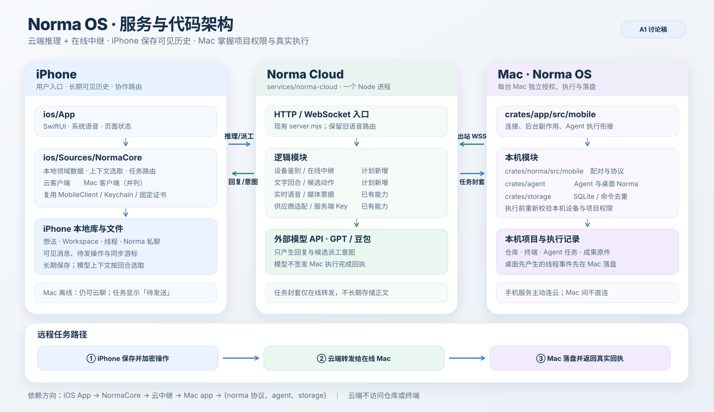
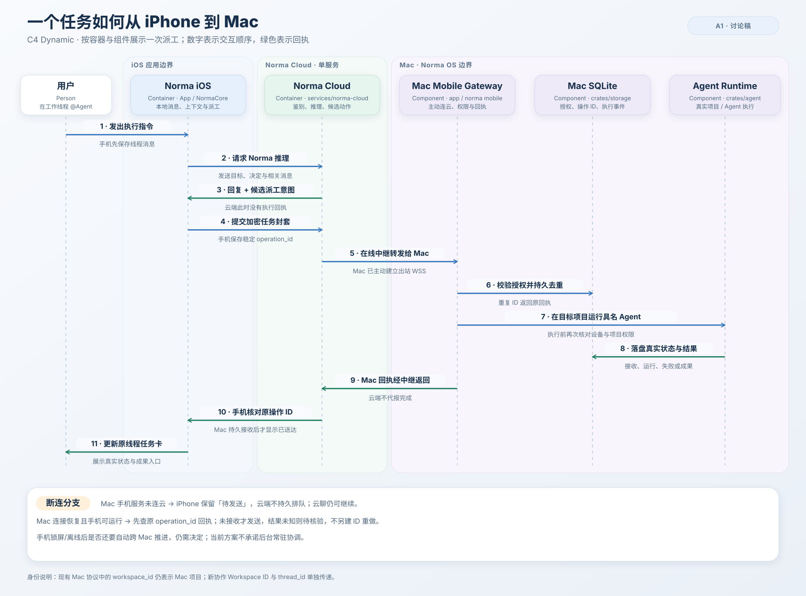

# A1｜Norma 云服务与跨端代码边界（讨论稿 v0.2）

状态：**A1 拓扑已确认：个人/受邀设备、跨网络即时派工、锁屏后不自动跨 Mac 接续、Mac 登录后后台接收任务** · 2026-09-28  
依据：[原生架构讨论稿](2026-09-28-norma-ios-native-architecture-proposal.md)、[Goal](../exec-plans/2026-09-28-norma-ios-ideas-workspaces-native-goal.md)、现有 [`services/norma-cloud`](../../services/norma-cloud/README.md)。

## 1. 已确认的产品事实与现有实现

- iPhone 上的 Norma 直接调用默认云服务；供应商 Key 只在服务端，Mac 关闭时仍可文字和实时语音聊天。用户不填写模型、Key 或服务地址，Mac 不签发云端通行证。
- 想法、Workspace、可见线程历史和 Norma 私聊长期存 iPhone。Mac 负责本机项目、Agent 执行及桌面先产生的事件；重连后与手机同步。云端不做换机恢复或 Mac 间同步。
- `services/norma-cloud`（原 `services/voice`）当前是一套已部署的 Node 22 语音服务：`/v1/session` 换媒体票据、`/v1/voice` 实时媒体、`/v1/tools` 通话中的 Mac 工具通道。现有手机凭 Mac 签发的 24 小时语音授权换票；没有独立手机鉴别和文字回合入口。单个自有服务器实例使用内存票据，当前同时只允许一通语音；旧 Vercel 入口另有 Redis 适配。
- Mac 已有本地 Norma：桌面交互仍由 `crates/agent` 的 `NormaSession` 支持。手机云端 Norma 与桌面 Norma 共享明确归属 Workspace/线程的**可见事件**，不共享模型私有推理状态，也不把旧项目聊天猜成新线程。

## 2. 建议的首版拓扑

**部署建议**：首版复用自有服务器上现有 Node 进程、Nginx 和 HTTPS 域名，在 `services/norma-cloud` 内增加文字、独立手机鉴别和远程中继。Mac 上启用的手机服务主动建立并维持到云端的出站连接；iPhone 在蜂窝网络也能经云端向在线 Mac 送任务。首版先由 iPhone 持久保存待发操作，云端只在在线连接间转发加密封套，Mac 的持久接收回执才算送达；云端不成为项目执行器或用户长期历史库。仓库目录改名不改变旧公网 `/norma/voice` 路径和线上 `norma-voice` systemd 单元；新接口基址及发布迁移在 S0 定稿。

**锁屏边界已确认**：Mac 在锁屏前已持久接收的任务继续执行；手机退到后台或锁屏后，不要求 Norma 自动把某台 Mac 的新结果接续派给下一台 Mac。需要手机作下一步协调时保留待处理状态，用户重新打开 App 后再核对原操作并继续，不把云中继扩成持久调度器。

**Mac 启动条件已确认**：用户在 Mac 启用手机服务后，Norma 随该用户登录自动在后台启动并连接云中继；无需先打开窗口。关闭最后一个窗口只解除视图，不停止手机服务或已接收任务；用户明确退出 Norma 时才停止服务并将 Mac 显示为离线。Mac 关机、休眠、未登录或失去网络时不能宣称任务已送达，手机保持待发送并按原操作 ID 恢复核对。开机登录后的后台接收、关窗继续、明确退出停止都纳入真实 App 验收。

## 3. 职责与数据归属

| 内容或动作 | 权威位置 | 其他端拿什么 |
|---|---|---|
| 想法、Norma 私聊、手机创建的 Workspace/线程及可见消息 | iPhone 本地库 | 云端按回合取得必要上下文；Mac 取得所属 Workspace/线程的同步副本。 |
| Mac 创建的线程、消息、Agent 任务、执行回执及成果原件 | 执行 Mac 的 SQLite/项目文件 | iPhone 按稳定事件 ID 和游标合并可见历史，成果原件在线按需读。 |
| Workspace 关联项目、参与 Agent、共同事实 | iPhone 维护并同步至相关 Mac；Mac 离线只能依据最近已同步副本工作 | 每份副本带来源、版本/时间，避免把旧副本显示成已全端同步。 |
| 云模型回复和模型提出的派工意图 | iPhone 收到后落入本地历史 | 模型意图只是候选操作，不等于 Mac 接收或完成。 |
| 供应商 Key、云端设备准入记录、配额计数 | 云服务 | iPhone 只持有自身短期或可撤销凭据；供应商 Key 永不到客户端。 |
| 在线 Mac 连接与远程任务封套 | 云服务仅转发并持有当前连接/短期内存状态 | 封套在 iPhone 创建、在 Mac 解开；Mac 持久接收后回真实回执。云端不持久保存任务正文。Mac 暂时断线或手机在得到回执前被挂起时，该操作仍由 iPhone 保持「待发送」。 |
| 模型上下文、语音媒体票据及短期通话状态 | 云服务内存/短期存储 | 不作为用户长期历史；进程重启可丢失，iPhone 持久记录可见内容。 |

云端不直接访问仓库、终端或 Mac 项目，也不代 Mac 签发执行完成回执。Mac 是每次真实执行及设备/项目授权的最后检查点。

## 4. 建议的代码模块与依赖方向

| 位置 | 建议职责 | 依赖规则 |
|---|---|---|
| `ios/App/` | SwiftUI 页面、导航、系统语音/音频生命周期和交互状态。 | 依赖 `NormaCore`；持久化、网络协议和任务去重不写进 View。 |
| `ios/Sources/NormaCore/` | 新增本地领域数据与存储、上下文选取、云客户端、协作路由；复用现有 `MobileClient`、Keychain 和 Mac 固定证书连接。 | 新协作派工经云端中继发往 Mac；现有直连仍服务配对和旧能力。网络适配器不直接驱动 UI；首版保持一个 Swift package target。 |
| `crates/norma/src/mobile/` | 现有配对/传输、协作协议数据类型与能力协商；新增端到端封套及稳定操作身份。 | 仍不依赖 GPUI、`app` 或 `storage`；旧 `workspace_id` 仍指 Mac 项目。 |
| `crates/app/src/mobile/` | Mac 网络连接、到云端的出站在线连接、运行时命令与 Agent 执行衔接。 | 中继收到的操作必须进入既有设备授权、命令去重和 Agent 执行路径；不做第二套执行器。 |
| `crates/storage/src/` | Mac 授权、命令去重、线程事件、同步游标与执行记录。 | 保持零 GPUI；网络处理不进入存储模块。 |
| `services/norma-cloud/` | 单个 Node 入口组合鉴别、文字回合、实时语音、在线 Mac 注册与远程封套转发。 | 文字/语音共用准入和配额；中继不解读项目任务或执行命令；旧路由保持兼容。 |

新任务的调用方向固定为 `iOS App → NormaCore → Norma Cloud 中继 → Mac app → {norma 协议，storage，agent}`；Mac 先主动连到云端，不开放公网入站端口。已有手机到 Mac 的直连用于扫码配对及旧能力。网络模型返回的工具调用始终按不可信输入处理：iPhone 校验操作身份与目标，Mac 再按本机最新授权、项目状态和已有操作回执校验。云端只转发封套，禁止 `云服务 → Mac 仓库/命令` 的执行直通路径。

云端的**代码落点**建议更具体地约束为：

| 模块 | 现状与首版改动 | 可以依赖 |
|---|---|---|
| `server.mjs` | 保留已上线的 HTTP/WSS 入口和旧语音路由；只组合新文字路由，不把文字业务继续塞进现有 540 行的语音实现。 | 鉴别模块、文字模块、既有语音实现。 |
| `voice-authorization.mjs` | 只验证旧 Mac 签名语音令牌，作为迁移兼容路径。 | Node 加密标准库；不负责新手机身份。 |
| 新设备准入模块 | 独立验证手机身份、撤销和配额，给文字与语音相同的设备主体。 | 持久准入记录与 Node 加密标准库；不读取对话。 |
| 新文字回合模块 | 校验回合输入上限、组织模型请求、流式返回文本和候选动作；不保存永久聊天记录。 | 已鉴别的设备主体、模型调用；不导入 Mac 执行代码。 |
| 新在线中继模块 | 鉴别 Mac 出站连接、维护在线目录、转发有大小/时间上限的加密任务封套及 Mac 回执。 | 设备准入、在线连接与短期内存；不读项目正文，不持久保存操作队列。 |
| `plan.mjs` 与模型调用 | 保留现有语音 ASR/Chat/TTS 适配；文字先复用可复用的上游请求能力，按实际 GPT/豆包差异放最少的适配代码。 | 供应商 HTTPS/WSS 与服务端 Key；不依赖设备准入或 Mac 项目协议。 |

这里的“新模块”指职责和导入方向，不预设每个职责都要建包或进程；真正增加文件时按可测试接口和现有代码量决定。

## 5. 三条关键流程

1. **文字对话**：iPhone 先存用户消息，选取目标、已确认决定、摘要与最近相关消息提交云端；云端鉴别、限额、调用模型，返回 Norma 文本及结构化候选动作；iPhone 存可见回复。仅有执行意图或有效 `@Agent` 才形成桌面操作。
2. **桌面派工**：iPhone 为候选动作生成稳定 `operation_id`，按 `(Mac ID, 项目 ID)` 找目标，并通过云端把加密封套发给该 Mac 的出站连接。Mac 以最新设备/项目授权校验并持久记录接收、运行与结果；持久接收回执经云端返还手机后才显示「已送达」。Mac 连接不可用时手机显示「待发送」；重连先按原 ID 查回执，结果未知时不盲目重做。云端回复或转发成功均不改变任务的真实执行状态。
3. **实时语音与桌面同步**：语音复用现有媒体通道，但新入口改用独立手机鉴别；语音可见转写/回复在 iPhone 落盘。桌面离线创建的线程和执行事件先存 Mac，iPhone 可经在线中继按游标拉取并去重；云服务不成为这些事件的长期权威库。

## 6. 云鉴别与容量：已确认的首版范围

**已确认：首版仅服务个人/少量受邀设备，不做云账户。** 手机可在设备内生成不可导出的身份密钥，服务端登记允许的设备公钥，按设备鉴别、撤销和限额；第一次登记由服务端受控准入完成，不能把供应商 Key 或全局管理口令塞进 App。用户使用时不填写配置，也不依赖 Mac；具体邀请/批准体验和密钥证明形式在 S0 定稿。仅靠 App Attest 证明是正版 App，并不能证明用户有权消费付费模型。

若首版就向所有下载者开放，需要另行设计规模化设备准入、滥用控制、额度/计费、设备恢复与服务端持久身份库；是否增加用户账户可单独决定，但不能直接沿用当前单人语音服务的“一个全局并发通话”限制。这会改变 A1 和 T5/T8 的范围。

首版运行容量按当前单实例实测确定：现有语音并发上限为 1，文字入口必须有独立超时、请求大小与配额限制，不能被一通语音锁住；受邀设备阶段先保持单实例。扩大到多人再按测量结果增加共享票据/租约存储与横向扩容，不提前复制 Vercel 的 Redis 方案。

## 7. 兼容与落地门槛

- 保留旧 `/v1/session`、`/v1/voice`、`/v1/tools` 和旧 Mac 签名授权，直到新版 iOS 文字/语音入口及旧通话记录迁移验收；新独立鉴别另加路径/版本，不偷改旧令牌语义。
- 新 iOS 与旧 Mac 可继续旧项目能力；协作线程派工必须经 `collaboration_v1` 能力协商。新 Mac 继续支持旧 iOS 协议。
- A1 确认后，S0 必须写清云端文字请求/流式事件、独立手机准入与撤销、上下文上限、派工意图格式、失败/断线状态、服务端升级与回退的可验收契约；随后才开始 T1–T9 编码。

## 8. 架构复核：进入 to-spec 前还要决定什么

| 优先级 | 发现的问题 | 需要确定的边界 |
|---|---|---|
| **已确认** | 现有手机只连接 QR 中的局域网/Tailscale 地址；人在外面、Mac 在家但在线时，也必须立即派工。 | 新协作任务经云端在线中继；Mac 登录后自动在后台运行已启用的手机服务并返回持久接收回执。明确退出 Norma 或 Mac 离线时保持待发送。 |
| **已确认** | iOS 退到后台或锁屏后，不能承担可靠的常驻跨 Mac 调度。 | 首版不要求锁屏后自动跨 Mac 接续；Mac 已接收的任务继续，下一台 Mac 的派工等手机恢复连接并核对状态。 |
| S0 契约 | iPhone 维护 Workspace 设置和事实，Mac 又能离线建线程并产生消息。若两端同时更新同一事实，仅有时间戳和事件 ID 不足以决定覆盖顺序。 | 规定字段写入者、离线变更是直接生效还是提议，以及冲突时的合并/人工处理规则。 |
| S0 契约 | 受邀设备的首次云端登记尚未给出用户体验；App Attest 只能证明 App 实例，不能独自充当付费服务授权。 | 设计服务端邀请/批准、撤销、丢机换机和配额错误；不得让手机配置供应商 Key，也不能要求 Mac 签发云通行证。 |
| S0 契约 | 仓库目录已改名，但公网仍是 `/norma/voice`，旧客户端和线上 systemd 使用旧路径。 | 新文字接口确定稳定基址、服务端先行发布和回退顺序；旧语音 URL 保持兼容。 |

手机仅本地保存想法和私聊意味着卸载 App 或丢失手机时不能完整恢复；这已在首版范围中明确，不再作为 A1 阻断项。任务字段、状态机、数据表、超时和验收案例应在 S0 细化，不必在 A1 逐一确认。

产品拓扑已定，可进入 S0 to-spec。T5/T6 还需在规格中定稿协议字段、Mac 登录启动与退出的恢复路径、超时和同步冲突规则；这些属于实施契约，不再阻断票据拆分。
