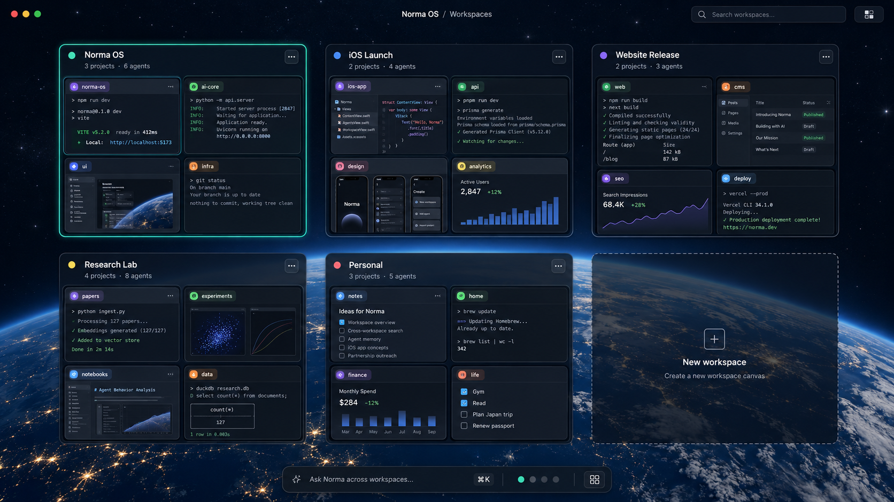
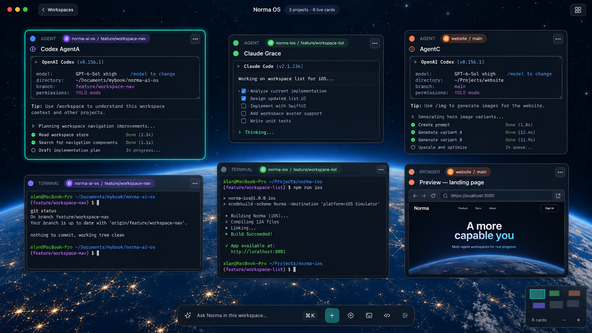
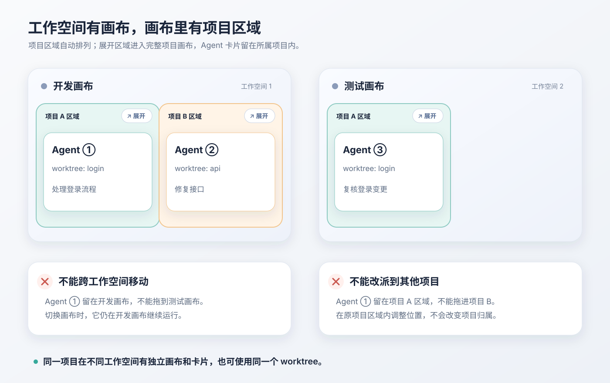
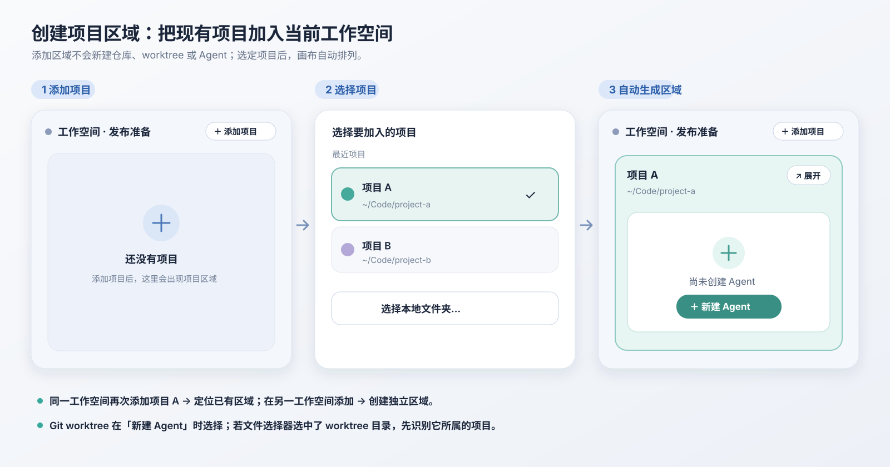
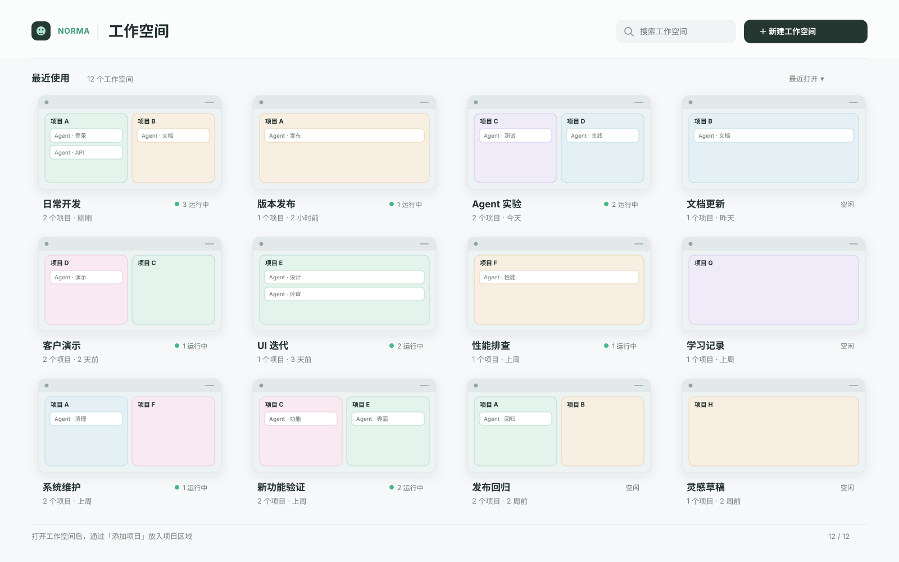

# 桌面多项目工作空间画布：交互原型

状态：交互方向已确认；实施以[桌面工作空间 SPEC](../product-specs/2026-09-29-SPEC-desktop-multi-project-workspaces.md)为准 · 2026-09-29。

## 范围

- 本次只设计和实现 macOS 桌面端的工作空间画布、跨项目卡片与切换交互。
- 桌面工作空间是本机画布的组织单位，使用独立身份；不要求与 iOS 协作 Workspace 共用 ID、配置或同步规则。
- 桌面 App 可在 iPhone 离线时创建、改名工作空间及调整关联项目。
- iOS 的页面、工作空间语义和现有手机协作协议保持现状。桌面画布通过现有项目运行实例操作 Agent，不把画布身份传给 iOS。
- 新桌面工作空间不兼容旧版单项目画布与卡片存档；不自动导入旧数据，也不主动删除旧文件。本地项目目录仍可重新加入新工作空间。

## 原型

前两张图片仅供视觉风格参考；工作空间、项目区域、卡片的最终关系以关系图、添加流程和下方已确认语义为准。

## 创建项目区域：交互草案

“添加项目区域”是把一个本地项目加入当前桌面工作空间；它不会新建仓库、Git worktree 或 Agent。

1. 在空工作空间的画布中央，或已有项目时的顶部工具栏，点击同一个「添加项目」入口。
2. 选择最近项目，或用系统文件选择器打开本地项目文件夹。若选中的是 Git worktree 目录，将它识别为所属项目，而不是创建独立的 worktree 项目区域。
3. 选定项目后，工作空间总览立即增加一个项目区域，并按固定规则自动重新排列。区域显示项目名称、路径与「展开」「新建 Agent」入口；此时不自动启动 Agent。
4. 点击「展开」，进入这个工作空间专属的项目画布。点击「新建 Agent」时再选择该 Agent 使用的 worktree；不同工作空间可选择同一个 worktree。
5. 若当前工作空间已包含该项目，「添加项目」只定位到已有区域，不创建重复区域；在其他工作空间添加同一项目，则创建独立的项目画布和卡片集合。

首版用点击添加和自动排版完成这条流程；不要求通过拖拽项目或卡片来创建区域。展开时从所点的项目区域过渡到完整画布，返回时回到原区域；减少动态效果设置下改为淡入淡出。

## 启动页改版：讨论草案

当前启动页以「Open Project」「Clone Repo」「Recent projects」作为主入口，实际点击最近项目会直接打开按项目根目录唯一化的窗口。这与桌面工作空间可包含多个项目、同一项目可处于多个工作空间的模型不符。

- 首页采用紧凑顶栏和画布缩略图网格；在 1600 × 1000 的草图里一屏显示 12 个工作空间，更多工作空间继续滚动。只保留搜索、新建和最近打开排序，缩略图下方显示名称、项目数、最近活动与运行状态。点击缩略图进入工作空间总览；空状态显示新建入口。
- 首页不展示「打开本地项目」「克隆仓库」操作。进入工作空间后，从「添加项目」选择最近项目、本地目录或克隆仓库，完成后直接创建当前工作空间的项目区域。
- `⌘O` / File → Open Project 在首页触发时，选定项目后还需指定目标工作空间；在工作空间内触发时，目标就是当前工作空间。菜单中的克隆命令若保留，也沿用相同的归属规则。
- 最近项目列表只作为「添加项目」选择器的数据源。首页缩略图先用静态画布快照与独立的实时状态标记，避免同时渲染多张实时画布。
- 按 Apple 的内容优先与空间一致性原则，预览直接显示项目区域及少量 Agent；名称和状态只出现一次。打开与返回沿同一缩略图位置过渡，缩略图、搜索和新建入口需有清楚的 hover、按下与键盘焦点反馈。
- 顶部导航显示「工作空间名 / 项目名」。展开项目区域与返回总览沿同一空间位置过渡，用户始终看得出当前在哪个工作空间、哪个项目。

## 其他受影响模块：代码核对

| 模块 | 当前行为 | 需要调整的桌面边界 |
| --- | --- | --- |
| [启动页](../../crates/app/src/workspace/launchpad/mod.rs)、[最近项目](../../crates/app/src/workspace/launchpad/recent.rs) | 直接打开项目，最近列表按路径列出 | 改为工作空间缩略图与新建入口；项目列表移入添加项目选择器 |
| [项目选择器](../../crates/app/src/workspace/project_picker.rs)、[克隆完成](../../crates/app/src/workspace/clone_project/controller.rs) | 选定目录或克隆完成便创建项目窗口 | 根据入口选择目标工作空间并创建项目区域；保留文件选择与 Git 克隆能力 |
| [窗口注册](../../crates/app/src/workspace/windowing.rs)、[项目会话](../../crates/app/src/workspace/sessions.rs) | 窗口按项目根目录唯一化，会话按现有项目 `workspace_id` 管理 | 当前窗口内切换桌面工作空间；同一项目在不同工作空间允许独立画布和运行会话，现有手机路由身份不改 |
| [打开流程](../../crates/app/src/workspace/flow.rs)、[画布渲染](../../crates/app/src/app/render.rs)、[顶部导航](../../crates/app/src/app/chrome/top_bar.rs) | 单个 `Runtime`、`Launchpad/Canvas` 两态、顶部只显示项目名 | 增加工作空间总览/项目展开视角；保留每张项目画布的 Runtime 输入路径，明确当前工作空间与项目 |
| [新建 Agent](../../crates/app/src/app/agent_actions.rs)、[Terminal](../../crates/app/src/app/mod.rs)、[Runtime](../../crates/runtime/src/runtime.rs) | 创建动作依赖当前单一 Canvas，Terminal 默认在 `workspace_root` 启动 | 总览中的动作要指向明确的项目区域；新建 Agent 时选 worktree，不能把输入路由到另一个项目 |
| [存储](../../crates/storage/src/migrations.rs)、[最近记录](../../crates/storage/src/recent_store.rs)、[持久化](../../crates/app/src/workspace/persistence.rs) | 最近的“workspace”实际是项目路径；每个项目数据库只有一份画布与会话快照 | 新增桌面工作空间与「工作空间 + 项目」画布实例身份；不导入旧桌面画布存档，也不主动删除旧文件 |
| [项目生命周期](../../crates/app/src/app/lifecycle.rs)、[Agent 路由](../../crates/app/src/workspace/norma_route.rs) | 关窗和主动退出会释放一个项目 Runtime；现有 `workspace_id` 绑定项目身份 | 收起项目画布、切换工作空间不得停止 Agent；关闭窗口、退出 App 才按既有策略处理对应实例，手机项目身份继续保留 |
| [菜单与快捷键](../../crates/app/src/menu_bar.rs)、[快捷键目录](../../crates/app/src/shortcuts/catalog.rs) | `Open Project` 与 `New Window` 都围绕项目启动页 | 增加新建/切换工作空间语义，并使添加项目入口在首页与工作空间内有明确目标 |
| 旧 e2e（已移除） | 当时断言打开项目后关闭首页并只剩一个项目窗口 | 用所属 crate 测试与真实 App 验收工作空间创建、添加项目区域、克隆后归属、同项目跨工作空间独立、重启恢复 |

改动限定桌面工作空间层；现有 iOS 页面、手机协议及以项目为身份的手机访问路由不纳入重构。由于桌面与手机目前共用一部分项目加载和生命周期代码，实施时仍需回归验证其现有行为。

## 已确认的交互语义

- 总览中的每个缩略图是一张完整画布，代表一个工作空间；点选后进入该画布。
- 工作空间画布自动把所关联的项目排列成固定区域；项目区域不能在总览中自由拖动或缩放。
- 每个项目区域展示该项目及其 Git worktree 的 Agent 卡片，可直接展开为完整的项目画布。
- 工作空间总览可以直接查看并操控多个项目的 Agent；展开项目区域后继续操作同一批卡片，不创建副本。
- 在总览中可直接阅读 Agent 状态与结果、回复待处理请求、发送简短指令；完整终端输出、长对话和卡片布局调整在展开后的项目画布中完成。
- 同一个项目可以关联多个工作空间；每个工作空间分别拥有该项目的画布、布局和 Agent 会话，项目仓库仍是同一个。
- 不同工作空间的 Agent 可以同时使用同一个 Git worktree；不因已有 Agent 使用而限制启动或要求二次确认。它们共享该 worktree 的文件变化，但卡片与会话各自独立。
- 卡片留在所属项目画布内；不支持跨项目移动，也不提供工作空间之间的卡片移动操作。
- 在项目画布内拖动卡片只改变布局，不改变它所属的项目。
- 工作空间切换应保留运行中的 Agent/PTY。卡片持续显示所属项目和 worktree，让用户知道操作会落在哪里。
- 桌面工作空间在当前窗口中切换；切换视图不停止其他工作空间正在运行的 Agent/PTY。
- 首版支持从当前工作空间移除项目区域；该区域的画布与卡片不再恢复，之后重新加入同一项目从空画布开始。本地项目、Git worktree 和其他工作空间里的同一项目区域不受影响。

## 补充确认的产品决策

- 当前桌面工作空间的统一 Norma 输入可在一次指令中向其中多个项目的 Agent 派工；目标不明确时先询问，不猜项目。
- 在工作台底部工具栏增加工作空间切换入口；从已经打开的工作空间通过可配置快捷键 `⌘⇧K` 打开同一个缩略图切换器，并在当前窗口完成切换。
- 支持删除整个桌面工作空间。若包含运行中的 Agent/PTY，删除前明确提示并在确认后结束该工作空间的任务；本地仓库、Git worktree 和其他工作空间不受影响。

## 当前代码的断点

- 现有 `workspace_id` 是按项目目录生成的身份，`WorkspaceWindowRegistry` 也按 canonical root 管窗口；它不能直接改成新工作空间 ID。
- `Runtime` 同时持有一张 `Document`、LiveNode 和单个 `workspace_root`。Agent/Terminal 默认从此 root 启动。
- 当前 `enter_workspace_for_path_with_source` 在打开下一个项目时调用 `runtime.kill_all()` 并替换唯一的 `Runtime`；桌面工作空间切换不能沿用这条销毁路径。
- `ProjectStore` 已将单项目画布、布局和会话检查点保存在该项目目录的 `.multisoul/project.sqlite`；新模型需要以桌面工作空间与项目的组合区分新画布实例，不导入旧桌面画布数据。
- `render_canvas` 和卡片输入目前读取一个 `MultisoulApp.runtime`；完整项目画布可沿用这条路径，工作空间总览需要组合多个项目的可见状态与展开入口。
- App 全局编排已有按项目身份路由的基础，可复用其明确目标和回执语义；画布节点 ID 仍只在原 Runtime 内唯一。

## 候选实现路径（待讨论）

1. 在桌面 App 级存储中建立工作空间目录及其关联项目的顺序；总览自动排版。项目仓库、Agent 定义和执行回执仍由各项目持有。桌面工作空间使用独立 ID；保留旧协议中 `workspace_id` 的项目含义。
2. 以「桌面工作空间 ID + 项目身份」标识一个独立项目画布及其运行会话。工作空间总览从这些实例获取预览与运行状态；展开区域时复用现有单项目画布的渲染和输入路径。
3. 先做一个可运行切片：工作空间 1 同时显示项目 A、B，工作空间 2 也显示项目 A；两个项目 A 画布有不同卡片。验证展开、输入路由、切换后 PTY 继续运行、重启恢复，以及卡片无法跨项目或跨工作空间移动。
4. 总览缩略图先用画布快照与独立的实时状态标记；当前画布完整实时渲染。切换时保留空间位置和可中断的放大/缩小反馈，减少动态效果设置下使用淡入淡出。
5. 新工作空间从空画布开始；用户重新添加本地项目。旧版单项目画布与卡片不迁移，旧存档文件留在原处。

## 首版边界

- 已启动的 Agent 保持原项目和 worktree；要换执行目标就在对应项目画布新建卡片。
- 移除运行中的项目区域时，先提示并在确认后结束该区域的 Agent/PTY；取消时保持区域、卡片和运行任务原样。
