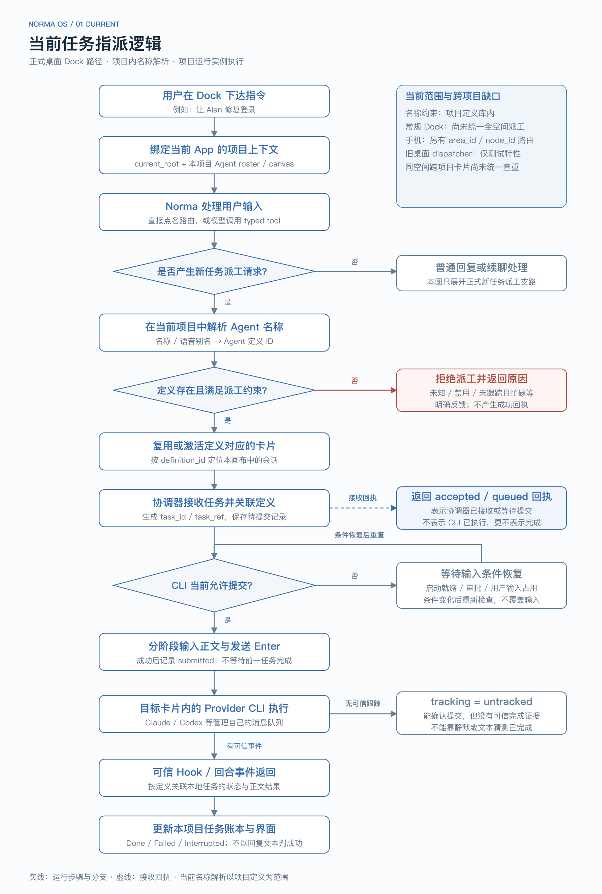
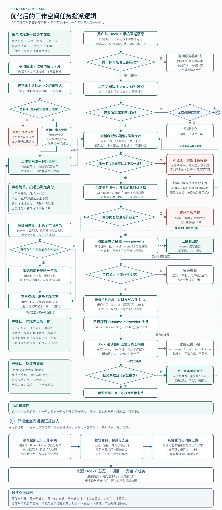

# 工作空间内任意项目的智能体卡片任务分派方案

创建日期：2026-10-09。更新日期：2026-10-10。状态：本轮核心派工与反馈规则已收敛；实施建议与后续范围另行标注，尚未修改 App。

正式规格已发布为 [GitHub Issue #96](https://github.com/multisoul-ai/Norma-AI-OS/issues/96)，标记 `ready-for-agent`；[本地规格副本](../product-specs/2026-10-10-workspace-agent-task-dispatch.md)记录用户故事、实现与测试合同。本设计稿保留讨论背景和流程图。

[浏览器方案演示](assets/workspace-agent-dispatch/show-me-workspace-dispatch.html)提供流程对比、名称解析场景与全空间进度快照示例；所有交互与数据均为本地演示，不向真实卡片派工。

已确认：Dock 中的 Norma 面向整个当前工作空间。展开项目提供上下文，具体卡片通过点名或选择确定。

已确认：同一工作空间内所有智能体的角色名称保持唯一，覆盖其全部项目区域；一个角色名称只对应一张卡片，卡片主名称与角色名称一致。多张卡片不能共用具名角色，再通过不同卡片别名区分；不同工作空间可以复用名称。

已确认：发现历史重名角色时，由系统自动改名，按固定顺序保留一个原名称，给其余角色分配唯一名称并显示变更记录；无需用户逐一选择谁改名。

已确认：角色彻底删除后，允许新角色复用其名称；新角色获得新的身份，旧任务与历史卡片引用仍绑定原角色，不转投同名新角色。

已确认：保留中文语音别名，例如 Alan 可以用“艾伦”点名。角色主名称与别名纳入同一个工作空间唯一呼叫范围，均只对应该角色的同一张卡片。

已确认：角色改名后，旧角色名称与旧语音别名失效，不再用于呼叫原角色；之后只使用新名称与对应别名，已有任务继续绑定原角色与卡片身份。

已确认：原角色仍存在时，改名前的旧主名称与旧语音别名保留失效占用，其他角色不能复用；连续改名的历次旧称呼遵守同一规则。角色彻底删除成功后，才释放当前称呼与属于该角色的历史失效占用，旧任务仍不转投同名新角色。

已确认：点名角色不存在或称呼已失效时，保留任务内容，提示用户选择有效的已有卡片；目标补全前不接收或投递任务，不自动创建角色，也不猜测替代目标。

已确认：忙碌卡片的新任务沿用现有 CLI 消息队列，不增加等待上一任务结束后才提交的调度规则；明确区分已接收、等待提交、已提交与正在执行，实际开始时机由 CLI 管理。

已确认：仅指定项目且派工意图明确时，汇总该项目在当前空间全部画布、后台与未加载区域的有效候选卡片；只有一张则自动选中，多张则由用户选择，没有则保留任务并提示补全，不自动创建。选中后绑定稳定身份并再次校验，不按当前焦点猜目标。

已确认：来源工作空间的 Dock 对话逐项更新任务进度，完成或失败后显示摘要与结果入口；用户点击后才打开目标卡片，不自动跳转或抢焦点。明确失败由用户点击安全重试，状态未知先核对，不自动重发；多目标中的成功项不重复提交。

用户新增要求：Norma 能主动汇报整个当前工作空间的进度，包含各项目的工作、成果与需要处理的事项。下文补充只读查询合同与验收；最近 24 小时成果窗口等默认值为本轮实施建议，不标作此前已确认决定。

建议将 Norma 的跨项目协调范围提升到桌面工作空间，按明确的项目区域和卡片身份派工，继续由各项目运行实例负责实际提交、会话与任务结果。桌面 Dock、手机群聊以及后续语音入口共用分派模块。首先打通指定现有卡片的完整闭环，再扩展按能力自动选人、创建卡片与任务依赖。

“任意项目”包括当前工作空间中没有展开、位于屏幕外、尚未加载的项目区域；“任意卡片”包括已注册 Agent 定义的卡片和普通 Coding Agent 卡片。已删除卡片、失效目录与不支持跟踪的 Provider 必须返回明确状态，不能换一个目标继续执行。

## 当前实现与可复用能力

| 现状 | 对方案的影响 | 源码或规格 |
| --- | --- | --- |
| `DesktopWorkspace` 包含多个 `DesktopProjectArea`；区域保存实际 root 与仓库 project_key | 工作空间组织执行范围，区域定位实际画布与目录 | [desktop_workspace_store.rs](../../crates/storage/src/desktop_workspace_store.rs) |
| 同一目录可以创建多张独立区域画布；migration 已移除旧项目唯一性约束 | 不能以项目名、仓库路径或 project_key 唯一定位目标 | [desktop migration](../../crates/storage/src/migrations/desktop.rs)、[实例测试](../../crates/storage/tests/desktop_project_instances.rs) |
| 宿主按 `(desktop_workspace_id, area_id)` 保留项目会话 | 切换视图不必切换执行目标，可向后台区域派工 | [desktop.rs](../../crates/app/src/workspace/desktop.rs)、[session resolver](../../crates/app/src/workspace/desktop/mobile.rs) |
| 桌面区域注册的 CLI workspace_id 为 `desktop:{workspace_id}:{area_id}` | 已有区域隔离路由可复用；它不等于桌面工作空间 ID | [PreparedProject::load_for_desktop](../../crates/app/src/app/background_project.rs) |
| 定义库按 project_key 共享；画布、会话、任务存储按工作空间与区域隔离 | 现行 Agent 定义保存具名身份与配置；新的空间级角色名称必须与具体卡片唯一对应 | [project_store.rs](../../crates/storage/src/project_store.rs) |
| 常规 Dock 调用 `submit_project_agent`，注入单项目 roster 与 canvas | 总览与展开项目中的 Norma 尚未统一为工作空间协调入口 | [Dock 对话](../../crates/app/src/app/command_dock/conversation.rs)、[submit.rs](../../crates/app/src/app/agent_runtime/submit.rs)、[Dock 宿主](../../crates/app/src/workspace/desktop/shell.rs) |
| 旧桌面跨项目 dispatcher 只在 `e2e-test-support` 特性下编译，按名称拆句后直接输入卡片 | 这是历史基础，不能作为正式任务分派闭环；文本输入成功也不代表任务完成 | [模块条件](../../crates/app/src/workspace/desktop.rs)、[dispatcher](../../crates/app/src/workspace/desktop/dispatch.rs)、[纯路由](../../crates/runtime/src/desktop_dispatch.rs) |
| 手机路径已有工作空间级 Norma，工具以 `area_id/node_id` 寻址，再校验卡片 run/session | 可提取跨入口共享模块；当前实现仍绑定手机来源、授权和事件格式 | [workspace Norma](../../crates/app/src/app/agent_runtime/workspace.rs)、[精确执行](../../crates/app/src/mobile/workspace_live.rs) |
| 手机目录会跳过没有 definition_id 的卡片；协调器 roster 为每个定义只投影一个 active_node_id | 当前模块还不能完整支持任意卡片，需要实例级调度接口 | [catalog](../../crates/app/src/mobile/workspace_live/catalog.rs)、[roster](../../crates/app/src/app/agent_runtime/coordination.rs)、[协调器](../../crates/agent/src/coordination.rs) |
| 已有本地任务账本、全局路由幂等和手机操作事件 | 复用其机制，明确每种记录的权威职责，避免重复维护执行状态 | [任务账本](../../crates/storage/src/agent_dispatch_store.rs)、[全局路由](../../crates/storage/src/orchestration_task_route_store.rs)、[群聊事件](../../crates/storage/src/workspace_chat_store.rs) |
| 手机已有只读活动汇总和审批事实；当前 live capture 只列已加载且有关联定义的卡片 | 复用事实和授权边界，补齐未加载、无定义卡片及来源 Dock 汇报，不能直接把局部活动称为全空间进度 | [活动汇总](../../crates/app/src/mobile/activity/overview.rs)、[live capture](../../crates/app/src/mobile/workspace_live/activity.rs)、[授权测试](../../crates/app/tests/unit/workspace_activity_api_tests.rs) |
| Runtime 已有按可信会话／回合事件生成的任务步骤与有界工作摘要；步骤事件有缺口时不提供分母 | 汇报复用观察事实，区分步骤、任务和成果，不生成虚构的完成比例 | [任务步骤](../../crates/runtime/src/runtime/mobile_cards/progress.rs)、[工作摘要](../../crates/runtime/src/runtime/mobile_cards/summary.rs) |
| 当前 Agent 名称校验与查重作用于项目定义库；英文名称忽略大小写，预设语音别名参与冲突校验 | 新规则需将卡片命名查重提升至整个工作空间，不能只复用某个项目的查重结果 | [AgentName](../../crates/agent/src/identity.rs)、[定义存储](../../crates/storage/src/agent_definition_store.rs) |

9 月 29 日规格曾假设同一工作空间内同一项目只有一个区域，当前源码与实例测试已支持多画布，分派应按当前实例模型设计。10 月 5 日[手机群聊计划](../exec-plans/2026-10-05-mobile-workspace-chat.md)已明确两端共用桌面工作空间、项目区域和卡片，不能继续按旧手机独立 Workspace 方案设计。

## 产品范围与使用方式

推荐保留现有 Dock 作为工作空间级 Norma 的主要入口。在工作空间总览和展开项目中，Norma 都能发现该空间的全部项目与卡片；展开项目只提供用户正在看的上下文。卡片内部输入继续属于该卡片会话。首页没有选定工作空间时，可以讨论，但执行前必须明确目标空间。

| 用户表达 | 推荐行为 |
| --- | --- |
| `让 Web 项目的 Alan 修复登录按钮，并补回归测试` | 定位 Web 的具体区域与 Alan 卡片，建立正式任务并返回真实接收状态 |
| `@Betty 检查接口兼容性` | 在当前工作空间按唯一名称定位 Betty；项目与画布作为上下文显示，无需用户补齐目标路径 |
| `@Alan 修复登录` | 在当前工作空间按唯一名称定位 Alan，并绑定具体卡片身份；其他项目不得再有第二张名为 Alan 的卡片 |
| `让艾伦修复登录` | 将已登记的中文语音别名“艾伦”解析为 Alan 的同一卡片，再按稳定卡片身份派工 |
| `帮 Web 项目修复登录` | 项目明确且只有一张有效候选卡片时自动选中；多张时选择，零候选时保留任务并提示补全。计数包含该项目在当前空间的后台与未加载区域 |
| `让 Web 的 Alan 修前端，同时让 API 的 Betty 补测试` | 一条来源消息产生两条独立 assignment，分别显示状态与结果 |
| `登录怎么改比较好` | 与 Norma 讨论，不创建任务 |
| `汇报整个工作空间的进度` | 只读查询当前空间全部项目、区域与已知任务，返回总体概况、逐项目进展、成果及需要处理的事项，注明范围与更新时间 |
| `现在有哪些任务卡住了` | 从同一事实快照列出等待原因、失败／中断与待核对事项，不猜业务阻塞原因，不自动审批、催办或重试 |
| `今天 API 项目做了什么` | 明确项目与时间范围后查询已有成果与任务证据，不向卡片新增“报进度”任务 |
| `继续刚才的任务，兼容旧接口` | 若任务引用明确，向同一任务的卡片续聊；多候选时补充目标 |
| `让 Alan 做`，当前空间没有名为 Alan 的卡片 | 保留任务内容，提示目标不存在并选择有效的已有卡片；选定后重新校验再派工，不按其他空间、共享定义或相似名字找替代会话 |

明确任务与目标后直接分派，回执在发送后出现。目标澄清只补足缺失信息，不增加普遍的执行确认步骤。执行意图应由系统记录为明确类型，讨论模式必须在工具执行端禁止派工，不能只依赖提示词。

## 工作空间内角色名称唯一

本方案的“角色名称”是可点名的智能体名称，例如 Alan、Betty，也是卡片显示的主名称。“前端开发”“测试”等职责描述，以及 Provider、模型和技能配置可以相同，但不会成为多个智能体共用的投递名称。

唯一性的范围是整个 DesktopWorkspace，不是单个项目、画布或当前已加载会话。后台、收起、未加载、停用但仍保留的卡片都需要占用其名称；否则切换视图或加载旧画布时会重新出现冲突。

已确认的约束与建议落地方式分开记录：

| 项目 | 规则或建议 |
| --- | --- |
| 已确认的核心约束 | 同一空间的角色名称唯一，一个名称对应一张卡片；具名角色不能由多张卡片共用。冲突不能留到派工时再让用户选择项目 |
| 已确认的名称关系 | 卡片主名称就是角色名称，创建第二张卡片必须使用另一个角色名称，不能只改卡片别名绕过角色名称唯一 |
| 推荐的名称比较 | 输入先去掉首尾空白，复用现有 AgentName 格式与 match_key；Alan、alan、ALAN 视为同名。Norma 保持保留身份 |
| 已确认的语音别名规则 | 保留中文语音别名，它是同一角色的另一种称呼；主名称与别名共用工作空间唯一呼叫键登记，主名称对主名称、主名称对别名、别名对别名均不能跨角色冲突 |
| 创建与改名 | 在提交前检查整个空间的有效称呼与失效占用，提交时用持久唯一约束兜底；手动指定重名或其他角色的旧称呼时明确指出占用原因，拒绝提交并保留输入 |
| 自动分配名称 | 默认名称从整个空间的未使用合法名称中选择，沿用现有名称池与后备名生成，跳过有效称呼与失效占用，不能只查看当前项目 |
| 并发创建 | 桌面与手机同时申请同名时只能一项成功；失败项返回冲突，不能出现两张已成功的同名卡片 |
| 已确认的旧数据处理 | 汇总全部区域的持久角色与卡片，系统自动修复重名；按固定顺序保留一个原名称，其他角色获得唯一名称，并记录变更。登记完成前不按冲突名称派工 |
| 改名后的已接收任务 | 继续绑定原卡片身份；记录派工时名称与当前名称，不因改名重新寻找目标 |
| 已确认的删除后名称复用 | 角色彻底删除成功后释放当前称呼与所属的历史失效占用，新角色可以复用，但必须获得新身份；原角色的任务与历史卡片引用不转投新角色 |
| 已确认的改名后寻址 | 改名生效时，旧主名称与旧语音别名不再指向该角色；仅新名称及对应别名有效，已有任务的目标身份不变 |
| 已确认的旧称呼占用 | 角色仍保留时占用当前称呼与历次改名产生的旧主名称／旧语音别名；旧称呼不寻址且禁止其他角色复用。关闭会话、收起或停用不等于彻底删除 |

建议在 app 级数据库建立工作空间角色名称登记，保存规范化角色名称到具体区域／卡片的绑定，同时保证一个卡片身份只绑定一个主角色名称；卡片主名称从这项登记投影，不能独立写入另一个名称。主名称与中文语音别名共同写入唯一呼叫键索引，以 `(desktop_workspace_id, call_key)` 持久唯一约束仲裁；记录所属角色及有效／失效占用状态，失效占用也参与唯一约束，但只允许有效键寻址。创建、改名、自动分配时同时检查完整呼叫键集合，不能只保证英文主名称可用。内存点名目录只投影有效称呼，失效占用用于冲突检查与无有效目标的解释，不靠扫描当前屏幕或所有 PTY 临时去重。命名属于低频操作，查库与提交放后台。

沿用现有内置名称与中文语音别名对应关系。目录以主名称展示卡片，附语音别名供查看；直接点名时仅按当前空间已登记的主名称或别名精确解析。未知或识别错误的称呼返回目标不明，不能通过模糊匹配换一个角色派工。角色改名后旧别名不再保留为有效称呼；自定义别名的编辑范围继续讨论。

已确认名称属于具名角色，卡片使用该角色名称；撤回“保留同一个具名角色定义，只给多张卡片设置不同别名”的建议。需要同职责的第二个智能体时，建立不同名称的角色并绑定新卡片；若沿用现有具名 AgentDefinition 表达角色身份，就需要另一具名定义，同一定义在同一工作空间不能同时绑定多张卡片。没有 definition_id 的现有卡片也必须登记独立角色名称后才能进入空间派工目录。

当前定义库按项目共享，实施时需要将空间角色名称登记与项目定义适配，保留共同配置的复用能力，但不共享可寻址的具名角色身份。角色改名必须同时更新其卡片主名称与空间登记，不能通过修改共享定义隐式改名其他工作空间的角色。

### 旧重名角色自动改名

自动改名已确认，具体执行规则建议如下：

1. 在后台读取整个空间的持久角色与卡片，包括未加载区域、中文语音别名与历史失效占用；主名称与别名的跨角色碰撞都作为命名冲突。先预留已有合法登记与无冲突角色的完整呼叫键，避免给重名角色分配到另一张卡片正在使用或保留的名称／别名。
2. 重名组按稳定的区域与卡片身份排序，固定保留一张卡片的原名称；其余卡片依次从全空间未使用的合法名称池和后备名中取得新名称，新主名称及其预设中文别名作为一组检查与登记。不使用当前展开项目、加载先后或随机顺序决定谁保留名称。
3. 在空间角色登记中保存每张卡片的原名称、新名称及固定身份，并更新卡片主名称。若历史多张卡片共用了同一具名定义，需适配为各自独立的空间角色绑定，不能仅改显示别名，也不能改名其他空间的角色。
4. 名称登记与变更记录以可重试的事务保存；迁移失败时保持未完成状态，重启从已保存映射继续，不重复为同一卡片分配新名称。登记完成后才开放该组名称的新点名派工。
5. 已接收任务、历史回执和结构化提及继续绑定原卡片身份，不因名称变化重发任务或重新选卡片。旧记录若只有重名文本、缺少可核验的目标身份，则标为待核对，不自动迁移到保留原名称的卡片。
6. 向用户显示项目、卡片、原名称与新名称的变更记录，供核对与后续手动改名；旧重名不能作为多张卡片共同的语音别名或派工地址。

历史重名修复中，共享旧呼叫键只登记给固定保留者；其他角色的同名历史只保存在变更记录中，不重复建立失效占用，不覆盖保留者的有效登记。已形成唯一合法登记之后的改名，才将该角色拥有的旧呼叫键转为失效占用。

例如，Web 与 API 各有一张 Alan，若固定顺序决定 Web 保留 Alan，且 Bella 未被占用，则 API 自动改名为 Bella。此后新指令“让 Alan 做”命中 Web，“让 Bella 做”命中 API；API 已有任务和带卡片身份的历史引用仍关联原卡片。

### 删除后复用角色名称

允许复用已确认。名称唯一约束适用于当前仍保留的角色，不要求所有历史记录中的名称永远不同。

角色彻底删除成功后，空间中的当前主名称、语音别名与属于该角色的历次旧称呼失效占用一同解除；仅关闭会话、收起卡片或停用角色而保留身份时，它们继续被占用。实施时建议将呼叫键占用与历史身份记录分开维护，删除生效与全部所属呼叫键释放在同一事务中完成，避免尚未删除成功就创建同名角色。变更历史与任务记录不因释放占用而转移归属。

新角色可以再次叫 Alan，但必须使用新的角色／卡片身份。新发起的“让 Alan 做”按当前名称登记找到新角色；原任务、重试、历史结构化提及与迟到事件仍校验原身份，原角色已删除时返回目标失效或显示历史记录，不能再次按名称查找后投给新 Alan。历史中只有名称的文本不得自动升级为指向新角色的结构化引用；需要新派工时按新的明确操作处理。

### 改名后旧称呼失效

旧称呼失效并禁止其他角色复用已确认。例如 Alan／艾伦 改为 Bella／贝拉 后，新指令只通过 Bella／贝拉定位原卡片，Alan／艾伦不再作为它的别名。原角色仍存在时，其他卡片不能申请 Alan 主名称、艾伦主名称或相同语音别名；旧称呼保留失效占用与名称变更历史，但不参与当前寻址。

实施时建议在同一事务中登记新主名称与对应语音别名，并将旧呼叫键从有效改为失效占用，保留所属角色身份；新呼叫键冲突时整个改名失败，原名称与别名继续有效。事务提交后同步更新卡片标题、点名目录与语音名称提示，避免其中一端继续提供已经失效的称呼。连续改名保留该角色历次失效占用，重启或后台恢复不得清空这部分登记。

已接受任务及带稳定身份的结构化引用仍归原卡片，改名不重发任务。仅包含旧名称、尚未绑定卡片身份的新输入不能依赖名称变更历史猜测目标；当前空间无有效匹配时说明称呼已失效，保留任务并等待目标补全。原角色彻底删除后才释放所属旧称呼，新角色复用仍使用新身份；旧任务和历史引用不转投新角色。

### 目标不存在时补全卡片

采用提示并选择已有卡片的推荐方案已确认。输入中的名称或语音别名没有当前有效匹配时，保留任务正文和来源，显示未找到的称呼，并提供当前空间内有效卡片供用户选择；名称已失效也走这条路径，不根据历史名称自动恢复原角色。

此时操作处于目标待补全状态，不能返回 accepted／submitted 回执，也不能写入任何卡片。用户明确选择有效卡片后，将该选择转为稳定卡片引用，重新执行空间归属、可用状态与会话校验，再接收和投递原任务。选择过程中再次改名、删除或重建会话时仍以具体身份复核，不因显示名称变化换卡片。

明确要求“创建角色并派工”属于另一类操作，需要有新建意图与目标项目；当前指定已有卡片的路径不因缺失名称隐式开启创建流程。

### 仅指定项目时选择卡片

采用唯一候选自动选中、多候选由用户选择的规则已确认。只有在派工意图和目标项目都明确时才进入这条路径；项目只是参考上下文、项目名称存在歧义或任务指代不清时，先补全意图与范围。

候选范围是该项目在来源工作空间内的全部区域，包含未展开、后台与未加载画布，不能只统计当前画布或已加载会话。有效候选需有已登记的唯一角色名称、仍存在且启用、符合入口授权并支持本次派工；忙碌或未加载本身不排除候选。持久目录尚不完整时，先完成查询，不能把暂时只看到一张卡片当成唯一候选；查询不启动所有项目的 PTY。

| 有效候选数量 | 运行逻辑 |
| --- | --- |
| 0 | 保留任务正文与项目范围，提示补全有效目标；零任务接收、零投递，不自动创建或改投其他项目 |
| 1 | 自动选中并显示目标角色及项目／画布上下文，绑定稳定卡片身份，再走统一加载、复核与接收流程 |
| 多张 | 展示该项目候选，由用户选择；选择前零任务接收、零投递，不按焦点、最近使用或能力评分猜目标 |

自动选中只是确定目标，不表示任务已接收。绑定之后发生删除、停用或会话替换时，按失效目标处理，不能重新计数后悄悄换另一张卡片。用户明确点名不存在或失效角色时仍走目标补全，不能因为指定项目只剩一张卡片而自动替代该称呼。

## 目标身份与目录

```text
DesktopWorkspace                         工作空间协调与消息归属
  ├─ DesktopProjectArea A                画布实例、实际目录、独立 Runtime
  │    ├─ AgentCard Alan                 卡片实例、Provider 会话、任务
  │    └─ AgentCard Betty
  └─ DesktopProjectArea B
       └─ AgentCard Bella                独立具名角色，名称不可与 Alan 共用

Project / AgentDefinition                现行项目元数据与具名定义
                                        同空间具名角色与卡片唯一对应
Provider / 模型 / 技能配置                可以复用，不构成共同投递身份
```

跨项目目标应以组合身份表达：

| 字段 | 用途 |
| --- | --- |
| desktop_workspace_id、area_id、node_id | 定位工作空间中的具体画布和卡片；node_id 只在该画布内有意义 |
| card_instance_id | 建议新增持久卡片身份，区分删除后重建与恢复同一卡片，避免数字 ID 再用造成误投 |
| definition_id，可空 | 关联角色与配置；不作为卡片唯一身份，不为派工自动新建定义 |
| workspace_route_id | 当前运行实例的路由代次，拒绝迟到请求命中新的 Runtime |
| run_id、session_id，可空 | Provider 会话指纹；尚未启动的卡片可暂缺，已绑定会话不得静默替换 |
| task_ref，可空；turn_id 在接收后绑定 | 续聊、取消与结果的精确关联；不能使用另一任务或上一轮的结果 |

智能体角色名称是用户在工作空间内点名寻址的主名称，也是卡片主名称，名称解析后绑定稳定卡片身份。project_key、root、cwd、卡片位置与职责描述提供上下文，不作为卡片的投递身份。cwd 来自目标卡片已有执行配置；既有卡片不会因为当前展开项目或区域默认目录变化而改变 cwd。

目录向用户以唯一角色名称作为主要标识，卡片标题使用相同名称，项目／画布／实际目录作为次要上下文。目录向模型同时返回角色名称与系统生成的 `target_ref`，对应完整目标快照；模型不能提供任意路径作为执行地址。`target_ref` 是快照引用，不代替入口授权，过期后需要重新解析和校验。

未加载区域从保存的画布快照提供候选，并标注状态。选定后只加载所需区域，再校验持久卡片身份与运行指纹。目录查询、普通讨论不应为获得名单而启动全部项目的 PTY。

## 分派模块的接口与职责

建议提取一个跨入口的工作空间分派模块，隐藏目标校验、加载、幂等、提交和结果关联的细节。调用方只需目录、提交、查询、取消四类接口；提交包含 Assign 或 Reply 意图，查询包括具体操作／任务结果与全空间进度快照。

```text
桌面 Dock / 手机群聊 / 后续语音
             │  捕获空间、来源消息、操作身份与执行意图
             ▼
工作空间 Norma 或结构化 @ 目标
             │  产出目标明确的 assignment
             ▼
纯路由与计划校验 → 需要澄清时返回候选
             │
             ▼
工作空间分派模块
  目标复核 → 操作预留 → 卡片实例调度 → 接收回执
             │                         │
             ▼                         ▼
目标区域 Runtime / Agent CLI      工作空间操作与事件
             │                         ▲
             └─ Hook / Turn / Task ─────┘
```

| 位置 | 推荐职责 |
| --- | --- |
| `norma::protocol` | 入口无关的目标、意图、请求和回执 DTO；从 mobile 专用类型中提取共享部分，旧协议由 Adapter 保持兼容 |
| `agent` | 工作空间上下文、typed tools、实例级任务协调；不依赖 app、runtime、storage 或 GPUI |
| `runtime::workspace_dispatch` | 纯函数表达目标解析、澄清、范围校验和计划结果；不做 IO，不调用模型或写库 |
| `app` 的工作空间分派目录 | GPUI Adapter、异步加载、入口授权、提交副作用、事件回流；从 mobile 模块提取通用实现 |
| `storage` | 操作预留、assignment 与任务引用映射、持久回执和结果快照 |

模型工具建议增加工作空间专用的列举、派工、回复、任务查询、全空间进度查询和取消工具，派工与回复接受 `target_ref`。全空间进度查询无需点名角色，进入只读工具合同，不通过派工接口获取状态。保留现有单项目 `assign_agent_task(agent, task)` 语义，由兼容 Adapter 处理。不要把字符串 `agent` 同时解释为名称、路径和复合地址。

工作空间级 Norma 会话按 `(app_database, desktop_workspace_id)` 隔离对话，使用同一 Mac 的人格、模型与个人记忆。每轮注入有界的项目／卡片目录；所需项目记忆按 area_id 读取，避免把全部仓库正文和终端输出塞进提示词。展开画布的选中、聚焦只作为标明来源的观察信息，不能覆盖已解析目标。

目前 `submit_workspace_turn` 的 Scope 含 device/token，且通过 `@mobile-turn:` 从文本提取来源。共享模块应把来源放入 typed ToolContext，把桌面和手机鉴权放在各自 Adapter，不能为桌面伪造手机设备或 token。手机的配对与项目权限继续有效。

## 从消息到实际执行

先识别普通讨论、进度查询或派工／续聊意图。进度查询直接进入下述只读汇报流程；不能因为说了“汇报”就给所有角色创建任务。以下步骤只展开执行路径。

1. 发送时捕获工作空间 ID、来源消息 ID 和 operation_id。用户之后切换工作空间，不改变这条操作的归属。
2. 有结构化提及时直接取得卡片引用；自然语言点名在当前空间的唯一角色名称登记中精确解析，再绑定唯一卡片身份。未知或失效称呼提示目标不存在，保留任务并等待用户选择有效的已有卡片，选定后重新校验；旧冲突数据返回角色名称待修复，不按项目选择一个同名角色。若用户明确限定目标项目，而该名称对应卡片属于另一项目，返回目标上下文不匹配，不静默改变目标。仅指定明确项目时，统计其在当前空间全部区域的有效候选：唯一则自动选中，多张则选择，零候选则保留任务并提示补全。无法确定具体目标或任务指代不清时才澄清。“读取 API 项目的接口后修改 Web”不能把提到的两个项目都当执行目标。
3. 为计划生成并持久保存 assignment_id。每项包含完整任务正文、目标、必要上下文与来源；“同时”不是可靠的通用任务拆分语法。
4. 复核区域仍在该空间、卡片仍存在、目录可用、Provider 可提交、会话未被替换。未加载目标异步准备；已删除目标不能靠创建同名卡片修复。
5. 在后台事务中预留 assignment 操作，随后回到前台重验运行目标，再进入卡片调度。持久化等待期间发生移除、停用或会话重建时，拒绝该项。
6. 卡片调度复用输入占用、审批等待、粘贴与 Enter 分阶段提交规则。首次接受、等待提交、真正已提交和终态分别发出事件。
7. 接收后绑定 local task_ref；有 Provider 接收证据时补 run/session/turn。任务终态与回复正文回到原工作空间，点回执才导航到目标卡片。

多目标先预检整个计划，并依 [ADR 0016](../adr/0016-atomically-accept-multi-agent-delegations-before-delivery.md)原子接收 assignments，再独立投递并逐项回执；接收不表示卡片已提交。目标缺失、旧名称冲突或任务指代不清时不接收整组。进入投递后仍可能发生部分成功，已提交动作不能事务回滚。重试只处理明确未发生副作用的失败项；不确定项先核对账本。

## 主动汇报整个工作空间进度

这是用户主动发起的全空间查询，与派工后的逐项回执共用任务事实。默认固定发送时的当前工作空间，展开项目、当前消息批次或 Dock 派工来源都不缩小范围。项目、区域、卡片与任务逐层聚合，同目录多区域仍保留独立身份；停用或未完成命名登记的卡片不能仅因不具备派工资格就从汇报中消失。

### 汇报内容与默认口径

| 层级 | 汇报内容 | 口径 |
| --- | --- | --- |
| 空间总体 | 覆盖项目／区域、角色／卡片数量，已知任务状态分布，待处理事项与缺失范围 | 卡片、任务、内部步骤分别计数；不能只统计已加载或首屏项目 |
| 项目进度 | 当前工作、已知成果、等待原因、失败／中断与未知事项 | 全部当前未结束任务均纳入，不因创建时间早而过滤；历史异常附发生时间，不直接声称仍为业务阻塞 |
| 角色／任务 | 当前唯一名称、项目／画布、任务摘要、阶段、观察时间与结果入口 | 以持久卡片和任务身份归属；改名更新展示，不与后来同名角色合并 |
| 近期成果 | 有证据的已知终态及已有结果摘要 | 建议默认最近 24 小时，并在回复注明窗口；用户可指定“今天”“本周”等范围。成果数不与当前任务状态分布相加 |
| 用户处理事项 | 等待审批或输入、失败原因、需要核对的状态及已有入口 | 只报告已有依据，附时间；不自动审批、重试、取消或催办，不新增异常解决状态 |

没有可靠完整计划时只汇报状态、阶段和成果，不生成百分比。已有可信步骤计划可展示“完成 2／5 步”，注明它属于哪项任务；事件缺口时隐藏分母。步骤完成不等于任务终态，任务终态也不等于整个项目通过验收；多个任务的比例不能平均为项目或空间完成率。

“今天”“本周”等未明确时区的时间条件，建议按 Mac 本地时区解释，回显具体起止与时区；默认最近 24 小时是查询时点向前的时间窗口。每个任务只列一个可证实的最后状态及观察时间，无法确认阶段时单列未知；跟踪不足、过时或待核对标记不重复加入任务总数。状态冲突无法按同任务证据解释时保留待核对，旧会话的新落盘时间不能覆盖可信终态。

直接在卡片中输入的工作，只要已有可信任务或回合证据，也必须可见。不能关联逻辑任务的活动单独显示“卡片活动，尚未关联任务”，不虚构 task_ref 或填入任务总数。完全没有证据的区域说明“暂无可核实进度”，不能改写为“无任务”或“全部完成”。

### 只读运行逻辑与事实边界

```text
用户：汇报整个工作空间的进度
                 ↓
固定来源空间、授权范围、查询时点与明确时间条件
                 ↓
完整空间目录：全部项目／区域／卡片
   ├─ 已加载：当前 Runtime + 已验证 Hook／turn + 任务账本
   └─ 未加载：后台读取持久任务／结果／活动快照，不启动 PTY
                 ↓
按稳定卡片与任务引用合并、去重并校验状态证据
                 ↓
统计已知事实，标注未跟踪／待核对／旧快照／缺失范围
                 ↓
来源 Dock：总体 → 待处理事项 → 项目 → 角色／任务与成果
   ├─ 点击已有入口才导航，查询本身不抢焦点
   └─ 再次询问取得新快照，旧汇报保留原时间
```

查询复用共享服务的 query 能力及现有活动汇总、任务步骤与摘要边界。模型只负责基于结构化快照表达内容，不能升级证据支持的状态。任务账本负责已接收工作，Runtime／Hook／turn 提供经身份验证的当前阶段，持久结果保留历史成果；工作摘要只是观察摘要，不能单独证明任务完成。多个账本都记录同一 task 时只计一次；续聊与关联重试属于同一逻辑任务，内部步骤不当作新任务。缺少明确关联键的记录不按相同正文猜测合并。

快照返回查询时间、目录版本、授权范围、覆盖／缺失区域及逐项来源与观察时间。已加载事实标注实时采样，未加载事实标注持久快照与待核实；即使保存时间很近，也不能将其称为当前实时状态。多区域采样不是跨 PTY 的原子状态，采样期间身份、目录或权限变化要重新校验或标出缺口。部分区域不可读时保留其他已知结果，不把失败区域按零任务计入。跟踪不足、过时和待核对是状态的附加标记，不能重复加入状态总数。

查询不创建 operation assignment、不写卡片正文、不发送 Enter、不启动未加载 Runtime／PTY、不读取终端全文来猜进度，不触发审批、取消或重试。查询消息与回复可以沿用现有对话持久化，业务任务状态保持只读。大量任务采用完整统计加有界摘要／分页，不将全部仓库正文或终端输出塞进模型上下文。

桌面与手机复用同一进度查询和聚合事实。手机沿用只读项目授权，先过滤再聚合；只说明汇报限于授权范围，不暴露未授权项目名称、数量或任务。查询途中用户切换空间时，结果仍归发送时的原空间。一次请求给一次快照，不默认订阅、持续刷新、周期推送或跨空间汇报。

### 展示与验收示例

以下为格式示例，不代表当前仓库的真实执行状态：

```text
空间进度 · 产品开发空间
查询时间：10:30；成果窗口：最近 24 小时
覆盖 3 个项目、4 张卡片；其中 1 张只有持久快照，当前状态待核实

当前已知未结束任务 3 项：执行 1、等待提交 1、等待审批 1
需要你处理：Betty 等待工具审批；Bella 的旧快照需要核对
近期成果：2 项任务有可信完成事件，结果入口可查看

Web · Alan：修复登录，正在执行，最新证据 10:29
API · Betty：补兼容测试，等待审批，最新证据 10:28
API · Bella：仅有昨天的活动快照，未关联任务，当前进度无法核实
工具项目 · Clara：更新构建脚本，等待提交，最新证据 10:30
```

展示沿用 [apple-design](../../.agents/skills/apple-design/SKILL.md) 的层级与直接反馈：查询后立即反馈“正在汇总”，先展示总览和待处理事项，再按需查看明细；入口紧邻原任务，点击才导航。文字明确区分任务阶段与数据可核实程度，不只用颜色，浅深主题、键盘焦点与减少动态效果仍可读，不增加常驻进度面板或新动效。

## 任意卡片需要的调度改造

当前 coordinator 以定义维护队列，roster 从定义寻找第一张卡片；手机精确执行也要求该定义在区域中只有一张卡。这一约束不能直接覆盖所有卡片。

推荐新增 `dispatch_to_card` 一类精确接口，将调度键改为卡片实例，定义 ID 只作元数据。跨区域可使用 `(desktop_workspace_id, area_id, card_instance_id)`；区域内部 coordinator 可使用该区域内的 card_instance_id。Hook、pending submission、回复队列和任务结束处理都必须跟随实例，不能只修改入口寻址。

已有单项目名称接口保留其角色定义语义，由兼容 Adapter 处理，并遵守已接入工作空间的角色名称唯一规则；兼容路径也不能创建同名角色或第二张同角色卡片。新的工作空间入口按唯一角色名称解析唯一卡片，不再按定义寻找第一张卡片。工作空间“指定现有卡片”入口始终禁止自动打开替代卡片。

没有 definition_id 的卡片在获得空间内唯一角色名称后也要进入目录与调度。追踪能力由 Provider、Hook 安装状态和该实例的会话证据确定，不因缺少项目定义自动降级；无法可靠关联结果时明确标注 tracking=untracked。

如果首期只覆盖已绑定定义且实例唯一的卡片，应将范围明确命名为“已注册 Agent”，不能宣称任意卡片。推荐在完整首版验收前完成实例级接口。

## 排队与忙碌语义

当前 [pending submission](../../crates/app/src/app/agent_runtime/pending.rs) 在一次 Enter 成功后寻找下一条未提交消息；[delivery.rs](../../crates/agent/src/coordination/delivery.rs)明确传输不等待上一任务完成。因此不能把现有 queued 一律解释为“上一任务完成后才执行”。

已确认保留现有 CLI 消息队列行为，工作空间只统一观察与目标绑定。任务 A 未结束时，独立任务 B 可以先接收；CLI 允许输入时可提交 B，实际开始时机由 CLI 管理。区分等待 CLI 就绪、等待审批、输入被用户占用、已提交到 CLI 和正在运行，不能把 B 的接收或提交当成已经开始执行。工作空间不因 busy 状态抢占输入，也不自动中断旧任务；明确向任务 A 补充说明时仍走原任务的续聊路径。

缺少可信 Hook 且可能仍忙碌时，沿用 `UntrackedRequiresForce`，提供具体原因和“仍然发送”的明确用户动作；不能因模型自行添加 force 而放行。这是既有执行约束的落地，普通目标明确的任务无需增加确认。

“任务 A 完成并通过测试后再启动任务 B”需要独立的依赖调度能力。首版不把自然语言中的顺序承诺伪装成已有保证；如后续加入，需要可信的 task_ref 终态和前置条件，而不是等待 Enter 成功。

## 任务状态与结果证据

操作状态、任务状态和跟踪能力分别表达。Norma 完成了派工回合，不代表 Agent 完成了工作；Agent 声称完成，也不等于用户已验收成果。

| 状态或信息 | 需要的证据 | 展示含义 |
| --- | --- | --- |
| received / resolving | 来源操作已持久接收或正在解析 | 已收到／正在定位 |
| accepted / queued | 指定实例的调度器接收，尚未证实交给 CLI | 已接受／等待提交，并显示等待原因 |
| submitted | 对指定卡片的提交完成 | 已提交；不宣称任务完成 |
| running | 与任务绑定的 Provider 回合开始证据 | 正在执行 |
| waiting_approval | 指定会话的审批等待事件 | 需要处理审批 |
| done / failed / cancelled / interrupted | 同一 task 或 turn 的可信终态 | 完成／失败／已取消／中断 |
| outcome_unknown | 副作用或持久回执无法确认 | 状态待核对，禁止自动重复发送 |
| tracking=untracked | 缺少可靠关联或 Hook | 已提交但无法自动确认完成；不靠空闲、静默或输出关键词猜测 |

同一卡片的旧任务结果、上一轮回复、恢复后的新会话事件不能完成当前 assignment。回复应以接收确认后的 turn_id 跟踪；正式任务以 task_ref 跟踪，Provider 指纹校验仍需保留。已有[手机 monitor](../../crates/app/src/mobile/workspace_live/monitor.rs)可复用其任务／回合区分，但需解除手机事件与来源依赖。

## 任务回执与反馈

反馈方式已确认：任务回执保留在来源工作空间的 Dock 对话中，每个目标独立更新进度。手机入口消费同一操作与任务事实；完整聊天界面是否一致属于后续呈现范围。

| 反馈阶段 | 用户看到的内容与动作 |
| --- | --- |
| 消息收到与目标解析 | 显示正在定位；需要补全时保留任务并提供选择，不把收到消息称为任务已接收 |
| 任务接收、提交与执行 | 显示角色、项目／画布、任务摘要和证据支持的当前状态；等待提交注明启动、审批或输入占用等原因 |
| 完成或失败 | 更新原回执，提供摘要、结果入口及必要的失败原因；多目标逐项展示，不以某一项成功代表整组完成 |
| 查看目标 | 只有用户点击回执才导航；工作空间切换或后台任务终态不自动切换视图、不抢焦点 |
| 明确失败且可安全重试 | 提供手动重试入口，保留原目标身份与任务内容，重新复核有效性；多目标只重试失败项，成功项不重发 |
| 结果未知或缺乏跟踪 | 显示待核对或无法自动确认完成，提供查询原任务证据的入口；核实前不允许把该项当作安全失败重复发送 |

重试可用性沿用副作用规则：确认未提交的派工失败可以重试；执行失败已产生文件修改等副作用、且不能证明安全时，保留失败原因与已有结果，提示用户检查后给出新的处理指令，不直接重放整个任务。用户点击重试也不能绕过审批、输入占用或身份复核。

回执导航和重试都使用已绑定的卡片身份，不按当前显示名称重新找卡片。原卡片已删除时保留可查看的历史结果并说明目标已移除，不打开后来同名的新卡片。重试尝试应关联原失败记录，并与原操作的网络重发区分，避免幂等机制把明确的新尝试当成重复消息，或把重复消息当成新尝试。

## 持久化与幂等

建议把工作空间操作记录提升为入口无关的存储，保留旧手机记录的来源与兼容查询；不为桌面创建虚构 device_id。工作空间记录负责请求与分派关系，区域任务账本负责执行状态，工作空间事件负责可重读的回执与成果快照。

| 记录 | 至少保存 |
| --- | --- |
| WorkspaceOperation | operation_id、origin、来源主体、workspace_id、message_id、intent、原文、请求 fingerprint |
| WorkspaceAssignment | assignment_id、目标身份快照、任务正文、派工状态、local task_ref、可选全局 task_ref、错误与重试资格 |
| WorkspaceEvent | cursor、operation/assignment、事件类型、证据来源、结果摘要与必要的冻结身份 |

名称登记负责当前寻址，assignment 保存解析后的稳定目标。Alan 改名后，旧称呼不再寻址该角色；另一张卡片即使将来合法获得 Alan 这个名字，旧 assignment、已发出的提及和历史任务也不能转向新 Alan。新提交且尚未绑定的纯文字名称只查询当前有效呼叫键，不从历史改名记录回退寻找原角色。

推荐幂等键为“来源主体＋operation_id＋持久 assignment_id”，同键不同目标或正文返回冲突。重发同一操作返回原回执；用户有意再做一次相同任务是新操作，不能按任务文本去重。模型重试不得用新的 tool_call_id 绕过已经保存的 assignment。

现有全局 orchestration route 带必需的 Agent 来源字段，WorkspaceChatStore 则以 device 为主键，不能原样充当通用入口。优先从群聊存储提取通用操作模型，CLI 路由账本保留其来源授权与任务树功能；两个账本通过任务引用关联，不能各自驱动一次执行。是否立即统一所有账本可留到后续，首版必须统一 assignment 的副作用入口。

SQLite 与 PTY 之间没有原子事务。接受记录写入后、发送前，或发送后、写回前，都可能崩溃。需要记录阶段并提供核对路径；只凭预留记录不能承诺 exactly-once。未知状态不自动重放，恢复只读取任务／回合证据，无法核实的记录保留不确定状态。

移除区域目前会删除其画布数据库，任务账本也在该库中。因此任务正文、目标和已知结果应在接受／终态时保存必要快照到 app 级工作空间记录；移除路径需要在停止实例并删除库前完成最后对账，不能留下指向已删除数据库的唯一历史引用。工作空间删除后的历史保留或清理策略单独确认。

## 生命周期与失败处理

| 场景 | 推荐处理 |
| --- | --- |
| 工作空间切换、区域收起、目标不在屏幕上 | 执行继续，结果归原空间，不抢焦点；选择回执后再导航 |
| 源消息发送后用户改名或调整布局 | 显示更新名称；稳定目标不变，纯展示变更不应撤销任务 |
| 区域移除、卡片删除、Agent 停用 | 提交前拒绝；提交后按实际停止证据结束或标为待核对；不自动重绑 |
| Provider 会话重建或 route 代次变化 | 拒绝旧实时目标；已存在任务按原证据核对，不投向新会话 |
| 目录丢失或 root 指向改变 | 该项失败并保留草稿／任务正文，不改变 cwd 修复 |
| 同一目录被多个卡片同时修改 | 展示实际目录与共享写入事实；沿用允许共享目录的规则，不自动创建 worktree 或宣称文件隔离 |
| 手机断线 | Mac 已接收的操作继续，重连按 operation_id 与 cursor 获取记录 |
| 关窗与主动退出 | 沿用已存在的后台服务／项目生命周期；主动退出停止项目，不为该功能悄悄延长进程寿命 |
| App 重启或不确定超时 | 恢复查询历史，不恢复旧队列、不自动重复派工；新的明确操作使用新运行目标 |

目录维护采用事件更新与缓存。SQLite、保存快照读取、会话加载、模型调用和结果核对都在后台；前台只取内存快照、校验状态并执行短 UI／Runtime 操作。不能在 render、PTY drain、鼠标移动和输入热路径扫描会话或查库。

## 交互细节与设计验收

建议 Dock 对话显示当前工作空间范围，并提供可搜索的 `@` 目标选择器。列表以唯一角色名称为主，与卡片主名称一致，附项目／画布上下文；职责描述与画布名可以用于搜索筛选，但搜索匹配不能自动成为呼叫地址。已启用的唯一语音别名可精确寻址。选中后形成绑定卡片身份的提及，直接说“让 Alan 做”也能跨项目定位唯一目标。展开项目中的 Dock 仍显示空间范围，避免用户误认为只能向当前项目派工。

已确认使用紧凑逐项回执，显示项目／卡片、任务摘要、当前状态和必要等待原因，终态附摘要与结果入口。点击回执才打开既有卡片；明确失败手动安全重试，保留原目标与原文，未知结果先核对，不自动重发。卡片内部继续使用已有会话输入，避免新增第二条常驻派工栏。

参考 [apple-design](../../.agents/skills/apple-design/SKILL.md) 的层级、熟悉性、直接反馈和可访问性：发送后立即显示接收过程；目标旁显示足以判断身份的上下文；选择器支持键盘、焦点、hover、pressed、selected、disabled；浅深主题可辨。减少动态效果时保留状态与文字反馈。首版不增加专门的派工动效；复用已有动效时只能由真实接收事件触发，后台目标用回执提供反馈。

## 实施顺序与验收证据

| 阶段 | 内容 | 完成条件 |
| --- | --- | --- |
| A 名称与身份 | 工作空间角色名称登记、角色与卡片主名称一致、创建／改名仲裁、旧称呼失效占用、旧冲突处理、目标 DTO 与纯路由 | 同空间角色重名和同角色多卡片被拒绝，旧称呼不寻址且禁止其他角色复用，删除成功才释放；不同空间可同名，相同 node_id 与同目录多画布不误路由 |
| B 指定卡片闭环 | 实例级调度、通用操作幂等、任务／回复结果 | 已注册和无定义卡片均有明确结果能力；不支持能力明确反馈 |
| C 工作空间 Norma | 目录与记忆范围、typed 工具、桌面 Dock 接入，手机复用 | 总览与展开时都能指定其他项目；讨论不派工；逐项进度与终态摘要归原空间，点击才导航 |
| D 多目标与恢复 | 多 assignment、逐项结果、失效目标与重启核对 | 部分失败可解释、安全失败手动重试、不重复成功项、未知操作先核对且不重放 |
| E 全空间进度汇报 | 只读 query、可信事实聚合、完整统计、来源 Dock 汇报 | 展开 A 仍汇报 B 与未加载区域；含直接卡片工作、成果与待处理事项，未知和旧快照不猜完成，所有卡片零新增输入且无 PTY 启动 |
| 后续 | 新建卡片、按能力自动选人、依赖调度、Agent 跨项目委派 | 在明确新产品范围后设计，不混入首版任意现有卡片的能力 |

第一条完整验证建议是“展开项目 A，在 Dock 指定项目 B 的某张卡片，B 收到独有指令并返回与该任务绑定的结果，A 没有收到任何输入且视图不跳转”。在这条链路上再增加歧义、未加载和重启等反例。

依赖、代码落点与每项先写的失败场景见[开发任务拆分](../exec-plans/2026-10-10-workspace-agent-task-dispatch.md)。该文件是本地开发计划，任务均尚未实施。

| 验收场景 | 自动化证据与实际观察 |
| --- | --- |
| 跨项目创建或改名为同名，英文大小写不同 | agent 名称规则与 storage 唯一约束：拒绝冲突，原卡片与原名称保持不变 |
| Alan 与“艾伦”点名，以及另一个角色申请“艾伦”主名称或别名 | runtime 精确解析与 storage 呼叫键唯一约束：两种称呼命中同一卡片，跨角色碰撞被拒绝，非目标卡片无输入 |
| 自动分配或旧数据恢复时英文名称可用、对应中文别名已占用 | 名称分配与 migration 测试：完整呼叫键集合查重，不生成可通过别名误投的角色 |
| 同一具名角色在另一画布创建卡片，或仅设置不同卡片别名 | 角色／卡片绑定与兼容接口集成：拒绝重复绑定；新卡片必须使用另一个唯一角色名称 |
| 角色改名、卡片标题和点名目录更新 | storage 与 app 集成：登记、卡片主名称与目录保持一致，已接收任务继续命中原卡片身份 |
| Alan／艾伦改名为 Bella／贝拉，新名称冲突或更新成功 | storage 改名事务与 runtime 寻址：成功后仅新称呼定位原卡片；旧称呼不从历史回退寻址；失败时原名称与别名均保留 |
| Alan／艾伦改名后，其他角色申请其旧主名称或旧语音别名 | storage 唯一约束与 agent 命名检查：跨主名称／别名组合均拒绝，说明旧称呼仍被保留；旧称呼解析零接收、零提交，原角色与有效名称不变 |
| 原角色连续改名、关闭会话、停用或重启后尝试复用历次旧称呼 | storage 持久化与 app 生命周期集成：全部失效占用仍存在，不能只保护最近一次旧名，不为查重启动 PTY |
| 删除曾多次改名的角色，删除失败或成功后新角色复用旧称呼 | storage 删除事务与身份校验：失败时有效及失效占用全部保留，成功时仅释放该角色所属键；新角色使用新身份，旧任务与迟到事件不误投 |
| 未加载／后台区域占名，桌面与手机并发同名 | storage 事务与 app 集成：全部区域参与查重，并发只有一项成功，不加载 PTY 来检查名称 |
| 同一目录多区域、相同 node_id，卡片名称不同 | runtime 纯路由与 app 集成：只凭唯一名称定位正确实例，所有非目标实例均无输入 |
| 不同工作空间使用同名卡片 | scope 隔离测试：当前空间的名称只命中当前空间；切换后不改变已绑定 assignment |
| 删除角色后新角色复用名称，删除事务失败或卡片编号被复用 | storage 事务与 app 身份校验：删除成功才释放名称，新角色使用新身份；旧任务、重试、历史引用及迟到事件不转投同名新角色 |
| 旧重名数据包含未加载区域，名称池候选已被占用 | migration／名称分配测试：按固定顺序保留一个原名称，自动分配其他合法未占用名称，登记前不按冲突名称派工 |
| 自动改名迁移中断后重启或重复恢复 | storage 事务与恢复测试：沿用已保存映射，不再次改名、不重复变更记录，卡片标题与目录一致 |
| 历史重名组保留原名称，而其他卡片被自动改名 | storage migration 与呼叫键登记：共享旧键只属于固定保留者，不重复登记成其他角色的失效占用；各旧任务仍绑定原实例 |
| 改名后旧任务、历史回执及只有重名文本的记录 | migration／绑定测试：有身份记录继续归原卡片；缺乏身份的旧文本标为待核对，不猜目标、不重发任务 |
| 普通讨论或无法确定具体目标 | agent 工具门禁与 runtime 测试：零任务、零提交；补充目标后只执行一次 |
| 点名不存在或失效角色，用户随后选择有效卡片 | runtime 与 app 目标补全集成：保留原任务，选择前零接收、零创建、零提交；选择后重新校验，只向明确选定的卡片投递 |
| 仅指定项目，完整目录有零张、一张或多张有效候选 | runtime 路由与 app 集成：零候选保留任务且不创建；唯一候选绑定后派工；多候选等待选择，选择前零接收、零提交 |
| 当前画布只有一张，后台或未加载区域还有候选 | storage 目录与 app 集成：按完整项目范围计数并要求选择，不因尚未加载而误判唯一，不为查名单启动全部 PTY |
| 仅指定项目，切换焦点或目录查询尚未完成 | runtime 与 app 目录集成：焦点不影响候选范围；目录未完整前不自动选中，所有卡片均无输入 |
| 唯一候选自动选中后被删除、停用或重建会话 | app 目标复核：拒绝已失效身份，零提交；不重新选人或改投后来同名卡片 |
| 点名失效角色，指定项目恰好只有另一张有效卡片 | runtime 目标解析：保持目标待补全，不用唯一候选规则替代明确称呼，用户选择前零接收、零提交 |
| 未加载或后台区域 | app 加载／提交集成：只准备指定区域、不重复创建实例、不导航、不改变焦点 |
| 无 definition 的卡片及同职责不同名的角色 | agent 实例调度、app Hook／pending 集成：每张卡片有唯一角色名称，任务与结束事件都归精确卡片 |
| 指令明确限定项目，但角色名称对应另一项目的卡片 | runtime 目标校验与 app 集成：返回目标上下文不匹配，所有卡片均无输入 |
| 重发、同键不同参数、多目标部分失败 | storage 事务与 app 副作用计数：原操作无重复提交，冲突拒绝，只允许安全失败项重试 |
| busy、审批、用户输入占用、untracked | app 提交阶段测试：不覆盖输入、不越过审批、不自动 force，不把等待提交称为运行 |
| A 未结束时接收独立任务 B，随后 CLI 允许提交 | agent 队列与 app 提交集成：沿用现有消息传输，不等待 A 终态；B 单独保留任务身份，仅有提交证据时显示已提交，不提前显示运行或完成 |
| 迟到 Hook、上一轮回复、旧任务完成 | task/turn 关联测试：不能结束新 assignment，不把旧正文当新结果 |
| 多目标在不同时间接收、提交、等待审批和结束 | app 事件投影与 storage 回执集成：每项独立更新，状态与证据一致，终态包含摘要、结果入口与失败原因 |
| 切换工作空间后原空间的后台任务完成或失败 | app 反馈集成与真实 App：只更新来源空间记录，不切换当前空间、项目或焦点；点击回执后才打开准确卡片 |
| 明确未提交的失败项手动重试，其他项已经成功 | app 重试与副作用计数：仅明确点击后的失败项产生新尝试，原目标重新复核，所有成功项无新增输入 |
| 执行失败已有副作用、结果未知或跟踪不足 | app 重试资格与故障注入：不提供盲目重发；保留结果与原因，核对前零新增提交，静默和旧回复不能解锁重试 |
| 点击历史回执或重试前原卡片删除，同名新角色已创建 | app 导航与身份复核：保留历史结果，指出原目标已移除；不打开或投递同名新卡片 |
| 预留后移除、发送后落库失败、重启 | storage 与 app 集成故障注入：状态待核对、无自动重放、历史可查 |
| 真实桌面流程与状态反馈 | 实际 `.app` Computer Use：总览／展开、选择／澄清、跨项目任务、回执导航、浅深主题与键盘最终效果 |
| 真实 Provider 完成证据 | 针对支持的 CLI／Hook 做独立真实运行验证；Echo PTY 只能证明输入送达 |
| 展开 A 查询整个工作空间，B 后台、C 未加载，另有停用角色 | 共享 query 与 app 集成：完整目录汇报全部已知范围，不使用派工候选过滤；零 assignment 创建、零卡片输入、零 PTY 启动，视图和焦点不跳转 |
| 直接卡片输入、没有任务引用的回合活动、完全无证据的区域 | Runtime／Hook 与查询集成：有证据工作可见，未关联活动单列不计任务，无证据标为暂无可核实进度，不猜空闲或完成 |
| 同一 task 跨账本、续聊、重试、内部步骤与大量分页 | 聚合与 query 合同：稳定引用去重，状态互斥，逻辑任务／步骤分列；总计覆盖全部已知记录，页面大小不改变统计 |
| 当前任务、24 小时成果窗口边界与用户指定“今天” | 查询范围测试：未结束任务不按创建时间过滤，成果按明确窗口统计并注明；当前任务和成果不相加，无任务空间诚实显示已知范围 |
| 未跟踪、未知结果、旧快照、步骤事件缺口与区域读取失败 | 查询证据测试：附时间和覆盖说明，部分可用仍返回；不编造完成比例、阻塞原因或项目完成，无终态证据不称完成 |
| 查询期间切换空间、改名／删除、目录变化或手机撤销权限 | app 查询与授权集成：结果归原空间，复核或排除失效项；同名新角色不合并，先过滤再聚合，不暴露未授权名称／数量 |
| 全空间汇报、再次查询和点击任务结果入口 | 真实 App Computer Use：总体／项目／角色／任务与待处理事项可读，新查询取得新快照，旧回复保留原时间，点击才导航，无自动审批／重试／订阅 |

实施时先补失败测试，再改实现；按受影响的 norma、agent、runtime、storage、app 运行测试与检查，跨 crate 行为依仓库要求验证。依据本会话最新 AGENTS.md，旧 `crates/e2e` 已禁用，不新增、维护或运行该套件；用户流程采用受影响 crate 的单元／集成测试与真实 App 验收，页面与视觉状态必须使用 Computer Use，headless 点击不能替代真实 App 验收。

## 决策记录与后续范围

本轮核心派工、名称生命周期与反馈讨论已收敛。以下“已确认”记录本轮决定；实施建议与后续范围保持各自状态，不把后续能力视为本次实施范围。本次已整理本地开发任务，App 尚未实施。

| 状态 | 决策 | 规则或建议 |
| --- | --- | --- |
| 已确认 | 现有 Dock 中的 Norma 是否始终协调整个当前工作空间 | 是。展开项目提供上下文，具体卡片通过点名或选择确定 |
| 已确认 | 智能体角色名称是否在整个工作空间内唯一 | 是。跨项目、画布和加载状态统一查重，一个角色名称只对应一张卡片 |
| 已确认 | 能否共享具名角色，只用不同卡片别名区分 | 不能。卡片主名称就是角色名称；需要另一张卡片时使用另一角色名称 |
| 已确认 | 历史重名角色如何修复 | 系统自动改名，按固定顺序保留一个原名称，其余分配唯一名称并记录变更 |
| 已确认 | 彻底删除角色后能否复用其名称 | 可以。新角色使用新身份，原角色的任务与历史卡片引用不转投新角色 |
| 已确认 | 改名后旧名称与旧语音别名还能否呼叫原角色 | 不能。改名后只认新名称与对应别名，原任务仍绑定原卡片身份 |
| 已确认 | 改名前的旧名称能否供其他角色复用 | 原角色仍存在时，旧主名称与旧语音别名失效占用，其他角色不能复用；历次旧称呼均保留到原角色彻底删除成功后才释放，旧任务不转投新角色 |
| 已确认 | 是否保留角色的唯一语音别名 | 保留中文语音别名；主名称与别名共享空间内唯一呼叫键，均只指向同一角色与卡片 |
| 实施建议 | 首版覆盖无定义卡片与同职责不同名的角色 | 推荐覆盖；所有卡片先满足角色名称唯一。需要实例级调度；若收缩则明确称“已注册 Agent”，不能混淆范围 |
| 已确认 | 忙碌时使用 CLI 现有消息队列，还是等待上一任务完成 | 沿用现有 CLI 消息队列；不新增严格串行调度，按证据显示接收、提交与执行进度 |
| 已确认 | 点名角色不存在或称呼已失效时是否自动创建 | 不自动创建。保留任务内容，提示选择有效的已有卡片；选定并重新校验后派工 |
| 已确认 | 仅指定项目时由 Norma 自动选人还是让用户选卡片 | 意图与项目明确且有效候选唯一时自动选中，多候选由用户选择，零候选保留任务并提示补全；范围覆盖该项目全部画布、后台与未加载区域 |
| 已确认 | 任务结果与失败如何反馈 | 来源工作空间 Dock 逐项回执并持续更新；完成／失败返回摘要与结果入口，点击才导航；明确失败手动安全重试，结果未知先核对、不自动重发，成功项不重复提交 |
| 用户新增要求 | 能否汇报整个工作空间的进度 | 纳入首版。主动查询全部项目／区域／已知任务，含成果、等待原因与用户待处理事项；未加载和未知状态有范围与时间说明，查询不派工 |
| 实施建议 | 进度汇报的默认时间与展示 | 当前全部未结束任务和已知异常＋最近 24 小时成果，一次请求一次快照；允许明确时间范围，不生成无分母百分比，不默认周期推送 |
| 后续呈现范围 | 桌面是否展示与手机完全相同的工作空间消息历史 | 推荐共用操作／任务事实，聊天呈现先复用 Dock；完整群聊页面另定，业务执行不依赖 UI 选择 |
| 后续历史策略 | 删除区域与空间后的任务历史保留多久 | 推荐区域删除保留已冻结回执与结果；整个空间的归档／删除历史策略需明确 |
| 后续能力 | 是否支持 Agent 向其他项目卡片委派，以及任务依赖 | 推荐后续。需要明确工作空间范围授权、实例级 lineage、循环与预算，不能直接沿用项目定义 ID 判断自派工 |

首版成本主要在实例身份与调度、跨入口操作账本和异步结果关联。将现有手机业务抽成共享模块可以减少重复建设；直接启用旧名称 dispatcher 无法解决任意卡片、结果追踪和可靠重试。

## 当前与优化后的运行流程图

当前图聚焦正式桌面 Dock 的单项目任务派发路径；手机已有的精确区域路由与测试特性下的旧 dispatcher 作为旁注，不把它们混成统一入口。优化图保留已确认的名称、身份、候选与反馈规则，并新增 Q 只读全空间进度汇报分支；其余模块布局与默认时间窗口是待实施建议。

| 对比项 | 当前正式桌面 Dock | 优化后的方案 |
| --- | --- | --- |
| 派工范围 | 绑定当前项目上下文 | 固定来源工作空间，展开项目仅提供上下文 |
| 名称唯一范围 | 项目定义库 | 工作空间全部区域，主名称与语音别名共同查重 |
| 目标定位 | 项目名称解析为定义，再复用或激活对应卡片 | 有效称呼解析为唯一具体卡片，冻结稳定身份 |
| 仅指定项目 | 经单项目 Norma 的现有路由与工具处理 | 全项目完整目录计数，唯一自动选中、多张用户选择、零候选补全 |
| 改名后的寻址 | 由项目定义名称与别名更新处理 | 空间登记、卡片标题与点名目录同步，旧称呼失效且禁止其他角色复用，原角色删除后才释放 |
| 无有效目标 | 项目链路拒绝未知 Agent | 保留任务并提示选择有效卡片，选定后重新校验，不自动创建 |
| 提交与结果 | 项目协调器、CLI 提交与本地任务结果 | 精确区域与卡片提交，按任务／回合身份回流原工作空间 |
| 结果反馈与重试 | 本图展示项目任务账本与界面更新 | Dock 逐项进度、终态摘要与结果入口，点击才导航；手动安全重试，未知先核对 |
| 主动进度汇报 | 常规 Dock 仍注入单项目上下文；手机另有活动汇总 | 全空间只读 query：总体、项目、角色／任务、成果与待处理事项；覆盖后台及未加载快照，标注缺失与时间 |



[当前流程 SVG 源图](assets/workspace-agent-dispatch/current-dispatch.svg)



[优化流程 SVG 源图](assets/workspace-agent-dispatch/optimized-dispatch.svg)
