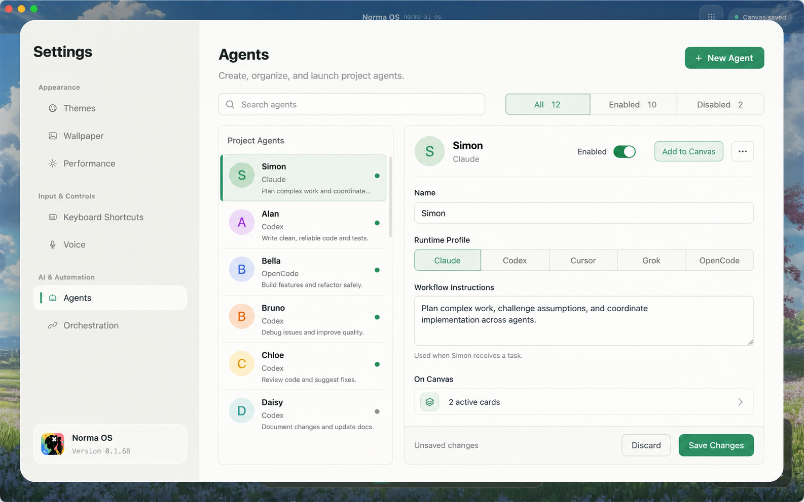
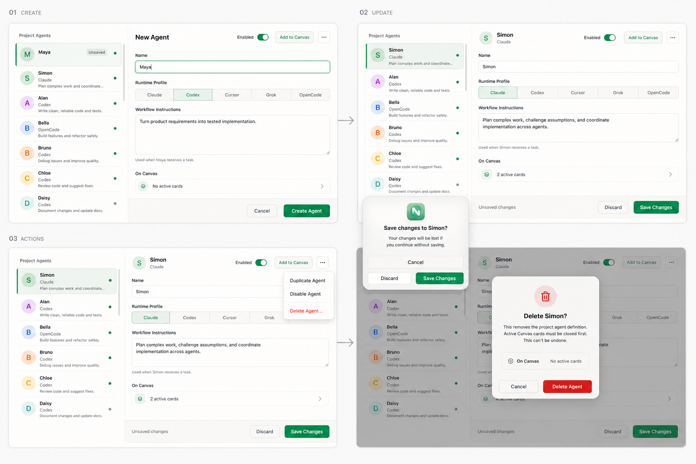

# Agent Settings 重设计

状态：CRUD MVP 已实施  
范围：Settings → Agents  
目标：在一个稳定的空间模型中完成 Agent 的查找、查看、新建、修改、启停、删除与添加到 Canvas。

## 1. 原型

### 主界面：Agent Library + Inspector

### CRUD 交互状态

## 2. 第一性原理结论

用户真正要完成的不是“管理一张数据库表”，而是：

1. 快速找到一个 Agent。
2. 确认它是谁、使用哪个 Runtime、会怎样工作。
3. 必要时修改配置，并明确知道修改是否已经保存。
4. 把可用的 Agent 放到 Canvas。
5. 安全地停用或删除不再需要的 Agent。

现有方案的问题不是双栏本身，而是同一份信息被拆成“只读详情”和“编辑详情”两套界面；`Edit`、`Enabled`、`Add to Canvas` 和删除又分散在不同状态里，导致用户反复切换模式。

新方案保留适合桌面端的双栏结构，但右侧只保留一套 Inspector：字段始终可编辑，只有出现修改时才显示保存栏。这样减少一次模式切换，同时仍保留显式保存和丢弃，避免误改 Agent 行为。

## 3. 信息架构

### Agent Library

- 顶部：搜索框、`All / Enabled / Disabled` 状态筛选、`New Agent`。
- 列表行：首字母头像、名称、Runtime Profile、Workflow 一行摘要、启用状态。
- 选中态：浅绿色背景与左侧强调线；hover、pressed、keyboard focus 使用不同反馈。
- 搜索匹配名称、Runtime Profile 和 Workflow；过滤后保留当前排序。

### Inspector

- Header：Agent 身份、Enabled toggle、`Add to Canvas`。
- Form：Name、Runtime Profile、Workflow Instructions。
- Context：显示当前绑定的 Canvas card 数量；点击可关闭 Settings 并聚焦对应卡片。
- Footer：左侧固定显示低强调度的 `Delete Agent…`；dirty 时右侧显示 `Unsaved changes / Discard / Save Changes`。

### 次要操作

- `Duplicate Agent`：可选增强项，复制当前配置并进入新建态；MVP 暂缓。
- Enabled / Disabled 统一由 Inspector Header 的 toggle 控制，不在菜单中重复提供。
- 删除不收进更多菜单：它是 CRUD 的必要能力，固定放在 Inspector Footer 左侧；使用红色文字和二次确认，但不与 Header 高频动作竞争。

## 4. 交互状态机

| 状态 | 进入条件 | 主要行为 | 离开条件 |
| --- | --- | --- | --- |
| Saved | 选择已保存 Agent | 可查看、直接编辑、Add to Canvas | 修改字段、New、Delete、切换选择 |
| Dirty | 任一字段或 Enabled 发生变化 | 显示 sticky save bar；阻止切换、关闭与 New | Save 成功或 Discard |
| Creating | 点击 `New Agent` | 左侧插入 `Unsaved` 临时行；Name 自动聚焦 | Create 成功或 Cancel |
| DeleteBlocked | 删除时存在 active cards | 解释阻塞原因，不提供确认删除 | 关闭卡片后重试或 Cancel |
| DeleteConfirm | 删除时没有 active cards | 显示不可逆确认对话框 | Confirm 删除、Cancel 或 Esc |
| Empty | 项目内没有 Agent | 显示用途说明和 `Create Agent` | 创建首个 Agent |
| NoProject | 没有打开项目 | 解释 Agent 为 project-scoped；禁用创建 | 打开项目 |
| SearchEmpty | 搜索或筛选无结果 | 保留查询条件与空结果提示 | 清空搜索或切回 All |

## 5. 完整流程

### 5.1 查看与切换

1. 打开 Agents 时恢复最近一次选择；没有记录则选择排序后的第一个 Agent。
2. 点击列表行立即切换 Inspector，不播放大幅位移动画。
3. 列表行、筛选、字段和 action 均可通过 Tab 聚焦，并使用 Enter / Space 激活；`↑/↓` 与 `⌘F` 属于后续快捷键增强。
4. Saved 状态切换 Agent 不弹确认。
5. Dirty 状态切换 Agent、关闭 Settings 或点击 `New Agent` 时会阻止离开并保留 draft，同时提示先 `Save` 或 `Discard`。

### 5.2 新建

1. 点击 `New Agent`，列表顶部出现选中的 `Unsaved` 临时行。
2. Inspector 复用同一表单，默认 Runtime Profile 为 Codex、Enabled 为开启，Name 自动聚焦。
3. Name 必须满足现有规则：2–16 个英文字母或 2–8 个中文字符，并在项目内唯一。
4. Workflow 可为空，最大 2000 个字符；超限时在字段下方即时显示错误。
5. 点击 `Create Agent` 时执行现有校验；失败时保留 draft 并显示可读错误文本，不能只用颜色提示。
6. 创建成功后临时行转为普通列表行并保持选中。
7. Cancel 是明确的丢弃动作，直接退出新建态并恢复进入新建前的选择。

### 5.3 修改与保存

1. Inspector 字段始终可编辑，不再需要 `Edit` 模式。
2. 首次修改后出现底部保存栏；保存前所有变化只存在于 draft。
3. `Discard` 恢复最后一次持久化值。
4. Save 时先做本地校验，再通过现有 project store 写入。
5. 保存成功后移除 dirty footer，并由 Inspector 与列表立即反映最新内容。
6. 保存失败时保留用户输入，并在主从容器下方显示可读错误。
7. Agent 名称保存成功后，沿用现有 runtime 同步逻辑更新关联 Canvas card 的显示名称。

### 5.4 Enabled

1. Toggle 的变化与其他字段一样进入 Dirty，不采用一部分字段自动保存、另一部分手动保存的混合模型。
2. Disabled Agent 仍保留在 Library，并可通过 `Disabled` 筛选找到。
3. Disabled Agent 的 `Add to Canvas` disabled，旁边帮助文本为 `Enable this agent before adding it to Canvas.`。
4. Enabled 状态不得只靠绿/灰颜色表达，列表状态需同时提供可访问性 label。

### 5.5 Add to Canvas

1. Saved + Enabled：创建绑定当前 definition 的 Agent card。
2. Dirty + valid：点击后执行 `Save → Add to Canvas`；Save 失败则不得创建卡片。
3. Creating：不显示 Add to Canvas，先完成 Create，避免产生没有稳定 definition 的卡片。
4. 成功后 Settings 保持打开，`On Canvas` 状态即时从 `Not added` 更新为 `1 active card`。
5. Header 的 `Add to Canvas` 同步替换为不可点击的 `✓ On Canvas` 状态，避免用户误以为可重复添加。
6. 点击 `Show on Canvas` 关闭 Settings，并聚焦当前关联的卡片。

### 5.6 删除

1. 删除入口固定在 Inspector Footer 左侧，以低强调度红色按钮显式呈现；不藏进更多菜单，也不与 Header 高频动作并排。
2. 若 `active_card_count > 0`，进入 DeleteBlocked：说明需先关闭 Canvas 上的关联卡片，且不渲染确认删除按钮。
3. 若没有 active cards，显示 `Delete Simon?` 模态确认层，清楚说明删除范围和不可恢复性；Cancel 与 Esc 均可安全退出。
4. 确认后删除 definition，选择下一行；没有下一行则选择上一行；列表为空则进入 Empty。
5. 删除失败时保持选择和 Inspector，不丢失上下文，并显示可读错误。

## 6. Apple 设计原则如何落地

- Purpose：把高频的查找、编辑、Add to Canvas 放在稳定位置；删除位于 Footer 的固定低强调度位置，并与高频动作分区。
- Agency：修改以 draft 保存，离开时允许 Save、Discard、Cancel；不可逆删除才使用确认。
- Familiarity：采用 macOS sidebar/list/inspector、segmented control、toggle 和 modal dialog。
- Simplicity：移除 read-only 与 edit 两套详情视图，复用同一 Inspector。
- Response：hover/pressed/focus 立即反馈；保存和创建在按钮原位显示状态。
- Spatial consistency：Inspector 与 Footer 在选择切换时保持稳定；modal dialog 在当前 Settings 空间内出现。
- Accessibility：键盘可达、明确 focus ring、状态不只依赖颜色、支持 Reduce Motion/Transparency/Increase Contrast。

## 7. 动效与反馈

- 列表选择：当前 MVP 即时切换背景与强调线，不引入会影响 Reduce Motion 的位移动画。
- Sticky save bar：从 Inspector 底部原位即时出现，保持内容空间稳定。
- 删除模态层：保持空间位置稳定，阻止点击穿透；所有确认与取消 action 均可键盘聚焦。
- 反馈分类：保存/创建/添加为 completion，校验为 inline error，删除为 warning，后台写入为 status。

## 8. 验收标准

- 用户无需进入独立 Edit 模式即可修改任一已保存 Agent。
- Create、Update、Delete、Enable/Disable、Search、Filter、Add to Canvas 均有明确入口和成功/失败状态。
- Dirty 状态下切换 Agent、关闭 Settings、创建新 Agent 均不会静默丢失修改。
- active cards 存在时无法删除 definition；没有 active cards 时必须二次确认。
- Disabled Agent 不会被移除，且不能 Add to Canvas。
- 所有按钮、列表行、分段控件、Toggle、菜单项覆盖适用的 rest、hover、pressed、focus、selected/toggled、disabled 状态。
- 页面实现后必须补 `crates/e2e` 用户流程，并用 Computer Use 操作真实 App 验收浅色、深色、键盘和破坏性流程。

## 9. 实现边界

- 复用现有 `AgentDefinitionDraft` 和 project-scoped `AgentDefinitionStore`。
- 存储写入沿用既有 `AgentDefinitionStore` 语义；本次重设计不把额外 IO 引入 GPUI 热路径。
- UI 优先使用 `ui::component` 的 Input 与 Switch；删除确认层遵循 macOS dialog 结构，并保留稳定的自动化锚点。
- 不改变 Agent definition 与 Canvas card 的既有 identity 关系。
- `Duplicate Agent` 为可选增强，不阻塞 CRUD MVP。

## 10. 后续增强（不属于本次 CRUD MVP）

- `⌘S` 保存、`↑/↓` 列表导航与 `⌘F` 搜索聚焦。
- 字段级即时校验、无效提交按钮禁用与字段旁错误定位。
- 异步 Saving 状态、重复提交锁与 completion toast。
- Reduce Motion 兼容的轻量背景淡化。
