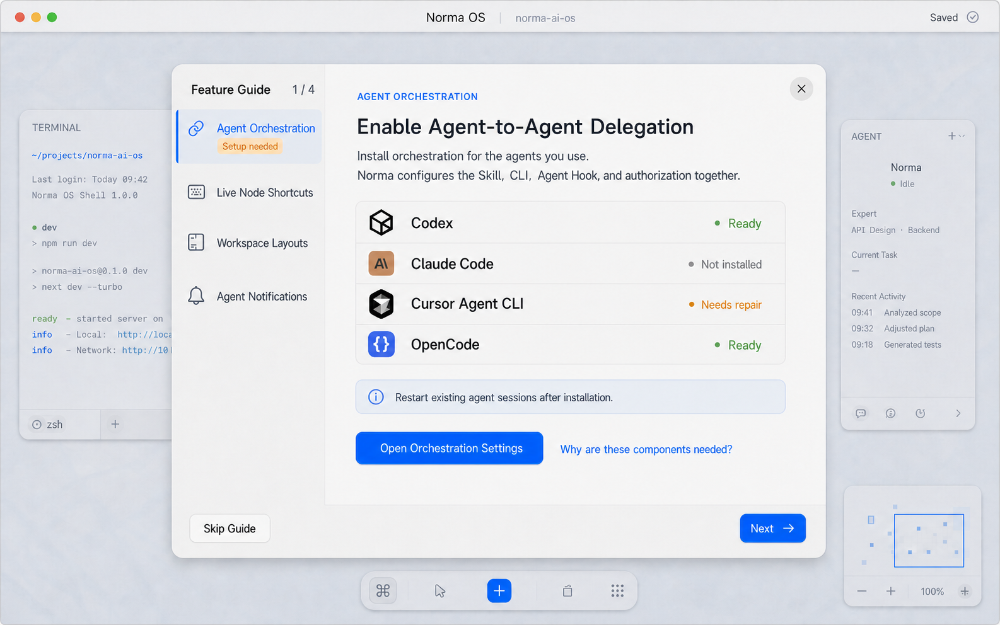

# Feature Guide：Agent 编排安装引导

- 日期：2026-08-04
- 状态：生产实现完成，待发布验收
- 目标：在现有 Help → Feature Guide 中解释 Agent 编排的价值、显示安装就绪状态，并把用户带到 Settings → Orchestration 完成真实安装
- 非目标：Feature Guide 不直接安装、修复或卸载任何外部组件；Settings → Orchestration 仍是唯一变更入口

## 原型



原型最初基于三项 Feature Guide 信息架构，因此图中显示 `1 / 4`。生产实现随后同步官网新增的两段真实 Demo；Agent 编排仍是后续 Agent 工作流的启用条件并保持第 1 项，当前默认进度为 `1 / 6`：

1. Agent Orchestration
2. Voice Group Control
3. Agent Collaboration
4. Live Node Shortcuts
5. Workspace Layouts
6. Agent Notifications

## 产品判断

用户真正需要的不是了解 Skill、CLI、Hook 的内部结构，而是知道“Agent 之间的任务委派需要先启用编排”，能够确认自己正在使用的 Provider 是否就绪，并能一步到达唯一的安装入口。

因此采用以下边界：

- Feature Guide 负责解释价值、展示只读状态和导航。
- Settings → Orchestration 继续作为唯一安装、修复和卸载入口。
- 不在 Help 内复制 `Install` / `Repair` / `Uninstall`，避免形成第二套安装状态机。
- 点击 `Open Orchestration Settings` 后，导览进入现有 `Suspended` 状态；关闭 Settings 后恢复到本主题并读取刷新后的状态。
- 不要求用户把所有 Provider 都安装完成；每个 Provider 独立展示真实状态。

这遵循 Apple 设计原则中的 Purpose、Agency、Familiarity 与 Spatial consistency：只在需要处解释、让用户明确触发外部配置、复用已有 Settings 心智模型，并在返回时保留原画布与导览位置。

两段新 Demo 继续使用相同的信息层级、媒体容器与导航反馈，没有引入新的交互模式；允许动态效果时播放官网 MP4，Reduced Motion 下只显示官网 WebP 海报，保持熟悉性、即时反馈和可访问性替代路径。

## 交互与文案

### 主题内容

- Eyebrow：`AGENT ORCHESTRATION`
- 标题：`Enable Agent-to-Agent Delegation`
- 说明：`Install orchestration for the agents you use. Norma configures the Skill, CLI, Agent Hook, and authorization together.`
- Provider：Codex、Claude Code、Cursor Agent CLI、OpenCode
- 状态：复用 Orchestration 的 `Ready`、`Not installed`、`Needs repair`、`Installing`、`Install failed`
- 提醒：`Restart existing agent sessions after installation.`
- 主操作：`Open Orchestration Settings`
- 辅助说明：`Why are these components needed?`
- 底部导览操作：左侧 `Skip Guide`，右侧 `Next →`

### 状态规则

- Provider 列表只读，不提供行内安装按钮。
- `Ready` 使用绿色文字和状态点；`Needs repair` / `Install failed` 使用警示或错误色；其他状态同时依靠文字表达，不能只靠颜色。
- 导航 badge 必须来自真实状态，不能永久写死为 `Setup needed`：
  - 健康检查中：`Checking`
  - 存在已授权但需要修复的 Provider：`Needs attention`
  - 没有任何 Provider Ready：`Set up`
  - 至少一个 Provider Ready 且没有修复错误：不显示 badge，或显示克制的 `Ready`
- Grok 首版不支持安装，不进入本页的安装引导列表；Settings 仍保留其完整“不支持”说明。

### Settings 往返

```text
Feature Guide / Agent Orchestration
  → Open Orchestration Settings
  → 导览因 settings_open blocker 进入 Suspended
  → Settings 选择 Orchestration 并触发现有后台 reconcile
  → 用户安装或修复 Provider
  → 用户关闭 Settings
  → 导览恢复到 Agent Orchestration 主题
  → Provider 状态读取 SharedOrchestrationHealth 最新快照
```

## 实现边界

建议改动落点：

- `crates/app/src/app/feature_guide/state.rs`
  - 增加 `FeatureGuideTopic::AgentOrchestration`
  - 把它放在 `ALL` 第 1 项，并更新序列化与反序列化
- `crates/app/src/app/feature_guide/content.rs`
  - 增加导航、标题与说明文案
  - 编排主题不需要视频资源；不要伪造空媒体路径
- `crates/app/src/app/feature_guide/view.rs`
  - 对编排主题渲染只读 Provider readiness panel 和 CTA
  - 复用现有 Feature Guide palette、Button 交互态和焦点规则
- `crates/app/src/app/feature_guide/controller.rs`
  - 新增打开 Settings → Orchestration 的明确 action
  - 复用 blocker 的 Suspended / Visible 恢复逻辑
- `crates/app/src/settings/orchestration/health.rs`
  - 只读取已有共享健康快照；任何扫描、文件 IO、哈希或安装仍在后台执行
- `crates/e2e/src/e2e_15_feature_guide*.rs`
  - 将主题数量更新为 6，覆盖两段新 Demo 的顺序、媒体、键盘顺序、Settings 往返和状态刷新

不要让 `feature_guide` 自己创建第二套 Provider 状态或安装逻辑，也不要在 GPUI 前台同步探测文件系统。

## 验收标准与自动化证据

- [x] Help 打开的 Feature Guide 默认显示第 1 项 `Agent Orchestration`，第 2、3 项依次为 `Voice Group Control`、`Agent Collaboration`，原有三个主题顺延到第 4—6 项，且不存在第 7 项。
- [x] 进入该主题后，Codex、Claude Code、Cursor Agent CLI、OpenCode 的只读状态与共享 Orchestration health 一致。
- [x] 本页不存在任何直接 `Install`、`Repair` 或 `Uninstall` 行为。
- [x] 点击 `Open Orchestration Settings` 打开 Settings 并精确选择 `Orchestration`。
- [x] Settings 打开时导览进入 `Suspended`；关闭后恢复到同一主题，而不是重置到第一项。
- [x] 安装或修复完成后，恢复的导览显示最新状态。
- [x] 健康检查和安装不阻塞 GPUI 前台线程。
- [x] 所有按钮覆盖 hover、pressed、keyboard focus 与 disabled（如适用）状态。
- [x] 键盘可聚焦并通过 Enter / Space 激活主题、Provider 明细和 CTA。
- [ ] VoiceOver 可读出主题、Provider 名称、状态、提醒与 CTA；GPUI 0.2.2 尚未向 macOS Accessibility Tree 暴露自定义控件，当前无法完成该项。
- [x] Reduced Motion 下 Settings 往返使用 160ms 短淡入淡出，不出现弹跳或大范围位移。
- [x] `cargo check -p app` 通过。
- [ ] `cargo test -p e2e` 全量为 194 通过、5 个与本功能无关的失败、4 个忽略；本功能聚焦 E2E 为 11/11 通过。
- [x] 新增测试完整遵守仓库的场景、数据构造、执行过程、预期结果、正负断言和断言说明规范。
- [x] Computer Use 已在独立真实 QA App 中点击验证六项导航和第 2、3 项真实 Demo；自定义 GPUI 控件仍未进入 Accessibility Tree，Settings 完整往返继续由聚焦 E2E 自动验证。

## 原型结论

推荐采用“新增独立 Feature Guide 主题 + 单一 Settings CTA”的方案。它能把缺失的安装教育补齐，同时保持 Settings 是编排配置的唯一事实源，范围小、可测试，也不打断现有画布心智模型。
