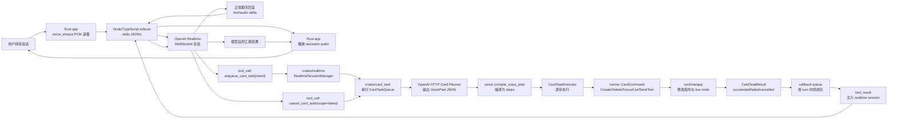

# 实时语音与卡片任务 MVP 设计

- 日期：2026-07-05
- 状态：草稿（待评审）
- 范围：Always Listening 实时语音对话 + 异步画布卡片操作
- 关联：`docs/references/neko-technical-analysis.md`、`crates/voice/`、`crates/voice_sherpa/`、`crates/norma/`、`crates/app/src/app/voice/`

> 逐步实施与验收入口见 [`realtime-card-task-mvp/README.md`](realtime-card-task-mvp/README.md)。本文保留完整设计背景，拆分后的子 SPEC 作为后续按任务包实现和验收的主入口。

## 1. 背景与目标

Norma OS 当前已经有一次性语音命令链路：

```text
voice_sherpa 生成最终转写
  -> crates/voice 规划命令
  -> VoicePlan / ExecutableCommand
  -> norma::protocol::CardCommand
  -> app 把命令应用到 Runtime
```

新需求是做一条类似 N.E.K.O 的“双流水线”，但操作对象不是整台电脑，而是 Norma 画布中的卡片：

```text
聊天主线：用户持续语音对话，AI 持续回复
卡片任务线：AI 异步入队并执行卡片 CRUD / SendText
回调线：卡片任务结果回灌 realtime session，由模型自然汇报
```

MVP 成功标准：

- 用户打开 Always Listening 后，可以持续语音对话。
- 聊天不中断时，AI 可以异步创建、删除、聚焦、列出卡片，以及给某张卡片输入文本并发送。
- 卡片操作以后台任务串行执行。
- 任务完成、失败或取消后，结果回灌 realtime 会话，由模型自然告诉用户。
- 现有 push-to-talk / 一次性语音命令路径保留，不被 realtime MVP 替换。

## 2. MVP 范围

### 2.1 本次要做

- 新增 `crates/realtime`：
  - Norma 内部 realtime event / command 类型。
  - sidecar 子进程桥接。
  - callback queue。
  - interrupt policy。
  - OpenAI Realtime sidecar 协议适配边界。
- 新增 `crates/card_task`：
  - `CardTaskRequest`、`CardTask`、`CardTaskStep`、`CardTaskEvent`。
  - 串行任务队列。
  - OpenAI HTTP Card Planner。
  - 复用 `voice::VoicePlan` / `compile_voice_plan` 输出契约。
- Node/TypeScript sidecar：
  - 连接 OpenAI Realtime WebSocket。
  - 接收 Rust 发来的 PCM audio chunk。
  - 输出 Norma 标准化事件。
  - 转发 `enqueue_card_task` / `cancel_card_task` tool call。
- Rust app：
  - Always Listening 开关与底部语音条状态。
  - 扩展 `voice_sherpa`，提供 streaming PCM capture。
  - 播放 assistant audio chunk。
  - 把 `CardCommand` 应用到现有 Runtime。
  - 把 card task result 注入 realtime session。
- Settings -> Voice：
  - Always Listening 开关。
  - OpenAI API Key。
  - Realtime model。
  - Card planner model。
  - Sidecar path / bundled sidecar status。

### 2.2 本次不做

- 不做 ComputerUse / BrowserUse / pyautogui / 截屏 grounding。
- 不读取卡片内容摘要，不解析 terminal grid、Preview 内容或 Browser DOM。
- 不做高风险判断或权限确认。MVP 中 planner 编译成功就直接执行。
- 不落 SQLite，不新增 `card_task_history`，也不扩展 `voice_history`。
- 不做任务活动面板。
- 不做卡片 chrome task badge。
- 不支持多 realtime session。一个 app 进程最多一个 active realtime session。
- 不把 Node sidecar 作为长期核心架构；它只是 MVP 降风险手段。

## 3. 已确认设计决策

| 决策点 | 结论 |
|---|---|
| MVP 目标 | 双流并行优先：聊天不中断，卡片操作后台执行 |
| Realtime provider | OpenAI Realtime 优先 |
| Realtime provider 边界 | OpenAI 原始事件只存在 sidecar / adapter，不泄漏到 app/runtime |
| Card Planner | OpenAI HTTP text model，单独请求，返回 `VoicePlan` 兼容 JSON |
| Tool input | `enqueue_card_task(intent)` 只传自然语言 intent |
| 取消工具 | `cancel_card_task(scope="latest")` |
| Crate 边界 | 新增 `crates/realtime` 与 `crates/card_task` |
| Realtime WebSocket | MVP 用 Node/TypeScript sidecar |
| Rust-sidecar IPC | stdio JSONL |
| 音频采集/播放 | Rust app 负责；sidecar 只转 OpenAI WebSocket |
| 音频来源 | 扩展 `voice_sherpa` 的 AVAudioEngine capture，新增 PCM streaming |
| 现有语音命令 | 保留 push-to-talk / one-shot path |
| UI | 只用底部语音条显示最小状态 |
| 持久化 | MVP 只写 tracing log |
| 错误反馈 | 注入 realtime provider，由模型自然说明；provider 断线时只记录日志 |
| 任务并发 | MVP 串行，未来保留冲突检测并发扩展点 |
| 配置来源 | Settings -> Voice；不使用运行时 env fallback |

## 4. 整体流程草图

下面是 MVP 的主流程。蓝色可以理解为聊天主线，绿色是后台卡片任务线，紫色是任务结果回调线。



### 4.1 三条线如何协作

```text
聊天主线：
  用户语音 -> Rust PCM capture -> sidecar -> OpenAI Realtime
  OpenAI Realtime -> sidecar -> Rust audio playback -> 用户听到回复

卡片任务线：
  OpenAI Realtime tool_call(enqueue_card_task)
  -> Rust 入队 CardTask
  -> OpenAI HTTP planner 规划 steps
  -> Rust 执行 CardCommand
  -> Runtime 修改画布卡片

回调线：
  CardTask 完成/失败/取消
  -> callback queue 判断当前是否适合插话
  -> tool_result 注入 realtime session
  -> OpenAI Realtime 自然组织语言回复用户
```

关键原则：Realtime 模型、Node sidecar 都不能直接改画布。真正改画布的只有 Rust executor，而且只能执行白名单 `CardCommand`。

## 5. 端到端例子

用户打开 Always Listening 后说：

> “创建一个 Codex 卡片，让它分析 README，然后发送。”

系统执行过程：

```text
1. Rust app 正在采集麦克风 PCM，并通过 sidecar 发给 OpenAI Realtime。

2. OpenAI Realtime 判断这句话需要操作画布，于是调用工具：
   enqueue_card_task({
     "intent": "创建一个 Codex 卡片，让它分析 README，然后发送"
   })

3. sidecar 把 tool_call 转成 Norma JSONL 事件发给 Rust：
   {"type":"tool_call","name":"enqueue_card_task","arguments":{"intent":"..."}}

4. crates/realtime 收到 tool_call，把 intent 转给 crates/card_task。

5. crates/card_task 创建一个 CardTask：
   task_id = task_7
   state = Queued
   summary = "创建 Codex 卡片并发送 README 分析请求"

6. 因为 MVP 串行执行，如果当前没有 active task，task_7 进入 Planning。

7. OpenAI HTTP Card Planner 收到：
   - intent
   - 当前画布卡片列表
   - 当前 selected / focused 节点
   - max_steps

8. Planner 返回 VoicePlan-compatible JSON，例如：
   commands:
     0. Create Agent(Codex)
     1. SendText target=PreviousStep(0), text="请分析 README", submit=true

9. Rust 调用 voice::compile_voice_plan，把 VoicePlan 编译为 CardTaskStep：
   step 0 = CardCommand::Create Agent(Codex)
   step 1 = SendTextToPrevious(previous_step=0, text="请分析 README", submit=true)

10. CardTaskExecutor 执行 step 0：
    - 通过现有 Runtime 创建 Codex card
    - 记录 created_by_step[0] = node_id 12

11. CardTaskExecutor 执行 step 1：
    - 把 previous_step=0 解析为 node_id 12
    - 调用 CardCommand::SendText { node_id: 12, text, submit: true }

12. task_7 成功：
    state = Succeeded
    summary = "已创建 Codex 卡片，并发送 README 分析请求"

13. crates/realtime 判断当前 turn 状态：
    - 如果用户和 assistant 都空闲，立即注入 tool_result
    - 如果用户正在说话或 assistant 正在播报，先放入 callback queue

14. tool_result 注入 OpenAI Realtime：
    {
      "tool_call_id": "call_123",
      "status": "succeeded",
      "task_id": "task_7",
      "summary": "已创建 Codex 卡片，并发送 README 分析请求"
    }

15. OpenAI Realtime 自然回复用户：
    “我已经创建了 Codex 卡片，并把 README 分析请求发过去了。”
```

如果用户在 step 0 后说：

> “取消刚才那个操作。”

则 OpenAI Realtime 调用：

```json
{"scope":"latest"}
```

取消语义：

```text
如果 task_7 已经创建了 Codex 卡片，但还没执行发送：
  - 不回滚已创建的 Codex 卡片
  - 设置 cancel_requested = true
  - 当前 step 结束后停止后续 steps
  - task_7 -> Cancelled
  - tool_result 回灌 realtime
  - 模型自然告诉用户：
    “我已经停止后续操作。Codex 卡片已创建，但没有发送内容。”
```

## 6. OpenAI API 约束

本设计按 2026-07-05 查阅的 OpenAI 官方文档制定：

- Realtime API 用于低延迟、多模态、自然语音交互，适合作为 Always Listening 的主会话层。
- 服务端 / worker 场景可用 Realtime WebSocket，把 raw audio / events 通过服务端连接转发。
- Realtime session 支持工具调用；工具结果需要回写为 conversation item，再触发后续 response。
- Card Planner 走单独 HTTP text-model 请求，要求返回结构化 JSON，避免污染 realtime conversation lane。

参考：

- OpenAI Realtime guide: https://platform.openai.com/docs/guides/realtime
- OpenAI Realtime WebSocket guide: https://platform.openai.com/docs/guides/realtime-websocket
- OpenAI Realtime function calling: https://platform.openai.com/docs/guides/realtime-function-calling
- OpenAI structured outputs: https://platform.openai.com/docs/guides/structured-outputs

## 7. 总体架构

```text
┌────────────────────────────────────────────────────────────┐
│ app crate / GPUI                                            │
│ - Settings -> Voice                                         │
│ - 底部语音条                                                │
│ - voice_sherpa PCM capture                                  │
│ - assistant audio playback                                  │
│ - 把 CardCommand 应用到 Runtime                             │
└───────────────┬──────────────────────────────┬─────────────┘
                │                              │
                ▼                              ▼
┌──────────────────────────────┐   ┌─────────────────────────┐
│ crates/realtime               │   │ crates/card_task         │
│ - RealtimeSessionManager      │   │ - CardTaskQueue          │
│ - stdio sidecar bridge        │   │ - CardTaskExecutor       │
│ - callback queue              │   │ - OpenAI HTTP planner    │
│ - interrupt policy            │   │ - VoicePlan bridge       │
└───────────────┬──────────────┘   └───────────┬─────────────┘
                │                              │
                ▼                              ▼
┌──────────────────────────────┐   ┌─────────────────────────┐
│ Node/TypeScript sidecar       │   │ crates/voice + norma     │
│ - OpenAI Realtime WebSocket   │   │ - VoicePlan              │
│ - 标准化 JSONL 事件           │   │ - compile_voice_plan     │
│ - tool call 转发              │   │ - CardCommand enum       │
└──────────────────────────────┘   └─────────────────────────┘
```

依赖方向：

```text
app -> {realtime, card_task, voice_sherpa, runtime, norma, voice}
card_task -> {voice, norma}
realtime -> {serde, async-channel/crossbeam-channel, child process bridge types}
runtime -> unchanged; no network, no OpenAI, no GPUI
canvas/terminal/storage -> unchanged
```

`runtime` 仍只负责 live node 生命周期和输入路由。`realtime` 与 `card_task` 不能让 `runtime` 反向依赖 OpenAI、sidecar、HTTP、WebSocket 或 GPUI。

## 8. 组件设计

### 8.1 `crates/realtime`

职责：

- 维护 Norma 内部 realtime session 状态。
- 启动 / 停止 Node sidecar。
- 编解码 stdio JSONL IPC。
- 维护 user/assistant 说话状态。
- 维护 callback queue。
- 处理中断策略。

建议状态：

```rust
pub struct RealtimeSessionState {
    pub session_id: RealtimeSessionId,
    pub user_speaking: bool,
    pub assistant_speaking: bool,
    pub active_response_id: Option<String>,
    pub pending_callbacks: VecDeque<TaskResultCallback>,
}
```

Norma 内部事件：

```rust
pub enum RealtimeEvent {
    SessionStarted { session_id: RealtimeSessionId },
    TranscriptDelta { text: String },
    TranscriptFinal { text: String },
    AssistantTextDelta { text: String },
    AssistantAudioChunk(PcmAudioChunk),
    AssistantAudioState { state: AssistantAudioState },
    ToolCall(RealtimeToolCall),
    SessionError { message: String },
    SessionStopped { reason: String },
}
```

Norma 发给 sidecar 的命令：

```rust
pub enum RealtimeCommand {
    StartSession(RealtimeSessionConfig),
    StopSession { session_id: RealtimeSessionId },
    Interrupt { session_id: RealtimeSessionId },
    InputAudioChunk(PcmAudioChunk),
    ToolResult(RealtimeToolResult),
}
```

`crates/realtime` 不执行卡片命令。它只把 tool call 交给 app/card_task，并接收 task result 用于回灌 provider。

### 8.2 Node/TypeScript sidecar

职责：

- 连接 OpenAI Realtime WebSocket。
- 把 OpenAI 原始事件翻译成 Norma JSONL 事件。
- 把 Norma JSONL command 翻译成 OpenAI client event。
- 转发 tool call：

```json
{"type":"tool_call","tool_call_id":"call_123","name":"enqueue_card_task","arguments":{"intent":"创建一个 Codex 卡片并发送分析 README"}}
```

明确不做：

- 不规划卡片命令。
- 不修改画布。
- 不写 SQLite。
- 不维护任务队列。
- 不决定权限策略。
- 不保存长期状态。

生命周期：

```text
start Always Listening -> Rust 启动 sidecar
stop session / app close / project close -> Rust 发送 stop_session，必要时 kill
sidecar 异常退出 -> realtime session 进入 error/stopped
```

### 8.3 `crates/card_task`

职责：

- 把一个用户意图表示成一个 task。
- 用 OpenAI HTTP Card Planner 规划 task steps。
- 通过 app 提供的 `CardCommandRunner` 串行执行 steps。
- 发出 task lifecycle events。
- 支持 step 边界取消。

核心模型：

```rust
pub struct CardTaskRequest {
    pub intent: String,
}

pub struct CardTask {
    pub task_id: CardTaskId,
    pub request: CardTaskRequest,
    pub summary: String,
    pub steps: Vec<CardTaskStep>,
    pub state: CardTaskState,
    pub cancel_requested: bool,
}

pub enum CardTaskStep {
    Command(norma::protocol::CardCommand),
    SendTextToPrevious {
        previous_step: usize,
        text: String,
        submit: bool,
    },
    FocusPrevious {
        previous_step: usize,
    },
}

pub enum CardTaskState {
    Queued,
    Planning,
    Executing { step_index: usize },
    Succeeded,
    Failed { message: String },
    Cancelled { message: String },
}
```

任务事件：

```rust
pub enum CardTaskEvent {
    Queued { task_id: CardTaskId, summary: String },
    Planning { task_id: CardTaskId },
    Planned { task_id: CardTaskId, step_count: usize },
    Executing { task_id: CardTaskId, step_index: usize },
    StepSucceeded { task_id: CardTaskId, step_index: usize },
    StepFailed { task_id: CardTaskId, step_index: usize, message: String },
    Succeeded { task_id: CardTaskId, summary: String },
    Failed { task_id: CardTaskId, message: String },
    Cancelled { task_id: CardTaskId, message: String },
}
```

队列策略：

```text
pending queue: VecDeque<CardTask>
active task: Option<CardTask>
completed recent records: bounded Vec<CardTaskRecord>

如果 active_task 为空：
  取队首 task 执行
否则：
  新 task 只保持 queued
```

未来并发扩展点：

```rust
pub struct CardTaskConflictHints {
    pub target_node_ids: Vec<NodeId>,
    pub writes_canvas_layout: bool,
    pub requires_focus: bool,
}
```

MVP 不并发调度，只保留以后做冲突检测的入口。

### 8.4 OpenAI HTTP Card Planner

Planner 输入复用现有 `VoicePlanningRequest`：

```rust
pub struct VoicePlanningRequest {
    pub transcript: String, // CardTaskRequest.intent
    pub cards: Vec<CardRef>,
    pub focused_node_id: Option<u64>,
    pub selected_node_ids: Vec<u64>,
    pub max_steps: usize,
}
```

Planner 输出仍是 `voice::VoicePlan`：

```rust
pub struct VoicePlan {
    pub commands: Vec<PlannedCommand>,
    pub confidence: f32,
    pub risk: RiskLevel,
    pub requires_confirmation: bool,
    pub reason: Option<String>,
}
```

MVP 特殊规则：

- 现有 `compile_voice_plan` 可能因为 terminal submit 或 high risk 标记 `requires_confirmation`。
- Realtime CardTask MVP 不实现确认流程。
- MVP 中，即使 compiled plan 标记需要确认，也直接执行，除非编译失败。
- `requires_confirmation` 字段保留给后续 risk policy 使用。

这是为了先验证“双流体验”的刻意取舍。

### 8.5 `voice_sherpa` PCM Streaming

现有能力：

```rust
SherpaProvider::start_recording()
  -> (SpeechSession, Receiver<String partials>)
SpeechSession::begin_finish()
  -> final transcript
```

新增能力：

```rust
SherpaProvider::start_pcm_stream(input_device_id)
  -> (PcmStreamSession, Receiver<PcmAudioChunk>)
```

`voice_sherpa` 继续负责：

- macOS 麦克风权限。
- 输入设备选择。
- AVAudioEngine capture。

`voice_sherpa` 不知道 OpenAI、sidecar、card task 或 realtime tool call。

音频 chunk：

```rust
pub struct PcmAudioChunk {
    pub sample_rate: u32,
    pub channels: u16,
    pub format: PcmFormat, // MVP: Pcm16
    pub bytes: Vec<u8>,
}
```

MVP 通过 JSONL base64 传音频：

```json
{"type":"input_audio_chunk","session_id":"rt_1","format":"pcm16","sample_rate":24000,"data_b64":"..."}
{"type":"assistant_audio_chunk","session_id":"rt_1","format":"pcm16","sample_rate":24000,"data_b64":"..."}
```

已知限制：base64 JSONL 会增加带宽和延迟，但适合 MVP 验证。如果后续延迟不够，再迁移到二进制 pipe 或 Rust 原生 provider。

## 9. 运行时流程

### 9.1 开启 Always Listening

```text
用户在 Settings -> Voice 打开 Always Listening
  -> app 校验 OpenAI settings
  -> app 通过 voice_sherpa 请求麦克风权限
  -> app 启动 PCM stream
  -> crates/realtime 启动 Node sidecar
  -> Rust 通过 JSONL 发送 start_session
  -> sidecar 连接 OpenAI Realtime
  -> sidecar 发回 session_started
  -> 底部语音条显示 Listening
```

如果项目关闭、app 切回 Launchpad，或用户关闭开关：

```text
停止 PCM stream
发送 stop_session
sidecar 不退出则 kill
清理 active realtime session
底部语音条回到 idle
```

### 9.2 聊天时执行卡片任务

```text
用户说：“创建一个 Codex 卡片，让它分析 README”
  -> OpenAI Realtime 判断需要 tool call
  -> sidecar 发出 tool_call enqueue_card_task(intent)
  -> app/card_task 入队 CardTask
  -> realtime session 继续听/继续回复
  -> card_task planner 调用 OpenAI HTTP text model
  -> 编译 VoicePlan 为 CardTaskStep 列表
  -> executor 通过 CardCommand runner 执行 steps
  -> task succeeded/failed
  -> realtime 注入 tool_result
  -> 模型自然告诉用户结果
```

### 9.3 回调时机

```text
如果 user_speaking == false 且 assistant_speaking == false：
  立即注入 task result
否则：
  先进入 callback queue
  等当前 user turn final 或 assistant audio end 后再注入
```

这样避免任务完成消息打断用户说话，或覆盖 assistant 当前播报。

### 9.4 用户打断

用户在 assistant 回复时开口：

```text
停止 assistant playback
发送 RealtimeCommand::Interrupt
保持 active CardTask 继续执行
继续 listening
```

语音打断不取消 queued task 或 active task。

### 9.5 取消最新卡片任务

Realtime tool：

```json
{"scope":"latest"}
```

取消语义：

```text
如果 latest queued task 存在：
  从队列移除
  emit Cancelled
否则如果 active task 存在：
  set cancel_requested = true
  当前 step 执行完
  下一个 step 开始前停止
  emit Cancelled
否则：
  返回 "no active card task"
```

MVP 不回滚。已经创建的卡片不会因为取消而被自动删除。

## 10. IPC 协议

### 10.1 Rust -> Sidecar

```json
{"type":"start_session","session_id":"rt_1","config":{"model":"gpt-realtime","tools":["enqueue_card_task","cancel_card_task"]}}
{"type":"input_audio_chunk","session_id":"rt_1","format":"pcm16","sample_rate":24000,"data_b64":"..."}
{"type":"interrupt","session_id":"rt_1"}
{"type":"tool_result","session_id":"rt_1","tool_call_id":"call_123","result":{"status":"succeeded","task_id":"task_7","summary":"已创建 Codex 卡片并发送请求。"}}
{"type":"stop_session","session_id":"rt_1"}
```

### 10.2 Sidecar -> Rust

```json
{"type":"session_started","session_id":"rt_1"}
{"type":"transcript_delta","session_id":"rt_1","text":"创建一个"}
{"type":"transcript_final","session_id":"rt_1","text":"创建一个 Codex 卡片"}
{"type":"assistant_text_delta","session_id":"rt_1","text":"我来处理。"}
{"type":"assistant_audio_chunk","session_id":"rt_1","format":"pcm16","sample_rate":24000,"data_b64":"..."}
{"type":"assistant_audio_state","session_id":"rt_1","state":"speaking"}
{"type":"tool_call","session_id":"rt_1","tool_call_id":"call_123","name":"enqueue_card_task","arguments":{"intent":"创建一个 Codex 卡片"}}
{"type":"session_error","session_id":"rt_1","message":"OpenAI realtime disconnected"}
```

所有 JSONL 消息都必须包含 `type`。未知 `type` 记录日志并忽略； malformed JSON line 触发 session error 并关闭 sidecar。

## 11. UI / UX

MVP 只使用底部语音条。

视觉状态：

```text
Realtime off
Always Listening
Listening
User speaking
Assistant speaking
Card task queued
Card task running
Task complete
Realtime error
```

MVP 不做任务面板，不做卡片 badge。step 级细节进入 tracing log。

推荐文案：

| 状态 | 文案 |
|---|---|
| Realtime off | `Voice` |
| Always Listening idle | `Always Listening` |
| User speaking | `Listening...` |
| Assistant speaking | `Replying...` |
| Task queued/running | `Running card task...` |
| Task complete | 短暂显示 `Task complete`，然后回到 listening |
| Session error | `Realtime error` |

## 12. Settings

Settings -> Voice 拆成两块：

```text
One-shot voice commands
  - existing Paraformer model dir
  - existing input device
  - existing Ollama planner settings
  - existing trace logging

Realtime conversation
  - Enable Always Listening
  - OpenAI API Key
  - Realtime model
  - Card planner model
  - Sidecar path / bundled sidecar status
```

配置规则：

- OpenAI API Key 只从 Settings 读取。
- Realtime model 只从 Settings 读取。
- Planner model 只从 Settings 读取。
- 普通运行时不使用环境变量 fallback。
- 测试可以显式注入 fake config / fake provider，但不能依赖隐藏 env 行为。

## 13. 错误处理

| 失败场景 | MVP 行为 |
|---|---|
| OpenAI settings 缺失 | 不启动 Always Listening；底部语音条显示配置错误 |
| 麦克风权限被拒绝 | 不启动 session；复用现有 voice error handling |
| sidecar 启动失败 | realtime error；记录命令和 path |
| sidecar 输出 malformed JSON | 停止 session；记录 offending line 摘要 |
| OpenAI realtime 断开 | 停止 session；底部语音条显示 realtime error |
| tool call 名称未知 | 返回 failed tool result；记录日志 |
| `enqueue_card_task` 缺少 intent | 返回 failed tool result；记录日志 |
| Planner HTTP 失败 | CardTask failed；realtime 在线则注入失败结果 |
| Planner JSON 无效 | CardTask failed；realtime 在线则注入失败结果 |
| CardCommand 目标不存在 | CardTask failed；注入失败结果 |
| task 失败时 realtime 已不可用 | 只写日志；不写 SQLite；不弹额外 modal |

Card task 错误优先注入 realtime provider，让模型自然解释。如果 realtime 已断开，MVP 只记录日志。

## 14. 安全与隐私

MVP 的刻意取舍：

- 不做高风险检测。
- 不做确认弹窗。
- 如果 planner 产出 Delete 或 terminal submit，且 Rust compiler 接受，MVP 会直接执行。

仍然必须遵守的安全边界：

- Realtime 模型不能直接修改画布。
- Sidecar 不能直接修改画布。
- Card Planner 输出必须经过 Rust `compile_voice_plan`。
- Executor 只能执行白名单 `norma::protocol::CardCommand` / `ExecutableCommand`。
- 不执行模型生成代码。
- MVP 不把原始音频或完整 transcript 落 SQLite。
- OpenAI API Key 只通过 Settings 存储路径读取，不写日志。

未来可以增加：

```text
RiskPolicy::classify(compiled_plan, card_context)
  -> DirectExecute | ConfirmationRequired | Reject
```

MVP 保持数据结构兼容，后续可以加 risk policy。

## 15. 与当前代码的衔接

可复用的现有模块：

- `crates/voice/src/plan.rs`
  - `VoicePlanningRequest`
  - `VoicePlan`
  - `compile_voice_plan`
  - `ExecutableCommand`
- `crates/norma/src/protocol.rs`
  - `CardCommand::{Create, Delete, SendText, Focus, List}`
  - `CardCommandResult`
  - `CardCommandError`
- `crates/app/src/app/voice/execution.rs`
  - `execute_compiled_voice_plan`
  - created-step node id tracking
- `crates/app/src/app/voice/mod.rs`
  - 从当前 Runtime 构造 card context
  - 现有 one-shot voice orchestration
- `crates/voice_sherpa`
  - microphone permission
  - input device selection
  - AVAudioEngine session lifecycle

可能需要的重构：

- 从 `app::voice::mod.rs` 抽出 card context builder，供 realtime CardTask 复用。
- 从 `execute_compiled_voice_plan` 抽出可复用的 `CardCommandRunner`。
- 增加 OpenAI planner provider，但不删除 `OllamaVoicePlanner`。
- push-to-talk 继续使用 Ollama planner，除非后续另有 spec 决定迁移。

## 16. 测试策略

### 16.1 `crates/card_task`

单元测试：

- `enqueue_card_task(intent)` 创建一个 queued task。
- 串行队列同一时间只执行一个 active task。
- create -> send previous-step 能保留 created `node_id`。
- active task 取消会在下一 step 前停止，不回滚已完成 step。
- queued task 取消会从队列移除。
- planner provider error 会产生 `Failed`。
- malformed planner JSON 会产生 `Failed`。
- task result summary 可作为 realtime tool result。

使用 fake planner 和 fake command runner。单元测试不调用 OpenAI。

### 16.2 `crates/realtime`

单元测试：

- JSONL parser 接受已知 sidecar events。
- 未知 event type 不 panic。
- malformed JSON 产生 session error。
- user/assistant idle 时 callback 立即注入。
- 用户或 assistant speaking 时 callback 入队。
- interrupt 停止 assistant state，但不取消 active card task。
- sidecar process command 日志不包含 API key。

尽量使用 fake sidecar streams。

### 16.3 `voice_sherpa`

可单元测试部分：

- `PcmAudioChunk` metadata validation。
- input device id selection 与现有测试兼容。
- streaming API 类型满足 app background task 的 `Send` 要求。

真实 AVAudioEngine capture 仍需要手工验证。

### 16.4 `crates/app`

App 级测试：

- Always Listening 不能在非 canvas/project 状态启动。
- Settings-only config 是必需的，不读取 env fallback。
- 底部语音条能把 realtime/task 状态映射成文案。
- 现有 push-to-talk voice tests 继续通过。
- app close / project close 会停止 sidecar 和 PCM stream。

### 16.5 实施后的验证命令

```bash
cargo test -p voice
cargo test -p voice_sherpa
cargo test -p card_task
cargo test -p realtime
cargo test -p app
cargo check -p app
bash scripts/check-storage-boundaries.sh
bash scripts/check-performance-guardrails.sh
bash scripts/check-max-file-lines.sh
bash scripts/check-no-allow.sh
```

如果修改 `crates/app` 或 `crates/ui` 的 GPUI 代码，实施前先按本仓库规则加载对应 GPUI skill。

## 17. MVP 后迁移路径

潜在后续阶段：

1. 把 sidecar realtime WebSocket 迁移为 Rust 原生 `crates/realtime` provider。
2. 把 JSONL base64 audio 改成二进制 framing 或 Rust provider 内部 audio events。
3. 增加 risk policy 和确认 UI。
4. 增加任务活动面板和卡片 chrome badge。
5. 增加 terminal / preview / browser 卡片内容摘要。
6. 如果排障或审计需要，再新增持久化 `card_task_history`。
7. 增加冲突感知的 CardTask 并发调度。

## 18. 未决问题

- OpenAI realtime model 与 structured-output model 的具体名字，实施前必须再次查官方文档，因为模型可用性会变化。
- Sidecar 打包路径未最终确定。建议初始路径：`sidecars/openai-realtime/`。
- Assistant audio playback 的实现细节未最终确定：如果已有 macOS audio output 路径可复用，优先复用；否则在 app voice/realtime 附近新增最小 playback module。
- push-to-talk 是否以后从 Ollama planner 迁移到 OpenAI planner，本设计不决定。
