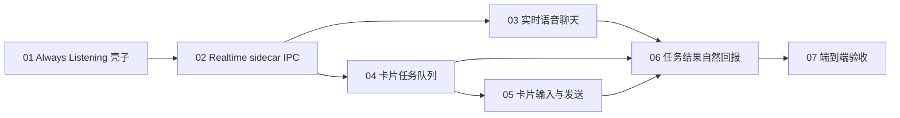

# 实时语音与卡片任务 MVP SPEC 索引

> **已取代：** 本 MVP 的 OpenAI Realtime / sidecar 路径已由 [`docs/product-specs/2026-07-09-SPEC-local-voice-pipeline.md`](../../product-specs/2026-07-09-SPEC-local-voice-pipeline.md) 中的本地语音管线取代（Task 4 删除 sidecar）。下文保留为历史施工记录。

- 日期：2026-07-06
- 状态：已被 2026-07-09 本地语音管线 SPEC 取代（历史草稿）
- 来源总稿：[`../realtime-card-task-mvp.md`](../realtime-card-task-mvp.md)
- 目标：把“Always Listening 实时语音对话 + 异步操作画布卡片”拆成多个可以独立实现、独立验收的小 SPEC。

## 1. 总体目标

用户打开 `Always Listening` 后，可以和 AI 实时语音聊天。聊天过程中，AI 可以异步派发卡片操作任务。任务完成、失败或取消后，AI 会用自然语言把结果接回当前对话，而不是打断聊天主线。

MVP 的实时体验验收底线：

- AI 语音首响目标为约 `1-2 秒`。
- 卡片任务可以后台执行数秒。
- 用户可以在卡片任务执行期间继续聊天。
- 任务结果由 AI 自然汇报，不弹额外 modal，不要求任务面板。

## 2. 技术栈决策

MVP 采用：

```text
OpenAI Realtime + Node/TypeScript sidecar + Rust app/card_task executor
```

职责边界：

- Node/TypeScript sidecar 负责 OpenAI Realtime WebSocket、OpenAI 原始事件适配和 JSONL IPC。
- Rust app 负责麦克风采集、assistant 音频播放、Settings、底部语音条和画布副作用。
- `crates/realtime` 负责 Norma 内部 realtime session、sidecar bridge、callback queue 和 interrupt policy。
- `crates/card_task` 负责任务队列、Planner bridge、任务生命周期和 step 边界取消。
- `runtime/canvas/terminal/storage` 不依赖 OpenAI、sidecar、HTTP、WebSocket 或 GPUI 新逻辑。

## 3. 拆分后的 SPEC

建议按下面顺序实现和验收：

| 顺序 | SPEC | 交付物 | 关键验收 |
|---|---|---|---|
| 01 | [`01-always-listening-shell.md`](01-always-listening-shell.md) | Always Listening 开关、配置和底部状态 | 能开启/关闭，失败有状态，资源能释放 |
| 02 | [`02-realtime-sidecar-ipc.md`](02-realtime-sidecar-ipc.md) | Rust sidecar bridge + Node sidecar 最小 IPC | 能启动 sidecar，收发 JSONL，断线进入 error |
| 03 | [`03-realtime-voice-chat.md`](03-realtime-voice-chat.md) | 实时语音聊天闭环 | 用户语音进 Realtime，AI 语音约 1-2 秒首响，可打断 |
| 04 | [`04-card-task-queue.md`](04-card-task-queue.md) | 卡片任务队列和基础 CRUD | tool call 可入队，串行执行 `Create/List/Focus/Delete` |
| 05 | [`05-card-send-text.md`](05-card-send-text.md) | 对卡片输入内容并发送 | 支持 `SendText` 和 previous-step target |
| 06 | [`06-task-result-callback.md`](06-task-result-callback.md) | 任务结果回灌和自然汇报 | 成功/失败/取消结果注入 Realtime，AI 自然汇报 |
| 07 | [`07-end-to-end-acceptance.md`](07-end-to-end-acceptance.md) | 端到端验收脚本和手动验收清单 | 完整跑通边聊天边操作卡片 |

## 4. 任务依赖图



## 5. 全局不做事项

所有子 SPEC 共同遵守：

- 不做 ComputerUse / BrowserUse / pyautogui / 截屏 grounding。
- 不读取卡片内容摘要，不解析 terminal grid、Preview 内容或 Browser DOM。
- 不做高风险判断或权限确认。MVP 中 Planner 编译成功就直接执行。
- 不落 SQLite，不新增 `card_task_history`，也不扩展 `voice_history`。
- 不做任务活动面板。
- 不做卡片 chrome task badge。
- 不支持多 realtime session。一个 app 进程最多一个 active realtime session。
- 不让 Node sidecar 或 Realtime 模型直接修改画布。
- 不执行模型生成代码。

## 6. 全局测试策略

每个子 SPEC 都必须有两类验收：

- 自动测试或检查：验证纯逻辑、IPC parsing、状态机、队列和错误路径。
- 手动验收句子：验证用户能按真实语音场景逐步体验。

实现阶段仍需遵守项目规则：

- 写代码前先 TDD。
- 修改 `crates/app` 或 `crates/ui` 的 GPUI 代码前，先加载对应 GPUI skill。
- 单元测试必须写完整测试注释和具体断言。
- 完成前必须运行对应验证命令。
