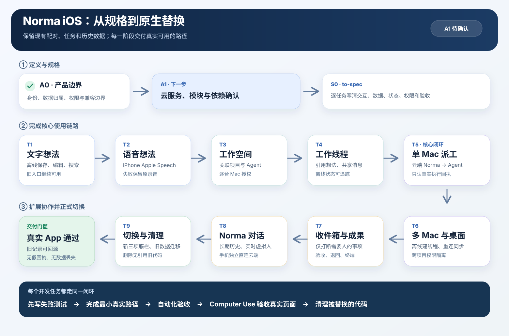

# Goal：Norma iOS 原生替换与旧实现收口

状态：**A0/A1 产品拓扑已确认；首版不支持锁屏后的跨 Mac 自动接续，Mac 登录后后台接收任务；待 S0 to-spec 与票据确认，原生代码尚未开工** · 2026-09-28  
工作分支：`codex/norma-ios-companion`

## 目标与依据

把现有 iOS 的「项目／指挥台／任务」主结构替换为原生 SwiftUI 的「工作空间／Norma／收件箱」。用户可以离线记录独立想法，在多个 Workspace 中关联已配对 Mac 的项目和 Agent，在各 Workspace 的多个工作线程中指挥 Norma 与 Agent，并长期查看 Norma 独立对话。保留现有扫码配对、项目授权、真实任务回执、成果、终端接管与虚拟人实时通话能力。

**原生正式版必须逐屏一比一还原** [09-28 五屏原型](../product-specs/norma-ios-ideas-workspaces-2026-09-28/生成提示词.md)与 [09-26 十屏原型](../product-specs/norma-ios-prototypes-2026-09-26/生成提示词.md)的可见设计及对应交互。每张图的任务归属、两套图之间的冲突处理和验收证据见 [逐屏还原规格](../product-specs/2026-09-06-norma-ios-companion.md#appendix-prototype-fidelity)。不是只借鉴配色或做出相似页面；图中可见的布局层级、间距、字号、图标、卡片、状态、材质、虚拟人形象和操作入口都是实现依据。产品概念以 [`CONTEXT.md`](../../CONTEXT.md) 为准，数据边界见 [存储矩阵](../product-specs/2026-09-06-norma-ios-companion.md#appendix-storage-matrix)。[2026-09-26 旧功能清单](../product-specs/2026-09-06-norma-ios-companion.md#appendix-feature-list) 中「保存想法即创建 Workspace」等规则已被新模型取代，不作为功能验收依据；旧图仍是其余页面的视觉依据。

首版不做云账户、第二部 iPhone/iPad 同步、换机自动恢复或 Mac 之间直接同步。iPhone 保存想法、Workspace、线程可见历史和 Norma 对话；Mac 保存项目及真实执行记录。手机失联时已接收任务继续，新跨 Mac 派工和上下文传递等待重连。

手机上的 Norma 直接连接默认云服务进行文字和实时语音对话；GPT/豆包等模型及供应商 Key 部署在云端，用户不填地址、Key 或模型，不需要 Mac 在线或签发云端通行证。Mac 离线时仍能云聊，需要桌面执行的任务留在手机待发送。旧 Mac 签发语音授权仅作为迁移中的现有实现，不能成为新入口的使用门槛。

桌面 Norma 在已有 Workspace 设置副本中可以独立创建工作线程并处理本机项目，不等待 iPhone 连接。Mac 先保存线程创建、对话、派工和成果事件；手机重连后按来源、稳定事件 ID 和游标补齐同一线程。旧项目聊天没有线程身份，不自动导入。

旧实时通话讨论保留独立可查看入口，用户可手动选片段保存为想法或引用到指定工作线程；原记录保留并标明来源，不自动并入新 Norma 私聊。

已确认的设备授权：用户可在每台 Mac 上一次性明确授权这部 iPhone 读取和控制该 Mac 当前及今后注册的项目；可撤销或改回逐项目范围。旧配对维持原逐项目授权，绝不因升级静默扩权。项目进入 Workspace 仍须留下关联记录，原有高风险操作门禁继续生效。首版移除 Workspace 硬约束设置与新增动作级禁令；普通工作要求保留在对话和共享上下文中。

## 拆分原则

用户已确认 [原生架构讨论稿](../design-docs/2026-09-28-norma-ios-native-architecture-proposal.md) 的产品方向。现有 [Norma 云服务](../../services/norma-cloud/README.md) 的语音能力已上线，但手机独立鉴权、文字对话、服务容量与部署边界尚未决定，先完成 [A1 服务架构讨论稿](../design-docs/2026-09-28-norma-cloud-service-architecture.md)。**再把本 Goal 拆成可验收规格；规格明确后才写原生代码。** 每个开发任务交付一条用户可完成的流程，同时包含必要的手机存储、Mac 协议、原生页面和自动验收；不把「先做数据库、再做 UI、最后接 API」当作三个独立成果。先跑通单设备、单项目的最短完整路径，再增加语音、多 Workspace、多 Mac 和复杂派工。每个切片结束都保留可运行的 iOS App，不用 HTML 原型或假回执代替真实能力。每完成一条新路径，就清理它取代的无引用代码；保留仍承载旧数据或旧客户端的能力。

执行次序：**A0（已确认）→ A1（服务架构确认）→ S0（to-spec）→ T1 → T2 → T3 → T4 → T5 → T6 → T7 → T8 → T9**。先完成文字与 iPhone 系统语音组成的独立想法库，再建立 Workspace 和工作线程，然后打通云端 Norma 与真实桌面任务；多 Mac、收件箱、长期对话与实时虚拟人依次接入。T1 只增加可到达的想法库入口，保留现有三项导航和旧流程；新「工作空间／Norma／收件箱」底栏在 T9 启用，避免尚未实现的页面成为空壳。

## 任务清单

| ID | 可交付的用户流程 | 实施范围与复用边界 | 完成证据 / 验收标准 | 依赖 |
|---|---|---|---|---|
| A0 · 架构确认 | 用户审阅并确认新旧概念、数据表、手机与 Mac 的职责、兼容、旧功能入口迁移及旧代码清理边界。 | 独立 Workspace/项目/线程 ID、Norma 运行位置、桌面离线建线程、手机长期存储和设备授权已确认；具体 API 字段由对应任务的 to-spec 定稿。 | **已完成：用户确认可以进入任务拆分与 to-spec。** | 无 |
| A1 · 云服务架构确认 | 明确手机怎样无需 Mac 在线就能安全调用云模型，以及云端与 iPhone、Mac 各自保存和执行什么。 | **产品拓扑已确认**：个人/受邀设备、跨网络即时派工、首版不支持锁屏后的跨 Mac 自动接续；启用手机服务的 Mac 随用户登录自动后台连接中继，关窗继续，明确退出才停止。复用 `services/norma-cloud`，具体鉴别、文字/语音/中继接口与回退边界在 S0 固定。 | **已完成产品决策**；验收场景要求手机无 Mac 时独立聊天、蜂窝网络向登录后后台运行的 Mac 派工，只有 Mac 持久回执能证明接收和完成；锁屏前已送达任务继续，后续跨 Mac 步骤待手机恢复。 | A0 |
| S0 · to-spec | 开发者能逐任务读到范围、输入输出、状态、验收案例、旧入口替代关系与执行依赖。 | 把下方子任务转成规格：T1–T5 先细化可立即施工的用户流程与接口；T6–T9 写清跨端契约和切换条件。规格放 `docs/product-specs/`，技术契约指向 `docs/design-docs/`。将[逐屏还原规格](../product-specs/2026-09-06-norma-ios-companion.md#appendix-prototype-fidelity)纳入每个页面任务，不把视觉验收推迟到 T9。 | 每项都有可复现的正反例和自动化证据计划；15 张参考图全部映射到页面任务及真实 App 截图；删除旧代码须有新路径或无引用证明；不得把原型或假数据当成验收。 | A1 |
| T1 · 文字想法 | 用户在 P01 记录、编辑、查找文字想法；重启 App 后仍在，且不产生 Workspace 或任务。 | 为长期内容建立 iPhone 本地可查询存储与想法列表；沿用现有 App 私有存储路径，不碰配对凭据。在现有导航内增加可到达的「想法库／更多模块」入口，保留旧项目、配对和任务流程；浅色新页面按原型实现，底栏暂不切换。 | 飞行模式下保存并重启仍可见；保存仅显示「已记录」；Workspace 数和任务数不变；旧配对/任务入口可达；Swift 模型测试与原生 UI 测试通过。 | S0 |
| T2 · 语音想法 | 用户在 P02 录音、看实时转写、修改文字并保存；识别不可用也能留下「待转写」想法。 | 复用现有 `ChatDictation` 的 Apple Speech/音频采集路径；优先设备端识别，不支持时用 Apple 在线识别；录音存 iPhone 私有文件，断网待转写。语音想法与工作线程保持独立。 | 设备端可用、Apple 在线回退、断网、权限拒绝、识别失败和 App 重启均不丢录音或已编辑文字；UI 明示转写状态；真机检查麦克风与权限。 | T1 |
| T3 · Workspace 与项目设置 | 用户新建多个 Workspace，在 P04 为其中一个添加或移除一台已配对 Mac 的已有项目和 Agent；另一个 Workspace 不受影响。用户可归档并重开。 | 新 Workspace ID 与现有协议中表示项目的 `workspace_id` 分开；项目引用包含 Mac ID 和项目 ID。复用扫码、配对和项目目录；在 Mac 配对确认及设备管理中增加本机当前及未来项目的一次性授权，保留旧逐项目授权。关联操作不复制或删除仓库。 | 两个 Workspace 的配置重启后独立存在；离线项目显示来源和上次状态，不能派工；归档后历史仍可看且重开不新建 Workspace；移除关联不删除 Mac 项目/Agent；新注册项目自动纳入已明确授予的本机设备范围，旧配对不自动扩权；撤销后新指令及待执行旧指令均不能越权；对应 iOS 与 Mac 权限测试通过。 | T1 |
| T4 · 工作线程最短闭环 | 用户可从一条想法创建线程，也可直接在 Workspace 建线程；发送消息、退出重进后仍看见原线程，来源想法仍留在想法库。 | 每个 Workspace 可含多个线程；持久化线程、消息、来源引用、目标和基础决定。消息有稳定 ID、来源及「待发送／已送达／失败」状态；复用现有命令回执与 Agent 会话读取。 | 同一 Workspace 两线程互不串消息；离线消息不显示已送达；重连后同一操作只发送一次；P05 显示正确的来源想法与回执。 | T1、T3 |
| T5 · 单 Mac 真实派工 | 用户在当前线程明确要求开工或 `@Agent`；Norma 派给具名 Agent，任务卡及回应出现在同一线程。 | 手机免配置直连默认 Norma 云服务，以 Workspace/线程身份取得回复和任务意图；新任务封套经云端在线中继发给主动出站连接的项目所属 Mac，按稳定操作 ID 与事件游标核对。启用手机服务的 Mac 随用户登录自动在后台连云，关窗不断连，明确退出才停止。供应商 Key 留在服务端，桌面 `NormaSession` 不为同一手机消息重复推理。新线程 ID、Workspace ID 与现有项目 ID 分别表达，旧 `workspace_id` 语义不变。Mac 按设备授权和真实回执执行；Agent 默认拿 Workspace 共同事实与当前线程相关上下文，其他线程按需检索并标注来源；普通 Agent 的跨 Agent 请求由 Norma 统一派发。云端文字、独立鉴别和中继契约在 S0 定稿。 | 蜂窝网络上的 iPhone 能向家中已登录、后台运行 Norma 手机服务的 Mac 派工，无需打开窗口；关窗后已接收任务继续，明确退出后新任务待发送；每次有效 `@Agent` 都有回答、真实接收回执或明确失败；Norma 回复、派工意图和真实任务结果分开显示；对活跃任务的追问续原任务，独立工作才新建任务；排队不显示完成；Mac 离线时云聊仍可用且任务只显示待发送；只讨论或保存想法不派工；现有设备/项目授权仍由 Mac 校验。 | T4 |
| T6 · 多 Mac 与桌面线程同步 | Workspace 同时关联 Mac A 的 iOS 项目和 Mac B 的 API 项目；Norma 可依据目标自主关联已注册项目、加入 Agent 并安排两边工作。用户在桌面 Norma 选择已有 Workspace，离线新建工作线程并处理本机项目；手机重连时看到这条新线程及同一时间线。 | iPhone 把带来源和更新时间的 Workspace 必要设置、事实及线程内容送往各 Mac；每个任务在项目所属 Mac 执行。Mac 持久保存桌面创建的线程、消息与任务事件并按游标供手机补齐；手机消息也同步给参与 Mac。设备全项目授权按 Mac 独立校验，不把 Mac A 的授权带到 Mac B。项目与 Agent 范围变化附原因和真实回执；稳定操作 ID 用于断线重连去重，不建立 Mac 间直连。 | 断开手机后，桌面在已有 Workspace 中创建新线程、派发本机项目任务并留下真实结果；新跨 Mac 派工显示待发送。重连后新线程、消息与结果只出现一次且无重复执行；未同步的新事实显示最近同步时间，不能冒充全端已知；Mac A 的授权不能操作 Mac B；旧项目私聊不自动串入新线程。 | T5 |
| T7 · 成果、收件箱与终端 | 用户从线程任务卡查看成果、验收或退回，并从收件箱处理真正需要自己决定的事项；需要时进入原 Agent 终端。 | 复用现有成果、审批、终端与通知的真实能力，接入新 Workspace/线程导航。普通进展留在线程；收件箱只聚合决定、失败和待验收，不另造任务队列；相近通知合并并按真实状态去重。 | 成果含来源任务、所属 Mac 和证据；退回续原任务；验收后收件箱消项而线程留痕；普通进展不触发系统打断，同一待处理事项不重复提醒；终端接管仍针对原会话且受既有权限控制。 | T5，跨 Mac 场景依赖 T6 |
| T8 · Norma 长期对话与虚拟人 | 用户在 Norma 页用文字或实时语音长期对话；回看旧消息；明确转入某 Workspace 时才把相关内容放进线程。 | 在 iPhone 本地持久保存 Norma 消息、语音转写、回复和操作回执；复用现有虚拟人、豆包/GPT 媒体与打断链路，移除新入口对 Mac 签发语音通行证和用户填写网关配置的依赖。运行时模型上下文与用户可见长期历史分开；原始通话音频默认不作为对话历史。 | App 重启后能浏览和搜索旧对话；所有 Mac 离线仍可免配置开始云端文字/语音对话；语音转写与真实派工回执准确归档；未经用户指定的私聊不自动注入 Workspace；挂断不取消已派任务。 | T4、T5 |
| T9 · 正式切换、清理与回归 | 用户只看到「工作空间／Norma／收件箱」三项导航；旧配对和运行中的任务仍可继续使用，两套原型的全部适用页面均由原生页面完成。 | 在替代页面可用后收口 `RootView`，保留旧 Keychain 凭据、设备记录、草稿及图片、未决命令、实时讨论/操作/播报记录和已存在的 Mac 会话；旧通话讨论提供可查看及手动保存为想法/引用到线程的入口，不自动并入新私聊。按架构讨论稿的清单删除已被取代且无引用的旧导航、页面、状态、样式和夹具，重写对应测试并更新 Xcode 工程。汇总逐屏对照，完成浅色布局、导航/Sheet 的 Liquid Glass、动效、VoiceOver、动态字号和减少动态效果。 | 在升级前后同一设备上核对配对、草稿及图片、待发命令、实时记录、偏好和会话；旧讨论手动引用后来源仍在、未选片段不进入新线程；重复启动或受损旧文件都不覆盖原数据、不重发旧操作；旧入口和资源无悬空引用，旧通知可回源；`swift test --package-path ios`、iOS Simulator `xcodebuild test`、相关 Rust crate 与 `cargo test -p e2e` 通过；15 张参考图对应的真实 App 截图和交互验收记录齐全；用 Computer Use 操作真实 App 验收页面及关键状态；发布前真机检查扫码、麦克风和实时通话。 | T1–T8 |

## 开发子任务与 to-spec 输入

以下编号是执行单元。S0 要为每个单元写出用户起点、交互、数据读写、成功/失败状态、旧能力复用点及可运行的验收证据；相邻单元可合并代码提交，但不能省略验收。

| 父任务 | 按顺序交付的子任务 |
|---|---|
| T1 | **T1a** 离线新增文字想法并重启恢复；**T1b** 编辑、搜索和保存失败恢复；**T1c** 从现有 App 进入浅色想法库，旧配对/项目/任务仍可到达。 |
| T2 | **T2a** Apple Speech 实时转写并允许编辑；**T2b** 离线或识别失败时保存录音和待转写状态；**T2c** 权限拒绝、重启恢复与设备端/Apple 在线路径验收。 |
| T3 | **T3a** 多 Workspace 创建、归档与重开；**T3b** 添加/移除既有项目和 Agent，保留来源及离线快照；**T3c** 每台 Mac 的一次性全项目设备授权与撤销，旧配对权限回归。 |
| T4 | **T4a** 从想法或 Workspace 新建线程，保持来源想法独立；**T4b** 线程消息和共享事实长期保存；**T4c** 离线待发、重连核验与同一操作去重。 |
| T5 | **T5a** iPhone 免配置接入云端 Norma 文字对话；**T5b** 单 Mac 上的 `@Agent` 与 Norma 真实派工；**T5c** 接收、执行、失败、结果未知及完成回执分别展示。 |
| T6 | **T6a** Mac 缓存已有 Workspace 并可离线新建桌面线程；**T6b** 手机与 Mac 双向事件补齐、游标去重；**T6c** 两台 Mac 的项目/Agent 路由、权限隔离与跨项目协作。 |
| T7 | **T7a** 收件箱仅聚合需人决定、失败和待验收；**T7b** 成果查看、通过与退回原任务；**T7c** 从任务回到准确的旧终端/会话并核对权限。 |
| T8 | **T8a** Norma 私聊长期保存与搜索；**T8b** 虚拟人实时语音改用手机直连云服务；**T8c** 用户明确选择后才将私聊片段引用到 Workspace 线程。 |
| T9 | **T9a** 旧数据与通知回源迁移；**T9b** 三项新底栏、浅色与 Liquid Glass 正式切换；**T9c** 删除已替换且无引用的旧 UI/状态/夹具，完成自动化、真实 App 和真机回归。 |

## 每个任务的执行方法

1. **to-spec**：固定该任务的输入输出、状态、错误、数据身份、权限与验收案例；只有依赖的上一任务通过才开始编码。
2. **先测再做**：先写会失败的聚焦测试；实现 iPhone、Mac 或云服务所需的最小真实路径；不以假回执或 HTML 原型代替执行结果。
3. **逐层验收**：开发 Agent 自己运行受影响的 Swift/Rust 单元测试、对应原生 UI 与 e2e，逐屏用 Computer Use 操作真实 App，保存同尺寸截图与两套原型对照并修正差异；扫码、麦克风和实时通话在真机验收。缺少真机或真实服务条件时明确记录未验收项，不能宣称该任务完成。
4. **迁移收口**：新路径验收后移除被它取代的无引用代码，同时保留旧数据和旧客户端仍使用的协议。T9 进行最终导航切换与全量回归。

## 关键实现约束

1. 数据不丢：旧手机的配对凭据、草稿和未决命令保留到新入口可读且可核验；迁移失败保留原始记录，不以空数据覆盖。手机本地存储是产品历史的长期位置，但 Mac 上的执行结果先在执行端落盘，再同步到手机。
2. 命名不混：现有协议的 `workspace_id` 是 Mac 项目 ID；新增协作 Workspace 和工作线程使用独立身份，不直接改旧字段的含义。客户端按 Mac ID + 项目 ID 定位执行设备。
3. 执行不猜：发送、接收、排队、执行中、结果未知和完成各有不同状态；离线重试以稳定操作 ID 回查，不凭 UI 乐观状态生成成功回执。
   设备授权以各 Mac 的最新记录为准；撤销或缩小范围后，已排队但未执行的命令必须重新校验并拒绝越权操作。
4. iPhone 交互：以两套原型为逐屏目标，使用系统导航、Sheet、动态字号和 VoiceOver；主触控目标至少 44pt。浅色内容层优先，按苹果原生 Liquid Glass 组合导航、浮动控件与 Sheet，正文和长文本保留清晰实底；动效说明层级和状态，遵守减少动态效果。先复用仓库和系统已有素材，缺少虚拟人、图标或其他必要素材时生成并纳入资源，再在真机上核对清晰度与裁切。每个页面改动都按 `apple-design` 审视，并用真实 App 操作验证。
5. 注意力：想法保存只反馈「已记录」；普通 Agent 进展留在线程；收件箱和系统通知只打断用户处理决定、失败和成果验收。

## Goal 验收场景

- 离线录入文字和语音想法 → 保存后重启仍在；无 Workspace、无任务；待转写状态准确。
- 创建「移动端体验」Workspace → 关联 Mac A 的 iOS App、Mac B 的 Norma API 与 Agent → 在「改进首屏交接」线程引用想法并 `@Norma` 开始 → 两台 Mac 各自返回具名真实回执及成果。
- 手机失联期间，已接收任务继续；新的跨 Mac 指令明确待发送；重连后只派一次、结果回到原线程，工作事实的来源和同步时间可核对。
- Norma 页文字/语音独立对话在 App 重启后仍可读；只有指定进入 Workspace 的内容才成为共享上下文。
- 关闭全部 Mac 后，iPhone 无需配置仍能连接 Norma 云服务聊天；桌面任务显示待发送，Mac 恢复后按真实回执送达一次。
- 手机暂时连不上 Mac → 在 Mac 的已有 Workspace 内让桌面 Norma 新建「排查启动耗时」线程并处理本机项目 → Mac 本机保留创建、消息和执行记录 → 手机重连后新线程及同一时间线补齐且不重复；旧项目聊天仍能从原项目入口查看。
- 收件箱只出现人需要处理的事项；验收或退回后任务、成果和线程状态一致；扫码配对、终端接管、实时虚拟人通话仍可用。

## 已采用的首版默认

转写后保留原录音，直到用户删除该想法；Workspace 首版只归档和重开，不提供永久删除；旧项目聊天留在原项目入口，不自动并入新线程。对应操作细节由 S0 写入各任务规格。
