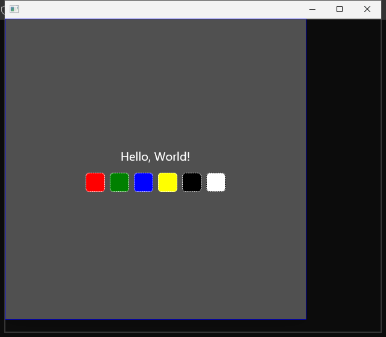

交付 Windows x64 核心预览包，并以 GitHub Actions 的运行记录作为验收依据。
默认使用标准 `windows-2025` runner，无需迁移日常开发环境。

## A 可直接启动的 Goal 任务

```callout info Goal 定义
适配 Norma OS 的 Windows x64 核心工作流。
保留现有 Rust、GPUI、域层和 macOS 行为。
使用 GitHub runner 完成构建、测试、真实程序场景及预览包验证。
所有必验项目通过，并交付对应源码版本的程序与证据后，目标才完成。
```

首版交付项目、画布、终端、文本任务分发、保存和恢复。
Claude 与 Codex 是两个候选 Agent，G1 验证后冻结支持矩阵。
本轮不把普通终端启动算作 Agent 控制完成。

原分期估算仍保留，但本轮不得用分期范围裁剪默认产品构建或禁用能力。
Windows 11 用户设备验收与 Windows ARM64 支持单独记录。
本 Goal 的完成名称为“Windows x64 云端验收预览版”。
它不代表 Windows 11 所有设备能力已经验收。

| 边界 | 约定 |
|---|---|
| 开发环境 | 继续在 Mac 修改代码；Windows 特有行为由 runner 验证 |
| 主要执行环境 | `multisoul-ai/Norma-AI-OS` 公开仓库，标准 `windows-2025` x64 runner |
| 技术版本 | 保持 `rust-toolchain.toml` 的 Rust 1.91.1；不直接采用镜像自带 Rust |
| 产品结构 | 不升级 GPUI，不重写画布、grid 或 Agent 协议，不新建通用平台框架 |
| 本次交付 | App IPC/图片平台边界、116逐项与Mac16复验；保留VAD、Sherpa、Codex及默认产品能力 |
| 后续启动 | 解决Windows关闭契约与App98条原生边界；收束Mac语言/全局锁隔离 |

实施时保留工作区已有改动；只提交本 Goal 的完整变更。
任务拆分与平台改动范围沿用 `docs/exec-plans/2026-11-01-windows-port-plan.md`。

## B Runner 能验证什么

标准 `windows-2025` 镜像运行 Windows Server 2025。
这与 Windows 11 是两个运行环境，不能合并声明支持状态。
当前镜像包含 Visual Studio、Windows SDK、PowerShell 和 Git。
镜像会更新，每次运行仍须记录实际版本。

本次实测镜像为 `win25-vs2026`，版本 `20261021.278.1`。
OS 为 Windows Server 2025 x64，Rust 固定为 1.91.1，Node 为 22.23.4。
进程与活动控制台均在 session 2；存在 1024×768 显示器。
D3D11 设备创建与 WARP 查询均成功，返回 feature level 11.0。
这些环境事实不能单独替代 GPUI 像素和 OS 输入验证。

| 验证项目 | 默认环境与方式 | 通过依据 |
|---|---|---|
| Rust 构建、单测与集成测试 | 标准 hosted Windows runner | 实际 MSVC 编译、测试退出码与报告 |
| ConPTY、IPC、文件和进程 | 标准 hosted Windows runner | 真实 OS 资源测试，包含失败和清理路径 |
| 窗口、渲染和基础交互 | 先由 G1 探测显示会话、DirectX、窗口与输入 | 实际程序、可见像素、OS 输入和行为结果 |
| 两个真实 Agent | 受保护的 Actions 手动验收任务 | 固定 CLI 版本、真实认证、任务产物及 session 回执 |
| 便携包 | 新的 hosted Windows job，下载同一候选包 | 无源码构建步骤，解压后真实运行核心场景 |
| macOS 回归 | 既有 macOS runner；新增差异按需验收 | 相关测试与真实 App 证据，不破坏现有流程 |
| Windows 11、物理设备和音频 | 标准 Server runner 不作为最终证据 | 保持未验收；后续由具备设备的 GitHub runner 覆盖 |

```callout warn 图形能力是首个环境门槛
不预设 hosted runner 能满足 GPUI 的图形与输入需求。
先运行窗口探针，检查是否有可用桌面和实际渲染。
若失败，记录 ENV_UNSUPPORTED；不能跳过真实窗口验收后宣布目标完成。
```

若标准 runner 无法承载核心桌面场景，继续完成可独立验证的迁移任务。
桌面验收阶段保持未通过，并提交探针日志和可复现原因。
后续可接入交互式 self-hosted Windows GitHub runner。
该机器须由用户提供或授权，不自动购买、扩容或注册机器。
不能为得到绿色结果，自动改成只编译不验收。

## C 阶段任务与退出门槛

| 阶段 | 投入估算 | 实施任务 | 退出门槛 | 本轮状态 |
|---|---|---|---|---|
| G0 基线与 CI 入口 | 1–2 人日 | 固定支持范围；修复现有域契约检查错误；建立 Windows 探针工作流 | 原护栏保留；失败测试先复现；探针可在迁移分支执行 | 最小探针入口通过；完整阶段未关闭 |
| G1 Runner 能力探针 | 1–2 人日 | 检查 MSVC、SDK、磁盘、DirectX、桌面输入、截图、ConPTY、CLI 支持与文件语义 | 产出能力报告；核心桌面路径可行；冻结 Agent 版本及支持矩阵 | 基础 GPUI 与 CLI 前置通过；ConPTY、文件语义和真实 Agent 待验 |
| G2 编译与窗口适配 | 3–5 人日 | 隔离 macOS 原生模块；补 Windows 能力状态；默认与 release 构建 | 真实 MSVC 构建通过；主程序和 helper 可启动 | 原六错消除；App98条原生边界阻塞；阶段未通过 |
| G3 IPC 与安全存储 | 5–8 人日 | 本地传输、身份隔离、记忆文件、路径、锁、冲突和恢复 | 越权、junction、硬链接、并发及恢复测试通过 | 部分：原生文件发布与反例通过；完整安全、冲突与恢复矩阵未齐 |
| G4 PTY 与 Agent | 6–10 人日 | PowerShell、参数、hook、提问、取消、恢复和整树退出 | 两个冻结 Agent 的真实工作流通过；无串卡片或遗留进程 | NOT_RUN |
| G5 核心场景与预览包 | 4–6 人日 | Windows 桌面驱动、双语场景、便携包复验和 macOS 回归 | 必验矩阵通过；新 job 验证同一包；发布证据可追溯 | NOT_RUN |

G0–G5 合计估算 20–33 人日。
估算按一名熟悉 Rust 的工程师全职投入计算。
G1 若发现图形、CLI 或文件语义阻塞，更新排期。
Runner 排队、外部认证和机器准备时间不折算为编码人日。

G0 的已知故障是 `scripts/check-domain-contracts.py:57` 的解析异常。
现已先复现失败，再改读实际 schema 子模块并显式使用 UTF-8。
缺失工具会返回契约失败，不再抛出 `IndexError`；原护栏保留。
本地报告 CLI 6 项、契约检查 4 项测试通过，Windows job 亦已执行通过。
基线运行：[41282011261](https://github.com/multisoul-ai/Norma-AI-OS/actions/runs/41282011261)。

### 首轮最小可行性验证

本轮验证编译、图形及 CLI 前置，分别对应 AC01、AC04、AC05/AC06。
AC10 明确保留未执行，不用 GPUI 示例冒充产品候选包。
G0 的探针入口与契约脚本修复已通过；G1 仍是部分验证。
ConPTY 生命周期、文件安全、完整 Agent 控制与产品 GUI 尚未验收。

第一轮运行：[41295234651](https://github.com/multisoul-ai/Norma-AI-OS/actions/runs/41295234651)。
源码为 `cbd146d02e1d98ac51d3d8e9deb8879b01e0f9b4`，汇总门槛结果为 failure。
`canvas` 52 项测试通过；`norma` 与 `app` 的 Windows check 均退出 101。
当前暴露 14 个错误，集中在 norma 的 Unix 导入、权限和条件编译引用。
App 检查被该依赖阻塞，14 个错误不是所有下游问题的总数。

GPUI 示例构建通过，但前台窗口控制未取得，图形门槛未通过。

第二轮运行：[41296333985](https://github.com/multisoul-ai/Norma-AI-OS/actions/runs/41296333985)。
源码为 `366b47182f12c7ba68b589cc7bed8148fecdca11`。
驱动按实际 `Zed::Window` 类定位，取得前台并保存实际窗口原图。
模型查看原图，确认 Hello World 文本与六色方块可见。

自动 RGB 检查仍失败，原因为探针误将 CSS green 的 128 亮度排除。
此轮失败记录保留，不追改成 PASS；未执行的键盘场景仍未通过。

第三轮运行：[41297206819](https://github.com/multisoul-ai/Norma-AI-OS/actions/runs/41297206819)。
源码为 `58fe7ebdaee43f1e3cd6b12725e3f947282dcaa4`。
运行已结束，整体结论为 failure；汇总没有缺失报告，SHA 与 attempt 一致。

固定色样自检通过；GPUI 示例构建耗时 352.25 秒，退出码为零。
真实前台窗口截图通过，RGB 采样为 100、100、267。
OS Alt+F4 输入后目标窗口销毁，键盘关闭检查为 PASS。

模型读取 640×560 原图，确认文本和六色方块可见。
这仅验证示例的基础绘制、截图和 OS 键盘路径，不代表 Norma 场景通过。
尚未验证中文输入、画布、终端、双语主题或 Windows 11 设备。

| 本轮门槛 | 第三轮实测结果 | 结论边界 |
|---|---|---|
| 产品编译 | FAIL：norma/app check 均退出 101 | norma 的 14 个错误仍在；release、主程序与 helper 未执行 |
| 域层样本 | PASS：canvas 52 项通过、0 失败、0 忽略 | 只运行 canvas lib 测试，没有宣称全 workspace 通过 |
| GPUI 基础图形 | PASS：构建、原图像素、前台归属、OS 键盘关闭 | 示例使用独立锁；真实 Norma 的 AC04、AC09 仍为 NOT_RUN |
| CLI 前置 | PASS：Codex 0.166.0、Claude Code 2.1.316 安装与启动 | Codex stdio initialize 通过；未验证原生 TUI relay |
| 真实 Agent | NOT_RUN | 未提供凭据、未授权模型预算，真实任务数为 0 |
| 产品候选包 | NOT_RUN | 未 release 构建、未打包，也未在新 job 复验 |

该历史运行的四个迁移门槛为 1 PASS、1 FAIL、2 NOT_RUN。
当时 AC01–AC12 为 0 PASS、1 FAIL、11 NOT_RUN。
采集 job 的 success 仅代表报告已生成；最终 gate 保留 failure。
本轮最小验证已完成，完整迁移 Goal 仍为未完成。



各轮完整证据与 SHA-256 清单位于 `docs/quality/evidence/windows-feasibility-20261101/`。
证据索引为 `docs/quality/evidence/windows-feasibility-20261101/README.md`。
保留每轮原始报告、日志和失败状态，不跨 SHA 拼接通过结果。

### norma 编译入口迁移与回归（前批）

先增加独立编译门槛，再提交产品修复。
失败基线：[41306097667](https://github.com/multisoul-ai/Norma-AI-OS/actions/runs/41306097667)。
源码 `bf03d7ef434a77dc5268d7ef257a4290c45cb031` 的独立门槛失败，原 14 个错误仍在。
`canvas` 为 52 passed、0 failed、0 ignored。

| 根因 | 原错误数 | 最小修复 | 聚焦证据 |
|---|---|---|---|
| 本地 Socket 导入 | 1 | Windows 复用已锁定的 uds_windows 1.2.1；Unix 仍用标准库 | 真实本地 Socket 往返与错请求 ID 拒绝 |
| Unix 文件权限 API | 8 | Unix 保留 0700/0600/0755；Windows 创建时即使用当前用户专属的受保护 DACL | 放宽 ACL 后检测与修复、原子替换、junction/符号链接拒绝 |
| 过宽的模块条件编译 | 5 | 开放提问与历史模块；跨平台读取打开句柄的稳定文件身份 | Codex/Cursor 问题协议、追加与等长替换、原有 macOS 历史读取 |

Windows 权限查询与修复绑定同一文件句柄，并拒绝 reparse point。
没有加入 chmod 空实现、无认证 TCP、跳过失败测试或隐藏构建参数。
Codex 的既有 POSIX relay 仍未移植，不据此声明完整 Agent 可用。

macOS 的 `cargo test --locked -p norma`：340 passed、0 failed、1 个既有 ignored。
忽略项是需要已安装 Grok Build 的只读发现测试；本次未新增或修改忽略设置。
新增 Socket 测试单独复跑通过，正常提交钩子的 workspace check 与 fmt check 通过。
本机验证使用独立任务缓存，验收后已定向回收 1.8 GiB。

修复版：[41307703559](https://github.com/multisoul-ai/Norma-AI-OS/actions/runs/41307703559)。
源码为 `dae96214474474dffe6e0fc96efabb9d2e14990f`，运行已完成，整体结论仍为 failure。

| 本批验收项 | 实际结果 | 证据与限制 |
|---|---|---|
| 原 14 个 norma 错误 | PASS：全部消除，当前编译诊断为 0 | 与失败基线 41306097667 比较 |
| norma Windows 编译 | PASS：lib 与默认 CLI/helper 编译检查通过 | lib 检查 185.69 秒；独立 gate 也通过；未使用 feature 覆盖 |
| norma 平台回归 | PASS：43 passed、0 failed、0 ignored | lib 26 项，加 5 个集成测试目标，共 43 项 |
| canvas | PASS：52 passed、0 failed、0 ignored | 58.67 秒；原测试未修改 |
| App 检查 | FAIL：退出 101，5 个 E0433 | 首个失败依赖为 voice_input；不是全部下游问题总数 |
| GPUI 示例 | PASS：原图、前台、OS 键盘关闭通过 | 示例仍不等于真实 Norma 图形验收 |
| 真实 Norma 图形、真实 Agent、候选包 | NOT_RUN | 没有以编译或模拟任务替代真实产品验收 |

App 新阻塞位于 `crates/voice_input/src/vad.rs:31`、45、64–66 行。
该文件无条件引用 sherpa_onnx，但 `crates/voice_input/Cargo.toml` 只在 macOS 目标声明依赖。
下一步先验证 Windows 的 Sherpa/VAD 原生依赖与构建路径，保留能力和默认构建语义。
本批没有禁用 VAD、语音或其他产品能力来消除错误。

本批 norma 入口验收已达成，G2 与整体 Goal 仍未通过。
前批 AC 矩阵为 0 PASS、1 FAIL、11 NOT_RUN；本批新增 Mac 环境失败见下文。
原始日志、测试统计与源码身份见 `docs/quality/evidence/windows-feasibility-20261101/41307703559/manifest.json`。

额外 i18n 护栏在 `crates/app/src/settings/voice/view/gpt_live.rs:70` 报既有硬编码。
该文件与修复前基线逐字节一致，本批未改 App 文案；此护栏未标为通过。
Windows Installer 的随机数来源与 Cursor 项目路径编码也仍需后续运行验证。

### Sherpa/VAD 平台依赖修复（前批）

本批针对运行 [41307703559](https://github.com/multisoul-ai/Norma-AI-OS/actions/runs/41307703559) 暴露的 5 个 VAD 引用错误。
先增加真实 Cargo 目标依赖图检查：Windows 三个子用例失败，macOS 三个子用例通过。
修复将 voice_input、asr、voice_sherpa 的 Sherpa 1.13 声明移入普通依赖。
锁定版本仍为 1.13.3，Cargo.lock、VAD 和其他产品 Rust 实现均未改动。
修复后六个子用例全部通过，不使用 test-support 或功能关闭选项。

新增独立 Windows speech job，记录 voice_input 默认编译及三个 crate 的默认测试。
先上传原始报告与日志，再只读校验本次 SHA/run/attempt 和准确退出码。
首轮报告测试为 8 项；后续增加状态与退出码矛盾回归。
最终 9 项报告测试通过；PASS 标签必须对应退出码 0。

首轮修复运行：[41312023075](https://github.com/multisoul-ai/Norma-AI-OS/actions/runs/41312023075)。
源码 `e0e75071fb431d9ff93d432f7f95f899802f57a4`。
voice_input 默认 Windows check 为 PASS，退出 0、116.39 秒，原 5 个错误已消除。
语音测试编译为 FAIL：ASR 引用了被 Unix cfg 排除的 A1RecognizerFactory，实际测试尚未执行。

同轮 norma lib 与默认 CLI/helper check 通过；43 项平台回归与 canvas 52 项均通过，无失败或忽略。
App check 退出 101，879.12 秒，在 storage 编译出现 25 条诊断。
其中 2 条源于 workspace::review 被 cfg(unix) 排除，其余 23 条为 memory/fs 的 Unix 文件 API。
它们涉及目录句柄、openat/renameat、文件描述符与硬链接数，不是下游完整错误清单。

最终报告一致性复验：[41312790317](https://github.com/multisoul-ai/Norma-AI-OS/actions/runs/41312790317)。
源码 `e29f676e6fce66894b87a8ab7fb1e23e3538d8b0`，attempt 1，运行已结束，整体 failure。
该版只补强报告退出码校验，产品依赖修复相同。

| 最终复验项 | 实际结果 | 日志与边界 |
|---|---|---|
| 原 5 个 VAD 错误 | 全部消除；voice_input 默认 check PASS，退出 0，117.0 秒 | speech/voice_input_compile.log；未禁用 VAD |
| norma Windows lib | PASS，退出 0，187.72 秒 | compile/norma_compile.log |
| norma 默认 CLI/helper | PASS，独立编译 gate success | workflow.log；不代表 helper 已启动 |
| norma 平台回归 | 43 passed、0 failed、0 ignored，149.73 秒 | compile/norma_platform_tests.log |
| canvas | 52 passed、0 failed、0 ignored，48.47 秒 | compile/canvas_tests.log |
| App 默认 check | FAIL，退出 101，866.02 秒；storage 25 条诊断 | compile/app_compile.log；不是完整下游清单 |
| 默认语音测试 | 命令 FAIL，退出 101，149.92 秒；A1 编译阻塞 | speech/speech_tests.log；实际测试 NOT_RUN，不填通过数 |
| GPUI 示例 | PASS，窗口、像素、前台与 OS 键盘关闭通过 | graphics/ 原始日志与 PNG；已看图，非真实 Norma |
| 真实产品能力 | 真实 Norma 图形、Agent、候选包、物理录音与模型 VAD 均 NOT_RUN | 未用示例、夹具或编译代替产品验收 |

原始证据与校验清单：`docs/quality/evidence/windows-feasibility-20261101/41312790317/manifest.json`。
App 的 2 条 Review 错误位于两个 mobile_task store 导入；根因是 workspace 的 cfg(unix)。
其余 23 条位于 memory/fs 的 POSIX 目录和文件句柄实现。

语音的 A1 错误位于 `crates/asr/src/providers/mod.rs:114`。
`crates/asr/src/providers/local/a1/mod.rs:8` 在 Windows 排除了该工厂定义。
两轮均保留失败日志，没有删除产品分支或绕过必验门槛。

前批五个探针门槛：1 PASS、2 FAIL、2 NOT_RUN，goal_complete=false。
前批 AC 矩阵：0 PASS、1 FAIL、1 ENV_UNSUPPORTED、10 NOT_RUN。
G1、G2 与整体 Goal 均未完成。


Mac 默认三个 crate 的测试合计 90 passed、4 failed、17 个既有 ignored。
失败均为 A1 host 资源检查；内核内存压力为 WARN（2），未修改的护栏要求 NORMAL（1）。
首次和一次重试日志均保留，重试使用 no-fail-fast 收集其余测试，不修改护栏或增加忽略。

Mac workspace check、fmt、依赖图、边界与性能护栏通过；i18n 仍有原有 GPT-Live 文案失败。
真实 Norma 图形、真实 Agent、候选包与物理录音/模型验收仍为 NOT_RUN。
本机两轮日志、内核查询和源码 SHA 归档在最终运行的 local 子目录。

### storage/Review 与 A1 平台边界修复（前批）

失败基线：[41322579276](https://github.com/multisoul-ai/Norma-AI-OS/actions/runs/41322579276)。
源码 `fbe37cf7a3aeddd36c34a4b72aa3eb321255bcbe`，已结束，整体 failure。
三个新增平台回归命令均退出 101；storage 原 25 条诊断、Review 入口和 A1 工厂错误均复现。
先保存失败版本，再提交产品修复；没有新增忽略或关闭产品能力。

| 修复范围 | 保留的契约 | 验证证据 |
|---|---|---|
| storage 的 23 条 POSIX 诊断 | Windows 使用 NT 目录句柄相对访问；拒绝 reparse、ADS、设备别名和硬链接；创建时施加私有 DACL | 既有 Unix 适配原样保留，338 项 storage/workspace 测试通过 |
| Review 的 2 条模块诊断 | 开放公共 Review；固定根及祖先身份，逐组件读取；保留链接类型和读前后检查 | Mac Review 定向复验通过；Windows 中文 capture 已通过 |
| 原子替换与持久化 | 使用同一目录句柄替换；普通读者不阻塞发布；同步失败不伪装成功 | Windows 旧读者/新指针、目录 flush 与创建冲突均实测通过 |
| A1 工厂与通信 | 保留真实工厂；Windows 管道有界收发；专属 Job 收口后代、取消与超时 | Mac 语音 96 通过、0 失败、17 既有忽略 |
| Review 子进程 | 父进程提前退出后也回收持 stdout 的后代，reader 不能永久等待 | Windows 父先退出、孙进程持 stdout 的 Job 生命周期反例已通过 |

App 探针扩为默认主程序与 helper，保留 norma lib 与独立 CLI/helper gate。
新增回归先证明只检查 lib 不充分，再修正命令；最终报告测试 10 项通过。
受影响语音测试使用 no-fail-fast，实际执行的通过、失败、忽略逐项保留。

#### Mac 压力失败复查

本批修复前原样重跑 A1 host，0 passed、4 failed；内核压力为 WARN（2）。
资源策略文件与前批基线逐字节一致，前批 Sherpa 依赖调整没有修改该策略或宿主 Rust 实现。
四项生命周期测试使用协议夹具，却从真实系统读取压力，环境条件影响了测试前置。

修复把压力输入作为宿主内部依赖；生产 Default 仍调用原内核检查，NORMAL 阈值仍是 1。
夹具显式提供 NORMAL，并新增高压力拒绝启动和取消优先的反向断言。
5 项聚焦 host 测试通过；完整语音测试 96 passed、0 failed、17 个既有 ignored。

A1 模型引擎仍要求 Apple Silicon macOS，该既有限制未改。
本轮 Windows 测试只验证工厂、协议与进程。
物理录音、模型 VAD、真实 Norma GUI、真实 Agent 与候选包均未验收。

本机 storage/workspace 全部测试 338 passed、0 failed、0 ignored。
正常提交 hook 的 workspace check、fmt 与相关边界护栏通过。
i18n 仍在未修改的 `crates/app/src/settings/voice/view/gpt_live.rs:70` 失败，证据保留。
本机基线和修复使用 Homebrew Rust 1.93.1；Windows CI 与独立 API 检查固定为 Rust 1.91.1。
独立 API 检查只证明绑定与目标语法，不冒充完整产品编译或运行证据。

#### Windows 修复版实测

运行：[41325043580](https://github.com/multisoul-ai/Norma-AI-OS/actions/runs/41325043580)。
源码 `f2838b21e04f7eb5c7ccecfc45271ec521ebe186`，attempt 1，已结束，整体 failure。

| 首轮修复项 | 实测结果 | 结论边界 |
|---|---|---|
| 原 storage 25 条诊断 | 已消除；memory 平台测试编译并实际通过 | 不代表全部 Windows storage 测试都已执行 |
| norma lib / 默认 CLI-helper | PASS；43 项平台回归、0 失败、0 忽略 | 未启动真实 App helper |
| canvas | 52 passed、0 failed、0 ignored | 原测试未修改 |
| voice_input / 语音测试 | 默认 check PASS；实际 89 passed、0 failed、16 既有 ignored | 高压力、取消、父先退出/孙进程与无关进程反例通过；真实模型未验 |
| memory 平台回归 | 1 passed、0 failed、0 ignored | 真实保存、重开、硬链接拒绝 |
| Windows NT 文件回归 | 4 passed、0 failed、0 ignored | 目录 flush 实际 Ok；相对替换、旧读者、根/祖先固定、junction/ADS |
| Review 与平台 lib | 中文 capture、进程 Job 反例通过；总计 25 passed、2 failed | 两项失败为既有 Git clone runner 的 GitFailed，原始路径含 verbatim 前缀 |
| A1 工厂平台回归 | 1 passed、0 failed、0 ignored | 取消不启动模型；真实模型引擎仍要求 Apple Silicon macOS |
| 默认 App 编译 | FAIL，退出 101，852.70 秒；runtime 6 条诊断 | 默认主程序与 helper 均未通过，不由库或采集 job success 替代 |

App 新失败位置包括 `crates/runtime/src/nodes/agent/codex.rs:4` 与 UnixStream 导入。
`codex_host`、`codex_turns` 与 `live` 也引用 Windows 未开放的 native_questions/relay。
这需要 Codex 控制传输的真实 Windows 实现；不删除 Agent 入口或把 cfg 去掉后假报支持。
该历史运行的六条诊断保存在其 `compile/app_compile.log`，是当时的编译前沿。

#### Git clone 路径修复与复验

Windows 新暴露的两个 clone 失败发生于 canonical 目标路径 `\\?\C:\...`。
补丁只给 Git argv 使用已锁定 dunce 1.0.5 的兼容路径。
OwnedTarget、Started/Completed、清理、安全收口与返回值仍保留原 canonical 身份。
新增回归记录原始路径和普通路径的真实 Git 对照，覆盖中文与空格目录。

后续运行：[41327614822](https://github.com/multisoul-ai/Norma-AI-OS/actions/runs/41327614822)。
源码 `747777db081a4f06005ee3b8b617de91db29fe8c`，attempt 1，已结束，整体 failure。

| 最终复验项 | 实测结果 | 验收边界 |
|---|---|---|
| 原 storage 25 条诊断 | 全部消除；公开 memory 平台测试实际通过 | 完整 Windows 存储/恢复矩阵仍未齐 |
| 原 Sherpa/VAD 5 条错误 | 未复发；voice_input 默认 check PASS、退出 0、196.91 秒 | 物理录音与真实模型 VAD 未验 |
| norma lib / CLI-helper | PASS；库检查 185.66 秒，独立默认 gate success | 只代表编译检查，不代表 helper 已启动 |
| 原平台回归 / canvas | 43 / 52 项全部通过，各 0 失败、0 忽略 | 本轮没有新增忽略 |
| 语音默认测试 | 实际 89 passed、0 failed、16 既有 ignored；退出 0、442.66 秒 | A1 协议/取消/进程收口通过，Windows 真实 A1 模型未验 |
| 新增平台回归 | 30 passed、0 failed、0 ignored；三个命令均退出 0 | memory 1、workspace lib 23、Review 1、NT 文件 4、A1 工厂 1 |
| Git clone 路径 | 两项原失败与新增中文空格路径回归通过 | 原始 verbatim 参数退出 128/Invalid argument；普通路径与公开 Runner 退出 0 |
| 默认 App 编译 | FAIL，退出 101，840.84 秒；runtime/Codex 6 条诊断 | 主程序、App helper 与 release 均未验收 |
| 真实 Norma GUI / Agent / 候选包 | NOT_RUN | GPUI 示例和协议夹具不作为产品场景通过 |

运行已结束，整体 failure；源码 `747777db081a4f06005ee3b8b617de91db29fe8c`，attempt 1。
五个探针门槛为 2 PASS、1 FAIL、2 NOT_RUN；独立平台 job 为 PASS。
该批 AC 矩阵为 0 PASS、2 FAIL、10 NOT_RUN：AC01 与 AC11 未通过。
G1、G2、完整 Mac 回归和整体 Goal 均未完成，goal_complete=false。

本轮完整日志与 SHA-256 清单：`docs/quality/evidence/windows-feasibility-20261101/41327614822/manifest.json`。
编译与测试派生索引：`docs/quality/evidence/windows-feasibility-20261101/41327614822/compiler-blockers.json`。
本机基线、完整失败与隔离诊断：`docs/quality/evidence/windows-feasibility-20261101/41327614822/local/local-validation.json`。


#### Mac 完整 workspace 结果与边界

按仓库规范执行完整默认 workspace：3415 passed、15 failed、52 个既有 ignored，退出 101。
失败为 App lib 的 14 项，以及 norma 的 OpenCode transport 1 项。
App 日志出现中英文期望差异及锁中毒连锁失败；OpenCode 夹具报 WouldBlock。

未改动相关断言或产品文案，仅各做一次隔离诊断。
对话组 38 项、提议回执 1 项和 OpenCode 1 项均通过。
这不能把完整运行改成 PASS；原始全仓失败日志继续保留，测试隔离问题尚未收口。
当前 Mac 4 项 A1 压力问题已复现并修复，但 Mac 整体验收仍未通过。


### Runtime/Codex 平台边界与最终复验（前批）

原六条 Runtime/Codex 编译错误已消除；App 仍未达到编译通过门槛。
前批运行：[41345708985](https://github.com/multisoul-ai/Norma-AI-OS/actions/runs/41345708985)，源码 `e7a7a78a9a871748f28becf1a6de32702ce41cd9`，attempt 1，整体为 failure。

| Windows 实测项目 | 结果（通过/失败/忽略） | 证据与边界 |
|---|---|---|
| norma 库、CLI/helper 编译 | PASS | 默认 feature，MSVC check；不代表 App/release/启动通过 |
| 原平台回归及 relay lib | 47/0/0 | 原43项执行覆盖以本轮 `compiler-blockers.json` 为准；新增激活3项旧单测及1项partial单测 |
| canvas | 52/0/0 | 实际执行，无新增忽略 |
| 随机控制身份 | 1/0/0 | Windows OS CSPRNG；Unix保留原行为 |
| 控制传输及 relay | 50/0/0 | 本轮实际通过；历史关闭失败未因本轮通过被判定修复 |
| Runtime Codex 集成 | 11/0/0 | session、提问、输入阻塞与turn生命周期 |
| 语音 | 89/0/16 | 16项既有忽略，原Sherpa/VAD/A1错误未复发；非物理音频或真实模型验收 |
| storage/Review/A1独立平台回归 | 30/0/0 | 原生OS文件与进程夹具，不是完整产品场景 |
| App默认检查 | FAIL：116条诊断 | 全部位于App；原6条Runtime诊断未复发 |

各测试组包含重叠的lib用例，不能相加为唯一测试总数。

先提交失败测试：[41335774179](https://github.com/multisoul-ai/Norma-AI-OS/actions/runs/41335774179)。
首轮实现：[41338252762](https://github.com/multisoul-ai/Norma-AI-OS/actions/runs/41338252762)，原6条消除，App新暴露116条。
中间复验：[41341784394](https://github.com/multisoul-ai/Norma-AI-OS/actions/runs/41341784394)，partial缓冲假设与真实背压关闭均失败。
保留各轮失败，不把新增夹具修正追写成旧运行通过。

partial单测现在真实写出4KiB后注入WouldBlock。
它保留Writing→Unknown/Sent、完整RPC及禁止重发断言。
它是确定性故障注入，不能替代真实OS背压关闭集成测试。

本轮关闭测试实际PASS，但前轮FAIL仍未关闭，readiness生产代码未改。
测试只确认外部writer的瞬时WouldBlock，未确定relay输出已背压；本轮绿色不能作为修复证明。
关闭可靠性记UNRESOLVED；不能用超时杀慢连接或有限预读冒充等价修复。

Mac完整基线为3427/3/52，首轮改后3418/17/52，修正Codex回执等待后3419/16/52，均退出101。
原15项在基线与改后逐项隔离均15/0/0；完整运行中的既有失败继续保留。
本轮观察到的Codex历史回执竞态已修正：原3秒内同时等Attached身份与SessionUsed历史；原断言保留。
最后仅替换partial故障注入后，norma/runtime实际687/0/12，退出0。

Mac使用Homebrew Rust1.93.1；Windows使用固定Rust1.91.1，环境区别已记录。

最终完整Mac另有OpenCode输入锁断言失败；未改基线额外20次中18次通过、2次失败于另一条状态断言。
最终输入锁症状未在基线复现，归因未收束，不能宣布Mac无新增回归或全仓通过。
i18n既有GPT-Live失败、52项全仓既有忽略和全部原始日志保留；没有新增ignore/allow或关闭默认feature。

逐项六错、Mac15项前后表、验收映射与剩余阻塞见 `docs/quality/evidence/windows-feasibility-20261101/runtime-codex-audit.md`。
完整日志及SHA-256清单位于 `docs/quality/evidence/windows-feasibility-20261101/41345708985/manifest.json`。
真实Norma图形、真实Agent、候选包仍为NOT_RUN；迁移Goal未完成。

### App IPC/图片边界与 Mac 16 项复验（本批）

原 116 条诊断已按 12 类根因逐项归档。
实现复验：[41384140463](https://github.com/multisoul-ai/Norma-AI-OS/actions/runs/41384140463)，源码 `a53698f635c1501dd37aa4799add30fc4f68b164`，attempt 1，整体 failure。
先行 RED：[41377422839](https://github.com/multisoul-ai/Norma-AI-OS/actions/runs/41377422839)，源码 `1d5b8e2441f3a0f9515b589ee4f2bf0fe92b7d51`。

| 项目 | 实测 | 门槛 |
|---|---|---|
| App 默认 check | 原 13 条 IPC、5 条图片文件错误消除；仍有 10 类 98 条 | FAIL，未默认编译成功 |
| 实际 App 适配 | Windows 15/0/0，含请求响应、端点身份、超时、取消、图片边界 | 仅前置通过，不替代 App/权限完整验收 |
| norma 与原平台 | 47/1/0；原 43 项通过名全部保留 | 新背压 shutdown 见证失败，命令 FAIL |
| Codex/Runtime 控制 | 控制 49/2/0；Runtime 11/0/0 | 强见证与原 shutdown 契约失败 |
| 独立平台/canvas/语音 | 30/0/0、52/0/0、89/0/16 | 16 个语音 ignored 为既有项 |
| Mac 完整 A/B | A 3428/14/52；B 3443/0/52 | A 的 14 项既有语言/锁失败仍保留，不能宣称修复 |
| Mac 两项 OpenCode | 确定性输入锁 RED、HTTP 非阻塞继承；修复后 A/B 完整均通过 | 原 session、唯一 POST、不重发与门闩均保留 |
| 真实 Norma GUI/Agent/候选包 | NOT_RUN | 未以图形示例、协议夹具或 CLI version 冒充 |

App IPC 保留 32/64 队列与 4 个 worker，增加可取消的绝对 IO 预算。
Windows 以 AF_UNIX reparse tag 与 volume/fileIndex 识别端点，通过 pinned HANDLE 删除。
图片复用私有 DACL，拒绝 reparse；Unix 文件与 Socket 行为保留。
没有关闭 VAD、Sherpa、Codex、Browser 或默认产品 features，没有新增 ignore/allow。

关闭日志记录 131072 字节未读，mask0 没有事件，RDNORM 只有可读。
当时 writer 仍持有 source 句柄，只能证明 shutdown 后未在 3 秒退出，不能证明真实退出后的收口。
强见证已修正为 writer 先 drop 并 ack，join、释放最后 clone 后才开始原 3 秒窗口。
旧 shutdown 契约继续保留，不能用新测试覆盖旧 FAIL。

最终复验：[41386261217](https://github.com/multisoul-ai/Norma-AI-OS/actions/runs/41386261217)，源码 `120492ca29ec49b12ed4368eb0d10e01b5d34845`，attempt 1，整体 failure。
App 默认 check 仍为 98 条，原 18 条消除；norma 库/CLI/helper 编译通过。
原平台目标为 47/1/0，原 43 项通过名完整保留；失败只有新增的严格 close 见证。

控制 50/1/0、Runtime 11/0/0、identity 1/0/0；两个 OpenCode 目标各 1/0/0。
实际 App 适配 15/0/0、独立平台 30/0/0、canvas 52/0/0、语音 89/0/16。

强见证记录真实输出 8 次连续 WouldBlock、5 个源帧、全部 source 句柄释放 true，原 3 秒内仍未退出。
原 shutdown 测试本轮通过，但历史 FAIL 没有生产修复证据，可靠性仍未收束。

当前 AC 为 0 PASS、3 FAIL、9 NOT_RUN；AC01、AC02、AC11 不标完成。

中间运行 41385201505 已因关闭见证前提修正主动取消，不用作通过证据。
报告 SHA、run/attempt 一致，未缺报告；完整日志和哈希清单保存在对应 run 目录。


原 116 与当前 98 逐项对照、Mac 16 项前后与所有日志入口：
`docs/quality/evidence/windows-feasibility-20261101/app-platform-audit.md`。
`docs/quality/evidence/windows-feasibility-20261101/app-116-comparison.json`。
`docs/quality/evidence/windows-feasibility-20261101/app-platform-local/macos-16-comparison.json`。
本分支提交 Draft PR，不合并；AC01、AC02、AC11 均未关闭，迁移 Goal 未完成。

### 已实测的阻塞与后续顺序

| 优先级 | 阻塞/条件 | 下一批任务 | 退出证据 |
|---|---|---|---|
| 1 | Windows shutdown 契约失败；全部 source close 独立复验 | 保留真实输出背压，分别核验shutdown与最终close | 原3秒门槛、全部句柄释放、完整分支；历史FAIL保留 |
| 2 | App98条原生平台诊断 | 生命周期/Brain/内容，再手机/Browser真实Windows实现 | 默认App check成功；能力不被关闭 |
| 3 | Mac既有14项语言/全局锁隔离仍复现 | 保留A/B前后；修复真正共享状态隔离 | 并发完整回归，不用单次全绿或隔离绿替代修复证据 |
| 4 | ConPTY与存储恢复矩阵尚缺 | PowerShell、hook、进程树与安全恢复 | 实际OS资源正反测试 |
| 5 | 真实Norma、Agent、候选包未验 | 先窗口，再授权Agent，最后同哈希包新job复验 | AC04/05/06/10与Mac回归 |

G1尚未完成，不下调20–33人日估算，不冻结Agent产品支持矩阵。

## D Actions 工作流设计

以下为完整迁移阶段的后续路径；本轮仅新增最小探针入口。
优先复用现有 Rust 缓存、协议、场景语义与检查脚本。
Windows 桌面入口与现有 Swift/macOS 驱动分开维护。

| 路径 | 职责 |
|---|---|
| `.github/workflows/windows-ci.yml` | PR 与迁移分支的环境、构建、域测试；不读取模型凭据 |
| `.github/workflows/windows-acceptance.yml` | 指定源码版本的完整验收、真实 Agent 和包复验 |
| `scripts/windows/preflight.ps1` | 输出工具链、资源、桌面、图形和设备能力报告 |
| `scripts/desktop-e2e-windows.ps1` | 启动真实 Windows 程序、执行场景、收集失败证据 |
| `test/desktop-e2e/Windows/Scenarios/` | 按模块维护 Windows 场景；不改写 macOS 场景注册表 |

本轮已实现 `.github/workflows/windows-feasibility.yml`。
新增 app-platform 独立执行实际 App 源适配；codex-control 分别保存 OpenCode transport/runtime 的日志与退出码。
原 norma 平台命令启用 no-fail-fast，新增见证失败也不能跳过原有目标。

采集程序为 `scripts/windows/probe.py` 与 `scripts/windows/native.ps1`。
固定 GPUI 示例入口和依赖锁位于 `test/windows-probe/Cargo.toml`、`test/windows-probe/Cargo.lock`。
示例复用 vendor 原代码，使用独立依赖锁，不代表产品依赖图通过。

报告记录 job 的 SHA、run ID、attempt、日志和实际镜像版本。
汇总严格核对证据身份；缺项、未执行或产品编译失败均不能通过。

| Job | 执行内容 | 初始超时建议 |
|---|---|---|
| preflight | 精确源码版本、工具链、磁盘、图形、桌面与依赖检查 | 15 分钟 |
| domain-tests | 受影响 crate、Windows OS 资源集成测试及对应护栏 | 45 分钟 |
| candidate-build | 一次 release 构建；生成候选包与哈希 | 120 分钟 |
| desktop-acceptance | 下载候选包，在实际窗口完成核心场景 | 30 分钟 |
| live-agents | 已受信源码、两个真实 CLI 与最小任务 | 30 分钟 |
| package-verify | 新 job 下载同一候选包，解压并运行，不从源码重建 | 30 分钟 |
| acceptance-gate | 汇总必验项、哈希和报告完整性，生成最终结论 | 5 分钟 |

普通 PR 不执行真实模型调用，也不接触发布或用户凭据。
完整验收先通过 `workflow_dispatch` 指定受信源码版本。
初始工作流可由迁移分支 push 验证。
`workflow_dispatch` 稳定入口须按正常 PR 流程进入默认分支。

本轮已获用户授权，提交探针到独立分支并触发真实 Actions。
未合并主分支，未修改分支保护，未启用付费 runner。
工作流按路径触发，只有文档更新不会重新跑全部构建。

PR 同分支任务可取消旧运行；正式候选验收串行执行。
固定 Actions 依赖版本，并记录实际镜像版本。
复用仓库钉死的 Rust；先检查 LFS 资源完整性。

后续构建记录磁盘峰值；本轮仅记录各采集任务末尾的可用空间。
本轮关闭增量缓存，编译并发固定为 2，没有上传构建二进制或缓存。
不能靠删除 runner 的系统工具和 SDK 掩盖容量问题。

## E 必须通过的验收矩阵

| 编号 | 场景与执行方式 | 必须观察到的结果 | 必须排除的失败 | 本轮状态 |
|---|---|---|---|---|
| AC01 | Windows 默认构建、release 构建及 helper 启动 | MSVC 退出码为零；工具版本可查 | 只在 Mac 交叉检查，或靠隐藏参数才能启动 | FAIL：App原18条消除、仍98条；norma/CLI/helper通过，release未执行 |
| AC02 | IPC 与身份、端点冲突集成测试 | 同用户正确请求成功，越权和陈旧端点被拒绝 | 无认证 TCP、跨项目误投递、后台线程不退出 | FAIL：控制shutdown契约失败；App适配15项通过，完整权限/进程集成未验 |
| AC03 | 真实 ConPTY 输入、resize、中文和特殊路径 | 真实 Shell 返回唯一标记，尺寸与 cwd 正确 | 只比较命令字符串、转义失败或等待无限挂起 | NOT_RUN |
| AC04 | 真实窗口建立项目和终端，移动缩放后重启 | 画布与终端可见，OS 输入生效，布局和内容恢复 | 黑屏、冻结、只改内部状态或仅检查 PNG 存在 | NOT_RUN：未运行真实 Norma；图形示例前置另列 |
| AC05 | 两个冻结 Agent 各完成一个最小任务 | 真实 CLI 创建预期文件；session、卡片和回执对应 | fixture 冒充真实 Agent、只有 version 检查或串卡片 | NOT_RUN：无真实模型任务 |
| AC06 | 提问、回答、取消、退出和恢复 | 请求归属正确，取消收口，恢复仍是同一会话 | 重复派工、假完成、取消后迟到动作 | NOT_RUN：未验证提问、取消与恢复 |
| AC07 | 关项目及主动退出 App | 受控子进程和后代退出并等待；其他任务保留 | 只杀 Shell、孤儿 CLI、误杀无关进程 | NOT_RUN |
| AC08 | 安全存储与编辑冲突测试 | 路径越界被拒绝，记忆可恢复，冲突内容不丢失 | junction、路径交换、硬链接或备份回滚失效 | NOT_RUN |
| AC09 | 中英文、亮暗主题、键盘与能力状态 | 文案可切换，焦点可见，终端 Ctrl+C 保留中断 | 硬编码文案、不可用能力显示就绪或快捷键冲突 | NOT_RUN：未验真实 Norma 的双语、主题与键盘 |
| AC10 | 新 job 下载候选便携包 | 哈希一致；无开发目录依赖；真实启动、命令与恢复成功 | 用另一份构建替代候选包，或只验证能解压 | NOT_RUN：未构建或复验候选包 |
| AC11 | macOS 增量回归 | 受影响 crate、App 构建和关键既有场景通过 | 用 Windows 通过掩盖 macOS 行为回退 | FAIL：本轮A3428/14/52、B3443/0/52；2项OpenCode修复且完整通过；14项既有隔离未修，真实App未验 |
| AC12 | 最终证据核对 | 每条必验项都有 PASS、执行版本与证据入口 | 缺项、跳过、continue-on-error 或拿旧版本证据拼接 | NOT_RUN：最终必验未齐；本轮证据独立留存 |

AC04、AC09 包含模型查看实际窗口原图。
实际输入、可见结果与持久状态需要相互印证。
桌面驱动不可只调用 `TestAppContext` 或模拟点击。
测试支持构建和候选构建若不同，必须分别记录。
AC10 仍须验证交付的候选包本身。

新 hosted job 仍预装开发工具，不能证明纯净 Windows 11 安装就绪。
另做 DLL 与运行库依赖审计，把用户设备安装验证留在后续矩阵。

真实 Agent 任务需要受保护的凭据与已授权调用预算。
缺少凭据时记 NOT_RUN，不能以协议替身替代 AC05、AC06。
不得从本机复制已有登录凭据到 GitHub。
凭据使用 GitHub Secrets 和受保护环境安全接入。
Fork PR、任意未受信 ref 和可执行测试输入均不得获得凭据。

本轮探针未新增 Secrets，未提交模型任务。
两个 CLI 的安装与启动通过；Codex stdio 初始化返回 Windows 平台结果。
该握手不验证 Norma 的 Unix TUI relay，也不验证真实任务、提问或恢复。

输入法、DPI、多显示器和物理音频只声明实际测到的环境。
Windows 11 专项、Browser 与语音验收仍属于后续阶段。
内容编辑若 G1 无法证明安全保存，首版明确为只读。
该范围变更必须在支持矩阵中冻结，不能运行失败后临时移出必验项。

## F 结果判定与交付证据

| 状态 | 含义 | 能否作为必验项通过 |
|---|---|---|
| PASS | 预期行为通过，反向断言及证据完整 | 能 |
| FAIL | 实现、断言、退出码或产物有误 | 不能 |
| ENV_UNSUPPORTED | 图形、桌面、设备或资源条件不具备 | 不能 |
| NOT_RUN | 未执行，或缺少必要认证、预算、依赖 | 不能 |
| NOT_IN_SCOPE | 在执行前已冻结的后续功能 | 不计入当前必验项，也不宣称支持 |

未被本轮证据覆盖的阶段与 AC 项保持未开始或未通过。
失败后只重试已判定为暂态的网络或环境问题一次。
断言失败不靠重跑覆盖；每个 attempt 保存独立结果。
阶段只有通过退出门槛才能标记完成。
若 hosted 桌面门槛未通过，整体 Goal 仍未完成。

每次运行输出以下证据；文件路径中的占位符由 run ID 和 attempt 替换：

- `artifacts/windows-acceptance/<run-id>/<attempt>/source-manifest.json`：实际 checkout SHA、事件 SHA、workflow SHA、CLI 与工具链版本。
- `artifacts/windows-acceptance/<run-id>/<attempt>/runner-capabilities.json`：镜像、OS、GPU、显示会话、输入、截图与可用设备。
- `artifacts/windows-acceptance/<run-id>/<attempt>/acceptance-results.json`：AC 编号、状态、耗时、失败类别与证据相对位置。
- 测试与构建日志：命令、退出码、测试统计和资源峰值。
- PNG 原图：关键窗口状态与失败现场，不能只有截图哈希。
- `artifacts/windows-acceptance/<run-id>/<attempt>/candidate-manifest.json`：包、主程序、helper 的 SHA-256 与构建 features。
- 对应 SHA 的便携包、功能支持矩阵和已知限制说明。

报告展示通过数、失败数、未执行数和未覆盖数。
工作流上传失败证据；下载后复核哈希和内容。
上传失败或证据缺失时，最终 gate 不能通过。
临时文件、真实用户数据库、凭据和完整模型对话不上传。
测试使用专属数据目录、合成项目和可公开的固定内容。

## G 费用、权限与资源控制

当前仓库公开，标准 hosted Windows runner 的计算免费。
该使用量归组织，不消耗个人账号的免费计算额度。
免费计算不代表构建产物和所有 runner 类型都免费。

| 项目 | 默认策略 |
|---|---|
| Runner | 只使用标准 `windows-2025`；不启用 larger runner 或 GPU 付费规格 |
| PR 权限 | 最小只读仓库权限；不传递 Secrets；不使用高权限事件执行不受信代码 |
| Artifact 留存 | 预检小报告 7 天；截图和验收日志 3 天；便携包默认 1 天 |
| Artifact 容量 | 本 Goal 当前保留数据控制在约 350 MiB 内；组织 Free 500 MB 为共享额度 |
| 缓存 | 复用现有 Rust 缓存；不提高每仓库 10 GB 的免费缓存上限 |
| 并发与超时 | 按阶段限时；正式候选验收串行；临时环境失败最多重试一次 |
| 真实模型调用 | 只在用户已配置凭据和预算的受保护验收任务执行 |
| 签名与正式发布 | 当前只交付 CI 预览包；不购买证书、不发布 Release、不更改账单设置 |

每次大包上传前盘点当前仓库留存量。
组织其他仓库也会共享产物存储，需在阶段验收时核对账单页。
空间不足时停止新增大包，不删除其他任务的验收记录。
可回收本 Goal 明确过期的自有产物，保留当前候选的完整证据。
免费计算不能作为所有用量都不会产生费用的证明。

## H 完成定义与后续入口

只有以下条件全部满足，才能宣布本适配 Goal 完成：

1. G0–G5 的退出门槛全部通过。
2. AC01–AC12 必验项均有 PASS 和对应版本证据。
3. 干净 runner 已运行同一个 Windows x64 候选包。
4. 两个支持 Agent 的真实控制流程均通过。
5. macOS 回归通过，平台能力边界与已知限制清楚。
6. 用户拿到包、源码 SHA、运行链接、截图与最终验收表。

Beta 后续按原计划补内置浏览器、语音与安装发布。
主流功能 Beta 累计估算仍为 36–60 人日，G1 后重估。
Windows 11 用户设备验证使用具备交互桌面的 GitHub runner。
如果尚未接入该环境，则相应支持状态保持未验收。

依据与现行入口：

- 原适配计划：`docs/exec-plans/2026-11-01-windows-port-plan.md`。
- GitHub runner 规格：https://docs.github.com/en/actions/reference/runners/github-hosted-runners 。
- Windows 镜像说明：https://github.com/actions/runner-images/blob/main/images/windows/Windows2025-Readme.md 。
- Actions 计费规则：https://docs.github.com/en/billing/concepts/product-billing/github-actions 。

本轮已运行最小 Windows 探针；产品迁移与整体 Goal 仍未完成。
