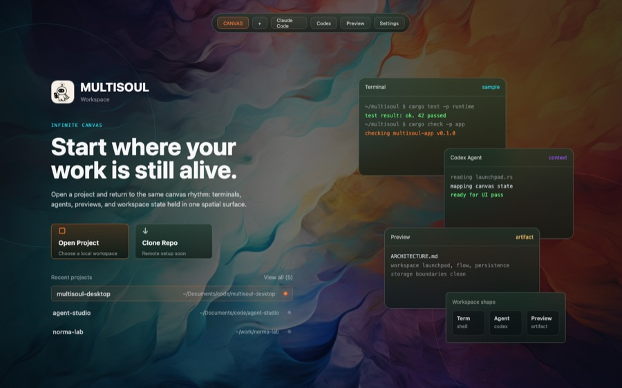

# Launchpad 静态视觉升级 SPEC

## 0. 原型关联（AI 识别入口）

本 SPEC 关联并落地 `Launchpad UI Option 1 / Orbit Entry` 原型。后续 AI 或 Agent 执行实现时，必须优先读取本节引用的原型文件，再对照本 SPEC 实现。

```yaml
prototype_id: launchpad_option_1_orbit_entry
prototype_name: Launchpad UI Option 1 - Orbit Entry
prototype_status: selected_for_static_visual_implementation
source_html: docs/design-docs/launchpad-ui-options/index.html
source_html_variant_url: docs/design-docs/launchpad-ui-options/index.html?variant=1
source_html_node: "#variant-1[data-name=\"orbit-entry\"][data-prototype-id=\"launchpad_option_1_orbit_entry\"]"
reference_png: docs/design-docs/launchpad-ui-options/variant-1.png
reference_jpg_small: docs/design-docs/launchpad-ui-options/variant-1-small.jpg
implementation_mode: static_visual_only
target_entrypoint: crates/app/src/workspace/launchpad.rs
```

采访决策结果：

- 右侧静态卡片状态词使用中性词：`sample` / `context` / `artifact`。
- Launchpad 背景使用 app-level wallpaper，即 `wallpaper_from_env()` 解析出的默认/自定义壁纸；不要依赖尚未打开的 workspace root。
- 顶部 toolbar 第一版保留 Canvas 标签，但只做静态视觉预览，不绑定点击事件。
- 实现第一版先拆 `workspace/launchpad/` 目录模块。
- 原型还原使用视觉锚点，不做逐像素还原。
- Recent Projects 行为测试列为必测。

参考图：



## 1. 背景与目标

当前启动页由 `crates/app/src/workspace/launchpad.rs` 渲染，主要是居中的 `MULTISOUL` brand、两个 action card 和 recent projects 列表。它功能清晰，但没有使用 workspace 已有的壁纸、graphite 遮罩、橙/青强调色和空间工作台语义，导致启动页与进入 Canvas 后的视觉体验断裂。

本次目标是基于方案 1 原型，实现一个静态视觉版启动页：让用户启动应用时先看到接近 workspace 的沉浸式入口，同时保留现有 Open Project、Clone Repo、Recent Projects 的行为边界。

## 2. 范围

### 2.1 In Scope

- 将启动页背景升级为 workspace 风格：
  - 使用 app-level wallpaper，即 `wallpaper_from_env()` 解析出的默认/自定义壁纸。
  - 使用 graphite 暗色遮罩。
  - 使用橙/青细线圆环和底部细线作为空间感装饰。
- 将启动页主内容从居中小面板升级为方案 1 的左右布局：
  - 左侧：brand、短 tagline、Open Project、Clone Repo、Recent Projects。
  - 右侧：静态 Terminal / Agent / Preview 视觉卡片。
  - 右下：静态 Workspace shape 小面板。
- 顶部可显示一个静态 toolbar 预览，呼应 Canvas 的顶部 chrome。
- 保留现有可用行为：
  - `Open Project` 打开目录选择。
  - recent project 行点击后打开对应 workspace。
  - `Clone Repo` 继续显示未实现提示。
- 增加必要的响应式布局计算，保证窄窗口不裁剪关键入口。
- 拆分 launchpad 代码，避免单文件超过 500 行。
- 为新增布局纯函数补测试，先 TDD 再实现。

### 2.2 Out of Scope

- 不实现 live preview，不启动 PTY，不创建 Runtime node。
- 不让右侧 Terminal / Agent / Preview 视觉卡片接入真实 runtime 状态。
- 不实现 Clone Repo 功能。
- 不改变 `canvas`、`terminal`、`runtime`、`storage` 的依赖方向。
- 不升级 `gpui = 0.2.2`。
- 不引入新 UI 框架或新依赖。
- 不实现动画、动态光效、真实 backdrop blur 或自定义 Metal shader。
- 不修改 workspace persistence 语义。

## 3. 用户体验需求

启动页应像“进入 workspace 前的预览态”，而不是独立营销页。

视觉要求：

- 首屏必须明显使用 app-level wallpaper 和深色 graphite 氛围。
- Brand 区使用项目内 `APP_ICON_ASSET`，不要用临时图形或文字占位。
- `Open Project` 是唯一主操作，使用 orange 作为主强调。
- `Clone Repo` 是次操作，视觉上可点击但弱于主操作。
- Recent Projects 保持可扫描：项目名左侧，路径右侧，最多显示 5 条。
- 右侧静态卡片只表达产品形态，不承诺真实状态。
- 文本必须保持克制，不写大段功能说明。

交互要求：

- 启动页所有真实点击行为与当前版本一致。
- 静态 toolbar 预览和右侧 preview cards 不应触发 runtime 操作。
- 当 storage/recent/open project 出错时，继续在启动页内显示错误，不切换到 Canvas。
- 键盘 action `OpenProject` 仍可触发打开目录。

## 4. 信息架构与视觉结构

### 4.1 背景层

背景层由下到上：

1. graphite fallback 背景。
2. App-level wallpaper，`ObjectFit::Cover`。
3. 深色透明遮罩，保证左侧文本和右侧卡片可读。
4. 左侧 cyan 圆环、右下 orange 圆环、底部 cyan 细线。

实现应尽量复用 `crates/app/src/app/chrome.rs::render_workspace_backdrop` 的视觉语言，但不要直接把 Canvas chrome 行为带入 Launchpad。

### 4.2 顶部 toolbar 预览

顶部 toolbar 只作为静态视觉预览：

- 居中宽度约 `460px`。
- 使用当前 toolbar 的 pill 风格、panel 半透明背景、细边框和阴影。
- 可以显示 `CANVAS`、`+`、`Claude Code`、`Codex`、`Preview`、`Settings`。
- 第一版不绑定点击事件，避免在 Launchpad 上触发 “Open a project before...” 这类错误。

### 4.3 左侧主入口

左侧宽度以 `560px` 为基准：

- Brand row：app icon + `MULTISOUL` + `Workspace`。
- Tagline：短文本，使用 cyan 小号等宽样式。
- Headline：两行以内，表达“从 workspace 继续工作”的感觉。
- Supporting copy：最多两行，避免说明书式文案。
- Action cards：
  - `Open Project` 主卡片。
  - `Clone Repo` 次卡片。
- Recent Projects：
  - 标题行：`Recent projects` + `View all (N)`。
  - 空状态：沿用 `No recent projects`。
  - 有数据：最多 5 条，行高比当前略高，首条可用 orange dot 强调。

### 4.4 右侧静态视觉卡片

右侧卡片是纯装饰/预览：

- Terminal card：展示少量 shell 输出文本，状态词使用 `sample`。
- Agent card：展示少量上下文文本，状态词使用 `context`。
- Preview card：展示文档/预览语义，状态词使用 `artifact`。
- Workspace shape panel：展示 `Term`、`Agent`、`Preview` 三个静态 tile。

这些卡片不得读取 runtime、不得启动 terminal、不得进入 session checkpoint。

## 5. 技术设计

### 5.1 模块组织

当前 `crates/app/src/workspace/launchpad.rs` 已约 294 行。方案 1 会增加背景、preview cards、toolbar preview、响应式布局等代码，直接写在单文件中容易触发 500 行限制。

建议改为目录模块：

```text
crates/app/src/workspace/launchpad/
├── mod.rs       # render_launchpad、事件回调、整体组装
├── layout.rs    # 纯布局计算 + 单测
├── backdrop.rs  # wallpaper、遮罩、rings、toolbar preview
├── actions.rs   # brand、tagline、action cards
├── recent.rs    # recent projects section
└── preview.rs   # 静态 Terminal/Agent/Preview cards
```

`crates/app/src/workspace/mod.rs` 仍保持 `pub mod launchpad;`，Rust 会从 `launchpad/mod.rs` 加载模块。

迁移时必须把原 `crates/app/src/workspace/launchpad.rs` 移动/拆分到 `crates/app/src/workspace/launchpad/mod.rs`，不要同时保留同名 `launchpad.rs` 与 `launchpad/` 目录模块。

### 5.2 Wallpaper 访问

`MultisoulApp.wallpaper` 当前是 `app` 模块私有字段，`workspace::launchpad` 不能直接访问。为保证 Launchpad 与 Canvas 背景一致，新增一个窄 getter：

```rust
impl MultisoulApp {
    pub(crate) fn wallpaper_image_source(&self) -> gpui::ImageSource {
        self.wallpaper.image_source()
    }
}
```

该 getter 可放在 `crates/app/src/app/wallpaper.rs`。不要把 `wallpaper` 字段直接改成公开可写。

### 5.3 布局计算

新增纯函数用于 TDD：

```rust
pub(crate) struct LaunchpadLayout {
    pub mode: LaunchpadLayoutMode,
    pub content_left: f32,
    pub content_top: f32,
    pub content_width: f32,
    pub preview_visible: bool,
    pub preview_left: f32,
    pub preview_top: f32,
}

pub(crate) enum LaunchpadLayoutMode {
    Wide,
    Compact,
}

pub(crate) fn launchpad_layout_for_window(width: f32, height: f32) -> LaunchpadLayout
```

建议规则：

- `width >= 1180`：使用方案 1 双区布局，左侧内容 + 右侧 preview。
- `width < 1180`：隐藏右侧 preview，左侧内容居中，保证 Open Project 和 Recent 可用。
- `height < 720`：减少顶部间距和 section gap，避免 action/recent 被裁剪。

1440x900 原型视觉锚点（允许 GPUI 适配，不要求逐像素）：

- 左侧主内容：`left ≈ 118px`，`top ≈ 186px`，`width ≈ 560px`。
- 顶部 toolbar：`top ≈ 30px`，`width ≈ 460px`，`height ≈ 46px`。
- 右侧 preview 区：`right ≈ 112px`，`top ≈ 142px`，`width ≈ 520px`，`height ≈ 610px`。
- Action card：`width ≈ 180px`，`height ≈ 82px`，`gap ≈ 14px`。
- Recent row：应比当前 28px 略高，但不得降低可扫描性。

### 5.4 GPUI 渲染约束

- 背景使用 `img(...).object_fit(ObjectFit::Cover)`。
- 暗色遮罩使用 `rgba(with_alpha(theme.graphite, ...))` 和 `linear_gradient` 近似。
- GPUI 0.2.2 没有 CSS `backdrop-filter`；玻璃感通过半透明 fill、细边框、阴影模拟。
- 静态 preview cards 使用普通 `Div`，不复用真实 card renderer，避免引入 runtime 依赖。
- Action 和 recent rows 保留稳定 `id`，避免 UI 测试或自动化脚本丢失定位点：
  - `launchpad-open-project`
  - `launchpad-clone-repo`
  - `("launchpad-recent-project", index)`

## 6. 状态、错误与边界情况

- `workspace_state.recent.records` 为空：显示 `No recent projects`，但整体布局不坍缩。
- recent path 很长：项目名和路径都必须 truncate，不允许覆盖 action cards 或右侧 preview。
- 打开不存在路径失败：保留 Launchpad，显示错误。
- storage 初始化失败：保留 Launchpad，显示错误。
- 窄窗口：隐藏右侧静态 preview，而不是压缩到不可读。
- 自定义 wallpaper 不存在：沿用现有 fallback 逻辑，不在 Launchpad 做额外处理。
- `Clone Repo` 被点击：显示当前未实现提示，不切换页面。

## 7. 非功能性需求

- 不在 Launchpad 渲染中同步读写 SQLite。
- 不在 Launchpad 中启动 PTY 或 agent 子进程。
- 不引入新依赖。
- 不改变域层 crate 的 GPUI-free 约束。
- 不破坏关闭最后窗口退出进程的现有逻辑。
- 新增 Rust 文件必须保持单文件不超过 500 行。
- 不使用 `#[allow(...)]`。

## 8. 测试要求

新增测试必须遵守项目测试规范：测试上方写场景、数据构造、执行过程、预期结果；每个断言都要有说明字符串。

建议先写以下聚焦测试：

- `launchpad_layout_for_window` wide case：
  - 1440x900 下 `mode == Wide`。
  - `preview_visible == true`。
  - 左侧 content 与右侧 preview 都在窗口内。
- `launchpad_layout_for_window` compact case：
  - 960x700 下 `mode == Compact`。
  - `preview_visible == false`。
  - content 宽度不超过窗口宽度减去安全边距。
- `launchpad_layout_for_window` short-height case：
  - 1180x640 下 top/gap 不应导致内容起点低于安全范围。
- Recent Projects 行为测试：
  - 空状态仍显示 `No recent projects`。
  - 有数据时只渲染 `top(5)`。
  - recent row 保留 `("launchpad-recent-project", index)` id。
  - 点击 recent row 仍调用 `open_workspace_path`。

验证命令：

```bash
cargo check -p app
bash scripts/check-max-file-lines.sh
bash scripts/check-no-allow.sh
```

## 9. 验收标准

- 启动 app 后默认显示方案 1 对应的静态视觉方向：壁纸背景、暗色遮罩、左侧主入口、右侧静态 preview cards。
- `Open Project` 点击行为与当前版本一致。
- recent project 行点击行为与当前版本一致。
- `Clone Repo` 点击后显示未实现提示。
- 右侧 Terminal / Agent / Preview cards 不创建 runtime node，不启动 PTY，不写 session checkpoint。
- 自定义 `MULTISOUL_WALLPAPER` 背景在 Launchpad 和 Canvas 中保持一致。
- 窄窗口下启动页仍可使用，不出现核心文本或按钮裁剪。
- `cargo check -p app` 通过。
- `check-max-file-lines` 和 `check-no-allow` 通过。

## 10. 建议实现路径

1. 新增本 SPEC 并确认方案 1 原型关联。
2. 将 `workspace/launchpad.rs` 移动并拆分为 `workspace/launchpad/` 目录模块，避免同名文件和目录共存。
3. 先写 `layout.rs` 的聚焦测试，覆盖 wide/compact/short-height。
4. 实现 `launchpad_layout_for_window`。
5. 增加 `wallpaper_image_source()` getter。
6. 实现 background/rings/toolbar preview。
7. 实现左侧 brand/action/recent section。
8. 实现右侧静态 preview cards。
9. 跑 `cargo check -p app` 和脚本验证。
10. 启动 app 做视觉检查，必要时微调 spacing、alpha、字体大小。

## 11. 风险与权衡

- 原型来自 HTML/CSS，GPUI 0.2.2 的材质能力较弱，最终效果需要用半透明 fill、阴影和边框近似，不追求 CSS 级 backdrop blur。
- 顶部 toolbar 预览如果做成可点击，会和 Launchpad 状态冲突；第一版应保持静态。
- 右侧 preview cards 很容易被误解为真实状态；文案和样式应保持“预览感”，不要出现会让用户误判为正在运行的内容。
- 过度还原原型会推高代码量；第一版以视觉方向和信息结构正确为主，动画和细节光效留到后续。
