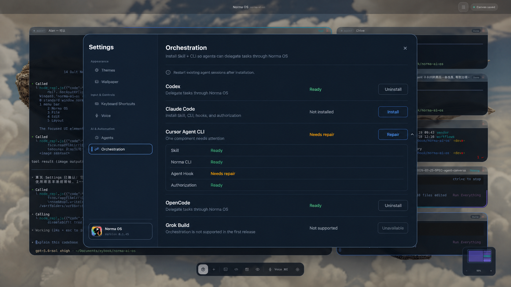

# Agent 编排安装与任务委派 SPEC

- 日期：2026-07-25
- 状态：已确认
- 目标版本：首版
- 关联领域词汇：[`CONTEXT.md`](../CONTEXT.md)
- 适用范围：Settings、Norma CLI、Agent Skill、Agent Hook、Agent 任务队列、授权与审计

## 1. 背景与目标

Norma OS 已具备 Agent 定义、Agent 卡片、任务协调队列、Agent Hook 和高层任务派发协议，但这些能力目前主要由 Norma Master Agent 和 App 内部调用。运行在 Agent 卡片中的 Claude、Codex、Cursor、OpenCode 尚不能通过统一、受控的方式，把用户明确要求委派的子任务交给其他 Norma OS Agent。

本功能在设置页新增“编排”能力，为支持的 Agent Provider 安装以下四个组件：

1. Agent 编排能力包（Skill 或 Provider 原生等价适配）。
2. Norma CLI。
3. Agent Hook。
4. Provider 独立编排授权。

安装后，Agent 可以在用户明确要求时通过 Norma CLI：

- 查询当前项目中可寻址的 Agent；
- 向指定 Agent 的现有任务队列派发一个任务；
- 查询、等待或取消该任务。

本功能必须沿用现有 `AgentTaskCoordinator`，不得建立第二套任务队列。

### 1.1 产品目标

- 让用户能够明确要求当前 Agent 把子任务派给另一个 Norma OS Agent。
- 为不同 Agent Provider 提供统一的任务派发协议。
- 保持任务接收、排队、运行和终态语义真实可验证。
- 通过设置页完成安装、检查、修复和卸载。
- 保留任务来源、父子关系、目标和状态，支持审计与排障。

### 1.2 成功标志

- 支持的 Provider 可从设置页完成一键安装并进入 `Ready`。
- 新启动的 Agent 会话能够发现编排能力并调用 Norma CLI。
- CLI 派发的任务进入现有 Agent 卡片队列。
- 用户能够通过 `task_id` 查询、等待和取消任务。
- Agent 不会在缺少用户明确指令时自主委派。
- App 重启后不会恢复旧队列，也不会让旧任务引用错误指向新任务。

## 2. 范围

### 2.1 In Scope

- 设置页新增“编排”页面。
- Claude、Codex、Cursor、OpenCode 的完整安装支持。
- Grok 不支持状态及原因说明。
- Skill、CLI、Hook、授权四组件检测。
- 幂等安装、升级、修复和安全卸载。
- `norma agent` CLI 命令树。
- 默认 JSON 输出、稳定错误码和退出码。
- Provider 独立长期 Token 授权。
- 复用当前项目的 Agent 定义、Agent 卡片和任务队列。
- 非活跃但已启用的 Agent 自动激活。
- 任务查询、等待和精确取消。
- Agent 子委派的来源、父任务、根任务和目标关系。
- 自派发、祖先循环和任务树预算校验。
- SQLite 审计记录。
- App、CLI、Installer、Storage 和 E2E 自动化验证。
- 将 `norma` CLI 纳入 App 打包产物。

### 2.2 Out of Scope

- Agent 自主决定拆分或委派任务。
- 根据任务内容自动选择目标 Agent。
- 未经用户明确要求的后台委派。
- 自动创建未知 Agent。
- 自动启用已禁用 Agent。
- 单次 CLI 调用向多个 Agent 批量派发。
- 跨项目 Agent 寻址或任务派发。
- 持久化并恢复运行队列。
- 返回终端全文、文件内容或工作产物；可信 Hook 提供的有界 Agent 最终回复属于任务结果协议。
- Agent 间实时通信、共享上下文或共享记忆。
- 父任务结束或取消时级联取消子任务。
- 自动启动 Norma OS。
- 自动选择最近项目。
- 热修改正在运行的 Agent 会话。
- Grok 编排安装。
- Keychain、短期 Token 或复杂能力凭据系统。
- Web 或远程网络调用；首版仅支持本机 Norma OS。
- 模糊 Agent 名称匹配。

## 3. 用户与使用场景

### 3.1 用户角色

- Norma OS 用户：在设置页安装和管理编排能力。
- Agent 卡片中的 Agent：在用户明确指示下调用 Norma CLI。
- 维护者：通过任务记录、结构化错误和日志排查问题。

### 3.2 关键用户故事

1. 作为用户，我想在设置页为 Codex 安装编排能力，使 Codex 可以把任务交给其他 Agent。
2. 作为用户，我想明确告诉 Codex“把测试任务交给 Bella”，让 Codex 调用 CLI 派发任务。
3. 作为用户，我想让尚未激活但已经定义并启用的 Bella 自动创建活跃卡片并接收任务。
4. 作为用户，我想获得 `task_id`，以便继续查询或取消任务。
5. 作为用户，我想让忙碌 Agent 的新任务进入其现有 FIFO 队列。
6. 作为用户，我想在没有 Hook 时看到真实的 `untracked` 状态，而不是虚假的完成状态。
7. 作为用户，我想修复缺失或过期的安装组件，而不覆盖自己的配置。
8. 作为用户，我想安全卸载编排能力，而不删除其他 Skill、Hook 或任务历史。
9. 作为用户，我想让运行中的 Agent 会话保持不变，并在重启会话后加载新安装能力。
10. 作为用户，我想在 Grok 上看到明确的不支持说明。

### 3.3 Skill 使用约束

Skill 只有在用户明确表达以下意图时才能调用派发命令：

- 明确要求把任务或子任务交给 Norma OS 中的某个 Agent；
- 明确给出可解析的目标 Agent 呼叫名；
- 明确给出要委派的任务。

Skill 不得：

- 自行拆解用户任务并派发；
- 主动选择目标 Agent；
- 为提升并行度而创建额外任务；
- 自动调用 `--force-untracked`；
- 隐式创建或启用 Agent；
- 把“建议委派”理解成已经获得执行授权。

## 4. 业务流程与信息架构

### 4.1 设置页信息架构

设置侧边栏的 `AI & Automation` 分组新增 `Orchestration`（领域名称“编排”）。`Orchestration` 是唯一安装入口，现有独立 Agent Hooks 安装操作并入该页面。

每个 Provider 使用一张紧凑卡片：

- Provider 名称和图标；
- 汇总状态；
- 一句能力说明；
- 一个主要操作；
- 可展开的组件详情。

汇总状态包括：

- `未安装`
- `正在安装`
- `Ready`
- `需要修复`
- `安装失败`
- `正在卸载`
- `不支持`

组件详情包括：

- Skill
- Norma CLI
- Agent Hook
- 授权

Grok 卡片始终显示 `不支持`，禁用安装按钮，并说明首版没有提供 Grok 编排适配。

### 4.2 安装流程

```text
用户打开 Settings → 编排
  → 系统后台检测四个组件
  → 用户点击安装
  → 检查文件冲突和现有版本
  → 安装或升级 Skill
  → 安装或升级共享 Norma CLI
  → 安装或修复 Agent Hook
  → 创建 Provider Token 和授权记录
  → 重新检测全部组件
  → 全部有效时显示 Ready
  → 提示重启已有 Agent 会话
```

安装和修复使用同一个幂等协调流程：

- 已是当前版本的组件不重复写入；
- 只处理缺失或过期组件；
- 每个组件独立记录结果；
- 部分失败时保留真实状态；
- 用户修复后重新执行检测；
- 文件冲突时不静默覆盖用户内容。

App 启动和进入 Orchestration 设置时自动 reconcile 已授权 Provider 的 Norma 受管组件：

- 只处理凭据与全局授权仍然有效的既有安装，不自动安装未授权 Provider；
- 自动升级受管 Skill、共享 CLI 和 Hook，共享二进制在同一轮 reconcile 中只更新一次；
- 不轮换有效 Token，不重新启用已撤销授权；
- 用户文件冲突保持 `Needs repair`，继续由用户明确处理；
- 自动修复失败时保留真实组件状态和手动 `Repair` 入口。

所有文件扫描、写入、哈希计算和 SQLite 操作必须在后台执行，不得阻塞 GPUI 前台线程。

### 4.3 卸载流程

卸载只处理 Norma 明确管理的内容：

- 删除对应 Provider 的受管 Skill 或适配文件；
- 精确移除 Norma Hook 配置项；
- 删除 Provider Token 配置；
- 撤销 SQLite 授权记录；
- 保留任务审计历史；
- 不删除其他用户 Skill、Hook 或自定义设置。

卸载不热修改运行中的 Agent 会话。页面提示用户关闭或重启已有会话。

### 4.4 Agent 任务派发流程

```text
用户明确要求当前 Agent 委派
  → Agent 加载编排 Skill
  → agent list 查询可寻址目标
  → task assign 提交一个目标和一个任务
  → Norma OS 验证 Provider 授权和当前项目
  → 根据 Agent 呼叫名解析定义
  → 校验启用、自派发、祖先循环和任务树预算
  → 必要时自动激活目标 Agent 卡片
  → 进入现有 AgentTaskCoordinator
  → 返回 task_id 和真实接收状态
```

每次 `assign` 只允许一个目标和一个任务。用户明确要求多个目标时，调用方按用户顺序分别执行多次 `assign`；后续失败不回滚已经成功的调用。

### 4.5 任务生命周期

建议状态集合：

- `accepted`：当前运行实例已接收，等待完成目标激活或实际提交。
- `queued`：目标 Agent 正忙，任务位于其 FIFO 队列。
- `submitted`：任务正文与提交动作已真实发送到目标 Agent。
- `untracked`：任务已发送，但缺少可信 Hook，无法自动判断终态。
- `cancel_requested`：已向运行任务请求中断，等待运行时确认。
- `done`：Hook 确认任务成功结束。
- `failed`：Hook 或提交路径确认任务失败。
- `cancelled`：尚未提交的任务已取消。
- `interrupted`：运行任务已确认中断，或 App 重启时将未完成历史标记为中断。

只有 `done`、`failed`、`cancelled`、`interrupted` 是终态。

### 4.6 父子任务生命周期

- CLI 派发的子任务记录来源 Agent、父任务、根任务和目标 Agent。
- 来源和父任务由服务端根据当前 Agent 卡片及其运行任务确定，不接受 CLI 自由伪造。
- 目标 Agent 不得等于来源 Agent。
- 目标 Agent 已存在于当前活跃祖先链时拒绝派发。
- 不设置固定委派深度。
- 每个根任务最多同时拥有 32 个未完成后代。
- 达到预算时返回 `delegation_budget_exceeded`。
- 后代任务进入终态后释放预算。
- 父任务自然结束后，未完成子任务继续运行。
- 显式取消父任务也不级联取消后代。
- 取消操作只影响指定 `task_id`。

### 4.7 App 生命周期

- 任务执行队列只存在于当前 App 运行实例。
- App 退出、崩溃或重启后不恢复 `accepted`、`queued`、`submitted` 或 `untracked` 任务。
- 启动清理把历史中的未完成任务标记为 `interrupted`。
- CLI 任务引用必须包含运行实例身份，不能在重启后错误命中新任务。
- 旧引用查询返回 `runtime_expired`，可以附带最后持久化状态，但不得继续执行等待或取消。

## 5. 数据模型与接口

### 5.1 ProviderIntegration

```text
ProviderIntegration
- provider: Claude | Codex | Cursor | OpenCode | Grok
- support_status: Supported | Unsupported
- aggregate_status
- skill_component
- cli_component
- hook_component
- authorization_component
- installed_version
- last_checked_at
- last_error
```

组件状态：

```text
ComponentState
- Missing
- Installing
- Ready { version }
- Outdated { installed_version, required_version }
- Conflict { path, reason }
- Failed { error_code, message }
- Unsupported { reason }
```

汇总状态应由四个组件状态确定，不单独作为第二套事实源持久化。

### 5.2 Provider 授权

每个支持的 Provider 拥有一个独立长期随机 Token。

受管配置文件保存：

```text
ProviderCredential
- provider
- token
- schema_version
- installed_version
```

要求：

- 配置文件权限必须为 `0600`；
- Token 不写入 Skill；
- Token 不写入普通日志；
- SQLite 仅保存 Token 哈希、Provider、授权状态和时间；
- 不同 Provider 不共享 Token；
- 卸载时删除配置并撤销授权；
- 授权校验使用常量时间比较或等价安全比较。

建议 SQLite 表：

```text
orchestration_authorizations
- provider PRIMARY KEY
- token_hash
- enabled
- installed_version
- created_at_unix
- updated_at_unix
- revoked_at_unix NULL
```

该授权是用户级配置，不绑定单个项目或 Agent 定义。

### 5.3 AgentDispatchTask 扩展

现有任务记录需要补充：

```text
AgentDispatchTask
- id
- runtime_instance_id
- runtime_task_id
- task_ref
- root_task_ref
- parent_task_ref NULL
- source_definition_id NULL
- source_node_id NULL
- source_provider
- target_definition_id
- target_node_id
- original_instruction
- task_text
- state
- tracking
- error
- created_at_unix
- updated_at_unix
```

`task_ref` 是 CLI 使用的不透明引用，至少组合当前运行实例身份与运行时任务 ID。

顶层 Norma 委派可以没有 `source_definition_id`；由 Agent 卡片发起的 CLI 子委派必须具有来源 Agent 和父任务。

### 5.4 CLI 命令

```text
norma agent list
norma agent task assign <agent> --task <text>
norma agent task status <task-id>
norma agent task wait <task-id> [--timeout <seconds>]
norma agent task result <task-id>
norma agent task cancel <task-id>
```

通用选项：

```text
--format json|text
```

Agent 编排命令默认使用 JSON；人工调试可指定 `--format text`。

`--force-untracked` 只允许用于 `task assign`。Skill 不得自动添加该参数，必须先取得用户对覆盖输入和无法跟踪风险的明确授权。

### 5.5 JSON 输出契约

所有 JSON 输出包含：

```json
{
  "schema_version": 1,
  "ok": true,
  "request_id": "...",
  "result": {}
}
```

错误输出：

```json
{
  "schema_version": 1,
  "ok": false,
  "request_id": "...",
  "error": {
    "code": "unknown_agent",
    "message": "未找到 Agent：Bella",
    "retryable": false
  }
}
```

约束：

- `stdout` 只包含协议结果；
- 日志和诊断写入 `stderr`；
- 不依赖自然语言解析状态；
- 错误码保持稳定；
- 新增字段必须向后兼容；
- 不在输出中暴露 Token。

### 5.6 `agent list` 输出

每个 Agent 至少包含：

```text
definition_id
name
speech_alias
profile
enabled
active_node_id
busy
tracking
```

列表只返回当前项目的 Agent。未知项目上下文时返回 `project_unavailable`。

### 5.7 `task assign` 输出

至少包含：

```text
task_id
target_definition_id
target_name
target_node_id
status: accepted | queued | untracked
tracking
parent_task_id
root_task_id
```

命令成功表示任务已被当前运行实例真实接收，不表示任务完成。

### 5.8 `task status`、`task wait` 和 `task result`

终态 `status` 与 `wait` 直接携带按 `task_id` 绑定的结果；`task result` 对同一结果执行单次查询。结果结构为：

```text
availability: available | unavailable
text: string | null
truncated: boolean
```

仅可信 Hook 的完整 Agent 回复可产生 `available`；Provider 未提供可信回复、任务失败、取消或中断时返回 `unavailable`，不得从最新对话猜测。回复最多 1200 字符，超过时 `truncated=true`。任务尚未进入终态时，`task result` 返回可重试的 `task_result_not_ready` 与当前状态。

结果协议不返回：

- 终端全文；
- 文件内容；
- 工作产物。

`wait` 默认等待 60 秒：

- 提前进入终态时立即返回；
- 超时返回 `wait_timeout` 和当前状态；
- 超时不取消任务；
- 调用方可以再次等待；
- `--timeout` 只调整当前调用；
- 对 `untracked` 任务立即返回无法可靠等待的状态，不伪造终态。

### 5.9 `task cancel`

- `accepted` 或 `queued`：直接取消并进入 `cancelled`。
- `submitted`：发送中断并进入 `cancel_requested`。
- 收到可信中断确认后进入 `interrupted`。
- 无法确认中断时保持真实的未确认状态。
- 不级联取消后代。
- 不接受批量任务 ID。

### 5.10 稳定错误码

至少包括：

- `app_unavailable`
- `project_unavailable`
- `unauthorized`
- `provider_not_installed`
- `source_agent_unavailable`
- `unknown_agent`
- `agent_disabled`
- `empty_task`
- `self_dispatch_forbidden`
- `delegation_cycle`
- `delegation_budget_exceeded`
- `untracked_requires_force`
- `task_not_found`
- `runtime_expired`
- `task_untracked`
- `task_result_not_ready`
- `wait_timeout`
- `install_conflict`
- `component_install_failed`
- `unsupported_provider`
- `internal_error`

## 6. 技术实现概览

### 6.1 分层边界

- `crates/agent`：任务协调、父子关系、祖先循环、任务树预算及纯领域校验。
- `crates/norma`：CLI 命令树、Wire Protocol、JSON 输出、Provider 安装适配器。
- `crates/storage`：Provider 授权和任务审计持久化。
- `crates/app`：设置页、后台安装协调、Socket 服务、Agent 激活和运行时副作用。
- `crates/e2e`：设置、安装、派发、状态和重启语义的端到端验收。

不得让 `agent` 或 `storage` 反向依赖 `app`、`runtime` 或 GPUI。

### 6.2 复用现有高层派发路径

外部 CLI 必须复用：

```text
CardCommand::DispatchAgentTasks
  → App 高层 Agent 命令执行器
  → AgentTaskCoordinator::dispatch
  → Agent 卡片激活、提交与排队
  → AgentDispatchTaskStore
```

当前 `crates/app/src/norma/server.rs` 把高层 Agent 命令送入低层卡片执行器，并将其判定为 `Unsupported`。实现时必须把以下命令路由到现有高层 Agent Runtime 执行路径：

- `ListAgents`
- `ActivateAgent`
- `DispatchAgentTasks`
- 新增的任务查询、等待和取消命令

不得通过 `SendText` 组合模拟 Agent 任务派发。

### 6.3 协调器扩展

`AgentTaskCoordinator` 增加：

- 当前运行实例 ID；
- 任务父子索引；
- 根任务未完成后代计数；
- 来源 Agent 与当前父任务解析；
- 自派发校验；
- 活跃祖先链校验；
- 精确状态查询；
- 等待订阅或状态通知；
- 按任务 ID 精确取消。

祖先循环校验必须只拒绝当前活跃祖先链中的目标，不得把不同根任务共同使用同一个目标误判为循环。

### 6.4 安装器

安装器按 Provider 使用适配器：

```text
OrchestrationInstaller
- inspect(provider)
- install_or_repair(provider)
- uninstall(provider)
```

Provider 适配要求：

- Claude：安装原生可发现 Skill 和现有 Hook。
- Codex：安装原生可发现 Skill 和现有 Hook。
- OpenCode：安装原生可发现 Skill 和现有 Hook/Plugin。
- Cursor：使用 Cursor 原生可发现机制提供等价编排能力，并安装现有 Hook。
- Grok：返回 `Unsupported`，不写入任何文件。

Skill 使用供应商中立的单一源模板生成，Provider 适配器只处理目录、frontmatter 和调用格式差异。

### 6.5 CLI 分发

- `norma` 必须加入 `Packager.toml` 的非主二进制。
- App 使用一个用户级、受管、稳定路径安装 CLI。
- 多个 Provider 共用同一份版本化 CLI，不复制多套二进制。
- CLI 更新采用临时文件、校验和原子替换。
- 安装不要求 `sudo`，不写入系统级目录。
- Skill 和 Provider 配置引用受管 CLI 路径。
- App 升级后自动 reconcile 已授权 Provider 的 CLI/Hook/Skill；冲突或失败时设置页提供手动修复。

### 6.6 本地服务与授权

- 沿用本机 Socket 通信。
- Wire Request 增加 Provider 身份和授权材料。
- Agent 运行环境提供来源节点信息。
- 服务端校验 Provider Token、来源节点是否仍活跃，以及 Provider 是否与来源 Agent Profile 一致。
- 当前父任务由服务端从协调器查询，不能由 CLI 参数指定。
- 修改型命令缺少有效 Agent 会话上下文时返回 `source_agent_unavailable`。
- Norma OS 未运行或 Socket 不可连接时返回 `app_unavailable`。
- 当前项目不存在时返回 `project_unavailable`。
- 首版不自动启动 App 或选择最近项目。

### 6.7 前台线程和性能边界

以下操作必须在 `background_executor` 或后台线程执行：

- Provider 文件检测；
- Skill、CLI、Hook 安装与卸载；
- 文件哈希；
- SQLite 授权写入；
- 长时间 `wait`；
- 外部进程或文件 IO。

GPUI 前台只负责：

- 更新安装状态；
- 显示结果；
- 触发 Runtime 副作用；
- 刷新 Provider 卡片。

不得在 `Runtime::drain_all`、PTY 输出、Canvas 鼠标移动、输入路由或关闭无脏 flush 热路径中加入同步 SQLite 操作。

## 7. UI/UX 需求

### 7.1 设置页原型



该原型以当前 `Settings → Agent Hooks` 真实页面为结构基线，是本功能的正式视觉规格和验收基准。最终实现必须对原型进行一比一还原，不得仅把它视为方向参考。

除画布中的动态卡片内容、系统字体抗锯齿和运行时真实 Provider 状态外，以下可见内容均属于一比一还原范围：

- Settings 浮层相对画布的位置、尺寸、圆角、描边和背景透明度；
- 左右分栏比例、竖向分隔线和内容安全边距；
- 侧栏分组、项目顺序、选中态、图标尺寸和底部 Norma OS 版本卡；
- 页面标题、副标题、顶部横向分隔线和关闭按钮；
- 提示行的位置、图标、字号与上下间距；
- Provider 顺序、行高、文字层级、状态位置、分隔线和右侧操作按钮；
- Cursor 展开态的容器、四个组件行、行间分隔线和状态颜色；
- `Ready`、`Not installed`、`Needs repair`、`Not supported` 的文字与语义色；
- 所有可见文案、按钮标签及对齐方式。

实现不得擅自增加搜索框、独立 macOS 设置窗口、交通灯按钮、大型 Provider 卡片、额外导航分组或第二个 Agent Hooks 入口。

### 7.2 设计原则

页面遵循 macOS 和 Apple Human Interface Guidelines：

- 状态优先于技术细节；
- 每个 Provider 行只有一个主要操作；
- 高级组件信息通过展开详情呈现；
- 操作后提供即时反馈；
- 错误必须说明受影响组件和恢复方式；
- 不以颜色作为唯一状态表达；
- 支持键盘导航、焦点指示和 VoiceOver 标签。

上述原则用于补足动态交互和可访问性，不得作为改变原型布局或视觉层级的理由。

### 7.3 Provider 列表项

折叠状态显示：

- Provider 名称；
- 汇总状态；
- 简短说明；
- 主操作按钮；
- 展开详情按钮。

展开状态显示四行组件：

```text
Skill          Ready / Missing / Outdated / Conflict
Norma CLI      Ready / Missing / Outdated
Agent Hook     Ready / Missing / Failed
授权            Ready / Revoked / Invalid
```

### 7.4 操作规则

- `Not installed`：主按钮为 `Install`。
- `Needs repair` 或安装失败：主按钮为 `Repair`。
- `Ready`：右侧显示低强调度描边按钮 `Uninstall`。
- `Not supported`：右侧显示禁用按钮 `Unavailable`。
- 安装和卸载期间禁用重复操作。
- 完成后重新检查实际组件状态，不仅依赖操作返回值。
- 页面提示行固定显示 `Restart existing agent sessions after installation.`。
- 文件冲突展示路径和原因，但不得显示 Token。
- 卸载前说明只会删除 Norma 管理的内容。

### 7.5 Hooks 页面迁移

现有 Hooks 安装入口并入“编排”。如果需要保留低层 Hook 诊断信息，应作为 Provider 卡片的展开内容，不得继续提供第二套安装按钮或独立状态源。

## 8. 状态、错误与边界情况

### 8.1 安装部分成功

如果 Skill 和 CLI 已安装，但 Hook 失败：

- 汇总状态为 `需要修复`，不能显示 `Ready`；
- 展示 Hook 失败原因；
- 已成功组件不回滚；
- 再次点击修复只处理缺失或失败组件。

### 8.2 用户配置冲突

- 不覆盖无法确认归属的用户文件；
- 受影响组件进入 `Conflict`；
- 提示冲突路径和建议操作；
- 其他 Provider 状态不受影响。

### 8.3 未跟踪任务

- 没有 Hook 时允许首次任务进入 `untracked`；
- 系统不能自动确认完成或推进下一任务；
- 再次派发默认返回 `untracked_requires_force`；
- Skill 只有获得用户明确风险授权后才能使用 `--force-untracked`；
- `wait` 不得把超时伪装成失败或完成。

### 8.4 目标 Agent 状态

- 未知名称：返回 `unknown_agent`，不创建 Agent。
- 已禁用：返回 `agent_disabled`，不自动启用。
- 已启用但未激活：自动激活唯一卡片。
- 正忙：进入已有 FIFO 队列。
- 名称模糊或冲突：拒绝执行，不猜测目标。

### 8.5 子委派异常

- 自派发：拒绝。
- 目标位于活跃祖先链：拒绝。
- 不同根任务共同排队到同一 Agent：允许。
- 根任务已有 32 个未完成后代：拒绝新任务。
- 父任务结束或取消：已有子任务继续执行。
- 子任务终态：释放根任务预算。

### 8.6 App 重启

- 不恢复队列；
- 未完成历史标记为 `interrupted`；
- 旧 `task_id` 不得命中新运行实例任务；
- 旧引用等待或取消返回 `runtime_expired`；
- 审计记录继续保留。

### 8.7 安装后旧会话

- 不热注入 Skill、CLI、Hook 或授权；
- 设置页明确提示重启；
- 新建或重新激活的 Agent 会话使用最新能力；
- 卸载后已有会话必须关闭，才能彻底清除已加载能力。

## 9. 非功能性需求

### 9.1 性能

- CLI 普通命令应在本地服务可用时快速返回。
- `assign` 不等待任务终态。
- `wait` 使用通知或低频等待机制，不得忙轮询。
- 安装扫描和文件 IO 不阻塞 GPUI。
- 32 个未完成后代预算的计算不得扫描无界历史。
- 日志不得记录完整任务正文作为默认 INFO 内容。

### 9.2 安全

- Provider Token 文件权限固定为 `0600`。
- SQLite 只保存 Token 哈希。
- Token 不进入 Skill、JSON 输出、普通日志或 UI。
- Provider Token 不能跨 Provider 使用。
- 服务端重新验证目标、来源和当前项目。
- CLI 输入不能伪造父任务或来源 Agent。
- 卸载立即撤销 Provider 授权。

首版明确接受：受管配置文件的安全性弱于 Keychain，以降低实现复杂度并加快交付。

### 9.3 可靠性

- 安装操作可重复执行。
- 受管文件写入使用临时文件和原子替换。
- 用户文件冲突不覆盖。
- 派发结果必须来自真实协调器回执。
- 等待超时不改变任务状态。
- 取消失败不得伪装为已经停止。

### 9.4 可扩展性

- Provider 安装逻辑通过统一适配器扩展。
- Skill 内容保持供应商中立。
- JSON 包含 `schema_version`。
- 未来可增加新的 Provider，而不修改 Agent 队列语义。
- 未来可以增加持久队列或完整工作产物，但当前协议不得伪装存在。

### 9.5 可运维性

结构化日志至少包含：

- request_id
- task_id
- runtime_instance_id
- source_definition_id
- target_definition_id
- provider
- command
- state
- error_code
- elapsed_ms

不得包含：

- Token
- Authorization Header
- 默认完整任务正文
- 终端输出
- Agent 最终回复

## 10. 风险、权衡与未决问题

### 10.1 已确认的权衡

1. 队列不持久化  
   优先保持当前 Runtime 语义和实现简单性；SQLite 仅作审计。

2. Token 使用配置文件  
   不引入 Keychain 和短期凭据，接受同一 macOS 用户下较弱的隔离边界。

3. 只返回有界最终回复，不返回任务产物
   结果只接受可信 Hook 的完整回复并绑定到任务引用，避免引入终端抓取、文件搬运或最近对话猜测。

4. 不限制嵌套深度  
   使用祖先链检测和每根任务 32 个未完成后代预算控制失控风险。

5. 不级联取消  
   每个任务独立管理，父任务结束或取消不改变已派发子任务。

6. 仅用户明确授权委派  
   降低 Agent 自主扩张任务树和意外副作用风险。

7. 新会话生效  
   避免热修改运行中 Provider 的配置和上下文。

### 10.2 已知风险

- Skill 无法从技术上完全证明用户是否明确授权，首版依赖 Skill 指令、调用上下文和审计。
- Cursor 的原生能力格式与 `SKILL.md` Provider 不同，需要单独维护适配。
- 长期 Token 配置文件可能被同一用户下的其他进程读取。
- 无 Hook 时任务无法得到可信终态。
- App 重启会中断未完成任务，用户需要重新派发。
- 共享 CLI 升级失败可能同时影响多个 Provider。
- Provider 自身升级可能改变 Skill 或 Hook 格式。

### 10.3 实现阶段需验证但不改变产品语义的事项

- Cursor 当前版本对应的原生能力安装路径和格式。
- 各 Provider 受管文件的版本标记方式。
- 用户级授权记录应落入现有哪一个全局 SQLite Store。
- CLI 受管安装路径和 App Bundle 内 sidecar 定位方式。
- 旧 Agent Hooks 页面迁移时的兼容处理。

## 11. 验收标准与示例

### 11.1 视觉一比一还原

- [ ] [`agent-orchestration-settings-prototype.png`](../assets/agent-orchestration-settings-prototype.png) 作为 canonical golden image，开发过程中不得用重新设计的图片替换验收目标。
- [ ] 使用与原型一致的 Settings 窗口尺寸和固定验收数据启动真实 `.app`，不得只用 headless GPUI 或静态组件预览代替。
- [ ] 固定验收数据必须呈现：Codex=`Ready`、Claude Code=`Not installed`、Cursor Agent CLI=`Needs repair` 且展开、OpenCode=`Ready`、Grok Build=`Not supported`。
- [ ] 通过 Computer Use 打开 `Settings → Orchestration` 并保存真实 App 截图。
- [ ] 将真实截图与原型按 Settings 浮层外框对齐后进行并排检查和半透明叠图检查。
- [ ] 浮层外框、左右分栏、标题区、提示行、Provider 行、按钮和 Cursor 展开容器不得出现可见双边、错位、拉伸或比例差异。
- [ ] 主要边界、间距、组件位置与尺寸相对原型的误差不得超过 2 px。
- [ ] Provider 顺序、全部可见文案、状态文字和按钮标签必须与原型完全一致。
- [ ] 字号、字重、行高、描边、圆角、背景透明度和语义色必须复用现有 Settings 设计 token，并在叠图中达到肉眼不可区分。
- [ ] 不得出现原型之外的搜索框、交通灯、大型卡片、额外导航、独立 Hooks 入口或重复操作。
- [ ] 仅允许忽略画布动态内容、系统字体抗锯齿和光栅化造成的亚像素差异。
- [ ] 功能全部正确但未达到以上视觉标准时，验收结果仍为失败。
- [ ] 验收报告必须附真实 App 截图和叠图/差异图证据，不能只写“手动检查通过”。

### 11.2 设置与安装

- [ ] Settings 的 `AI & Automation` 中存在 `Orchestration` 入口。
- [ ] Claude、Codex、Cursor、OpenCode 均可安装。
- [ ] Grok 显示不支持原因，且不存在可触发的安装操作。
- [ ] Provider 卡片展示四个组件的独立状态。
- [ ] 四个组件全部有效时才显示 `Ready`。
- [ ] 缺失 Hook 时不得显示 `Ready`。
- [ ] 重复安装不会重复写入或破坏已就绪组件。
- [ ] 修复只处理缺失、过期或失败组件。
- [ ] App 升级后已授权 Provider 的受管组件自动恢复 Ready，无需逐个点击 Repair。
- [ ] 自动 reconcile 不安装未授权 Provider、不重新启用撤销授权、不覆盖用户冲突文件。
- [ ] 用户文件冲突不会被静默覆盖。
- [ ] 安装、修复和卸载不阻塞 GPUI 前台。
- [ ] 安装后提示重启现有 Agent 会话。
- [ ] 卸载只删除 Norma 管理的内容。
- [ ] 卸载后任务审计历史仍存在。
- [ ] Token 文件权限为 `0600`。
- [ ] Token 不出现在 Skill、UI、JSON 输出或日志中。

### 11.3 CLI

- [ ] `norma agent list` 返回当前项目 Agent。
- [ ] `norma agent task assign` 一次只接收一个目标和一个任务。
- [ ] `norma agent task wait` 在可信终态直接携带绑定结果。
- [ ] `norma agent task result` 按精确 `task_id` 单次查询同一结果。
- [ ] 非终态 result 返回可重试的 `task_result_not_ready` 与当前状态。
- [ ] 所有 Agent 命令默认输出合法 JSON。
- [ ] `--format text` 输出适合人工阅读的文本。
- [ ] `stdout` 不混入日志。
- [ ] 每次成功派发返回唯一 `task_id`。
- [ ] App 不可用时返回 `app_unavailable`。
- [ ] 没有项目时返回 `project_unavailable`。
- [ ] CLI 不自动启动 App 或选择项目。
- [ ] 未授权 Provider 无法调用编排命令。
- [ ] Provider Token 不能跨 Provider 使用。
- [ ] CLI 随 App 安装包分发。

### 11.4 队列与派发

- [ ] CLI 派发复用现有 `AgentTaskCoordinator`。
- [ ] 未知 Agent 不会被创建。
- [ ] 已禁用 Agent 不会被自动启用。
- [ ] 已启用但未激活的 Agent 自动激活并接收任务。
- [ ] 忙碌 Agent 的新任务进入现有 FIFO 队列。
- [ ] 不同 Agent 可以并行执行。
- [ ] 无 Hook 的首次任务返回 `untracked`。
- [ ] 无 Hook 的后续任务默认被拒绝。
- [ ] Skill 不会自动使用 `--force-untracked`。
- [ ] 派发接收状态不会被描述为任务完成。

### 11.5 子委派

- [ ] 只有用户明确要求委派时，Skill 才调用 CLI。
- [ ] Agent 不会自行拆分并派发任务。
- [ ] 子任务保存来源、父任务、根任务和目标。
- [ ] Agent 向自己派发时被拒绝。
- [ ] A → B → A 的活跃祖先循环被拒绝。
- [ ] 不同根任务可以共同排队到同一个 Agent。
- [ ] 委派深度不受固定层数限制。
- [ ] 第 32 个未完成后代允许存在。
- [ ] 第 33 个未完成后代被拒绝并返回 `delegation_budget_exceeded`。
- [ ] 后代进入终态后预算被释放。
- [ ] 父任务完成不会取消子任务。
- [ ] 取消父任务不会取消子任务。

### 11.6 查询、等待与取消

- [ ] `status` 返回真实当前状态。
- [ ] `wait` 默认最多等待 60 秒。
- [ ] 任务提前结束时 `wait` 立即返回。
- [ ] 超时返回 `wait_timeout` 和当前状态。
- [ ] 等待超时不取消任务。
- [ ] 调用方可以再次等待。
- [ ] `wait` 不返回终端输出、回复或工作产物。
- [ ] 未提交任务取消后进入 `cancelled`。
- [ ] 运行任务取消后先进入 `cancel_requested`。
- [ ] 只有可信确认后才进入 `interrupted`。
- [ ] 取消只影响指定任务，不影响后代或兄弟任务。

### 11.7 重启与审计

- [ ] App 重启后不恢复旧队列。
- [ ] 未完成历史被标记为 `interrupted`。
- [ ] 旧任务引用不会命中新运行实例任务。
- [ ] 旧引用等待或取消返回 `runtime_expired`。
- [ ] 审计记录保留 Provider、来源、父任务、目标、状态和错误。
- [ ] INFO 日志不包含 Token、完整任务正文或终端内容。

### 11.8 自动化证据

必须新增或更新：

- `crates/agent` 单元测试：自派发、祖先循环、32 个后代预算、预算释放、非级联取消。
- `crates/norma` 测试：CLI 解析、JSON schema、错误码、stdout/stderr、授权。
- `crates/storage` 测试：授权记录、Token 哈希、父子任务字段、重启清理。
- `crates/app` 测试：高层命令路由、后台安装状态、Provider 状态汇总。
- `crates/e2e`：设置页安装/修复/卸载、Agent 自动激活、派发、等待、取消和重启语义。
- 真实 App L3：使用 Computer Use 验证设置页面、视觉状态、键盘操作和完整安装流程，并输出与 canonical golden image 对齐后的叠图/差异图。
- 打包验证：发布产物包含可执行的 `norma` CLI。

所有新增 Rust 测试必须遵守项目规定的完整场景注释、数据推导、执行步骤、正负断言和断言说明。
