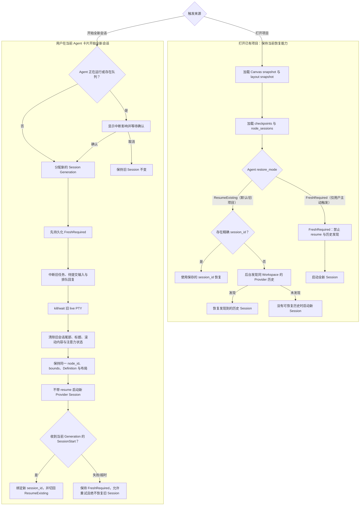

# Agent 卡片全新会话与上下文隔离 SPEC

- 日期：2026-07-31
- 状态：Draft for Review
- 文档性质：产品与技术规格草案；本次不实施
- 范围：Agent 卡片主动开始全新 Provider Session，同时完整保留现有 Workspace/Canvas 恢复能力
- 相关规格：
  - [`2026-07-25-SPEC-agent-conversation-context-and-continuation.md`](2026-07-25-SPEC-agent-conversation-context-and-continuation.md)
  - [`2026-07-18-SPEC-natural-agent-delegation-and-canvas-context.md`](2026-07-18-SPEC-natural-agent-delegation-and-canvas-context.md)
  - [Phase 1 画布会话恢复](#phase1-canvas-session)

<a id="phase1-canvas-session"></a>

## 历史：Phase 1 画布会话恢复

> 历史：见 git 提交。原文路径：`docs/superpowers/specs/2026-06-27-canvas-session-persistence-design.md`、`docs/superpowers/plans/2026-06-27-canvas-session-persistence.md`。

2026-06-27 已批准的 Phase 1 只做视图恢复，不保活后台进程：

- 退出时把终端 cwd 和 Claude `session_id` 写入项目库的 `node_sessions`。该表与 `session_checkpoints` 分开：后者保存启动参数，前者保存退出时捕获的运行状态。
- 终端 cwd 用 macOS `proc_pidinfo` 读取，恢复时进入该目录。读不到则从工作区根目录打开。
- Claude 卡片用 `--resume <session_id>` 恢复。当时未做 Codex 恢复，也不恢复终端滚动历史。
- 没有 `node_sessions` 记录时，行为与加入该表之前相同。任一步失败都静默退回当时的默认行为。

本规格要求的「开始全新会话」不得破坏上述未重置项目的恢复。

## 1. 背景与问题

Agent 卡片当前同时承担两种生命周期：

1. 长期存在的 Agent 身份与 Canvas 空间对象。
2. 一次持续运行的 Provider 会话及其上下文。

当用户在同一张 Agent 卡片中完成任务 A，准备开始不相关的任务 B 时，底层 Provider Session 仍然保留任务 A 的对话、工具过程和推理上下文。继续在原 Session 中输入任务 B，可能导致旧约束、旧假设或旧任务状态污染新任务。

当前可行但体验不完整的替代做法是关闭 Agent 卡片后重新创建。该做法会把“清理一次会话”错误地表达为“删除一个空间对象”，也可能影响卡片位置、布局、选中状态和用户对长期 Agent 身份的理解。

与此同时，Norma OS 已支持打开旧项目时恢复：

- Canvas 节点、位置、尺寸、层级和 viewport。
- Master/detail 等布局状态。
- Terminal checkpoint 和 cwd。
- Agent 卡片及其保存的 Provider `session_id`。
- 当旧库没有精确 `session_id` 时，后台发现同 Workspace 的 Provider 历史会话并尝试恢复。

本功能必须新增“用户主动开始全新会话”，但不能把“打开旧项目恢复原会话”的现有能力改成默认开新会话。

## 2. 第一性原则与产品判断

### 2.1 领域模型

本 SPEC 将三个概念明确分离：

```text
AgentDefinition / Skill Instructions   长期身份与能力
└── AgentCard                          长期 Canvas 空间容器
    ├── Session Generation N           已结束的任务上下文
    └── Session Generation N+1         当前活跃的任务上下文
```

- **Agent Definition**：名称、语音别名、Provider Profile、启用状态和 Workflow Description 等项目级定义。
- **Agent Card**：Canvas 上稳定的空间对象，拥有 `node_id`、bounds、z-index、选中/聚焦关系和布局位置。
- **Agent Session Generation**：该卡片当前绑定的一代 live PTY/Provider Session。它可以被替换，而不删除 Agent Card。

### 2.2 核心判断

- 上下文在同一任务内有价值，在不相关任务之间可能成为负担。
- 系统不能仅凭 `Done` 判断用户是否还会追问、验收或修复，因此不得自动切换 Session。
- 用户明确触发“开始全新会话”时，系统必须提供硬会话边界，而不是给旧 Session 发送“请忘记之前内容”的软提示。
- “清理上下文”默认表示不再恢复或注入旧上下文，不表示安全擦除 Provider 磁盘历史。

## 3. 目标与成功定义

### 3.1 产品目标

用户可以在同一张 Agent 卡片中明确开始一个不携带旧对话的新 Session，同时：

- 保留 Agent 身份、卡片和空间布局。
- 保留项目文件、Git 改动和已生成产物。
- 不把旧 Session 的对话尾部、排队回复或待提交任务带入新 Session。
- App 关闭或重启后只恢复用户当前认可的 Session。
- 未执行该动作的旧项目继续按现有规则恢复旧 Agent Session。

### 3.2 成功定义

功能成功时同时满足：

1. 用户主动开始全新会话后，新 Provider 进程不使用旧 `session_id` 或 Provider `resume` 命令。
2. Agent 卡片的 `node_id`、bounds、Agent Definition 和 Canvas 布局不变。
3. 旧 Session 的未提交输入、排队任务、排队回复和对话尾部不能进入新 Session。
4. 未主动重置的已保存项目仍能恢复其原 Agent Session，行为与本功能加入前一致。
5. 在“已请求全新会话，但新 Session 尚未返回 `session_id`”的崩溃窗口中，重启也不得恢复旧 Session。

## 4. 范围

### 4.1 In Scope

- 在现有 Agent 卡片内原地开始全新 Provider Session。
- 保留 Agent Definition、Agent Card、Canvas snapshot 和 layout snapshot。
- 中断或清理旧 Session 绑定的运行中任务、排队任务、待提交输入和排队回复。
- 清除旧 Session 的内存与项目 SQLite 会话尾部投影。
- 引入明确、可持久化的 Agent Session 恢复意图。
- 使用本地 Session Generation 隔离旧进程的迟到 Hook 事件。
- 在 App 重启、切换项目和 Provider SessionStart 等生命周期中保持一致行为。
- UI 菜单动作、忙碌确认、成功/失败反馈和可访问性约束。
- 通过单元测试、`crates/e2e` 和真实 App Computer Use 验收保护现有恢复能力。

### 4.2 Out of Scope

- 删除 Claude、Codex、Cursor、Grok 或 OpenCode 在磁盘上的历史文件。
- 浏览、搜索、恢复或回滚到任意旧 Session 的历史管理 UI。
- 自动在每个 Agent Task 完成后开启新 Session。
- 自动总结旧 Session 并注入新 Session。
- 回滚旧 Session 已经修改的文件、Git 工作区或外部系统副作用。
- 清空 Norma Master 自己的全部对话历史。
- 改变现有 Terminal cwd/session 恢复行为。
- 将 Settings 中的 `workflow_description` 新增为 Agent CLI System Prompt；该字段的执行语义需由独立规格决定。
- 在本 SPEC 中实施任何代码或数据库迁移。

## 5. 领域语言

### 5.1 开始全新会话

用户主动要求当前 Agent 卡片结束旧 Session，并在相同卡片中启动一个不执行 `resume` 的新 Provider Session。

### 5.2 恢复现有会话

打开已保存项目时，系统根据该 Agent 节点的恢复意图与 `session_id`，重新启动并恢复已存在的 Provider Session。

### 5.3 Session Generation

由 Norma OS 在本地为 Agent 卡片分配的单调递增代次。它在 Provider `session_id` 出现之前就存在，用于区分同一 `node_id` 上的旧 live 进程与新 live 进程。

### 5.4 对话尾部投影

供 Norma 感知活跃 Agent 最近完整回合的有界缓存与持久化记录。它不是 Provider 完整历史，也不是文件成果的真相源。

### 5.5 上下文隔离与历史擦除

- **上下文隔离**：旧 Session 不再被恢复、注入或接收新消息。
- **历史擦除**：删除 Provider 磁盘历史或审计数据。

本 SPEC 只承诺上下文隔离，不承诺历史擦除。

## 6. 用户故事

1. 作为用户，我完成 Alan 当前任务后，可以在 Alan 原卡片中开始全新会话，不必删除并重建卡片。
2. 作为 Canvas 用户，我希望 Alan 的位置、尺寸、层级和布局在开始全新会话后保持不变。
3. 作为项目用户，我希望项目文件和 Alan 已经写入的代码继续存在，但 Alan 的新 Session 不自动携带旧对话。
4. 作为正在处理任务的用户，我希望开始全新会话前看到明确警告，知道运行中与排队任务会被中断。
5. 作为恢复旧项目的用户，我希望没有主动重置过的 Agent 卡片继续恢复上次会话，而不是突然打开空白 Session。
6. 作为旧数据库用户，我希望缺少 Hook `session_id` 的历史项目仍能使用现有后台发现逻辑恢复 Provider 历史。
7. 作为可靠性敏感用户，我希望重置过程中 App 崩溃后也不会意外恢复已放弃的旧 Session。
8. 作为多 Agent 用户，我希望只重置目标 Agent，不影响其他 Agent、Terminal、Browser、Preview 或 Canvas 状态。

## 7. 总体流程图



## 8. 核心业务流程

### 8.1 打开已有项目：默认行为不变

这是本 SPEC 的最高优先级不回归边界。

1. 加载项目级 Canvas snapshot，恢复节点身份、类型、bounds、z-index 和 viewport。
2. 加载 layout snapshot，恢复既有布局模式与卡片关系。
3. 加载 session checkpoints，取得 Agent Profile 与终端网格尺寸。
4. 加载 `node_sessions`，取得节点精确 `session_id` 和恢复意图。
5. 对 `ResumeExisting`：
   - 有保存的 `session_id`：优先恢复该卡片精确 Session。
   - 无保存的 `session_id`：保留现有后台 Provider 历史发现逻辑。
   - 后台未发现可恢复 Session：才启动新 Session。
6. Canvas 首帧仍先展示静态文档与初始化覆盖层，live session 继续延迟、分批恢复，不在打开项目的前台路径同步扫描历史或阻塞启动。

本功能不得把旧数据迁移为 `FreshRequired`，不得因为新增字段而让已有项目默认丢失 Session。

### 8.2 用户主动开始全新会话

执行必须遵循以下顺序：

1. 校验节点仍存在、仍为 Agent、Definition 仍有效。
2. 检查运行中任务、协调器队列、待提交输入和会话回复队列。
3. 如存在运行中或排队工作，展示影响范围并等待用户确认。
4. 分配新的本地 `session_generation`。
5. **在终止旧 Session 之前**持久化 `FreshRequired` 与新 generation。
6. 持久化失败时停止操作，旧 Session 保持运行，避免出现不可恢复的半切换。
7. 中断当前任务，取消/中断等待任务、待提交输入和旧 generation 的会话回复。
8. kill/wait 旧 Agent live PTY，确保旧进程退出。
9. 清除该节点旧 Session 的对话尾部、终端渲染缓存、task title、attention 和当前 Session ID。
10. 保留 Agent Card 的 `node_id`、bounds、z-index、Definition、Profile、alias、Canvas selection 和布局关系。
11. 使用普通 Agent 启动命令启动新 live PTY；不得传入旧 `session_id`，不得执行任何 Provider `resume` 变体。
12. Hook 只接受与当前 `session_generation` 一致的事件。
13. 收到当前 generation 的 `SessionStart` 后，绑定新 Provider `session_id`，并将恢复意图切回 `ResumeExisting`。
14. 向用户反馈“已开始全新会话，未带入上一会话内容；项目文件和 Agent 配置已保留”。

### 8.3 崩溃与重启窗口

如果 App 在第 5 步之后、第 13 步之前退出或崩溃：

- `FreshRequired` 必须已经持久化。
- 下次打开项目时，该节点禁止 Provider 历史发现，也禁止恢复旧 `session_id`。
- 系统启动一个全新 Session。
- 只有新 generation 的 `SessionStart` 成功绑定后，才恢复为后续可正常续接的 `ResumeExisting`。

### 8.4 新 Session 启动失败

如果旧 Session 已结束而新 Session 启动失败：

- Agent Card 继续保留在原位置，不删除节点。
- 卡片显示明确的启动失败状态和“重试全新会话”动作。
- `FreshRequired` 保持不变。
- 重试仍启动全新 Session，不得以恢复旧 Session 作为静默降级。

## 9. 恢复意图与数据模型

### 9.1 建议领域类型

```rust
pub enum AgentSessionRestoreMode {
    ResumeExisting,
    FreshRequired,
}

pub struct AgentSessionBinding {
    pub node_id: NodeId,
    pub session_id: Option<String>,
    pub generation: u64,
    pub restore_mode: AgentSessionRestoreMode,
}
```

具体实现可以扩展现有 `NodeSession`，也可以由独立存储结构表达，但必须满足本节语义。

### 9.2 兼容性默认值

- 完全没有 `node_sessions` 行的旧 Agent 节点也必须隐式视为 `ResumeExisting`，继续走当前后台历史发现路径。
- 新增数据库字段必须对旧行默认映射为 `ResumeExisting`。
- 旧数据库没有 generation 时使用稳定初始值，例如 `0`。
- `session_id = NULL` 不能再单独表示“必须新开”。
- `ResumeExisting + session_id = NULL` 必须继续允许当前后台历史发现。
- `FreshRequired` 才是禁止历史发现与禁止 resume 的唯一可靠信号。

### 9.3 状态转换

| 当前状态 | 事件 | 下一状态 | 行为 |
|---|---|---|---|
| `ResumeExisting(id)` | 打开项目 | `ResumeExisting(id)` | 精确恢复 `id` |
| `ResumeExisting(None)` | 打开旧项目 | `ResumeExisting(discovered?)` | 保留后台历史发现 |
| 任意 | 用户确认全新会话 | `FreshRequired(None, generation+1)` | 禁止恢复旧上下文 |
| `FreshRequired` | 新 PTY 启动中 | `FreshRequired` | 只接受当前 generation Hook |
| `FreshRequired` | 当前 generation `SessionStart(new_id)` | `ResumeExisting(new_id)` | 新 Session 成为后续恢复目标 |
| `FreshRequired` | 启动失败/App 退出 | `FreshRequired` | 下次继续新开，不恢复旧 Session |

## 10. 保留与清理契约

| 状态或数据 | 开始全新会话后的行为 | 理由 |
|---|---|---|
| Agent Definition ID | 保留 | Agent 身份长期存在 |
| Profile、alias、speech alias | 保留 | 能力与寻址不因任务变化 |
| Workflow Description | 保留元数据，不新增注入语义 | 避免本功能顺带改变 Agent 行为 |
| Canvas `node_id` | 保留 | 卡片仍是同一空间对象 |
| bounds、z-index、viewport、layout | 保留 | 不影响画布恢复与空间记忆 |
| selection/focus | 原则上保留当前卡片焦点 | 用户动作作用于当前对象 |
| 项目文件、Git 状态、产物 | 保留 | Session reset 不是工作区回滚 |
| 旧 Provider live process | kill/wait | 建立硬会话边界 |
| 旧 Provider `session_id` 绑定 | 清除并禁止恢复 | 防止旧上下文回流 |
| 终端 scrollback/render cache | 清除 | 新 Session 不显示旧对话 |
| task title、task state、attention | 重置为新 Session 初始状态 | 不让旧任务 UI 污染新任务 |
| 运行中 Agent Task | 确认后标记 Interrupted | 真实反映中断 |
| 等待中的 Agent Task | 取消或标记 Interrupted | 不得进入新 Session |
| pending Agent submission | 清除 | 防止旧文本提交给新 PTY |
| queued session replies | 按 node + generation 全部中断 | 空 `session_id` 也不能成为通配符 |
| conversation tail 内存 | 删除旧节点/Session 投影 | Norma 不再声明旧内容是当前上下文 |
| conversation tail SQLite | 后台删除旧 Session 投影 | 重启后不重新注入旧尾部 |
| Provider 磁盘 transcript | 保留但不 resume | 本 SPEC 不做不可逆历史擦除 |
| Norma Master protocol history | 默认保留 | 单卡 reset 不等于全局对话清空 |

### 10.1 Norma 上下文边界

新 Session 建立后，`CurrentCanvasContext` 只能暴露新 generation 的当前可用性和新 Session 尾部，不得继续把旧 Session 尾部描述为“Alan 最近的当前回复”。

Norma 自身历史中可能曾讨论过旧任务。本 SPEC 不做全局协议历史擦除，但 Norma 不得自动把旧 Agent 尾部重新注入新 Agent；如果未来需要“任何模型输入中都完全不出现旧内容”的强隔离，应另设“开始全新 Norma 对话/项目上下文”能力。

### 10.2 Agent 指令来源

- 项目 `AGENTS.md`、Provider 原生项目指令和已安装 Skill 等现有可执行指令来源，应随全新 CLI Session 按 Provider 当前机制重新加载。
- Settings 的 `workflow_description` 当前是 Agent Definition 元数据；本 SPEC 只要求保留，不把它隐式升级为 Provider System Prompt。
- 如果未来需要每张 Agent 卡片拥有保证注入的固定指令，应定义独立的 Agent Bootstrap Contract，并同时覆盖首次启动、恢复和全新 Session 三条路径。

## 11. Hook 与迟到事件隔离

仅使用 `node_id` 不足以区分同一卡片上的旧进程与新进程。仅使用 Provider `session_id` 也不足，因为新进程启动早期还没有 `session_id`。

### 11.1 Generation 契约

- 每次启动或替换 Agent live Session 时分配本地 generation。
- Hook 环境增加 generation 标识，例如 `MULTISOUL_AGENT_SESSION_GENERATION`。
- Hook 事件或 App 内部归一化事件携带 generation。
- Runtime/App 只接受与当前节点 generation 一致的事件。
- 旧 generation 的 `SessionStart`、`Stop`、`UserPromptSubmit`、工具事件和完成事件全部忽略并记录诊断日志。

### 11.2 回复与任务绑定

所有延迟副作用至少绑定：

```text
(definition_id, node_id, session_generation, provider_session_id?)
```

当 generation 变化时：

- 等待中的 session reply 进入 `Interrupted`。
- 待提交 Agent Task 不得继续输入。
- 已输入但未 Enter 的文本必须在终止旧 PTY 前完成安全清理或随旧 PTY 一并终止。
- 不得把空 `session_id` 当作可以跨 generation 发送的通配符。

## 12. 分层与架构边界

### 12.1 `crates/canvas`

- 不增加 Provider Session 逻辑。
- `AgentSpec`、Canvas node 和 snapshot 继续表达长期空间身份。
- 全新会话不得删除、重建或移动 Canvas node。

### 12.2 `crates/runtime`

- 提供“替换某个 Agent 节点的 live Session”能力。
- 负责 kill/wait 旧 live node、启动 fresh Agent command、维护当前 generation/session binding。
- 继续保持零 GPUI。
- 普通 Workspace restore 的 `ResumeExisting` 路径保持当前精确恢复与后台发现优先级。

### 12.3 `crates/storage`

- 持久化 Agent Session 恢复意图和 generation。
- 旧数据库迁移默认 `ResumeExisting`，不能改变既有项目行为。
- Conversation tail 的删除继续通过后台 writer 执行。
- 不在鼠标、PTY output、`Runtime::drain_all` 或输入热路径同步写 SQLite。

### 12.4 `crates/app`

- 编排用户动作、忙碌确认、持久化屏障、队列中断、Runtime Session 替换和 UI 反馈。
- 保持 Canvas document/layout 不变。
- 在 GPUI 前台只做状态投影和轻量 Runtime 副作用；持久化与可能阻塞的清理必须后台化。

### 12.5 `crates/agent`

- 如需支持 Norma 自然语言触发，定义高层 `StartFreshAgentSession` Adapter 契约和真实回执。
- 不依赖 Runtime、Storage 或 GPUI。
- “新任务”继续表示 Agent Task；“全新会话”才表示 Session 边界。

### 12.6 Provider Hook / `crates/norma`

- 归一化 generation 字段。
- 不持有项目数据库。
- 不根据 Provider 自由文本猜测 Session 是否已切换。

## 13. UI/UX 需求

### 13.1 入口与命名

- Agent 卡片标题栏或卡片菜单提供“开始全新会话…”动作。
- 不使用单独的刷新字母或仅有图标的模糊入口。
- 不使用“清除全部数据”，因为项目文件和 Provider 历史不会被删除。
- 不将入口命名为“新任务”，避免与现有 Agent Task 队列语义冲突。

### 13.2 确认策略

遵循 Apple Design 的 Agency、Safety 和 Simplicity：

- Agent `Ready`、`Done` 或 `Failed` 且无任何等待工作时，从明确菜单触发后可以直接开始，避免无意义确认。
- Agent 正在 Thinking、RunningTool、WaitingApproval，或存在 task/reply/pending submission 时，必须显示确认。
- 确认内容必须具体说明将中断“当前任务”和“等待中的 N 项”，不得只写“确定吗”。
- 取消确认后不产生任何状态或持久化变化。

建议文案：

```text
开始全新会话？

Alan 的当前对话不会带入新会话。项目文件、Agent 配置和卡片位置会保留。
当前任务和等待中的 2 项工作将被中断。

[取消] [开始全新会话]
```

### 13.3 过程反馈

- 用户触发后立即显示按压/选中反馈。
- 持久化 `FreshRequired` 和替换 Session 期间，卡片显示“正在开始全新会话…”。
- 卡片保持原位置，不触发重排、缩放或跨 Canvas 移动。
- 新 live Session 就绪后使用现有 Agent 初始化表现或短暂状态切换，不增加弹跳式庆祝动效。
- Reduce Motion 下使用静态状态或短 cross-fade，不依赖位移动画表达成功。

### 13.4 成功与失败反馈

成功：

```text
Alan 已开始全新会话。上一会话内容未带入；项目文件和 Agent 配置已保留。
```

持久化失败：

```text
无法安全开始全新会话。Alan 的当前会话没有被中断，请重试。
```

新 Session 启动失败：

```text
Alan 的旧会话已结束，但全新会话启动失败。卡片和项目内容仍然保留。
```

## 14. 状态、错误与边界情况

### 14.1 Agent 忙碌

- 第一次动作只进入确认，不发送 Ctrl+C、不清空队列、不写恢复意图。
- 确认后统一中断旧 generation 的全部工作。
- 中断结果必须持久化为 `Interrupted` 或等价真实终态，不得伪装为成功完成。

### 14.2 Agent 未被 Hook 跟踪

- 仍可通过 kill/wait live PTY 建立 Session 边界。
- 无法证明 Provider 已产生新 `session_id` 时保持 `FreshRequired`。
- UI 只能声称新进程已启动，不能声称 Provider 已完成 Session 绑定。

### 14.3 快速 Agent 卡片

- 原地替换不触发节点删除，因此不得触发 QuickCard Definition 清理。
- QuickCard 的名称、Profile 和卡片空间身份保留。

### 14.4 重复触发

- `PreparingFreshSession` 期间的重复动作应被幂等拒绝或聚合为同一次 generation 切换。
- 不得连续启动多个新 PTY。

### 14.5 旧 Hook 迟到

- generation 不匹配的事件不得覆盖新 Session ID、task state、title 或 conversation tail。
- 记录 node、旧/新 generation、Provider event 名称，不记录敏感正文。

### 14.6 Conversation tail 删除失败

- 新 Provider Session 仍不得恢复旧 Session。
- 内存立即移除旧尾部，后台删除失败记录为持久化错误并重试。
- 在旧尾部未成功清理前，Context 构建必须按当前 generation 过滤，不能只依赖数据库删除成功。

### 14.7 App 关闭或切换项目

- 已持久化 `FreshRequired` 的节点按该意图保存。
- 项目切换不得把旧项目的 generation、尾部或恢复意图带入新项目。
- 其他项目、其他 Agent 和 Terminal 的既有保存与恢复流程不变。

### 14.8 Provider 不支持恢复

- 对不支持或当前未启用恢复的 Provider，`ResumeExisting` 仍按现有降级规则启动。
- `FreshRequired` 始终使用 fresh command，不执行扫描或 resume。

## 15. 非功能性需求

### 15.1 性能

- 开始全新会话不得在 GPUI 前台同步扫描 Provider 历史目录。
- Workspace 打开仍先恢复静态 Canvas，再延迟逐个启动 live Session。
- generation 比对必须为内存常数时间操作。
- Conversation tail 清理使用后台 writer，不阻塞输入、渲染或 PTY drain。

### 15.2 可靠性

- `FreshRequired` 必须先于旧进程终止完成持久化确认。
- 任何失败都不能静默恢复用户已经明确放弃的旧 Session。
- 普通项目打开的 `ResumeExisting` 行为不得因本功能回归。

### 15.3 隐私

- 默认不删除 Provider transcript，应在文案中避免暗示“历史已擦除”。
- 日志记录 session/generation 状态和错误类型，不记录用户对话正文、工具输出或凭据。

### 15.4 可访问性

- 菜单项、确认按钮和状态文本有稳定可访问标签。
- 不依赖颜色区分“保留”与“清理”。
- 键盘可进入菜单、取消确认和提交动作。
- 若未来新增快捷键，必须注册到 Settings → Keyboard Shortcuts；本 SPEC 首版不要求快捷键。

## 16. 验收标准与自动化证据

### 16.1 最高优先级不回归验收

#### NR-1：精确恢复已保存 Agent Session

- 已有项目保存 Agent `session_id = old-123`。
- 打开项目后仍使用 Provider resume 命令恢复 `old-123`。
- 不得启动空白 Session。

#### NR-2：旧库缺失 Session ID 时继续后台发现

- `restore_mode` 缺失或迁移默认 `ResumeExisting`，`session_id = NULL`。
- Provider 历史存在匹配 Workspace 的 Session。
- 打开项目后仍后台发现并恢复该 Session。
- 不得因为新字段默认启动空白 Session。

#### NR-3：Canvas 与布局完整恢复

- 保存至少一张 Agent、一张 Terminal 和一张非 live 卡片。
- 打开项目后逐一断言 node ID、kind、bounds、z-index、viewport 和 layout state 与保存值一致。
- Agent live Session 的延迟恢复不得创建第二张 Agent 卡片或改变原卡位置。

#### NR-4：Terminal 恢复不受影响

- Terminal cwd、shell、cols 和 rows 继续按现有 checkpoint/node session 恢复。
- Agent Session Restore Mode 不得应用到 Terminal。

#### NR-5：未重置 Agent 的对话尾部恢复不受影响

- 同一 Agent Session 的持久化 conversation tail 在重启后继续可用于当前 Context。
- 不得全局清空其他 Agent 的尾部。

### 16.2 全新会话验收

#### FS-1：同卡原地切换

- 触发前后 Agent `node_id`、Definition ID、Profile、alias、bounds、z-index 和 layout slot 完全一致。
- live Session generation 增加且 Provider `session_id` 改变。
- 不创建第二张卡片，不删除原卡片。

#### FS-2：新进程不恢复旧上下文

- fresh command 不含 Claude `--resume`、Codex/OpenCode `resume` 或其他 Provider 恢复参数。
- 不调用 Provider 历史发现作为重置路径的 fallback。
- 新 Session 第一条用户输入前，Context 中不存在旧对话尾部。

#### FS-3：旧队列不泄漏

- 构造一个运行任务、一个等待任务、一个 pending submission 和一个空 `session_id` 的 queued reply。
- 确认重置后四者逐一进入 Interrupted/Cancelled 或被清除。
- 新 PTY 不收到其中任何文本。

#### FS-4：迟到 Hook 被拒绝

- generation N 旧进程在 generation N+1 启动后发送 SessionStart/Done。
- Runtime/App 不更新新 Session ID、title、task state 或 tail。
- generation N+1 的对应事件正常生效。

#### FS-5：崩溃窗口不反弹

- 持久化 `FreshRequired` 后、收到新 SessionStart 前模拟 App 退出。
- 重启打开项目时不使用旧保存 ID，也不扫描 Provider 历史。
- 只启动全新 Session。

#### FS-6：持久化失败保持旧会话

- 模拟写入 `FreshRequired` 失败。
- 旧 live PTY 仍存在，任务和队列未被中断。
- UI 显示安全失败，不进入半重置。

#### FS-7：新 Session 启动失败可安全重试

- 旧 Session 已结束，新 spawn 失败。
- 卡片、Definition、bounds 和项目内容保留。
- `FreshRequired` 保留；重试不恢复旧 Session。

### 16.3 测试层级

- `crates/storage`：migration 默认值、恢复意图与 generation round-trip。
- `crates/runtime`：restore decision matrix、fresh command、live replacement、generation event guard。
- `crates/agent`：如加入自然语言/Adapter，验证“新任务”与“全新会话”语义不混淆。
- `crates/app`：确认、队列清理、conversation tail 清理、原卡身份和 layout 保留。
- `crates/e2e`：真实 Workspace open 编排的 NR-1～NR-5；用户动作闭环的 FS-1～FS-7。
- L3/Computer Use：真实 `.app` 中打开旧项目，确认原卡片恢复旧 Session；再对单卡开始全新会话，确认卡片不移动且显示全新 Session。
- Provider fixture：Claude、Codex、Cursor、Grok、OpenCode 分别验证 fresh/resume 命令，不从一个 Provider 的 CLI 规则类推其他 Provider。

所有新增测试必须遵守项目的完整场景注释、数值推导、执行过程、正负断言和断言说明规范。

## 17. 诊断与可观测性

建议记录以下无敏感正文事件：

- `agent_fresh_session_requested`
- `agent_fresh_session_confirmation_required`
- `agent_fresh_session_restore_intent_persisted`
- `agent_old_session_interrupted`
- `agent_fresh_session_spawn_started`
- `agent_fresh_session_bound`
- `agent_fresh_session_failed`
- `agent_stale_generation_event_ignored`
- `workspace_agent_session_resumed_exact`
- `workspace_agent_session_resumed_discovered`
- `workspace_agent_session_started_fresh_required`

每条诊断至少包含 project identity 的安全摘要、node ID、Definition ID、Profile、generation、是否有 session ID 和状态，不记录 session 对话正文。

## 18. 风险与权衡

### 18.1 引入恢复意图字段

代价是增加一个持久化状态，但它解决了 `session_id = NULL` 的语义冲突：该值当前既可能表示旧库缺失数据，也可能表示新 Session 尚未产生 ID，不能安全承担“必须 fresh”的含义。

### 18.2 原地替换而不是删除重建

实现复杂度高于关闭再创建，但它能稳定保留 Canvas 身份、空间位置、Definition 与用户心智模型，也避免触发 QuickCard 清理和布局重排。

### 18.3 保留 Provider 历史

保留历史降低误删风险，并为未来“恢复上一会话”留下空间；代价是“清理上下文”不能被描述为安全删除。UI 必须使用“不带入上一会话”而非“永久删除历史”。

### 18.4 Norma Master 历史默认保留

单卡重置不会破坏用户与 Norma 的项目级连续性；代价是这不是所有模型输入的全局隐私擦除。强隔离应由独立功能解决，避免单卡动作意外清空整个项目对话。

## 19. 待评审决策

以下为当前建议，需在实施前由产品评审确认：

1. **入口**：首版仅提供 Agent 卡片菜单“开始全新会话…”，自然语言触发后续加入。
2. **确认**：仅运行中或存在队列时确认；空闲/已完成状态从明确菜单直接执行。
3. **历史**：首版保留 Provider transcript，但不提供历史浏览或恢复入口。
4. **Norma 范围**：只移除旧 Agent tail，不清空 Norma Master protocol history。
5. **指令**：保留现有项目指令/Skill 加载机制，不在本功能中把 Workflow Description 注入 CLI。
6. **失败策略**：用户已确认 fresh 后，任何失败都不得静默恢复旧 Session。

## 20. 实施门禁

本 SPEC 当前为评审草案，不授权实施。

进入开发前必须：

1. 用户确认第 19 节待评审决策。
2. 将每条验收标准映射到自动化测试文件与层级。
3. 按项目要求先写失败测试，再写实现。
4. 涉及 GPUI 交互时重新加载 `apple-design` 与相关 `gpui-*` skills。
5. UI 完成后使用 Computer Use 操作真实 App 验收，不能只依赖 headless GPUI 或静态截图。
6. 单独验证现有 Workspace/Canvas/Agent Session restore 用例全部通过后，才允许合并。
