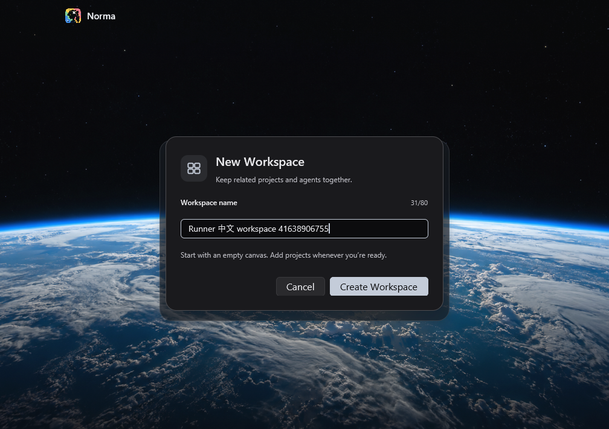
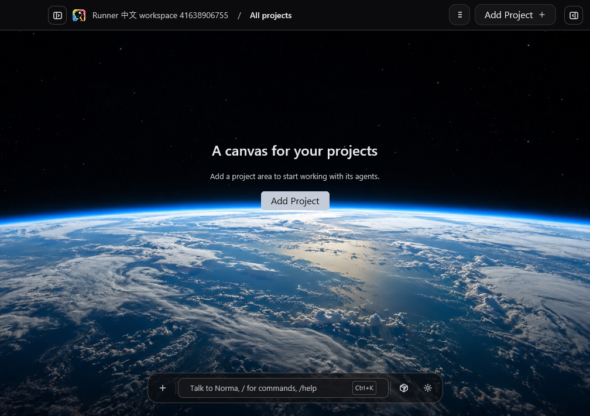
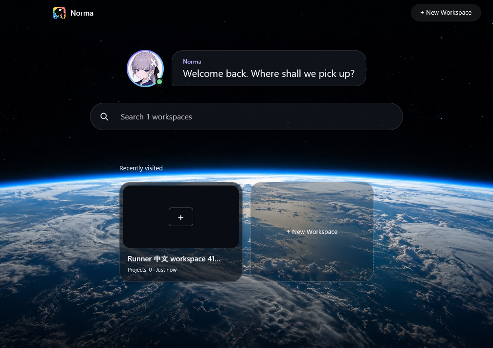

# Windows 工作区修复版 release ZIP 同包验收

本次仅恢复用户确认的 release 构建、ZIP 打包和同包真实 App 验收；不恢复其他暂停范围，不发布 Release、不合并，Claude/Codex 真实模型验收由用户负责。

状态：本次固定提交的 release ZIP 构建、同包启动和中文工作区创建/关闭重开验收均 PASS。可下载此未签名测试候选；完整 Windows 适配仍未完成，15项已知 storage 失败继续保留。

## 固定来源与验收矩阵

- 分支：`codex/windows-workspace-create-20261103`。
- 固定候选源码：`94e4bc83a7940a39ef0888d97d5f90669c5ccacd`，包含修复 `7cf61b94a846c750f6355e1465d1d4d275eb27b8`，以及下述本打包范围内的 adapter 锁文件修复。后续证据提交不改变候选来源。
- Producer：[Windows build 41629601361](https://github.com/multisoul-ai/Norma-AI-OS/actions/runs/41629601361)，attempt 1，两个 job 均 PASS。[build 125895500210](https://github.com/multisoul-ai/Norma-AI-OS/actions/runs/41629601361/job/125895500210) 完成 App/CLI release 编译及 ZIP 上传，[verify-candidate 125927765081](https://github.com/multisoul-ai/Norma-AI-OS/actions/runs/41629601361/job/125927765081) 在另一个 runner 启动原上传包。
- 独立 Consumer：[Windows packaged desktop contracts 41638906755](https://github.com/multisoul-ai/Norma-AI-OS/actions/runs/41638906755)，attempt 1，[job 125927076450](https://github.com/multisoul-ai/Norma-AI-OS/actions/runs/41638906755/job/125927076450) PASS。验收脚本提交 `cdc35620a926f282bcb80307a414afdb36bcacfd`，无 App 重新编译。`source-comparison.json` 保留候选对修复、脚本对候选的文件差异。
- 初次固定源码 `6fd2507908a330c2f2a29590e1dd34221178e03b` 的 [Windows build 41626941303](https://github.com/multisoul-ai/Norma-AI-OS/actions/runs/41626941303)，attempt 1，已在 `Require App adapters` 门槛失败；未进入 release 编译、未产 ZIP。发现确定失败后请求停止后续诊断编译，不能把该 run 当作成功打包。
- 验收脚本与候选源码身份分别记录，不能以 consumer 的 `GITHUB_SHA` 冒充包来源。

| 验收条件 | 证据与当前状态 |
|---|---|
| 固定提交的 release ZIP | PASS：原生 `--locked --release` App/CLI 构建、59文件 manifest、ZIP 哈希 |
| 新 runner 下载相同 ZIP，无重新编译 | PASS：`consumer-download.json` 的 `rebuilt=false`，与 producer 的内层 ZIP 名称、大小、哈希均相同；59文件逐项校验 |
| 包内 CLI/helper 与真实 App 启动 | PASS：`package-smoke-report.json`、真实 native WebView2 ready、窗口原图与退出码0 |
| 原生输入中文名称后精确查询 | PASS：Ctrl+N、SendInput、Enter；`workspace-created.json` 有且仅有一条精确名称记录 |
| 正常关闭并重开后同一 ID | PASS：两次10秒内正常退出0；`workspace-reopened.json` 有且仅有一条同名、同 ID、同创建时间记录 |
| 实际可见结果 | PASS：当前 Agent 多模态查看原始输入、创建、重开 PNG；脚本原始 PENDING 字段保留，人工看图结论另记 |

## 下载与同包身份

- 版本 `0.1.77`，`x86_64-pc-windows-msvc`，未签名。
- 便携候选：`norma-os-0.1.77-windows-x64-94e4bc83.zip`，95,184,305字节。
- **便携候选 ZIP SHA-256：`87ee66f8985766bbc611e5d4530e9edd3533fa27f26777037ffd3fcdcde9eba7`**。
- [下载 producer artifact 13231717118](https://github.com/multisoul-ai/Norma-AI-OS/actions/runs/41629601361/artifacts/13231717118)，到期时间为 `2026-11-04 12:48:25 UTC`。GitHub 下载的是外层 artifact ZIP，解开后得到上述便携 ZIP 和 `.sha256`；便携 ZIP 需整体解压再运行。
- 已下载的便携 ZIP 本地位置：`/private/tmp/norma-workspace-create-20261103/build/windows/norma-os-0.1.77-windows-x64-94e4bc83.zip`，旁边保留原始 `.zip.sha256`。

`producer-download.json` 记录本地按字节复核的下载结果；`consumer-download.json` 是新 Windows runner 的原始下载报告。两端的内层候选哈希和95,184,305字节大小完全一致。Producer 和 consumer 的 manifest 原始字节也相同，来源为固定 `94e4bc83`、producer run `41629601361`。消费 workflow 只有下载、解压、校验及包内可执行文件启动，没有 cargo build 或替代二进制。

GitHub 外层 artifact 的95,101,037字节 SHA-256 为 `ec7a249654e6d1f18e7f5a5be6fd71cf2786f3fb4b4bbf4876d9ef20da3e0dae`，下载后复核一致；它不是便携候选 ZIP 的哈希。`producer-release-excerpt.log` 保留原始 release 与打包日志节选，完整 build job 日志另保存在 `/private/tmp/norma-release-producer-41629601361.log` 和上方 GitHub job 链接。App release 编译耗时30分10秒，CLI release编译2分38秒，日志均明确为 optimized release profile。

## 新 runner 的真实 App 验收

Consumer 在 `windows-2025` hosted runner（Windows Server 2025）将同包解压到含中文和空格的目录，实际执行路径记录在 `workspace-native-report.json`。这不是用户 Windows 11 设备实测。包内 CLI、hook help、browser helper 的未授权 caller 拒绝、真实窗口与正常最后窗口关闭均通过；native workspace 流程另外等待真实 WebView2 创建完成。

| 查询时点 | 精确名称 | ID |
|---|---|---|
| 原生 Enter 创建后 | Runner 中文 workspace 41638906755 | 4a34cb6a-72d9-46c3-bec1-f05b9d7fa092 |
| 正常关闭并重新启动同一包后 | Runner 中文 workspace 41638906755 | 4a34cb6a-72d9-46c3-bec1-f05b9d7fa092 |

两个只读查询各有且仅有一条记录，创建时间也相同。`package-smoke-report.json` 的正常退出码为0；workspace 脚本的两次正常关闭均通过10秒内退出0的断言。首次 smoke、workspace 首次和重开的六条 App stdout/stderr 流均经 runner 的共用错误检查和下载后的证据分析，无所检查的 ERROR/panic；helper 预期拒绝输出单独保留，不混为 App 错误。

当前 Agent 按原始分辨率看图确认：输入框显示完整名称、31/80、创建启用；创建后页头完整显示精确名称并进入空工作区；重开后目录显示1个工作区，卡片中文名称前缀正确、尾部按现有布局截断，完整名称与同一 ID 由只读查询确认。`consumer-report.json` 与 `workspace-native-report.json` 的原始 `visual_verification=PENDING` 未改写，看图 PASS 单独记录在本报告和 `acceptance.json`。

[完整 consumer 证据 artifact 13231424159](https://github.com/multisoul-ai/Norma-AI-OS/actions/runs/41638906755/artifacts/13231424159) 到期时间为 `2026-11-06 12:50:11 UTC`，9,303,461字节，SHA-256 `1b292a5bf5070ed7118363ba3bb553876c66649f4709a5508cd1f0775913d8a0`，下载后按原始 ZIP 字节复核一致。完整原图与日志在 `/private/tmp/norma-release-consumer-41638906755`，本目录保留三张关键原图、原始 JSON、App/helper 日志与汇总身份。主 App 和 helper 均来自同一个已校验候选。

## 本打包范围内的失败与聚焦回归

`storage` 安全随机数修复已更新主锁文件，但独立 `crates/app/tests/platform_probe/Cargo.lock` 遗漏新增的 storage→ring 依赖边。原 release 链的 adapter 门槛因此在编译前立即失败。

先增加不编译的真实 Cargo 解析检查，提交 `7e9dce52`，[41628880914 / package-lock](https://github.com/multisoul-ai/Norma-AI-OS/actions/runs/41628880914/job/125893064650) 得到 RED：`cargo metadata --locked --manifest-path crates/app/tests/platform_probe/Cargo.toml --format-version 1` 报 `Cargo.lock needs to be updated but --locked was passed`，退出1。不是通过移除 `--locked` 获取通过。

修复 `94e4bc83` 仅给该独立锁文件的 storage 记录加上已锁定 ring 0.17.14 的依赖边，不升级任何包、不改生产 Rust 源码或主 Cargo.lock。同时将相同检查提前到 release 长构建前。修复后的独立门槛：[41629196173](https://github.com/multisoul-ai/Norma-AI-OS/actions/runs/41629196173)，GREEN；该来源的全部脚本检查也通过。对该锁修复的独立只读增量审查未发现阻断项。

来源隔离的公开 PowerShell 回归先于实现提交：`f7dd73a6` 的 [41627701925](https://github.com/multisoul-ai/Norma-AI-OS/actions/runs/41627701925) 为 RED（旧脚本未提供 ExpectedSourceSha 接口，未生成要求的失败报告）；实现 `7416b57b` 的 [41628100068](https://github.com/multisoul-ai/Norma-AI-OS/actions/runs/41628100068) 为 GREEN。7个包测试、18个报告测试、2个媒体测试、2035项双语catalog检查，以及真实窗口client截图/越界拒绝、原生就绪日志正负例均通过。

独立只读对抗审查确认来源分离、同目录包内执行和复用的 exact ID 断言，无重编译命令。审查还发现既有 smoke 单独运行时不扫描 App 错误日志的盲点；本次在消费端补齐检查，不改变已固定的包源码。

日志检查先以 `a2421b11` 的 [41629960881](https://github.com/multisoul-ai/Norma-AI-OS/actions/runs/41629960881) 得到 RED，再由 `cdc35620a926f282bcb80307a414afdb36bcacfd` 提取和共用原生 App 双流检查。smoke 的首次启动、workspace 的首次及重开启动均拒绝 Rust ERROR、Chromium ERROR 和 panic；不扫描 helper 预期拒绝的日志。该来源的 [41630292125](https://github.com/multisoul-ai/Norma-AI-OS/actions/runs/41630292125) 脚本检查 GREEN：干净 INFO/WARN 正例、两个流各三种错误共六个负例，以及同一 driver 重复加载均通过；原有7个包测试、18个报告测试、2个媒体测试、双语与真实窗口检查也通过。独立只读增量审查未发现新增阻断。

## 继续保留的 Windows 全套 15 项失败

复用 [上一轮同源码实现的比较证据](../windows-workspace-create-20261103/README.md) 及 `../windows-workspace-create-20261103/storage-comparison.json`：修复实现 `7cf61b94` 的 [41617015436](https://github.com/multisoul-ai/Norma-AI-OS/actions/runs/41617015436) 完整 Windows storage 为267通过/15失败/0忽略。固定候选相对该修复未改变生产源码、生产 manifest 或主 Cargo.lock；额外改动为 CI、验收脚本、证据，以及上述独立 adapter 测试锁的依赖同步。当前 release workflow 的专项检查通过也不替代完整 storage。

| 类别 | 仍失败的测试 | 对交付的影响 |
|---|---|---|
| 数据根路径及哈希 | `database_paths::tests::isolated_test_paths_stay_under_the_explicit_test_boundary` | Windows 路径与哈希预期尚未统一，不能宣称数据目录平台验证全通过 |
| 旧库导入及初始化 | `constructing_a_project_store_cannot_bypass_legacy_import`；`failed_import_does_not_publish_an_empty_database_and_can_retry`；`legacy_database_is_imported_once_including_committed_wal_data`；`concurrent_initialization_publishes_one_complete_database`；`test_mode_never_imports_the_production_legacy_database` | Windows AccessDenied 尚未解决；旧库升级、失败重试及并发初始化不能宣称可靠 |
| SQLite 并发 | `live_concurrent_claim_is_unique_and_unfinished_restart_is_unknown`；`mobile_command_is_reserved_once_and_receipt_is_immutable`；`concurrent_creation_migrates_legacy_chat_time_once` | DatabaseBusy；并发预留、回执及迁移仍有可靠性阻塞，衔接既有并发失败排查提议，本次不另起修复 |
| 共享记忆身份 | `repository_worktrees_share_only_project_memory` | 当前平台目录身份校验未完成，不能宣称跨 worktree 记忆隔离全通过 |
| 手机会话文件引用 | `cursor_session_persists_bound_transcript_reference`；`session_index_is_durable_scoped_and_immutable`；`session_history_pages_without_duplicates`；`transcript_reference_uses_existing_writer_and_cannot_be_rebound`；`native_events_preserve_session_identity_and_record_exact_turn` | session filesystem reference 被拒绝；手机会话索引、历史、绑定及事件持久化验收未完成 |

其中14项基线也失败；`mobile_command_is_reserved_once_and_receipt_is_immutable` 在基线曾通过、本轮出现 DatabaseBusy，尚未归因。历史82项失败降为15项的名称比较不能证明所有历史抖动已修复。

本次限定同包流程已全部通过，只证明该哈希的未签名测试候选覆盖了上述限定行为；完整 Windows storage、全部 Windows 功能及真实模型验收仍不能标为通过。没有发布 Release 或合并分支，其他暂停范围继续暂停。
