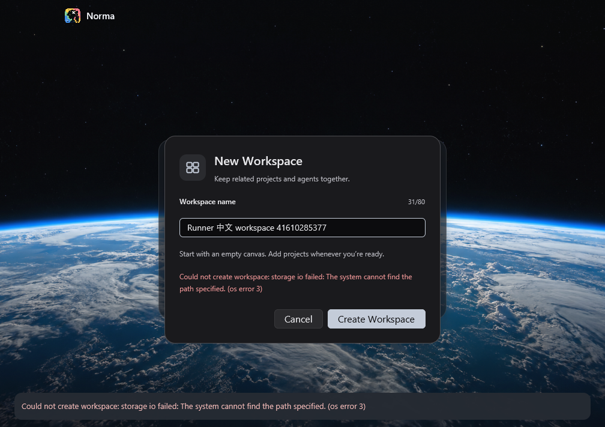
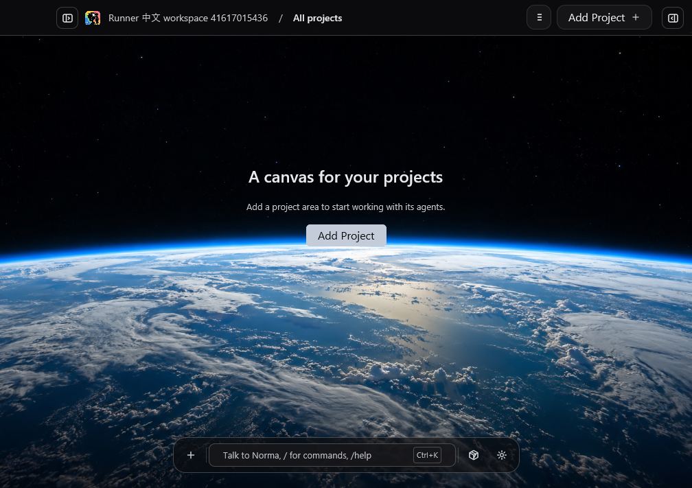
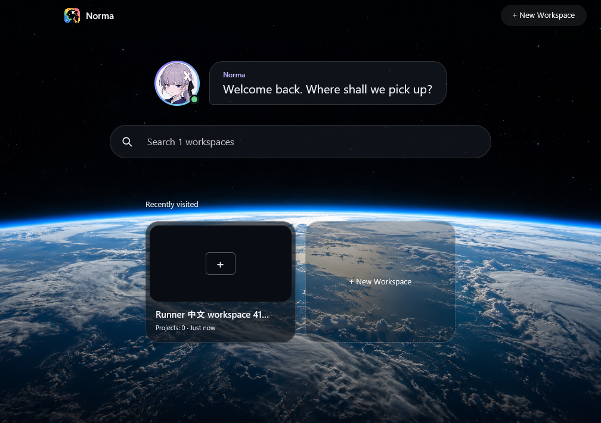

# Windows 中文工作区创建回归

本次仅继续用户确认的中文工作区创建、记录查询及关闭重开验收；其余 Windows 适配范围保持暂停，Claude/Codex 真实模型验收仍由用户负责。

状态：本项中文工作区创建及重开验收PASS；完整 Windows storage 仍有15项失败，整体 Windows 适配不因此标为完成。

| 验收项 | 对应证据 |
|---|---|
| 正式存储入口创建中文名称、精确查询、重开同一记录 | `crates/storage/tests/desktop_workspace_platform.rs`，Windows/macOS runner |
| 原生输入、Enter 提交、关闭重开后同一工作区身份 | `scripts/windows/probe-startup.ps1` 的 `workspace-reopen`，真实 Windows App |
| 受影响存储行为及已有中英文消息 | storage 全套测试、`scripts/check-i18n.py` |
| 实际可见结果 | 输入/提交、创建成功、重开后的原始窗口截图 |

## 原始真实 App 失败

[run 41610285377](https://github.com/multisoul-ai/Norma-AI-OS/actions/runs/41610285377)，attempt 1，源码 `43eab9b2aebd2a36b0211652d62cf4b596366168`，Windows hosted runner。任务整体 FAIL。

原生 Ctrl+N 打开新建弹窗；输入后的原图显示完整的 `Runner 中文 workspace 41610285377`，字符计数为 31/80，创建按钮启用。Enter 后原图显示文件系统错误 `The system cannot find the path specified. (os error 3)`，只读精确名称查询结果为 `[]`。关闭重开步骤尚未执行，不能将该结果写成重开丢失数据。

调用路径是 `DesktopWorkspaceStore::create` → `create_on_connection` → `workspace_identity_store::random_workspace_id`。最后一步无条件打开 `/dev/urandom`；Windows 不存在该设备路径。名称输入和 Enter 均已到达创建流程。

原 artifact：`13219008516`，SHA-256 `975f867cc77a3db379fe2327730987fa830f6d558d8763e0cdc7afa924c740ad`；下载后按 ZIP 原始字节复核一致。完整原始材料保存在 `/private/tmp/norma-workspace-red-43eab9b2-41610285377`。

## 聚焦回归与修复

测试先提交为 `ec31f04a0547047ef9dd30a1775f84a8455dbf93`，生产实现尚未改变。两平台聚焦运行：[41614569839](https://github.com/multisoul-ai/Norma-AI-OS/actions/runs/41614569839)，attempt 1：Windows 0通过/1失败/0忽略，执行2.34秒，在正式 `catalog.create` 返回相同 OS error 3；macOS 1通过/0失败/0忽略，执行0.06秒。

Windows 聚焦 artifact `13221805860`，SHA-256 `1e895fa21c2c6206d21bc20a6b44d82d6aa51e5ed192000993bb585dca58d70c`，下载 ZIP 后复核一致；macOS artifact `13221430882`，GitHub SHA-256 `081f7202abf22cad17e37007d5c839ed172b4a7ea21a546c040803a765da3dce`。

后续修复保持现有 UUID v4 格式及显式失败结果，不使用时间戳、固定值或弱随机降级。真实程序验收必须另有创建及重开的精确 ID、名称和原图证据，存储测试绿色不能替代真实 App。

修复为 `7cf61b94a846c750f6355e1465d1d4d275eb27b8`：存储层直接使用已锁定的 ring 0.17.14，显式启用 `std` 以保留错误 source。只替换随机字节获取；UUID 的16字节输入、版本/variant处理、字符串格式及 `StorageResult` 签名保持不变。Cargo.lock 仅新增 storage→ring 依赖边，未升级版本。独立只读对抗审查未发现阻断问题。

同来源完整验收：[41617015436](https://github.com/multisoul-ai/Norma-AI-OS/actions/runs/41617015436)，attempt 1。两平台聚焦通过，macOS 完整 storage 为283通过/0失败/0忽略；Windows 完整 storage 为267通过/15失败/0忽略，仍为FAIL。真实 App 的创建及重开通过，具体原图见下一节。macOS artifact `13222570030`，SHA-256 `5bfa243578c8c959ad836b1d413cdd2029bfc02c34e77e4184b078f350f39fc2`；Windows artifact `13223126942`，SHA-256 `556d438b615262a825a858a48e362ca378ac0c1479774f208c749d5c23c230f9`，两个ZIP下载后均按原始字节复核一致，原始材料分别为 `/private/tmp/norma-workspace-storage-green-7cf61b94-macos` 与 `/private/tmp/norma-workspace-storage-green-7cf61b94-windows`。

`b90879694e458feba6a26264ed3804926dfb5b26` 仅给该工作流补充 storage 依赖/热路径、文件行数及禁止allow护栏。生产源码、manifest与lock相对修复提交逐字节一致（`git diff --exit-code 7cf61b94 b9087969 -- Cargo.lock crates` 为0）。该来源的增量检查 [41617410143](https://github.com/multisoul-ai/Norma-AI-OS/actions/runs/41617410143) 两平台聚焦及全部护栏均PASS：Windows聚焦2.76秒，Mac聚焦0.09秒，均1通过/0失败/0忽略。没有以验证入口变化重写修复版证据身份。

护栏 artifact 的 ZIP 下载后均按原始字节校验一致：Windows `13221838145` / SHA-256 `8dd001bcd471e330397b1c2d0f3ac90e4a61147ac970bcb77b5a6c92a1e1986b`，macOS `13221673677` / SHA-256 `6b9a1eef6e47c23ae1429cb6027f0cba994666fa1bef6ff0544668990caec7a1`。原始材料为 `/private/tmp/norma-workspace-guards-b9087969-windows` 与 `/private/tmp/norma-workspace-guards-b9087969-macos`。

## 真实 App 创建与关闭重开

同一源码 `7cf61b94a846c750f6355e1465d1d4d275eb27b8`、同一run/attempt的 [actual-app job 125852886241](https://github.com/multisoul-ai/Norma-AI-OS/actions/runs/41617015436/job/125852886241) 完成真实默认能力 App 构建（只用既有 production-data 数据目录选项）、中英文catalog检查，以及原生Ctrl+N、SendInput中文输入、Enter提交、两次正常WM_CLOSE和重开。不是候选包验收，也不代表Windows 11用户设备实测。

| 查询时点 | 精确名称 | 工作区ID |
|---|---|---|
| 创建后 | Runner 中文 workspace 41617015436 | a5ebc033-91be-455c-b2a0-9018210cdf65 |
| 正常关闭并重新启动后 | Runner 中文 workspace 41617015436 | a5ebc033-91be-455c-b2a0-9018210cdf65 |

两次只读查询各有且仅有一条精确名称记录，ID相同；原脚本的两次正常关闭均满足10秒内退出且退出码0的断言。公开回归另外验证UUID格式和重开后无默认记录。

当前Agent已按原始分辨率多模态查看两张关键原图：创建后页头完整显示中文名称并进入空工作区；重开后目录显示1个工作区及对应中文名称卡片。原始 `native-report.json` 的 `visual_verification` 字段仍保留脚本产生的PENDING，未篡改为PASS；这里单独记录看图确认结果为PASS。

真实App artifact `13224485054`，ZIP SHA-256 `c94ca4d52119d0e4e1fd138db1ebcf92df75f5c1811ead7ade3efcb9aeef858c`，下载后复核一致；完整原始材料为 `/private/tmp/norma-workspace-app-green-7cf61b94`。本目录保留原始创建/重开查询JSON、原生报告和两张PNG；它们不含真实用户数据或模型会话。

## 保留的 Windows 全套阻塞

基线 `f232ac0b` 的 [41611131460](https://github.com/multisoul-ai/Norma-AI-OS/actions/runs/41611131460) 为199通过/82失败/0忽略；本轮新增一项测试后为267通过/15失败/0忽略。逐项名称比较保存在 `storage-comparison.json`：68个原失败测试本轮通过，14个原失败测试仍失败，另有1个基线曾通过的并发测试本轮失败。该比较不证明每个历史抖动都已修复。

| 当前剩余类别 | 本轮证据与边界 |
|---|---|
| 数据根路径与项目库哈希 | 一条 Windows/Unix 路径及哈希预期不一致的单测仍失败 |
| 旧项目库导入与并发初始化 | 五条测试在 Windows 返回 Access denied；本次未修改迁移代码 |
| SQLite 并发预留与迁移 | live operation、mobile command、chat time 三条仍有 DatabaseBusy；其中 mobile command 是基线曾通过、本轮失败，尚未归因，不以重跑覆盖 |
| 项目记忆范围身份 | 一条 shared project memory 测试报告当前平台不能核验目录身份 |
| 手机会话文件引用 | 五条测试拒绝 session filesystem reference，属于后续会话平台边界 |

以上15项未修复，完整 Windows storage 不能标为PASS。它们保留为整体 Windows 适配的剩余阻塞，本次不扩展恢复暂停范围。
