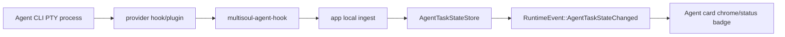

# Card RuntimeEvent Extension Guide

本文定义卡片事件扩展机制。目标是让 Terminal、Agent、Preview 和后续新卡片都能用同一套事件契约暴露状态，同时保持 `runtime` 零 GPUI、可测试、无热路径阻塞。

当前代码已实现 `RuntimeEvent`、进程状态和 Agent Hook 状态投影；本文同时记录现状与后续扩展约束。

## 1. 事件分层

卡片状态不要只用一个枚举承载所有语义。第一层描述进程，第二层描述 Agent 任务。

```text
Card process state
  来源: LiveNode / TerminalSession / PTY lifecycle
  语义: 进程是否启动、运行、退出、异常

Agent task state
  来源: Claude/Codex/Cursor/Grok/OpenCode hooks
  语义: 当前 turn 是否思考、运行工具、等待授权、完成、失败
```

推荐状态类型：

```rust
pub enum CardRunState {
    Initializing,
    Running,
    Finished { code: Option<i32> },
    Error { message: String },
    Stopped,
}

pub enum AgentTaskState {
    Ready,
    Thinking,
    RunningTool { tool_name: Option<String> },
    WaitingApproval { tool_name: Option<String> },
    Done,
    Failed { message: String },
    Ended,
}
```

`CardRunState` 适用于所有 live card。`AgentTaskState` 只适用于 `NodeType::Agent`。

## 2. RuntimeEvent 契约

`RuntimeEvent` 是 runtime/app 对外通知卡片状态变化的统一出口。事件只表达“发生了什么”，不直接执行 UI、存储或网络副作用。

推荐事件：

```rust
pub enum RuntimeEvent {
    CardRegistered {
        node_id: NodeId,
        node_type: NodeType,
        run_state: CardRunState,
    },
    CardRunStateChanged {
        node_id: NodeId,
        from: CardRunState,
        to: CardRunState,
    },
    CardRemoved {
        node_id: NodeId,
        previous_run_state: Option<CardRunState>,
    },
    CardOperationFailed {
        node_id: Option<NodeId>,
        operation: CardOperation,
        message: String,
    },
    AgentTaskStateChanged {
        node_id: NodeId,
        from: Option<AgentTaskState>,
        to: AgentTaskState,
        source_event: String,
    },
    EventsDropped {
        count: usize,
    },
}
```

事件队列规则：

- `Runtime` 维护短生命周期内存队列，例如 `VecDeque<RuntimeEvent>`。
- app 帧循环在 `runtime.drain_all()` 后调用 `runtime.take_events()`。
- 只在状态变化时发事件。`Running -> Running` 不发。
- 队列需要上限，例如 1024 条；超限时合并为 `EventsDropped`。
- 事件不可包含 PTY 输出正文，终端内容仍走 `GridSnapshot`。

## 3. 进程运行状态来源

Terminal 和 Agent 当前都由 PTY 子进程承载，Agent 只是用不同命令启动的 terminal-backed live node。

```text
PTY child process
  -> pty-reader thread
  -> PtyEvent::Output / PtyEvent::Exited
  -> TerminalSession::drain
  -> TerminalStatus
  -> CardRunState
  -> RuntimeEvent
```

映射建议：

| Source | CardRunState |
| --- | --- |
| spawn 成功 | `Running` |
| `TerminalStatus::Running` | `Running` |
| `Exited { code: Some(0) }` | `Finished { code: Some(0) }` |
| `Exited { code: Some(non_zero) }` | `Error { message }` |
| `Exited { code: None }` | `Finished { code: None }` |
| 用户关闭卡片 | `Stopped` 或 `CardRemoved` |
| spawn/input/resize/scroll 失败 | `CardOperationFailed` |

`CardRunState` 不能判断 Agent CLI 是否正在思考或执行工具。Agent 任务语义必须走 provider hooks。

## 4. Agent 任务状态来源

Claude、Codex、Cursor、Grok 与 OpenCode hooks 会在 session、用户输入、工具调用、授权请求、停止等生命周期点执行命令。Norma OS 应追加自己的 hook bridge 命令或 OpenCode plugin，而不是替换用户已有配置。Grok 使用 `~/.grok/hooks/*.json`，其官方 camelCase 事件字段会在 bridge 内归一化。Grok 卡片优先持久化 Hook 提供的精确 `sessionId`；缺失时只读扫描 `~/.grok/sessions/<URL-encoded-workspace>/`，按已知活动文件时间选择当前 workspace 的最近会话，再以 `grok --resume <ID>` 恢复。

推荐命令：

```bash
multisoul-agent-hook --source claude
multisoul-agent-hook --source codex
multisoul-agent-hook --source cursor
multisoul-agent-hook --source grok
multisoul-agent-hook --source opencode
```

bridge 行为：

- 从 `stdin` 读取 provider 原始 hook JSON。
- 从 env 读取 `MULTISOUL_NODE_ID`、`MULTISOUL_AGENT_PROFILE`、`MULTISOUL_HOOK_ENDPOINT`、`MULTISOUL_HOOK_TOKEN`。
- 缺少 Norma OS env 时直接 `exit 0`，避免影响普通 Agent CLI 会话。
- POST 到本地 app ingest endpoint，例如 `http://127.0.0.1:<port>/agent-hooks`。
- endpoint 不可达或解析失败时也 `exit 0`，避免阻塞 Agent CLI。
- 不解析 transcript 文件。transcript 只用于人工排障，不作为稳定状态接口。

Agent PTY 启动时注入 per-node env：

```text
MULTISOUL_NODE_ID=<node_id>
MULTISOUL_AGENT_PROFILE=claude|codex|cursor|grok|opencode
MULTISOUL_HOOK_ENDPOINT=http://127.0.0.1:<port>/agent-hooks
MULTISOUL_HOOK_TOKEN=<random-token>
```

统一 hook payload：

```json
{
  "node_id": 12,
  "profile": "codex",
  "provider_event": "PreToolUse",
  "session_id": "...",
  "turn_id": "...",
  "tool_name": "Bash",
  "message": null,
  "raw_json": {}
}
```

## 5. Hook 事件映射

| Provider event | AgentTaskState |
| --- | --- |
| `SessionStart` | `Ready` |
| `UserPromptSubmit` | `Thinking` |
| `PreToolUse` | `RunningTool { tool_name }` |
| `PostToolUse` | `Thinking` |
| `PermissionRequest` | `WaitingApproval { tool_name }` |
| `PermissionDenied` | `Failed { message }` 或保持 `WaitingApproval` 后由 UI 展示拒绝 |
| `PostToolUseFailure` | `Failed { message }` |
| `Stop` | `Done` |
| `StopFailure` | `Failed { message }` |
| `SessionEnd` | `Ended` |
| `SubagentStart` | `RunningTool { tool_name: Some("subagent") }` |
| `SubagentStop` | `Thinking` |

映射函数应按 provider 分文件维护，例如 `agent_hooks/claude.rs` 和 `agent_hooks/codex.rs`。外部 hook JSON 视为不可信输入，字段缺失时不 panic。

## 6. App Ingest 与消费

hook ingest 属于 app 层，因为它涉及本地 HTTP、token 校验和 UI 通知。`runtime` 不应监听 socket，也不应依赖 HTTP crate。



消费规则：

- app 接收 hook 后先校验 token 和 `node_id`。
- 只有 `NodeType::Agent` 可更新 `AgentTaskState`。
- 重复状态不发重复事件。
- UI 通过 `node_id` 读取当前 run state 和 task state。
- 持久化不要直接发生在 ingest 路径；如需保存历史，交给 debounce scheduler 或后台任务。

## 7. 扩展新卡片的步骤

新增卡片能力时按下面顺序接入事件：

1. 判断它是否有 live process。有则接入 `CardRunState`，无则只在 app/card store 维护局部状态。
2. 定义最小状态枚举，不要把日志、输出正文或大 payload 放进 `RuntimeEvent`。
3. 在状态 transition 处发事件，不在每帧或每个 output chunk 发事件。
4. app 层消费事件后决定是否刷新 UI、记录日志或触发后续动作。
5. 新增单元测试覆盖正向事件、负向不发事件、重复事件去重和缺失字段容错。

常见反例：

- 解析终端屏幕文字判断 Agent 是否完成。
- 把每段 PTY output 作为事件广播。
- 在 `Runtime::drain_all` 或 hook ingest 中同步写 SQLite。
- 让 `runtime` 依赖 GPUI、HTTP server 或 app-only store。
- 使用 provider 原始 hook 名称作为 UI 状态，不做统一归一化。

## 8. 验证要求

涉及 runtime 事件：

```bash
cargo test -p runtime
```

涉及 app ingest、hook bridge 或 UI 状态：

```bash
cargo test -p app
cargo check -p app
```

跨层边界必须继续通过：

```bash
bash scripts/check-storage-boundaries.sh
bash scripts/check-max-file-lines.sh
bash scripts/check-no-allow.sh
```

新增测试必须遵守仓库测试注释规范：场景、数据构造、执行过程、预期结果都要写清楚；每个断言都要带失败说明。
