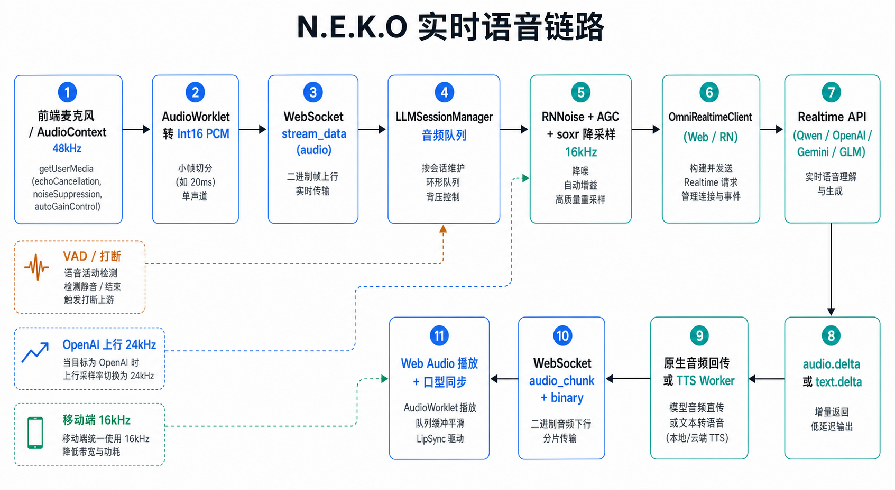
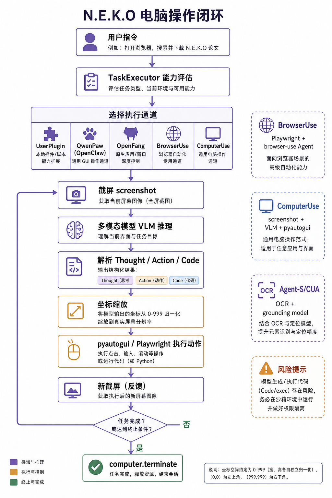
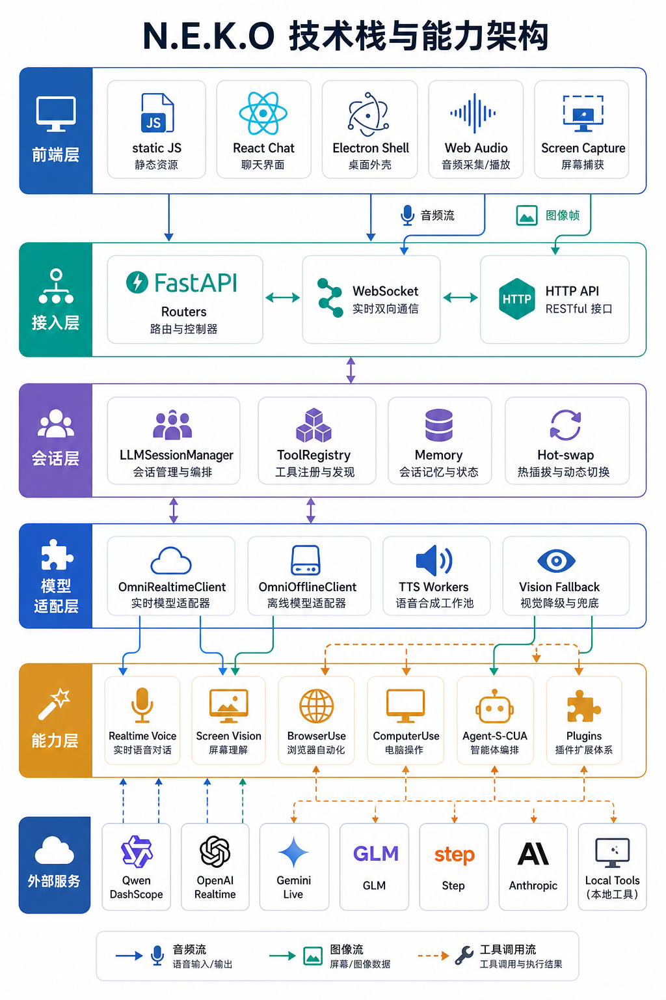

# Project N.E.K.O 实时语音与电脑操作能力技术分析

分析对象: [Project-N-E-K-O/N.E.K.O](https://github.com/Project-N-E-K-O/N.E.K.O)

本地 clone: `/private/tmp/neko-analysis/N.E.K.O`

分析 commit: `dd86629`，提交时间 `2026-07-04 20:57:42 +0800`

## 结论摘要

N.E.K.O 的实时语音不是传统“录一段音频再请求一次 HTTP”的模式，而是浏览器前端持续采集 PCM 音频，经 WebSocket 送到 Python 后端，后端用 `LLMSessionManager` 管理会话，再由 `OmniRealtimeClient` 适配 Qwen DashScope、OpenAI Realtime、Gemini Live、GLM、Step 等实时模型。输出也分两条路: 模型原生返回音频 `audio.delta` 时直接回传给前端播放；模型只返回文本或配置启用外部声音时，则把文本增量送到 TTS worker，再把音频片段发回浏览器。

电脑操作能力不是单个实现，而是一组执行通道。`TaskExecutor` 先根据开关、任务类型、可用性和模型评估选择渠道，然后可能走 UserPlugin、QwenPaw/OpenClaw、OpenFang、BrowserUse 或 ComputerUse。通用桌面控制的核心是“截屏 -> 多模态模型推理 -> 解析动作/代码 -> `pyautogui` 或 Playwright 执行 -> 再截屏反馈”的闭环。

## 图片总览







## 技术栈

| 层 | 主要技术 | 作用 |
|---|---|---|
| 前端 | 静态 JS、React chat、Electron shell、Web Audio API、AudioWorklet、MediaDevices、Screen Capture | 麦克风采集、音频播放、口型同步、屏幕/摄像头帧采集 |
| 接入层 | FastAPI、WebSocket、HTTP routers、Uvicorn | 聊天会话、语音流、屏幕流、Agent 控制接口 |
| 会话层 | `LLMSessionManager`、`ToolRegistry`、memory、hot-swap cache | 管理实时/离线模型会话、工具调用、TTS、会话切换 |
| 模型适配 | `OmniRealtimeClient`、`OmniOfflineClient`、OpenAI SDK、DashScope、Google GenAI、Anthropic | 统一不同模型供应商的实时音频、文本、图像、工具协议 |
| 音频处理 | `numpy`、`soxr`、RNNoise、AGC、limiter | 降噪、增益、限幅、流式重采样 |
| 电脑操作 | `pyautogui`、Playwright、browser-use、pytesseract、mss/dxcam/pyobjc/pywinauto | 桌面 GUI 控制、浏览器自动化、OCR/视觉定位 |
| 插件/工具 | `pyzmq`、HTTP RPC、JSON Schema tool definitions | 本地/远程工具注册、插件入口、跨进程工具调用 |

依赖证据见 [`pyproject.toml`](https://github.com/Project-N-E-K-O/N.E.K.O/blob/dd86629/pyproject.toml#L6-L74): Python 3.11、FastAPI、websockets、soxr、OpenAI、Google GenAI、Anthropic、pyautogui、pytesseract、browser-use、Playwright、mss、dxcam、pyrnnoise 等都在主依赖中。

## 实时语音实现

### 1. 前端采集: Web Audio + AudioWorklet

前端在开始语音时创建 `AudioContext({ sampleRate: 48000 })`，请求麦克风权限，并设置浏览器侧约束: `noiseSuppression: false`、`echoCancellation: true`、`autoGainControl: true`、单声道。源码见 [`static/app-audio-capture.js`](https://github.com/Project-N-E-K-O/N.E.K.O/blob/dd86629/static/app-audio-capture.js#L884-L929)。

采集后加载 `/static/audio-processor.js`，桌面端目标采样率是 48kHz，移动端目标采样率是 16kHz。AudioWorklet 产出 `Int16Array` 后通过 WebSocket 发送 JSON:

```json
{
  "action": "stream_data",
  "input_type": "audio",
  "data": [/* Int16 PCM samples */]
}
```

证据见 [`static/app-audio-capture.js`](https://github.com/Project-N-E-K-O/N.E.K.O/blob/dd86629/static/app-audio-capture.js#L795-L856)。Worklet 内部按目标采样率决定 chunk 大小: 48kHz 为 480 samples，也就是 10ms 一帧；16kHz 为 512 samples，约 32ms 一帧。Float32 会转换为 Int16 PCM。证据见 [`static/audio-processor.js`](https://github.com/Project-N-E-K-O/N.E.K.O/blob/dd86629/static/audio-processor.js#L15-L72)。

### 2. WebSocket 接入和会话启动

WebSocket router 处理两个关键动作:

- `start_session`: 按 `input_type` 选择 text/audio 模式，并启动 `LLMSessionManager.start_session(...)`。
- `stream_data`: 音频、图像等输入按类型分发到 `session_manager[lanlan_name].stream_data(message)`。

证据见 [`main_routers/websocket_router.py`](https://github.com/Project-N-E-K-O/N.E.K.O/blob/dd86629/main_routers/websocket_router.py#L296-L357)。

`LLMSessionManager.start_session` 会读取模型配置、TTS 配置、角色 prompt、工具快照，并根据模式创建 `OmniOfflineClient` 或 `OmniRealtimeClient`。实时语音模式下，`OmniRealtimeClient` 注入这些回调:

- `on_text_delta`: 文本增量，通常进入 TTS 或聊天 UI。
- `on_audio_delta`: 原生音频增量，直接回传前端。
- `on_new_message`: 用户语音 turn 结束。
- `on_input_transcript`: 用户语音转写。
- `on_output_transcript`: 模型输出转写。
- `on_tool_call`: 实时模型发起工具调用。

关键创建点见 [`main_logic/core.py`](https://github.com/Project-N-E-K-O/N.E.K.O/blob/dd86629/main_logic/core.py#L5772-L6410)。

### 3. 音频预处理: RNNoise + soxr + VAD

后端收到 JSON 数组后先打包为 PCM16 bytes。对于 48kHz 桌面输入，`core.py` 会识别 `480 samples = 960 bytes / 10ms`，通过 session 的 `AudioProcessor` 做 RNNoise 降噪和降采样；处理后的 16kHz 音频才进入热切换缓存或实时发送。证据见 [`main_logic/core.py`](https://github.com/Project-N-E-K-O/N.E.K.O/blob/dd86629/main_logic/core.py#L9758-L9823)。

`OmniRealtimeClient.stream_audio` 也保留了同样的输入兼容逻辑:

- 48kHz 桌面输入: 走 RNNoise，再降到 16kHz。
- 16kHz 移动端输入: 直接透传。
- VAD 优先级: 服务端 VAD 最高；没有服务端 VAD 时，RNNoise speech probability 次之；最后用 RMS 能量兜底。
- OpenAI/GPT Realtime 这类目标在上行末端把 16kHz 转成 24kHz，其它供应商保持 16kHz 或各自 SDK 要求。

证据见 [`main_logic/omni_realtime_client.py`](https://github.com/Project-N-E-K-O/N.E.K.O/blob/dd86629/main_logic/omni_realtime_client.py#L1295-L1396)。

手动 VAD 模式下，用户停止说话时会显式提交 turn: Gemini 通过 SDK 发送 `ActivityEnd`，WebSocket 协议供应商发送 `input_audio_buffer.commit` 后接 `response.create`。证据见 [`main_logic/omni_realtime_client.py`](https://github.com/Project-N-E-K-O/N.E.K.O/blob/dd86629/main_logic/omni_realtime_client.py#L1414-L1456)。

### 4. 供应商实时协议适配

`OmniRealtimeClient.connect()` 会根据模型名和 base URL 构造不同的 session 配置。它把供应商差异藏在适配层里:

- Qwen DashScope: WebSocket，`pcm16` 输入输出，`gummy-realtime-v1` 转写，Qwen 3.5 走 `semantic_vad`，其它多为 `server_vad`。
- OpenAI Realtime/GPT: WebSocket，音频输入格式声明为 24kHz PCM，semantic VAD，工具为扁平 OpenAI Realtime 结构。
- Gemini Live: 不走同一套 WebSocket event，而是 Google GenAI SDK 的 live session。
- GLM/Step/free proxy: 各自有不同的 `session.update` 字段、工具 schema 和图像事件格式。

核心配置区见 [`main_logic/omni_realtime_client.py`](https://github.com/Project-N-E-K-O/N.E.K.O/blob/dd86629/main_logic/omni_realtime_client.py#L789-L1030)。

### 5. 输出路径: 原生音频或 TTS

模型返回原生音频时，WebSocket event `response.audio.delta` 或 `response.output_audio.delta` 里携带 base64 音频。客户端解码后调用 `on_audio_delta`。证据见 [`main_logic/omni_realtime_client.py`](https://github.com/Project-N-E-K-O/N.E.K.O/blob/dd86629/main_logic/omni_realtime_client.py#L2840-L2855)。Gemini Live 的音频则来自 SDK 的 `inline_data`，同样回调 `on_audio_delta`，见 [`main_logic/omni_realtime_client.py`](https://github.com/Project-N-E-K-O/N.E.K.O/blob/dd86629/main_logic/omni_realtime_client.py#L3152-L3164)。

`core.py` 的 `handle_audio_data` 会在不使用外部 TTS 时接收这些原生音频 bytes，转换为 float，走流式重采样器，再调用 `send_speech` 发给前端。证据见 [`main_logic/core.py`](https://github.com/Project-N-E-K-O/N.E.K.O/blob/dd86629/main_logic/core.py#L3427-L3440)。

如果启用外部 TTS，文本增量进入 TTS worker。`tts_response_handler` 从响应队列里读 `("__audio__", speech_id, payload)`，再交给 `send_speech`。`send_speech` 的传输格式是先发 JSON header:

```json
{ "type": "audio_chunk", "speech_id": "..." }
```

然后立刻发送二进制音频 bytes。证据见 [`main_logic/core.py`](https://github.com/Project-N-E-K-O/N.E.K.O/blob/dd86629/main_logic/core.py#L10312-L10327) 和 [`main_logic/core.py`](https://github.com/Project-N-E-K-O/N.E.K.O/blob/dd86629/main_logic/core.py#L10344-L10535)。

前端收到 `audio_chunk` header 后，把 metadata 放入 `pendingAudioChunkMetaQueue`，下一段二进制 Blob 会和这个 metadata 配对，用于打断、turn 归属和播放状态管理。证据见 [`static/app-websocket.js`](https://github.com/Project-N-E-K-O/N.E.K.O/blob/dd86629/static/app-websocket.js#L1912-L1965)。

播放端会把音频 Blob 解码/转换为 `AudioBuffer`，用 Web Audio 的 `BufferSource` 精准排程，并驱动 VRM/MMD/PNGTuber/Live2D 的口型同步。排程和口型同步入口见 [`static/app-audio-playback.js`](https://github.com/Project-N-E-K-O/N.E.K.O/blob/dd86629/static/app-audio-playback.js#L987-L1134)。

### 6. 屏幕和视觉输入

屏幕共享每秒抓一帧 canvas，编码为 JPEG data URL，通过同一个 `stream_data` WebSocket 消息发送。前端还会附带 avatar 位置元数据，便于后端在图像上叠加“角色在哪里”的提示。证据见 [`static/app-screen.js`](https://github.com/Project-N-E-K-O/N.E.K.O/blob/dd86629/static/app-screen.js#L638-L699)。

后端 `stream_data` 对图像类型调用 `process_screen_data`，文本模式下把图像挂到 `OmniOfflineClient`，语音模式下直接调用 `OmniRealtimeClient.stream_image`。证据见 [`main_logic/core.py`](https://github.com/Project-N-E-K-O/N.E.K.O/blob/dd86629/main_logic/core.py#L9855-L9911)。

实时图像发送也按供应商分流:

- Gemini: SDK `send_realtime_input(media=...)`。
- Qwen/free proxy: `input_image_buffer.append`。
- GLM: `input_audio_buffer.append_video_frame`。
- GPT: `conversation.item.create`，content type 为 `input_image`。
- 不支持原生视觉的模型: 调用单独的 vision model 做图像描述，再把描述作为文本注入。

证据见 [`main_logic/omni_realtime_client.py`](https://github.com/Project-N-E-K-O/N.E.K.O/blob/dd86629/main_logic/omni_realtime_client.py#L1497-L1608)。

## 电脑操作能力实现

### 1. 调度入口: TaskExecutor

Agent 能力由开关控制: `computer_use_enabled`、`browser_use_enabled`、`user_plugin_enabled`、`openclaw_enabled`、`openfang_enabled`。`TaskExecutor.analyze_and_execute` 会:

1. 读取这些开关。
2. 检查 ComputerUse、BrowserUse、OpenClaw/OpenFang 等执行器是否可用。
3. 对插件分支和统一通道分支并行做 LLM 评估。
4. 优先选择 UserPlugin，然后在统一通道中按 `qwenpaw > openfang > browser_use > computer_use` 的顺序选可执行通道。

证据见 [`brain/task_executor.py`](https://github.com/Project-N-E-K-O/N.E.K.O/blob/dd86629/brain/task_executor.py#L1865-L2108)。

### 2. ComputerUse: 截屏 + VLM + pyautogui

`brain/computer_use.py` 是通用桌面控制器。它的系统提示要求模型每步输出 `Thought`、`Action` 和 Python code。可用动作包括 click、doubleClick、rightClick、moveTo、dragTo、scroll、write、press、hotkey、sleep，以及特殊的 `computer.wait(...)` 和 `computer.terminate(...)`。

每一步执行流程:

1. `pyautogui.screenshot()` 获取当前屏幕。
2. 压缩到 1080p JPEG。
3. 把当前截图、任务描述和历史轨迹送给多模态模型。
4. 解析模型输出的代码。
5. 把模型坐标从 0 到 999 归一化空间映射到真实屏幕。
6. 用包装过的 `_ScaledPyAutoGUI` 执行动作。
7. 继续下一轮，直到 `computer.terminate(...)` 或达到最大步数。

主循环证据见 [`brain/computer_use.py`](https://github.com/Project-N-E-K-O/N.E.K.O/blob/dd86629/brain/computer_use.py#L1106-L1197)。坐标映射、点击、拖拽、滚动、输入等包装逻辑集中在 [`brain/computer_use.py`](https://github.com/Project-N-E-K-O/N.E.K.O/blob/dd86629/brain/computer_use.py#L394-L640)。

重要安全观察: 它目前用 `exec(code, exec_env)` 执行模型生成的 Python，且 `exec_env` 暴露了 `__builtins__` 和 `os`，见 [`brain/computer_use.py`](https://github.com/Project-N-E-K-O/N.E.K.O/blob/dd86629/brain/computer_use.py#L1185-L1197)。这能提升灵活性，但也意味着生产级复用时必须加动作 DSL、AST 白名单、权限确认、危险 API 屏蔽和急停。

### 3. BrowserUse: browser-use + Playwright/Chrome

BrowserUse 专门服务浏览器任务。它会查找 bundled Chromium 或系统 Chrome，创建 browser-use `Agent`，传入 browser session 和 LLM，并在任务期间通过 CDP 注入可视化 overlay。执行时支持:

- session-aware agent reuse。
- schema/text 等 LLM 模式 fallback。
- 每步 `on_step_end` 观察 last model output、action、错误和 done 状态。
- 用户取消时关闭 browser session，让悬挂的 CDP/Playwright await 快速失败。

证据见 [`brain/browser_use_adapter.py`](https://github.com/Project-N-E-K-O/N.E.K.O/blob/dd86629/brain/browser_use_adapter.py#L354-L455) 和 [`brain/browser_use_adapter.py`](https://github.com/Project-N-E-K-O/N.E.K.O/blob/dd86629/brain/browser_use_adapter.py#L696-L940)。

### 4. Agent-S/CUA: 计划 + OCR/视觉 grounding

`brain/cua` 是另一套更接近 OSWorld/Agent-S 风格的 GUI agent。Worker 会把任务、当前截图、反思结果和文本 buffer 输入给 generator agent，得到 “Grounded Action” 后，再让 grounding agent 把自然语言目标转成坐标。证据见 [`brain/cua/agents/worker.py`](https://github.com/Project-N-E-K-O/N.E.K.O/blob/dd86629/brain/cua/agents/worker.py#L120-L215)。

Grounding 过程有两条线:

- 视觉定位: 给 grounding model 一张截图和 query，要求只输出坐标。
- 文本定位: 用 `pytesseract.image_to_data` 获取 OCR word boxes，再让 text span agent 从 OCR 表里选择词 id，换算坐标。

证据见 [`brain/cua/agents/grounding.py`](https://github.com/Project-N-E-K-O/N.E.K.O/blob/dd86629/brain/cua/agents/grounding.py#L214-L345)。

### 5. ToolRegistry 和插件工具

工具调用并不只服务桌面操作，也服务实时语音模型。`ToolRegistry` 定义统一的 `ToolDefinition`，以 OpenAI 风格 JSON Schema 作为 canonical shape，然后各 provider adapter 再翻译成 OpenAI Realtime、Gemini、GLM、Step 等格式。工具可以是本进程 handler，也可以是远程 plugin/agent_server 工具。证据见 [`main_logic/tool_calling.py`](https://github.com/Project-N-E-K-O/N.E.K.O/blob/dd86629/main_logic/tool_calling.py#L15-L33) 和 [`main_logic/tool_calling.py`](https://github.com/Project-N-E-K-O/N.E.K.O/blob/dd86629/main_logic/tool_calling.py#L51-L100)。

执行时 `ToolRegistry.execute` 会查找工具，执行 sync/async handler，或通过 remote dispatcher 调用远程插件，并把结果包装成 `ToolResult` 回给模型。证据见 [`main_logic/tool_calling.py`](https://github.com/Project-N-E-K-O/N.E.K.O/blob/dd86629/main_logic/tool_calling.py#L163-L260)。

## 可复用技术方案

如果要在自己的桌面智能体里复刻 N.E.K.O 的能力，可以按下面拆分。

### A. 实时语音模块

组件:

1. `AudioCaptureWorklet`: 浏览器或桌面前端采集麦克风，输出 PCM16 小帧。桌面端建议 48kHz/10ms，移动端可 16kHz/20 到 32ms。
2. `RealtimeGateway`: WebSocket 接入层，支持 `start_session`、`stream_data(audio)`、`stream_data(screen)`、`voice_play_start/end`。
3. `SessionManager`: 维护 active session、热切换缓存、TTS 状态、interrupt speech id、工具快照。
4. `AudioPreprocessor`: RNNoise/AGC/limiter/soxr，统一内部采样率为 16kHz，供应商上行末端再做特定转换。
5. `RealtimeProviderAdapter`: 为每家供应商封装 `connect`、`session.update`、`stream_audio`、`stream_image`、`handle_messages`、`tool_result`。
6. `SpeechOutputBridge`: 统一发 `audio_chunk` header + binary bytes，前端用 metadata 配对并排程播放。

关键协议:

```json
{ "action": "start_session", "input_type": "audio", "new_session": false }
```

```json
{ "action": "stream_data", "input_type": "audio", "data": [0, 12, -9] }
```

```json
{ "type": "audio_chunk", "speech_id": "turn-xxx" }
```

状态机建议:

```text
Idle -> Preparing -> Listening -> Responding -> Interrupted -> Listening
                         |             |
                         v             v
                      Closing <----- SessionError
```

延迟控制建议:

- 前端 chunk 保持 10 到 32ms，避免大包积压。
- 降噪和重采样放后台或异步 wrapper，避免阻塞 event loop。
- 服务端 VAD 能用就优先用；无服务端 VAD 时再用 RNNoise probability + RMS 兜底。
- 打断时同时清 provider response、前端播放队列、TTS pending chunks。
- WebSocket 下行音频用 header + binary 双消息，metadata 和 blob 严格配对。

### B. 电脑操作模块

组件:

1. `AgentGate`: 只在用户显式开启且任务需要外部操作时进入 agent 评估。
2. `ChannelRouter`: 按任务类型选择 BrowserUse、DesktopUse、Plugin、专业 agent。
3. `BrowserExecutor`: browser-use/Playwright，适合网页搜索、填写表单、下载资料。
4. `DesktopExecutor`: 截屏 + VLM + 动作 DSL，适合任意桌面 UI。
5. `GroundingService`: OCR + 视觉定位，把自然语言目标映射到屏幕坐标。
6. `PermissionGuard`: 每个高风险动作前确认，支持暂停、取消、急停。
7. `AuditLog`: 保存任务、动作 DSL、截图 hash、结果，默认不保存原始敏感截图。

动作 DSL 建议不要直接执行模型代码。可以定义:

```json
{ "action": "click", "x": 512, "y": 340, "button": "left" }
```

```json
{ "action": "type", "text": "hello", "method": "clipboard" }
```

```json
{ "action": "hotkey", "keys": ["cmd", "l"] }
```

然后由受控解释器执行。这样比 `exec` 更容易做权限、审计、重放和测试。

安全边界建议:

- 默认只允许动作 DSL，不允许模型输出任意 Python。
- 对文件删除、支付、发消息、提交代码、安装软件、改系统设置等动作做用户确认。
- 限制坐标和窗口范围，避免点击到安全敏感区域。
- 为每个任务设置最大步数、最大执行时间和全局 cancel token。
- 浏览器任务和桌面任务分开授权；浏览器可以优先走 Playwright，桌面才走 pyautogui。
- 截图输入做敏感信息提示和最小化保存策略。

## 源码索引

| 主题 | 源码 |
|---|---|
| 依赖和技术栈 | [`pyproject.toml`](https://github.com/Project-N-E-K-O/N.E.K.O/blob/dd86629/pyproject.toml#L6-L74) |
| 麦克风采集和 Worklet 发送 | [`static/app-audio-capture.js`](https://github.com/Project-N-E-K-O/N.E.K.O/blob/dd86629/static/app-audio-capture.js#L795-L856) |
| AudioWorklet PCM 转换 | [`static/audio-processor.js`](https://github.com/Project-N-E-K-O/N.E.K.O/blob/dd86629/static/audio-processor.js#L15-L72) |
| WebSocket `start_session` / `stream_data` | [`main_routers/websocket_router.py`](https://github.com/Project-N-E-K-O/N.E.K.O/blob/dd86629/main_routers/websocket_router.py#L296-L357) |
| 会话创建和实时 client 回调 | [`main_logic/core.py`](https://github.com/Project-N-E-K-O/N.E.K.O/blob/dd86629/main_logic/core.py#L5772-L6410) |
| 音频预处理和 hot-swap cache | [`main_logic/core.py`](https://github.com/Project-N-E-K-O/N.E.K.O/blob/dd86629/main_logic/core.py#L9758-L9823) |
| 实时音频上行 | [`main_logic/omni_realtime_client.py`](https://github.com/Project-N-E-K-O/N.E.K.O/blob/dd86629/main_logic/omni_realtime_client.py#L1295-L1396) |
| 手动 VAD turn commit | [`main_logic/omni_realtime_client.py`](https://github.com/Project-N-E-K-O/N.E.K.O/blob/dd86629/main_logic/omni_realtime_client.py#L1414-L1456) |
| 模型原生音频回调 | [`main_logic/omni_realtime_client.py`](https://github.com/Project-N-E-K-O/N.E.K.O/blob/dd86629/main_logic/omni_realtime_client.py#L2840-L2855) |
| 后端音频下行 | [`main_logic/core.py`](https://github.com/Project-N-E-K-O/N.E.K.O/blob/dd86629/main_logic/core.py#L10312-L10327) |
| 前端播放排程和口型同步 | [`static/app-audio-playback.js`](https://github.com/Project-N-E-K-O/N.E.K.O/blob/dd86629/static/app-audio-playback.js#L987-L1134) |
| 屏幕帧上行 | [`static/app-screen.js`](https://github.com/Project-N-E-K-O/N.E.K.O/blob/dd86629/static/app-screen.js#L638-L699) |
| 实时图像分发 | [`main_logic/omni_realtime_client.py`](https://github.com/Project-N-E-K-O/N.E.K.O/blob/dd86629/main_logic/omni_realtime_client.py#L1497-L1608) |
| Agent 通道选择 | [`brain/task_executor.py`](https://github.com/Project-N-E-K-O/N.E.K.O/blob/dd86629/brain/task_executor.py#L1865-L2108) |
| ComputerUse 主循环 | [`brain/computer_use.py`](https://github.com/Project-N-E-K-O/N.E.K.O/blob/dd86629/brain/computer_use.py#L1106-L1197) |
| BrowserUse 执行器 | [`brain/browser_use_adapter.py`](https://github.com/Project-N-E-K-O/N.E.K.O/blob/dd86629/brain/browser_use_adapter.py#L696-L940) |
| Agent-S/CUA worker | [`brain/cua/agents/worker.py`](https://github.com/Project-N-E-K-O/N.E.K.O/blob/dd86629/brain/cua/agents/worker.py#L120-L215) |
| OCR/视觉 grounding | [`brain/cua/agents/grounding.py`](https://github.com/Project-N-E-K-O/N.E.K.O/blob/dd86629/brain/cua/agents/grounding.py#L214-L345) |
| 统一工具注册 | [`main_logic/tool_calling.py`](https://github.com/Project-N-E-K-O/N.E.K.O/blob/dd86629/main_logic/tool_calling.py#L15-L33) |

