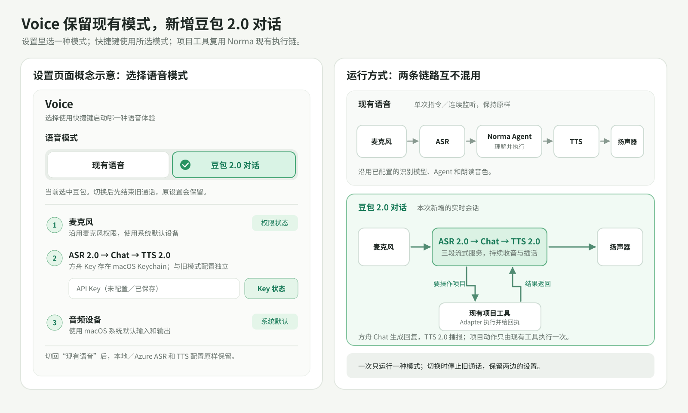

# 豆包语音 API 能力与 Norma OS 桌面 Voice 接入评估

> 调研日期：2026-09-29。依据火山引擎豆包语音官方文档及本仓库当前代码。桌面实现已通过本地假上游测试；当前 Ark Key 的真实握手返回 401，真实语音、设备回声消除及端到端延迟尚未验收。

## 结论

**按 2026-09-29 确认的产品方向：保留桌面现有链式 Voice（单次指令与连续监听），优先新增 Seeduplex 3.0 全双工会话；豆包单独的 ASR 2.0／TTS 2.0 接入是可选增强。** 全双工模型同时负责对话和语音输出，不能仅换一个 ASR 或 TTS Provider 就得到其插话与低时延能力；项目任务仍须由 Norma Agent 唯一执行。本次实现范围只有豆包；未来 GPT-Live 仅作为接口设计约束，不新增它的实现或设置项。



设置页应在现有 Voice Setup 顶部增加“现有语音／豆包全双工”模式选择。选择前者时原有 ASR、Agent、TTS 配置照旧；选择后者时展示麦克风、豆包凭据和 Norma Agent，隐藏不适用的独立 ASR／TTS 准备要求。两边配置都保留；切换会结束旧语音会话，快捷键启动当前选中的模式。

仓库已有 [豆包流式 ASR 协议研究](2026-08-02-volcengine-doubao-streaming-asr-integration.md)与[接入设计](../design-docs/2026-08-02-volcengine-doubao-streaming-asr-extension.md)，本文件只补充当前官方能力、桌面整体接入顺序及两套实时语音方案的边界。

## 一、官方目前提供哪些语音能力

“实时”在下表分别指**边说边转写**、**文字边生成边播报**和**语音到语音全双工对话**，三者不是同一种 API。[产品简介](https://docs.volcengine.com/docs/DoubaoVoice/ProductOverview-9?lang=zh)覆盖的产品能力比当前 Voice 所需更广；[模型列表](https://docs.volcengine.com/docs/DoubaoVoice/model-list?lang=zh)列出具体模型族。

| 能力 | 官方公开支持与接口形态 | 与桌面 Voice 的关系 |
| --- | --- | --- |
| 端到端实时语音对话 | Seeduplex 3.0 全双工：WebSocket 事件协议，输入 16 kHz 单声道 PCM16／Opus，建议约 20 ms 一包；输出默认 Ogg Opus，可配置格式；提供增量转写、文字和音频输出、插话／打断、会话历史接续及 Function Calling。`session.model` 为 `1.2.6.1`。[接入必读](https://docs.volcengine.com/docs/DoubaoVoice/access-mustread?lang=zh) | 可做更自然的对话模式；需单独处理会话状态、音频解码／播放中断和工具调用。 |
| 其他端到端语音模型 | [模型列表](https://docs.volcengine.com/docs/DoubaoVoice/model-list?lang=zh)还列出 S2S-Omni 及 S2S-Strong Character，分别面向通用交互／富媒体表达、角色与情感表达。 | 先不假设它们与全双工 3.0 共用同一 `model` 值、接口或账号授权；逐个核实。 |
| 流式 ASR 2.0 | 双向流式 `bigmodel_async` 可边输入边返回可能修订的增量文本；`bigmodel_nostream` 逐包输入但以句级结果为主。均为 WSS，官方建议约 100～200 ms 音频包。[接入必读](https://docs.volcengine.com/docs/DoubaoVoice/Accessmust-read_1?lang=zh)、[API 协议](https://docs.volcengine.com/docs/DoubaoVoice/LargemodelstreamingautomaticspeechrecognitionAPI?lang=zh) | `bigmodel_async` 最适合当前 Single Voice Command 的字幕预览和 Continuous Listening 的识别。 |
| 录音文件识别 | 官方有文件识别的标准、极速及闲时版本。[模型列表](https://docs.volcengine.com/docs/DoubaoVoice/model-list?lang=zh)、[文件识别接入必读](https://docs.volcengine.com/docs/DoubaoVoice/Accessmust-read?lang=zh) | 适合导入录音／会议文件，不能替代实时 Voice 输入。 |
| TTS 与声音复刻 | 官方列出豆包 TTS 2.0 和 ICL 2.0；复刻音色需先经训练与授权，再用于合成。[模型列表](https://docs.volcengine.com/docs/DoubaoVoice/model-list?lang=zh)、[声音复刻使用指南](https://docs.volcengine.com/docs/DoubaoVoice/Soundreplicationorderingandusageguide?lang=zh) | TTS 可作为桌面现有回复播报的独立 Provider；复刻音色是后续可选能力。具体 TTS 2.0 端点、输出格式、流式事件和账号音色清单尚待协议核对。 |
| 同声传译 | 官方提供流式语音到翻译文本（S2T）和语音到翻译语音（S2S）；产品资料还描述了译音保留说话人音色的能力。[产品简介](https://docs.volcengine.com/docs/DoubaoVoice/ProductOverview-9?lang=zh) | 属于独立的翻译场景，当前任务执行型 Voice 无需混入。 |
| 其他音频能力 | 产品线还列出音频生成、音色设计、播客／长音频制作和语音妙记等。[产品简介](https://docs.volcengine.com/docs/DoubaoVoice/ProductOverview-9?lang=zh) | 可以独立评估，不构成桌面实时 Voice 已可直接调用的承诺。 |

**ASR 授权更新：**[当前官方 ASR API 页](https://docs.volcengine.com/docs/DoubaoVoice/LargemodelstreamingautomaticspeechrecognitionAPI?lang=zh)已明确列出 2.0 小时版 `volc.seedasr.sauc.duration`、并发版 `volc.seedasr.sauc.concurrent`，以及新版控制台的 `X-Api-Key` 与 `X-Api-Resource-Id`。这更新了 2026-08-02 研究中“2.0 并发版 ID 尚未确认”的时间点；实际授权、计费 SKU 仍以目标账号控制台和真实握手为准。

## 二、Norma OS 桌面版的现有链路

```text
麦克风 → voice_input 16 kHz mono PCM16
  → asr::RecognizerFactory / RecognitionPipeline（本地 Sherpa 或 Azure）
  → Single Voice Command，或 Continuous Listening + 本地 Silero VAD
  → 唯一 Final transcript → AgentCommand::UserTurn(input_source: Voice)
  → Norma Agent／项目工具 → tts::TtsClient（本地或 MiniMax）
  → PcmAudioChunk → macOS 播放
```

- 录音和识别入口在 [`app/voice/recognition.rs`](../../crates/app/src/app/voice/recognition.rs) 与 [`app/dialogue/chat.rs`](../../crates/app/src/app/dialogue/chat.rs)；Continuous 的 Agent 提交在 [`reply_loop.rs`](../../crates/app/src/app/dialogue/reply_loop.rs)。partial 只用于转写过程，任务提交必须等本次输入的唯一 final。
- [ASR 注册表](../../crates/asr/src/providers/mod.rs)目前仅有 Local Sherpa、Cloud Azure；[TTS 注册表](../../crates/tts/src/provider.rs)目前仅有本地、MiniMax。[TTS 回复级流接口](../../crates/tts/src/stream.rs)是 `start_stream → push_text → finish_stream/cancel_stream`，输出统一交给 PCM 播放链。
- [iOS 云语音网关](../../services/norma-cloud/README.md)已存在 `DOUBAO_PROTOCOL=2/3/plan`：其中 `plan` 是 ASR → Chat → TTS 的组合，`3` 使用豆包端到端实时语音。它服务于手机语音，不等于 macOS 桌面 Voice 已有豆包 Provider；可借鉴其协议测试和音频配置，但不要把手机鉴权／媒体会话原样搬进桌面 ASR 接口。

## 三、桌面接入方案

下表列出三种独立接入点，按当前目标应先推进全双工 POC；表中的 ASR 和 TTS Provider 不构成全双工的前置条件。

| 能力 | 最小接入点 | 保留的既有行为 | 必须验证 |
| --- | --- | --- | --- |
| Seeduplex 3.0（当前优先） | 建立**独立全双工会话模式**，复用麦克风与播放基础能力，由专用会话控制器管理双向音频、服务端事件和历史。 | 项目任务继续经 Norma Agent；现有 Single／Continuous 保留供用户选择。 | 上下行格式、耳机／外放回声、打断时清空待播音频、会话取消、Function Calling 的 `call_id` 去重与回传、写操作只执行一次。 |
| 流式 ASR 2.0（可选） | 按[已确认的 ASR 设计](../design-docs/2026-08-02-volcengine-doubao-streaming-asr-extension.md)，在 `crates/asr/src/providers/cloud/` 增加豆包 WSS Recognizer，并注册 `AsrProviderId`／`BuiltinAsrProfile`；在桌面 Voice Settings 增加账号、Keychain 引用、验证与选择。现有约 20 ms PCM 输入聚合为官方建议的约 200 ms 包。 | Single 仍由用户结束输入；Continuous 仍由本地 VAD 分段；final 进入现有 Norma Agent。 | 新旧鉴权字段、目标资源授权、增量修订、last frame 后的唯一终态、取消／超时、代理、单段失败不误提交。与 Sherpa、Azure 跑同一语料。 |
| TTS 2.0（可选） | 核对官方 TTS 2.0 流式协议后，在 `crates/tts/src/providers/` 增加内置客户端并注册到 `provider.rs`；桌面 Settings 管理模型、音色及 Keychain 引用。 | `TtsClient`、回复分段、取消和播放器保持统一。 | 音频必须转换为 `PcmAudioChunk` 支持的格式：若接口可返回 PCM 则直接配置；若仅给 Opus，则在后台解码，不能把压缩数据送进 PCM 播放器。确认首包时延、拼接空隙和中断。 |

如增加 ASR Provider，还需审查桌面 [ASR 设置状态](../../crates/app/src/settings/voice/state/asr_provider.rs)、[就绪判断](../../crates/app/src/settings/voice/state/readiness_state.rs)及选择页中目前只区分 Sherpa／Azure 的分支；[Voice 控制](../../crates/app/src/app/voice/control.rs)还有写死的 “Azure 60-second limit” 提示。如增加 TTS Provider，沿用 [现有 TTS 设置状态](../../crates/app/src/settings/voice/state/tts_provider.rs) 的 Keychain 和选型流程。网络握手、终态等待、解码及取消收口都必须在后台，不能阻塞 GPUI 前台。

全双工的关键产品边界是：Seeduplex 的普通口语回复可以直接播报；一旦它通过 `response.function_call_arguments.done` 提出项目操作，应以 `call_id` 作为执行与结果回传关联键，委托 Norma Agent／项目工具路径，并对重放、断线和取消进行去重。不能把同一语音同时提交为普通 `UserTurn` 和独立的工具执行，否则可能重复修改项目。[官方 Function Calling 说明](https://docs.volcengine.com/docs/DoubaoVoice/access-mustread?lang=zh)要求客户端回传调用结果；桌面侧如何映射 Norma Agent 事件需 POC 证实。

## 四、实施前确认与验收证据

1. **账号与费用：**在目标火山项目分别确认 ASR 2.0、TTS 2.0、Seeduplex 3.0 的开通、资源 ID、音色权限、并发和实际计费。公开产品价格不能直接推为目标资源价格；本次未登录账号验证。
2. **ASR 闭环：**自动验证两种桌面输入模式下 partial 可修订、final 唯一、空结果／网络错误／取消均不触发 Agent；真人录音横评中文、中英技术词、噪声和停顿，并记录首 partial、停语到 final 的 p50／p95。
3. **TTS 闭环：**自动验证多段回复顺序、音频格式、取消后无旧音频续播；真实 App 验证耳机／外放及语音首播延迟。UI 或设置页变更按仓库要求补 `crates/e2e` 验收。
4. **全双工 POC：**分别验证插话、回声、工具调用结果、掉线后会话接续与副作用去重；延迟以桌面真实麦克风和扬声器实测，不引用厂商宣传数字作为 Norma OS 的结果。

## 五、本机联调凭据定位（不含密钥）

2026-09-29 用户提供的火山方舟 API Key 已存入本机 macOS Keychain；service 为 `com.norma-ai.os.agent-provider`，account 为 `doubao-ark-e2e`，标签为 `Norma OS Doubao Ark E2E`。本文和仓库不保存密钥值。本机真实握手访问 `wss://openspeech.bytedance.com/api/v3/duplex/realtime/dialogue` 时返回 HTTP 401（服务错误码 `45000010`，`Invalid X-Api-Key`）。这证明该 Ark Key 不能直接用于当前豆包语音服务端点；后续真实验收需要从豆包语音控制台取得具备 Seeduplex 3.0 权限的 API Key。桌面 Voice 设置应使用该语音服务 Key，不能引导用户输入 Ark Key。

用户截图显示的是 ASR 2.0（资源 ID `volc.seedasr.sauc.duration`）与 TTS 2.0（资源 ID `seed-tts-2.0`）的 `openspeech.bytedance.com` 接口配置；它不能证明该账号已开通 Seeduplex 3.0 全双工。全双工应单独对照目标产品的握手和授权测试，不能把 ASR/TTS 的资源 ID 当作全双工资源 ID。

当前实现保留原有链式 Voice，并提供独立的豆包双工模式、现有提示词与工具复用、回执去重和插话时的播放器清空。输入按 20 毫秒 PCM 帧实时发送，双工采集队列最多暂存约 160 毫秒，拥塞时丢弃最旧帧；普通回复没有桌面侧第二次 LLM 或独立 TTS。HTTP 401 使真实 Seeduplex 3.0 会话无法建立，因此不能据本地假上游结果宣称真实服务、免提回声消除或首音延迟已通过验收。
