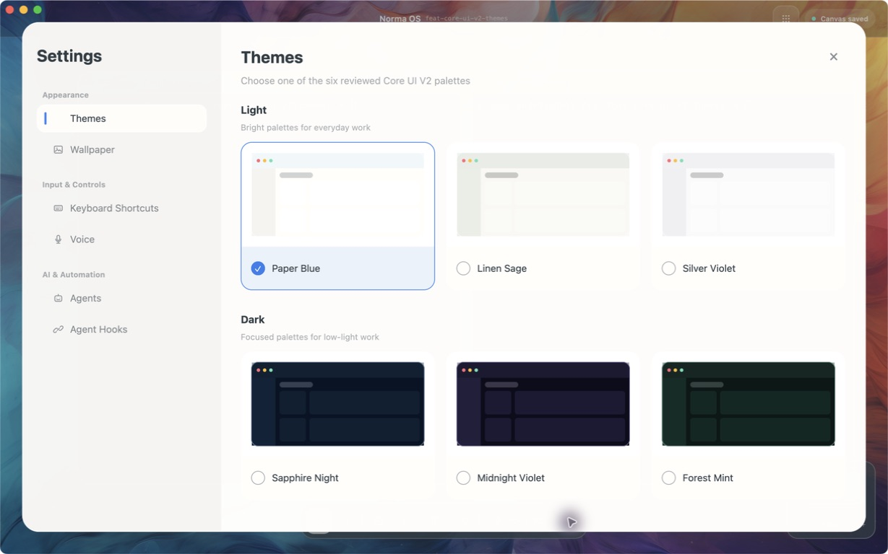
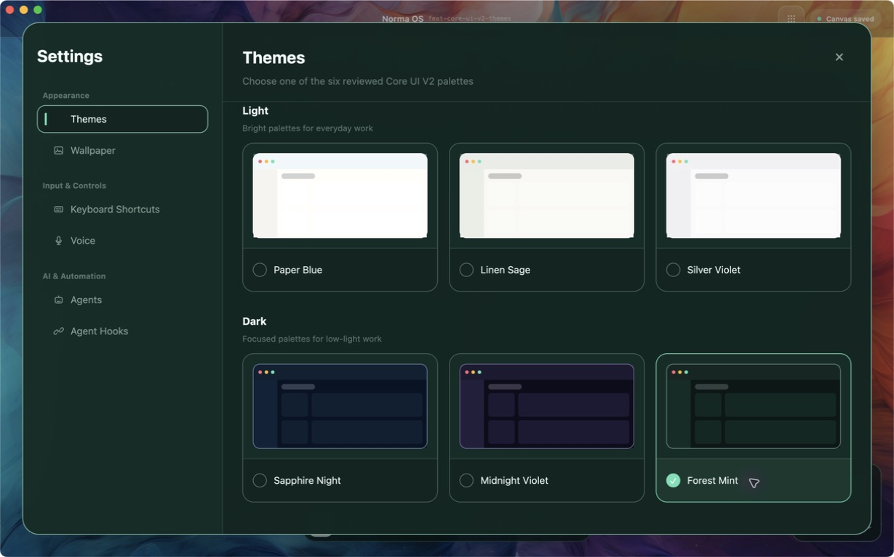
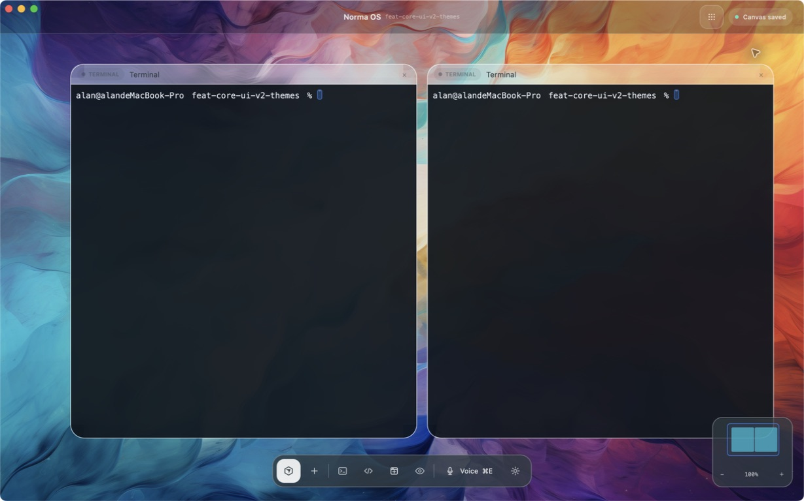
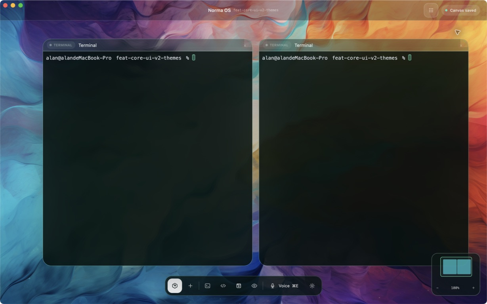

# Core UI V2 主题切换验收报告

> 历史：见 git 提交。原文路径：`docs/exec-plans/2026-07-16-core-ui-v2-theme-switching.md`。

本文是验收记录。六套主题与真实应用操作结果以下文为准。

> 验收日期：2026-07-16
> 分支：`feat/core-ui-v2-themes`
> Worktree：`.worktrees/feat-core-ui-v2-themes`

## 1. 实现范围

本次实现把 `docs/design-docs/core-ui-v2/README.md` 定义的六套主题映射到原生 GPUI 应用，并在 Settings → Themes 提供即时切换入口。

| 分组 | 主题 | Base / Raised | Text | Accent | Signal |
|---|---|---|---|---|---|
| Light | Paper Blue | `#FFFEFB` / `#F5F4F1` | `#313D44` | `#2F80ED` | `#64E0B5` |
| Light | Linen Sage | `#F9F8F3` / `#EBEDE6` | `#1D231F` | `#3D9978` | `#64E0B5` |
| Light | Silver Violet | `#FAFAF9` / `#F0F0F2` | `#232328` | `#6A5CFF` | `#64E0B5` |
| Dark | Sapphire Night | `#071324` / `#0E2338` | `#EFF7FF` | `#54A2FF` | `#64E0B5` |
| Dark | Midnight Violet | `#0C0C1B` / `#231F3C` | `#F8F5FF` | `#8B7CFF` | `#64E0B5` |
| Dark | Forest Mint | `#091716` / `#112D27` | `#F1FCF8` | `#64E0B5` | `#D6FF3B` |

主题 token 覆盖玻璃 shell、内容井、标题栏、焦点强调、成功信号与 Dock。Terminal 内容井继续保持深色，以保护 ANSI 颜色和日志对比度。主题不会在真实壁纸之后追加任何染色或提亮遮罩，切换主题不会改变背景图片/视频的实际显示内容。

Themes 页面按参考图重构为三列等宽大卡：每张卡由 150px 完整预览和 62px 独立选择栏组成，Light / Dark 各三张。选中态使用主题强调色边框、淡色选择栏与单选标记；主题名不再压进预览区域。

Settings 左侧导航的 Themes 项使用独立 SVG 图标，并已纳入应用内嵌资源清单；图标在默认态和选中态下均可见。

本次没有修改画布中现有卡片的标题文案、标题结构、节点布局或业务状态；也没有引入存储 schema 变更。

## 2. 自动化证据

以下命令均在独立 worktree 中通过：

- `cargo check -p app`
- `cargo test -p ui`：6 passed
- `cargo test -p app -- --test-threads=1`：472 passed，5 ignored
- `cargo test -p e2e`：主测试 54 passed，3 ignored；附加集成测试 2 + 5 passed
- `cargo build -p app --release`
- `cargo packager -c Packager.dev.toml`
- `bash scripts/check-max-file-lines.sh`
- `bash scripts/check-no-allow.sh`
- `bash scripts/check-storage-boundaries.sh`
- `bash scripts/check-performance-guardrails.sh`
- `python3 scripts/check-video-wallpaper-performance.py`
- `bash scripts/check-agent-guide-lines.sh`

新增证据覆盖六套主题 token、默认主题、Settings 选择状态、Themes 导航 SVG 的内嵌加载、三列大卡布局、预览与选择栏不重叠、原生点击切换、跨浅色/深色切换、壁纸遮罩缺失契约，以及卡片 shell、标题栏、Dock 和强调色的同步更新。

## 3. Computer Use 真实应用验收

验收使用 release 构建与 `cargo-packager` 生成的原生 `.app`。为避免干扰用户已运行的 `com.norma.os`，仅对构建产物复制出一个临时验收副本，使用独立 bundle id、独立 `HOME` 和独立测试数据目录启动；未修改产品源码或打包配置。

随后通过 Computer Use 打开真实项目画布，检查重构后的三列 Themes 页面，并在同一壁纸、同一画布节点和同一 viewport 下切换 Paper Blue 与 Forest Mint。

### 参考图式 Themes 页面

左侧 Themes 导航图标已恢复，并在进入 Themes 页面后显示主题强调色选中态。

Paper Blue 下的新版页面展示三列浅色预览、三列深色预览、独立选择栏和清晰的 Light / Dark 分组。

Forest Mint 下 Settings 壳层、选中边框和选择栏切换为对应主题，但页面结构、预览卡尺寸和背景纹理保持不变。

## 4. 画布对照

Paper Blue 与 Forest Mint 两张截图来自同一真实工作区。背景的蓝、紫、橙纹理在切换前后保持原始饱和度和相同位置；变化仅发生在 Terminal 外壳、标题栏、Dock、焦点色和状态色。两张实景图中的 Terminal 卡片标题均保持 `Terminal`，内容井保持深色。

## 5. 结论

六套 Core UI V2 主题均可在原生 Settings 中即时切换；重构后的 Themes 页面符合参考图的大预览、独立选择栏和明确选中态层级。主题只影响 UI 配色，不再改变壁纸图片或视频内容。Terminal 深色内容井和现有卡片标题保持不变。自动化测试、工程护栏、release 构建、打包和 Computer Use 实机截图均通过。
