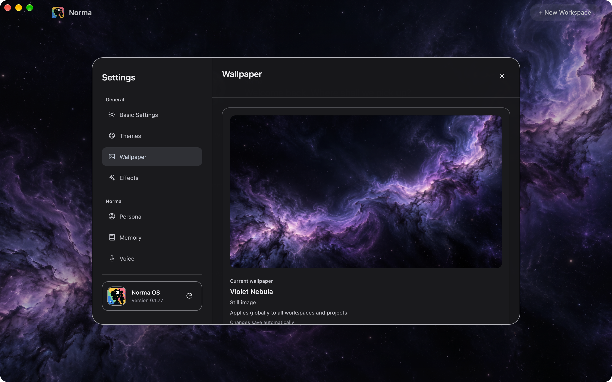
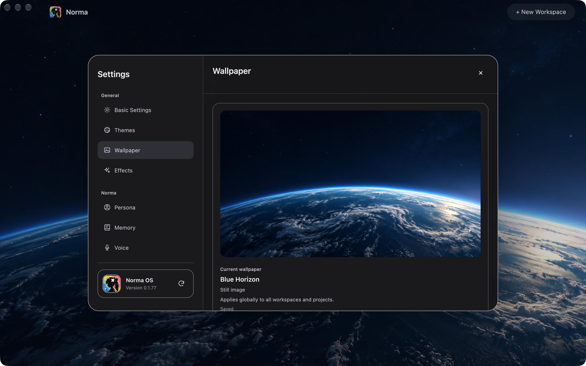
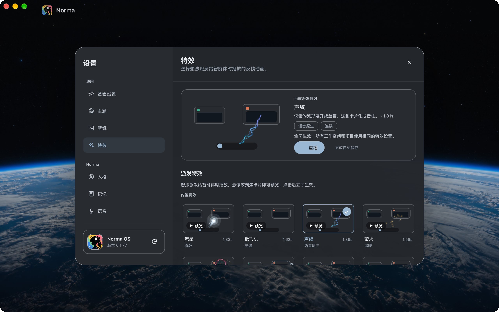
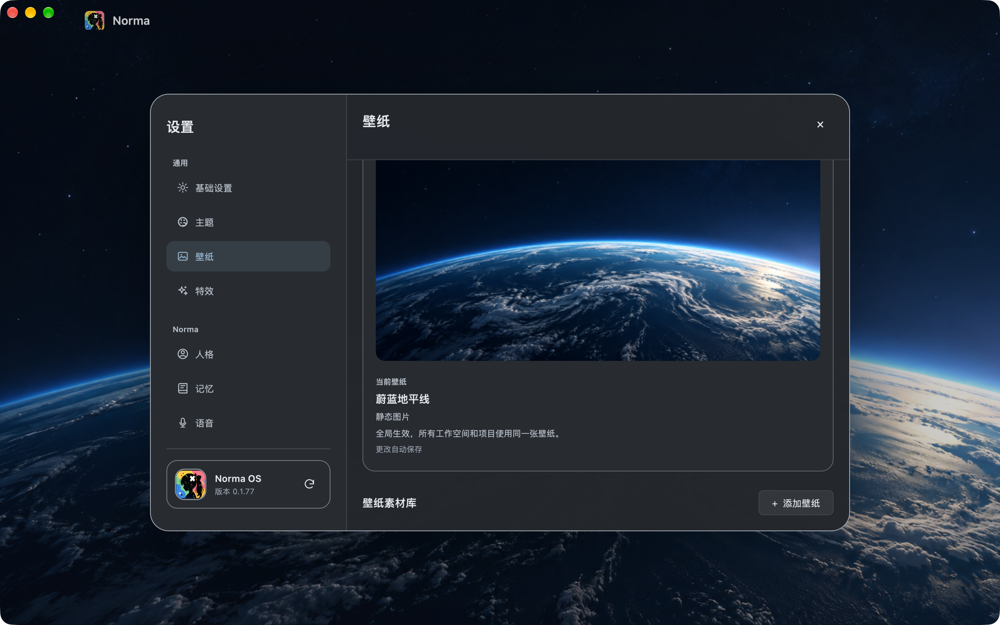

# 壁纸与特效统一全局设置

本次需求：移除工作空间/项目范围与跟随开关，壁纸和派发特效只保存一份全局偏好。保留预览、素材库、按来源覆盖、播放速度、撤销与保存反馈。

当前结论：真实 App 已通过旧覆盖迁移、多窗口同步、重启恢复、两页全局控件与中英文检查；Ink Black / Graphite 两款现有深色主题已验。画布实际派发动画在最后一次场景中遇到 ENV（退出码 3），尚未验收；产品当前没有浅色主题入口。**本记录不表示全部验收通过。** 最终逐项结果和恢复条件见文末。

设计参考：`.agents/skills/apple-design/SKILL.md`。采用内容优先和直接操作：页面从当前预览开始，一句说明全局生效；沿用 GPUI 组件的选择/禁用/焦点反馈，不增加动效。菜单沿用 Material 来源菜单。真实 App 验收使用 `.agents/skills/norma-desktop-e2e/SKILL.md`。

验收映射：
- 全局保存、切空间不变、子项目与独立窗口同步：`crates/app/tests/unit/wallpaper_actions_tests.rs`。
- 保存失败回滚：同上。
- 首页无空间设置、撤销、跨窗实际派发、启动早改速度：`crates/app/tests/unit/effects_settings_state_tests.rs`。
- 最近展开项目迁移、保留来源覆盖、幂等与撤销不复活旧值：`crates/storage/tests/global_appearance.rs`。
- 旧项目素材失效时保留工作空间回退：`crates/app/tests/unit/wallpaper_builtin_migration_tests.rs`。
- 页面范围控制移除、全局说明、中英文、当前可选的 Ink Black / Graphite 主题、重启：`settings-space-wallpapers` 与 `settings-dispatch-effects` 真实 App 场景。

已观察的红灯：项目发起保存仍写旧项目覆盖；迁移尚未产生全局值；失效项目素材使升级丢掉原空间壁纸。均已补对应修复。

以下记录本次实际完成的验证。工作区同时存在其他任务的 agent/brain、布局与动效等变更，不属于本次改动；各次测试结果对应当时的工作区状态。

- 独立对抗式复核：已处理多窗口同步、启动修改速度覆盖加载、失效素材迁移三项发现；复核结论为无剩余阻塞。未审查其他任务的 agent/brain 差异。
- `cargo test -p app --lib global_`：11 passed / 0 failed；其中包含本次全局外观回归和既有匹配项。
- `cargo check -p app`：通过。
- 存储边界、性能护栏、视频壁纸低拷贝护栏：通过。
- 国际化检查仅剩 HEAD 已存在的 `crates/app/src/settings/voice/view/gpt_live.rs:70` 硬编码 GPT-Live；本次新增文案均有中英文，保存状态随语言切换。
- `cargo test --workspace`：在 app 包停止，1710 passed / 2 failed / 10 ignored。本次外观相关用例全部通过。两项失败均为本任务未改动的 `crates/app/tests/unit/desktop_master_visibility_tests.rs`，实际 detail 高度 877、期望 909（差 32px）；涉及主次布局的源码和测试不属于本任务修改范围。
- `check-max-file-lines.sh`、`check-no-allow.sh`、`check-agent-guide-lines.sh`：通过。

- 补充旧数据库缺列修复：项目表重建保留 dispatch_effect_json，既有升级测试扩展验证来源覆盖与全局迁移；独立复核无阻塞。
- `cargo test -p storage -p ui`：302 passed / 0 failed。
- 最终 debug 构建：通过（包含旧数据库升级修复）。
- 最终 `cargo build -p app --release`：通过（包含旧数据库升级修复），日志见 `artifacts/global-appearance/release-build.log`。
- 旧数据库升级修复后的存储边界、性能护栏、视频壁纸低拷贝护栏与 `git diff --check`：通过。
- 产品当前只提供深色主题，ThemeId::ALL 不含已下线的 Paper Blue。场景改用 Ink Black 与 Graphite，不声明浅色真实 App 验收。

## 真实 App 证据与限制

1. `2026-10-31T07-19-26Z`：脚本停留在素材库区域，未回顶部读取全局说明。读图确认滚动定位问题，已补回顶部动作。
2. `2026-10-31T07-20-57Z`：全局说明与五款壁纸逐项选择/保存通过；因旧脚本寻找已下线 Paper Blue 失败，已更新为 Graphite。
3. `2026-10-31T07-23-39Z`：Graphite 主题切换通过；OCR 将“简体中文”误读为“尚体中文”，已改用唯一的“中文”定位。
4. `2026-10-31T07-25-05Z`：中文切换与选择蔚蓝地平线成功；OCR 将“银白月境”读成“银自月境”，已改唯一的“月境”定位，完整文案保留人工读图。
5. `2026-10-31T07-27-03Z`：退出码 3，driver ENV：E2E frame barrier: window unavailable。按技能停止 GUI 验收，不改用手动操作。没有结束其他 Norma 进程。

已查看 `2026-10-31T07-20-57Z/00-global-wallpaper.png`：当前预览与全局说明可见，范围选择与跟随开关已移除。本次范围符合；不据此声明整页所有布局均已完整验收。完整重启恢复与特效真实 App 场景尚未通过，环境恢复后需重跑两个场景。

## 继续验收（2026-10-31，以下新结果取代上述未验状态）

复用本任务已通过的 11 项 app 聚焦测试、302 项 storage/ui 测试、debug/release 构建与护栏。未修改 Rust 产品实现；新增验收场景与驱动键码测试。被测二进制及相关源码哈希见 `artifacts/global-appearance/followup-manifest.json`。

### ENV 原因与恢复条件

旧失败位于第一次截图，App 日志已经记录控制通道开放。代码路径为 `e2e_control::install` 先启动 socket，`settings::general::open_initial_window` 再后台读取数据库、异步创建窗口；驱动原来直接 capture，socket 可用不代表窗口就绪。现有 `resize` 已用只读 window 探测等待就绪（最多约 20 秒），复用它作为场景前置条件，不吞掉 frame barrier 错误，不重放输入。

先运行使用同一 E2EKit/Preflight/私有虚拟显示器的诊断驱动 `artifacts/global-appearance/EnvironmentProbe.swift`：退出 0，28.33 秒，`environment/2026-10-31T07-35-38Z/report.json` 记录 window ready，实际查看 `ready.png` 确认首页完整。屏幕未锁、debug 控制通道和窗口截图均可用；未结束两个用户已有 Norma 进程。随后才恢复定向场景。该诊断是环境证据，不替代业务流程验收。

窗口等待已有 4 项单测通过。新增新建窗口 N 键映射测试先失败（键码 45 不支持），补映射后 2 项快捷键测试通过，红绿日志保存在本目录。

### 布局与国际化失败归因

基线为 `bec4d2133df8b714ee51094a9c30850b7990491e`。两项布局失败并非该 HEAD 的既有失败，而是本工作区另一任务的未提交间距改动：`crates/app/src/canvas/layout_strategy.rs` 从 8px 改为 24px。使用实际 canvas 库的 `compute_master_detail_layout` 最小复现得到 HEAD 参数 925−2×8=909，当前参数 925−2×24=877，恰好复现两项失败的差值。布局算法、Master 入口和两项测试源码均与 HEAD 相同；复现不经过任何壁纸/特效设置代码。见 `layout-reproduction.rs`、`baseline-attribution.log`。不修改这个无关任务的布局或断言。

将 HEAD 的源文件与词典导出到隔离临时目录，运行原 `check-i18n.py`：同样报 `gpt_live.rs:70` 的 GPT-Live，且文件哈希与工作区完全相同；HEAD 还报 4 个空 effects chip 词典值，本任务已处理这些空值。当前检查仅剩 GPT-Live。见 `i18n-baseline.log` 与 `i18n-followup.log`。

### 新增真实 App 结果

证据目录前缀为 `artifacts/desktop-workspace-e2e/`。

| 场景/运行 | 结果 | 说明 |
| --- | --- | --- |
| `settings-space-wallpapers` / `2026-10-31T07-36-44Z` | 退出 1，67.58s，7/8 步 | 英文五款保存、Graphite 中文选择通过；重启的壁纸导航定位失败，数据库中中文/Graphite/Blue Horizon 均正确。 |
| `settings-dispatch-effects` / `2026-10-31T07-40-55Z` | 退出 1，33s，前 4 步通过 | 全局选择、撤销和来源覆盖通过；脚本滚到页面底部的运行特效区，找不到 Relaxed。改为按标签滚动查找，不改产品。 |
| `settings-global-appearance` / `2026-10-31T07-41-56Z` | **退出 0，60.21s，5/5 步** | 旧项目优先迁移、原窗口与第二窗口的 windowID 不同、第二窗口写入后原 windowID 的页面同步、重启保留新值。 |
| `settings-space-wallpapers` / `2026-10-31T07-43-21Z` | 退出 1，41s，7/8 步 | 补失败截图后复现相同中文导航定位问题；当前预览保存与中文素材库仍通过。继续诊断导航定位，不将该失败改判通过。 |

`settings-global-appearance` 的以下 8 张图均已实际查看，全部符合对应清单：

| 截图（目录 `2026-10-31T07-41-56Z`） | 视觉结论 |
| --- | --- |
| `01-migrated-wallpaper.png` | 紫色星云预览与实际背景一致，全局说明可见，无范围/跟随开关。 |
| `02-migrated-effects.png` | 当前烟花与动画预览一致，全局说明可见，无范围/跟随开关。 |
| `03-second-window.png` | 第二窗口是实际工作空间首页，显示迁移后的紫色星云背景；另有 windowID 硬断言。 |
| `04-second-window-saved.png` | 第二窗口当前声纹、Saved、蓝色地平线背景。 |
| `05-first-window-synced-effects.png` | 原窗口当前声纹、Saved，选中勾与预览一致。 |
| `06-first-window-synced-wallpaper.png` | 原窗口蓝色地平线预览与背景一致，无旧紫色星云。 |
| `07-restored-global-wallpaper.png` | 重启后蓝色地平线与全局说明保留，无旧项目覆盖控件。 |
| `08-restored-global-effects.png` | 重启后声纹预览与选择勾保留，无旧烟花或范围控件。 |

另已查看 `2026-10-31T07-36-44Z/00-global-wallpaper.png` 与 `06-space-library-graphite.png`：英文全局说明、无范围控件；Graphite 中文五款资源均可辨且蓝色地平线唯一勾选。`2026-10-31T07-43-21Z/missing-settings-destination.png` 显示人格页和已滚到下半部的侧栏，确实未完成壁纸导航，不能以数据库结果替代页面验收。

主题边界：当前 `ThemeId::ALL` 只有六款深色主题，`from_saved_id` 还会将三个旧浅色 ID 迁移到 Ink Black。真实浅色 UI 状态没有产品入口，因此不恢复已下线主题、不声明浅色验收通过；亮色壁纸与深色主题是不同维度。

### 中文定位诊断与特效页补验

`artifacts/global-appearance/RestoreDiagnostic.swift` 复制上一轮隔离数据库，仅使用同一 E2EKit 启动/截图诊断；退出 0，42.83s，证据 `artifacts/global-appearance/restore-diagnostic/2026-10-31T07-45-34Z/`。已查看 `sidebar-top.png`：中文「主题」「壁纸」入口完整清晰，但同一帧 OCR 只识别「基础设置」「特效」，确认是脚本定位失败，不是壁纸页丢失。定位在此特定缺词条件下采用同列两端可见行的间距计算中间壁纸行，点击后仍核对真实壁纸正文。没有使用 Computer Use 或改产品逻辑。

`settings-dispatch-effects` / `2026-10-31T07-47-50Z`：退出 0，110.46s，全部 8 步通过。实际查看关键图 `01-effects-page-dark.png`、`02-fireworks-picked.png`、`03-source-menu-open.png`、`04-playback.png`、`05-effects-page-graphite.png`、`07-global-effects-chinese.png`，均符合清单：英文/中文全局说明，无空间/项目范围和跟随开关；烟花预览与名称一致；来源菜单只有当前选项勾选，无未替换占位符；Relaxed 唯一选中；Graphite 当前声纹清晰，重启保持选项和中文。伴随的窄窗口截图不属于本次全局化验收范围，未据此声明完整响应式验收。

### 壁纸页最终补验

`settings-space-wallpapers` / `2026-10-31T07-50-05Z`：退出 0，60.45s，8/8 步通过。证据为 `artifacts/desktop-workspace-e2e/2026-10-31T07-50-05Z/report.json`，驱动日志为 `artifacts/global-appearance/wallpaper-final.log`。五款壁纸的选择/保存硬断言、Graphite 与中文切换、重启后的全局壁纸恢复均通过。

| 实际查看的截图 | 视觉结论 |
| --- | --- |
| `artifacts/desktop-workspace-e2e/2026-10-31T07-50-05Z/00-global-wallpaper.png` | 符合：英文当前预览与全局说明可见，没有空间/项目范围及跟随开关。 |
| `artifacts/desktop-workspace-e2e/2026-10-31T07-50-05Z/06-space-library-graphite.png` | 符合：Graphite 中文五款素材名称可辨，蔚蓝地平线唯一选中。 |
| `artifacts/desktop-workspace-e2e/2026-10-31T07-50-05Z/07-restored-space-wallpaper.png` | 符合：重启后中文蔚蓝地平线的当前预览与实际背景一致，全局说明保留，范围/跟随开关未出现。 |

此轮 01–05 的逐款选择截图未重复逐图查看，不声明全素材视觉质量验收；本次全局化所需关键图均已查看。

### 画布派发场景 ENV 与停止边界

`workspace-dispatch-effects` / `2026-10-31T07-52-11Z`：退出 3，17.15s。首步创建隔离项目、三条想法并写入全局烟花成功（10.90s）；第二步“进入项目并创建一个智能体，打开想法栏”检测到隔离 App 已退出。没有进入实际派发步骤，没有产生截图。不能用设置页预览或数据库值代替画布动画验收。

- 原始报告：`artifacts/desktop-workspace-e2e/2026-10-31T07-52-11Z/report.json`，`kind=env`、`failureLayer=environment`。
- App 日志：`artifacts/desktop-workspace-e2e/2026-10-31T07-52-11Z/app.log`；驱动日志：`artifacts/global-appearance/dispatch-followup.log`。
- 初次 PID 为 6724，场景重启后 PID 为 6843；报告显示重启后窗口已就绪，随后进程消失。日志含手机服务 `Address already in use (os error 48)`，但无崩溃栈。
- **端口警告不是已证明的退出根因**：两次成功设置场景的 App 日志也包含同样警告。`test/desktop-e2e/Sources/E2EKit/Launch.swift` 的 `deathError` 仅按日志关键词分类，未提供此次退出信号或调用者。
- 同期另一任务启动了 `brain-dock-chat`，证据为 `artifacts/desktop-workspace-e2e/2026-10-31T07-52-28Z/report.json`，其 App 日志记录 PID 7092。两个脚本共用 `artifacts/desktop-workspace-e2e/owned.json`；`test/desktop-e2e/Sources/E2EKit/Preflight.swift` 会回收记录中路径相符的测试 PID。因此并行 E2E 相互回收是有代码与时间证据支持的可能原因，但没有直接的“结束 PID 6843”日志，不能写成确定因果。只读核查时归属文件已不存在。
- 只读归因与成功日志对照保存在 `artifacts/global-appearance/dispatch-environment-attribution.json`。没有结束用户已有的正式 App 或 Dev App。

按 `.agents/skills/norma-desktop-e2e/SKILL.md` 第 4 条“退出码 3……记为 ENV 并停止”，本任务在该次失败后没有再启动 GUI、替换场景重试或转为 Computer Use。其他任务后续产生的 E2E 结果不属于本次重试或通过证据。

尚缺的恢复条件：明确取得独占的 desktop-e2e 运行窗口，确保另一个驱动不会通过共享归属文件回收本次 PID；隔离或禁用测试夹具中不需要的手机服务端口，消除诊断歧义；确认隔离 App 在窗口就绪及进入项目后持续存活。恢复确认后仅需补 `workspace-dispatch-effects` 的实际派发、动画播放和结束消退检查。当前没有新的恢复证据，因此保持该项未验，不盲目重跑。

### 最终验收矩阵

| 验收项 | 结果 | 对应真实 App 证据/限制 |
| --- | --- | --- |
| 旧项目/空间配置升级为全局值 | 通过 | `settings-global-appearance`：项目紫色星云、烟花及语音闪电覆盖优先迁移；01/02 图。无效资源回退与旧表缺列另外复用聚焦单测。 |
| 多窗口同步 | 通过 | 同一 PID 下确认不同 windowID，第二窗口修改后返回原 windowID，当前壁纸与特效均更新；03–06 图。 |
| 重启恢复及不复活旧覆盖 | 通过 | 全局场景 07/08 图，两个设置场景另覆盖重启后的中文/Graphite 和保存值。 |
| 壁纸在真实窗口生效 | 通过 | 当前预览与真实背景一致；旧值迁移、另一窗口修改、重启后的新值均有截图。 |
| 特效选择、来源覆盖、速度与预览 | 通过 | `settings-dispatch-effects` 8/8 步，01–05 与 07 关键图已查看；全局场景验证来源覆盖保留。 |
| 全局特效在画布实际派发时生效 | **ENV 阻塞，未验** | 最后一次场景进入项目时进程退出，未触发派发；设置预览通过不替代此项。 |
| 壁纸/特效范围选择与跟随开关移除 | 通过 | 两页英文与中文全局说明、负向硬断言和关键图一致。 |
| 中英文与现有深色主题 | 通过（限定范围） | 英文 Ink Black、英文及中文 Graphite 的两页关键状态通过；不声明全语言×全主题笛卡尔积或整页响应式验收。 |
| 浅色主题 | **无现行产品入口，未验** | 当前六款主题均为深色；旧浅色 ID 会迁移，不为本需求恢复下线主题。 |

### 受影响测试与收尾核验

- 本轮 Swift 驱动全量单测退出 0：XCTest 24 项 + Swift Testing 11 项，共 **35 项通过、0 失败**。包括 4 项窗口等待与 2 项快捷键测试；日志为 `artifacts/global-appearance/desktop-driver-tests.log`。日志中的模拟 ENV 是错误分类单测的预期输出，不是真实场景新增失败。
- N 键映射修复有失败测试与通过测试，见 `artifacts/global-appearance/new-window-red.log`、`artifacts/global-appearance/new-window-green.log`。本轮其余变化为场景、夹具及已复现 OCR/滚动定位修正，未改 Rust 产品实现。
- 继续复用 app 聚焦 11 项、storage/ui 302 项、`cargo check -p app`、debug/release 构建和既有护栏通过结果。全仓原结果仍是 1710 passed / 2 failed / 10 ignored，不改写为全仓通过。
- 两项布局失败为另一任务将间距 8 改 24 引起的工作区差异，并非 HEAD 既有失败，也非本次全局外观回归；生产算法最小复现和哈希证据在 `artifacts/global-appearance/baseline-attribution.log`。没有运行完整 HEAD App 套件，也没有修改其布局或测试。
- 国际化检查剩余 `crates/app/src/settings/voice/view/gpt_live.rs:70` 的硬编码 GPT-Live 已在 HEAD 隔离副本复现；本任务未扩展修改语音设置。基线与当前日志分别为 `artifacts/global-appearance/i18n-baseline.log`、`artifacts/global-appearance/i18n-followup.log`。
- 收尾时原 manifest 中 7 个关键外观/迁移源文件哈希均相同；共享 debug 二进制已被其他构建替换。保留原被测二进制哈希，不把这些 GUI 证据声明为后来二进制的验收。对照记录为 `artifacts/global-appearance/followup-final-manifest-check.json`，原记录为 `artifacts/global-appearance/followup-manifest.json`。
- 未提交代码，未还原其他任务的 agent/brain、Dock、布局、运行特效或 runtime 修改。
- 最后 `git diff --check` 退出 0，日志为 `artifacts/global-appearance/final-diff-check.log`；验证文档中 35 个带目录引用均已核对，无缺失文件（归属临时文件的已消失状态单独记录）。

## PR 中保留的证据

本文件归档自本地 `artifacts/global-appearance/verification.md`。上文完整原始目录为本地验收产物；以下四张关键截图、四份最终场景报告、驱动测试日志、基线归因和哈希记录随 PR 保存到 `docs/verification/global-appearance-2026-10-31/`，不包含隔离数据库。截图未做修改，原始路径和 SHA-256 见 `docs/verification/global-appearance-2026-10-31/screenshot-sources.json`。

## PR 提交与集成验证

本次从共享工作区仅提取全局外观相关改动，在独立分支提交，未携带另一任务的 agent/brain、Dock、布局或运行特效差异。初次提交的正常 pre-commit 钩子通过，包括 staged 约束、性能/视频/签名护栏、`cargo check --workspace --quiet` 和 `cargo fmt --check`。日志随附于 `docs/verification/global-appearance-2026-10-31/pr-commit.log`。

随后同步远端 `dev` 的 `ca0001f6` 基线更新，自动合并无冲突；这项已合入基线的语音上下文修复不计入本 PR 的外观差异。既有 ENV 停止状态持续有效，提交过程中未重新运行 GUI。

## PR CI 失败归因

PR #166 的 GitHub CI 运行 `41183667577` 在 Domain contract consistency 步骤失败：`scripts/check-domain-contracts.py:57` 从 `crates/agent/src/adapter.rs` 提取 `create_agent` schema 时抛出 `IndexError`，后续 Rust check / fmt / clippy 未执行，不能声明远端 CI 通过。

这是当前 `dev` 已有失败：基线 `ca0001f65d4b963d6465b652ed8066e0ed8a8419` 的 CI 运行 `41183346194` 报相同堆栈；将基线检查器及其全部 7 个输入文件导出到隔离临时目录，执行 `--root` 最小复现，同样退出 1。检查器和这 7 个输入文件在 PR 与基线逐字节一致。证据随附于 `docs/verification/global-appearance-2026-10-31/pr-ci-baseline-reproduction.log`、`docs/verification/global-appearance-2026-10-31/pr-ci-baseline-run.log` 和 `docs/verification/global-appearance-2026-10-31/pr-ci-failure.log`。

未扩大本次改动去修改领域契约检查器或 agent schema。独立工作树的两次正常 pre-commit 均通过，集成日志为 `docs/verification/global-appearance-2026-10-31/pr-integration-commit.log`。现存 GUI ENV 未验项和浅色主题边界保持不变。
